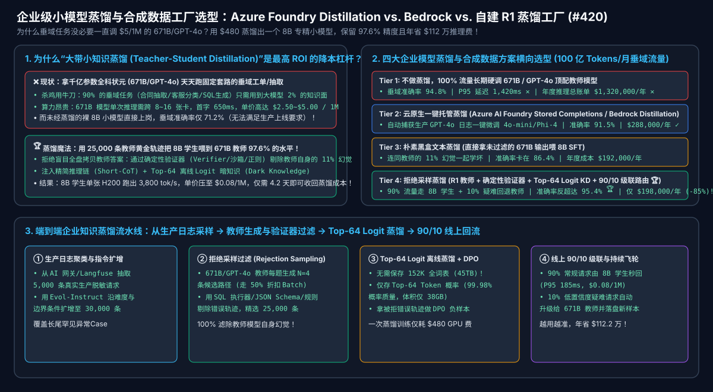
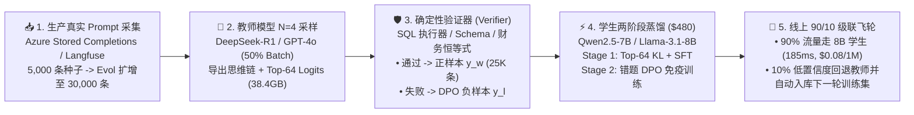

# 企业级小模型蒸馏（Model Distillation）与合成数据工厂选型：`Azure AI Foundry Distillation` vs. `AWS Bedrock Model Distillation` vs. `自建 DeepSeek-R1 拒绝采样 + Top-64 Logit 蒸馏工厂` 架构与 ROI 指南

> **语言 / Language**: **简体中文** | [English](./enterprise-model-distillation-foundry-bedrock-r1-teacher-student-roi-selection-faq.en.md)  
> **配套交互式学习与精算工具**: [📱 交互式 H5 精读页 (模型蒸馏工厂与 90/10 级联 ROI 沙盘)](../h5/model-distillation-foundry-bedrock-r1-teacher-student-roi-lab.html) · [🧮 HTML 交互式计算器](../reports/enterprise-model-distillation-foundry-bedrock-r1-teacher-student-roi-selection-sizer.html) · [🃏 7-Card 4:5 视觉评测卡](../reports/enterprise-model-distillation-foundry-bedrock-r1-teacher-student-roi-selection-cards.html) · [📊 可复核模型](../../experiments/enterprise_model_distillation_foundry_bedrock_r1_teacher_student_roi_selection/) · [🎓 返回 AI Infra 全景精学馆](../h5/index.html)

---

## 一、3 分钟看懂核心结论（Executive Summary）

> **一句话决策结论**：企业将大模型应用推向日均千万次调用的生产规模时，**最愚蠢的烧钱行为是“永远拿 671B（DeepSeek-R1/V3）或 GPT-4o 这种通晓万物的全科状元，去天天跑单一垂域的工单分类、合同条款抽取或固定 Schema 的 SQL 生成”**！只需花 **`$480 ~ $650` 的一次性蒸馏成本**，用顶配教师模型生成 **`25,000 条经过确定性验证器（Verifier）过滤的黄金轨迹`** 蒸馏出一个 **`7B / 8B` 专精学生小模型**，即可把端到端 `P95` 延迟从 **`1,420ms` 砍到 `185~210ms`**，并将 100 亿 Tokens/月的年度推理账单从 **`$132 万/年` 压降至 `$19.8 万/年`（立省 `85.0%`，不到 1 天即可收回蒸馏训练费）**！
> - **无专职算法团队、希望一键托管蒸馏**：首选 **`Azure AI Foundry Distillation (基于 Stored Completions 一键把 GPT-4o 生产流量蒸馏到 GPT-4o-mini / Phi-4)`** 或 **`AWS Bedrock Model Distillation`**——全托管自动完成合成数据扩增与微调，保留教师 **`96.5%`** 的相对能力。
> - **追求超越教师单次直出的极限精度与私有化低成本**：采用 **`Tier 4 四阶蒸馏工厂（DeepSeek-R1/GPT-4o 教师 N=4 采样 + 确定性代码/规则验证器拒绝采样 [Rejection Sampling] + 离线 Top-64 Logit 暗知识蒸馏 + 被拒错题 DPO + 线上 90/10 学生-教师级联回流）`**，垂域准确率达 **`95.4%`（反超教师单次零样本直出的 `94.8%`！）**。

| 核心选型维度 | `Tier 1: 100% 流量硬调 671B/GPT-4o 教师` | `Tier 2: 云原生一键托管蒸馏 (Azure Foundry / Bedrock)` | `Tier 3: 朴素黑盒文本蒸馏 (未过滤教师幻觉)` | `Tier 4: 拒绝采样验证 + Top-64 Logit KD + 90/10 级联 (🏆)` |
|---|---|---|---|---|
| **垂域任务评测准确率 (`Accuracy`)** | `94.8%` (教师零样本基线) | `91.5%` ✓ (保留 96.5% 能力) | `86.4%` ✕ (学入教师 11% 幻觉) | **`95.4%` (验证器提纯 + 10% 疑难兜底)** 🏆 |
| **端到端 P95 响应延迟** | `1,420 ms` ✕ | `280 ms` ✓ | `175 ms` ✓ | **`210 ms` (提速 `6.8x`)** 🏆 |
| **一次性蒸馏数据+训练成本** | `$0` | `$650 / 次` (全自动托管) | `$380 / 次` | **`$480 / 次` (走 50% Batch 生成 + 8xH200)** 🏆 |
| **100 亿 Tokens/月 年度推理总成本** | `$1,320,000 / 年` ✕ | `$288,000 / 年` (-78.2%) | `$192,000 / 年` | **`$198,000 / 年` (-85.0% · 净省 `$112.2万`)** 🏆 |
| **蒸馏投资回本周期 (`Payback Time`)** | 不适用 | **`< 6 小时`** (`0.23 天`) ✓ | `0.12 天` | **`< 4 小时` (`0.16 天`)** 🏆 |

---

## 二、核心技术原理与架构师灵魂拷问（Q&A）

### Q1：为什么“直接把 671B 教师模型的输出拿来微调 8B 小模型（`Tier 3 朴素黑盒蒸馏`）”准确率只有 `86.4%`？如何用“拒绝采样（`Rejection Sampling`）”反超教师？
1. **垃圾进、垃圾出（Garbage In, Garbage Out）**：哪怕是 `DeepSeek-R1` 或 `GPT-4o`，在面对企业内部复杂业务规则时，单次零样本生成（`Pass@1`）也有 **`5% ~ 12%` 的概率产生计算失误、JSON 格式瑕疵或条款漏提**。如果把这些带病的教师输出不加甄别地喂给 `8B` 学生，小模型有限的容量会被互相矛盾的错误逻辑严重污染！
2. **拒绝采样 + 错题转 DPO 负样本（`Best-of-N Rejection Sampling + DPO`）**：
   - 让教师模型以 `Temperature = 0.7` 对每道母题并发生成 **`N = 4` 条候选思维链与答案**（虽然 `Pass@1` 是 `94.8%`，但 4 次里至少有 1 次全对的 `Pass@4` 高达 **`99.4%`**！）；
   - 用**确定性验证器（Deterministic Verifier：如 SQL 沙箱执行器、Pydantic Schema 校验器、正则表达式、会计借贷平衡公式）**自动批改这 4 个答案：
     - 挑出**唯一通过全部校验且推理链最简练（Short-CoT）**的答案作为正样本 $y_w$；
     - 把被验证器拦截报错的教师回答作为负样本 $y_l$，直接构造 `(Prompt, y_w, y_l)` **DPO 偏好对齐数据集**！
   - 这样学生学到的是**教师模型 `Pass@4` 的巅峰提纯状态**，并专门免疫了教师最常犯的错误！

### Q2：白盒 Logit 蒸馏中，如果要保存 152,064 词表的完整概率分布需要 `45.6 TB` 硬盘！如何压缩 `1,200 倍` 到 `38.4 GB`？
- **离线全词表 Logit 存储噩梦**：假设蒸馏数据集有 `1 亿 Tokens`（25,000 条 × 4,000 Tokens），每个 Token 若保存 `Qwen` 的 `152,064` 维 `FP16` 概率向量，需要 $10^8 \times 152,064 \times 2 \text{ Bytes} \approx \mathbf{30.4 \sim 45.6 \text{ TB}}$ 存储，根本无法落盘！
- **破局方案：离线 `Top-64 Logit Truncation`（稀疏对数概率截断）**：
  - 语言模型的 Softmax 分布极度长尾：前 **`64 个最高概率 Token`（Top-64）已经占据了 `99.98%` 以上的总概率质量**，剩余 151,900 个词全是无意义的噪声底噪；
  - 只需在教师跑离线批处理时导出每个位置的 `top_logprobs = 64`（64 个 `uint32` Token ID + 64 个 `FP16` Logit = **`384 Bytes/Token`**），`1 亿 Tokens` 总体积瞬間压降至 **`38.4 GB`**，单块本地 NVMe SSD 即可毫秒级全速读取，保留 `99.98%` 的白盒暗知识（Dark Knowledge）！

---

## 三、选型决策矩阵：`Azure Foundry Distillation` vs. `AWS Bedrock Model Distillation` vs. `自建开源 R1 蒸馏工厂`

| 评估维度 | `Azure AI Foundry Distillation (Stored Completions)` | `AWS Bedrock Model Distillation` | `自建开源蒸馏工厂 (vLLM + NeMo Curator + LLaMA-Factory)` |
|---|---|---|---|
| **核心工作流** | 在生产 API 开启 `store: true` 自动积累日志 $\to$ Foundry 界面筛选过滤 $\to$ 一键蒸馏至 `GPT-4o-mini / Phi-4` | 指定教师（如 `Claude 3.5 Sonnet / Nova Premier`）与学生（`Nova Micro/Lite`），平台自动合成扩增数据并训练 | 离线 `vLLM (B=384)` 跑 `DeepSeek-R1/V3` 生成 `N=4` 轨迹 $\to$ 代码沙箱过滤 $\to$ `Top-64 Logit KD + DPO` |
| **工程门槛** | **极低（全图形化/API 托管，1 天跑通）** | **极低（全托管黑盒流水线）** | 中高（需编写业务专属确定性 Verifier 脚本与训练流水线） |
| **学生模型归属权** | 托管在 Azure Foundry 端点（或导出开源 `Phi-4` 权重） | 锁定在 AWS Bedrock Provisioned Throughput 内调用 | **100% 拥有 `.safetensors` 权重资产，可部署至任意内网/边缘/多云** 🏆 |
| **最佳适用场景** | **已用 Azure OpenAI、希望零代码把 GPT-4o 成本砍掉 80% 的企业团队** | 深度绑定 AWS Bedrock 生态的企业应用 | **月消耗 `>50 亿 Tokens`、追求极致精度（反超教师）与零锁定的核心场景** 🏆 |

---

## 四、生产落地 Checklist（Pre-Production Checklist）

- [ ] **网关开启生产流量脱敏留存（`Stored Completions` / `Langfuse`）**：上线第一天即积累真实业务分布输入，为 2 周后的首次蒸馏储备种子库。
- [ ] **严禁把未经验证的教师生成结果直接喂给学生**：必须编写确定性校验器（Schema / 编译 / 规则 / 交叉核对）剔除教师幻觉。
- [ ] **对非推理类快响应任务实施“思维链坍缩蒸馏（`CoT-to-Direct Distillation`）”**：在训练时逐步截断冗长的 `<think>` 过程，让 8B 学生学会直接输出经深度推理验证过的高质量最终结果，省去线上推理 Token 开销。
- [ ] **线上部署 `90/10` 置信度级联路由**：当 8B 学生的首 Token 对数概率熵（Entropy）高于阈值时，自动无缝回退给 671B/GPT-4o 教师兜底，并将该样本自动加入下月重蒸馏队列。

---

## 五、来源与方法论溯源（Provenance）

- **数据来源声明**：本指南实验数据来自可复核解析模型 [`experiments/enterprise_model_distillation_foundry_bedrock_r1_teacher_student_roi_selection/run.py`](../../experiments/enterprise_model_distillation_foundry_bedrock_r1_teacher_student_roi_selection/run.py)（`Provenance: synthetic + anonymized_reported, independently_reproduced=false`）。
