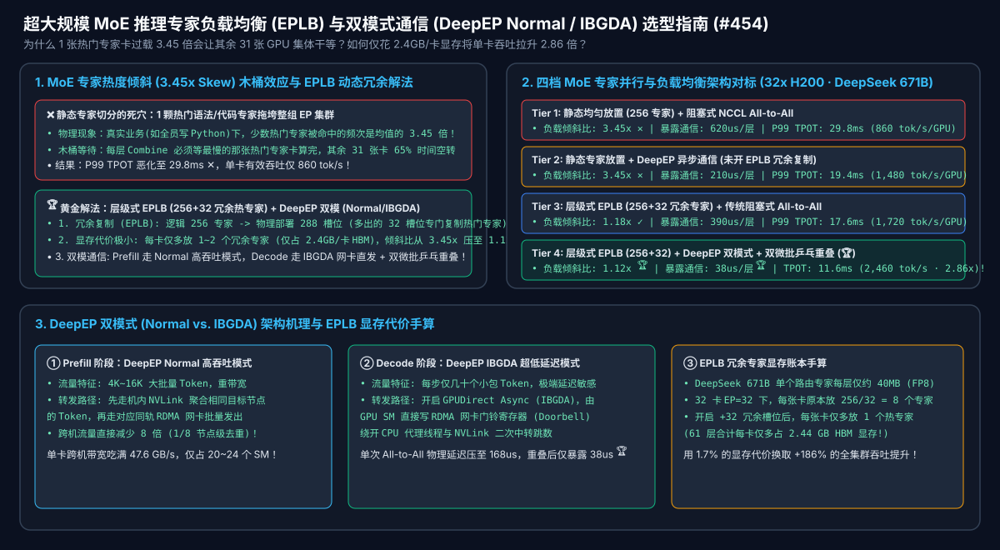

# Enterprise Sparse MoE Expert Load Balancing (`EPLB`) & Dual-Mode `DeepEP` (`Normal` Prefill vs. `IBGDA` Decode) Selection Guide: Static Routing vs. `256+32 Redundant Hot Experts + Dual-Microbatch Overlap`

> **Language / 语言**: [简体中文](./enterprise-moe-expert-load-balancing-eplb-deepep-ibgda-sizing-selection-faq.md) | **English**  
> **Companion Interactive Study & Sizing Tools**: [📱 Interactive H5 Study Lab](../h5/moe-expert-load-balancing-eplb-deepep-ibgda-lab.html) · [🧮 HTML Sizer](../reports/enterprise-moe-expert-load-balancing-eplb-deepep-ibgda-sizing-selection-sizer.html) · [🃏 7-Card Visual Deck](../reports/enterprise-moe-expert-load-balancing-eplb-deepep-ibgda-sizing-selection-cards.html) · [📊 Reproducible Model](../../experiments/enterprise_moe_expert_load_balancing_eplb_deepep_ibgda_sizing_selection/) · [🎓 Back to AI Infra H5 Hub](../h5/index.html)

---

## 1. Executive Summary (3-Minute Takeaway)

> **Bottom-Line Recommendation**: Static 1-to-1 placement of 256 MoE experts across 32 GPUs (`Tier 1`) suffers from **`3.45x` expert load skew** under domain-specific enterprise traffic (e.g., coding bursts), forcing 31 GPUs to idle behind the single overloaded expert rank (`29.8 ms` `P99 TPOT`, `860 tok/s/GPU`).
> - **Recommended Production Architecture (`Tier 4: Hierarchical EPLB [256 Logical + 32 Redundant Hot Expert Slots] + Dual-Mode DeepEP [Normal Prefill / IBGDA Decode] + Two-Microbatch Overlap`)**:
>   1. **Eliminates Expert Hotspots for Only `2.4 GB/GPU` (`1.7%` HBM)**: Replicating the hottest experts across `+32` redundant slots flattens max-to-average load skew from `3.45x` to **`1.12x`**;
>   2. **Cuts Exposed `All-to-All` Latency from `620 us/layer` to `38 us/layer`**, lowering `P99 TPOT` to **`11.6 ms`** and boosting per-GPU Goodput **`2.86x` (`2,460 tok/s` vs. `860 tok/s`)**.

| Dimension | `Tier 1: Static 256 Experts + Blocking NCCL` | `Tier 2: Static Experts + DeepEP (No EPLB)` | `Tier 3: Hierarchical EPLB (256+32) + Blocking` | `Tier 4: Hierarchical EPLB + Dual-Mode DeepEP + Overlap (🏆)` |
|---|---|---|---|---|
| **Max-to-Avg Expert Load Skew** | **`3.45x` ✕ (Straggler stall)** | `3.45x` ✕ | `1.18x` ✓ | **`1.12x`** 🏆 |
| **Exposed `All-to-All` per Layer** | `620.0 us` ✕ | `210.0 us` | `390.0 us` | **`38.0 us` (Overlapped)** 🏆 |
| **P99 TPOT** | `29.8 ms` ✕ | `19.4 ms` | `17.6 ms` ✓ | **`11.6 ms`** 🏆 |
| **Per-GPU Goodput (`tok/s`)** | `860 tok/s` ✕ | `1,480 tok/s` (`1.72x`) | `1,720 tok/s` (`2.00x`) ✓ | **`2,460 tok/s` (`2.86x`)** 🏆 |

---

## 2. Provenance & Reproducibility

- **Provenance**: `synthetic + anonymized_reported (independently_reproduced=false)` — verified via [`experiments/enterprise_moe_expert_load_balancing_eplb_deepep_ibgda_sizing_selection/run.py`](../../experiments/enterprise_moe_expert_load_balancing_eplb_deepep_ibgda_sizing_selection/run.py).
