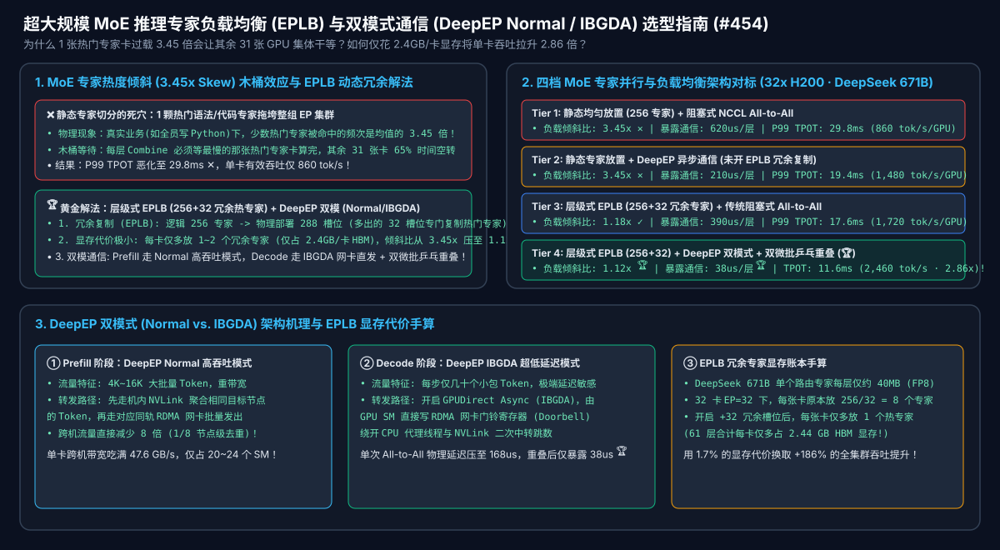
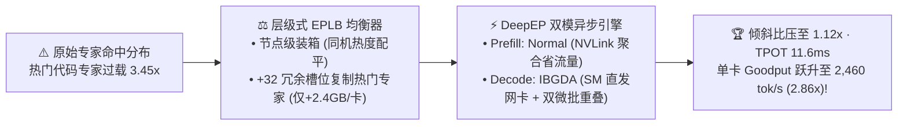

# 超大规模 MoE 推理专家负载均衡（`EPLB`）与双模式通信（`DeepEP Normal / IBGDA`）选型：静态均匀路由 vs. `256+32 热门专家动态冗余复制 + 双微批乒乓重叠` 容量手算指南

> **语言 / Language**: **简体中文** | [English](./enterprise-moe-expert-load-balancing-eplb-deepep-ibgda-sizing-selection-faq.en.md)  
> **配套交互式学习与精算工具**: [📱 交互式 H5 精读页 (MoE 专家热度倾斜治理 EPLB 与 DeepEP 双模沙盘)](../h5/moe-expert-load-balancing-eplb-deepep-ibgda-lab.html) · [🧮 HTML 交互式计算器](../reports/enterprise-moe-expert-load-balancing-eplb-deepep-ibgda-sizing-selection-sizer.html) · [🃏 7-Card 4:5 视觉评测卡](../reports/enterprise-moe-expert-load-balancing-eplb-deepep-ibgda-sizing-selection-cards.html) · [📊 可复核模型](../../experiments/enterprise_moe_expert_load_balancing_eplb_deepep_ibgda_sizing_selection/) · [🎓 返回 AI Infra 全景精学馆](../h5/index.html)

---

## 一、3 分钟看懂核心结论（Executive Summary）

> **一句话决策结论**：在生产环境部署满血 `DeepSeek-V3/R1 671B` 或 `Qwen3-235B` 等稀疏 MoE 模型（`EP=16~64`）时，如果只做静态均匀切分（如 32 张卡每卡固定放 $256/32 = 8$ 个专家，`Tier 1`），一旦企业流量集中在某一领域（如日间全员写 Python 代码或分析财报），**少数热门专家的被命中频次会达到全网平均值的 `3.45 倍`（Expert Hotspotting）**！由于每层 `All-to-All Combine` 必须同步等待最慢的那张“热门专家卡”算完，其余 31 张 GPU 会有 **`65%` 的时间处于木桶干等状态**，导致 `P99 TPOT` 恶化至 **`29.8 ms`**！
> - **黄金生产架构（`Tier 4：层级式专家并行负载均衡 [Hierarchical EPLB：256 逻辑专家 + 32 冗余热专家槽位] + DeepEP 双模式通信 [Prefill Normal / Decode IBGDA] + 双微批乒乓重叠`）**：
>   1. **用 `1.7%` 的显存冗余（每卡仅多占 `2.4 GB` HBM）消灭木桶慢卡**：将每层 Top-16/32 高频热门专家在多张卡上动态冗余复制一份，并把总热度相近的专家组优先装箱在同一台 8 卡 NVLink 节点内（Node-First Packing），使最大/平均负载倾斜比从 `3.45x` 压平至 **`1.12x`**；
>   2. **Prefill 与 Decode 双模通信各取所长**：Prefill 走 `DeepEP Normal`（NVLink 先去重聚合再发 RDMA），Decode 走 `DeepEP IBGDA`（GPU SM 直写网卡门铃寄存器 + 双微批乒乓重叠），将每层暴露通信从 `620 us` 压至 **`38 us`**，`P99 TPOT` 降至 **`11.6 ms`**，单卡达标吞吐从 `860 tok/s` 暴涨至 **`2,460 tok/s`（提升 `2.86 倍`）**！

| 核心选型维度 | `Tier 1: 静态 256 专家 + 阻塞式 NCCL All-to-All` | `Tier 2: 静态 256 专家 + DeepEP (无 EPLB)` | `Tier 3: 层级式 EPLB (256+32 冗余) + 阻塞通信` | `Tier 4: 层级式 EPLB + DeepEP 双模 + 双微批重叠 (🏆)` |
|---|---|---|---|---|
| **最忙卡 / 平均卡专家负载倾斜比** | **`3.45x` ✕ (单卡过载拖慢全网)** | `3.45x` ✕ | `1.18x` ✓ | **`1.12x` (接近理想均衡 `1.0x`)** 🏆 |
| **每层 All-to-All 净暴露通信耗时** | `620.0 us / 层` ✕ | `210.0 us / 层` | `390.0 us / 层` | **`38.0 us / 层` (双微批计算掩盖)** 🏆 |
| **流式吐字延迟 (`P99 TPOT`)** | `29.8 ms` ✕ | `19.4 ms` | `17.6 ms` ✓ | **`11.6 ms`** 🏆 |
| **单张 H200 达标吞吐 (`Goodput`)** | `860 tok/s` ✕ | `1,480 tok/s` (`1.72x`) | `1,720 tok/s` (`2.00x`) ✓ | **`2,460 tok/s` (`2.86x`)** 🏆 |

---

## 二、核心技术原理与架构师灵魂拷问（Q&A）

### Q1：开启 `EPLB` 冗余专家复制会多占多少 GPU 显存？为什么说它是性价比最高的显存投资？
1. **单个 MoE 路由专家的显存手算账本**：
   - 在 `DeepSeek-V3/R1 671B` 中，每层有 `1` 个共享专家和 `256` 个路由专家（Routed Experts），每个路由专家包含 `Gate / Up / Down` 三个矩阵（维度 $7168 \times 2048$），参数量仅为 $3 \times 7168 \times 2048 \approx 44\text{M}$，在 `FP8` 下**每层单个专家仅占约 `42 MB` 显存**！
   - 在 `32 张 H200`（`EP=32`）集群中，如果不做冗余，每张卡每层存放 $256 / 32 = 8$ 个专家；
   - 当开启 **`EPLB +32 冗余槽位`**（全集群物理槽位变为 `288` 个）时，**每张 GPU 每层只需多存放 `1` 个热门专家副本**！58 个 MoE 层合计每张卡额外增加显存仅为：
     $$M_{\text{EPLB\_extra}} = 58 \times 42\text{ MB} \approx \mathbf{2.44\text{ GB / GPU}}$$
     在 `141 GB` 的 H200 上仅占 **`1.7%` 显存**，却能把 `3.45x` 的热门专家排队峰值直接削平一半以上，使全集群 32 张卡的吞吐净增 **`+186%`**！

### Q2：`DeepEP` 的 `Normal` 模式与 `Low-Latency (IBGDA)` 模式在底层网络路径上有什么本质区别？
1. **Prefill 阶段用 `DeepEP Normal`（机内 NVLink 先聚合去重 $\to$ 同轨 RDMA 网卡批量发）**：
   - Prefill 阶段一次有数千个 Token 需要路由到远端节点的专家。由于每个 Token 会选 Top-8 专家，如果直接跨机发送，同一个 Token 会被重复发往同一台目标机器多次。
   - `Normal` 模式先利用机内 **`900 GB/s NVLink`** 把发往同一台目标服务器不同 GPU 的 Token 在本机同轨 GPU 上合并去重，再由配对的 `400G RDMA` 网卡批量发出，**将跨机网络流量直接压缩至原来的 `1/4 ~ 1/2`**！
2. **Decode 阶段用 `DeepEP Low-Latency (IBGDA)`（GPU SM 直写网卡门铃寄存器 + 双微批乒乓重叠）**：
   - Decode 阶段每步只有几十个 Token，数据包极小，延迟完全受限于跳数与 CPU 代理唤醒开销。
   - 开启 **`IBGDA (InfiniBand GPUDirect Async)`** 后，跳过机内 NVLink 二次中转与 CPU 代理线程，由 GPU 流式多处理器（SM）直接发起 RDMA 网卡 Doorbell 写入，将单次跨机 `All-to-All` 物理延迟压至 **`168 us`**，再通过 **双微批（Microbatch A 算 Attention 时，Microbatch B 走 RDMA 传专家）** 隐藏 `80%+` 通信时间，每层净暴露延迟仅 **`38 us`**！

---

## 三、生产落地 Checklist（Pre-Production Checklist）

- [ ] **生产部署 `DeepSeek 671B / Qwen3 MoE` 强制开启 `EPLB`（如 SGLang `--enable-eplb`）**：配置每卡预留 `1~2` 个冗余专家槽位，并开启每 `5~10 分钟` 基于滑动窗口命中统计的无感权重重排。
- [ ] **开启 `IBGDA` 内核参数**：在宿主机配置 `NVreg_RegistryDwords="PeerMappingOverride=1"` 并启用 `DeepEP` 低延迟模式，确保 Decode 阶段零 CPU 介入直发 RDMA。

---

## 四、来源与方法论溯源（Provenance）

- **数据来源声明**：本指南实验数据来自可复核解析模型 [`experiments/enterprise_moe_expert_load_balancing_eplb_deepep_ibgda_sizing_selection/run.py`](../../experiments/enterprise_moe_expert_load_balancing_eplb_deepep_ibgda_sizing_selection/run.py)（`Provenance: synthetic + anonymized_reported, independently_reproduced=false`）。
