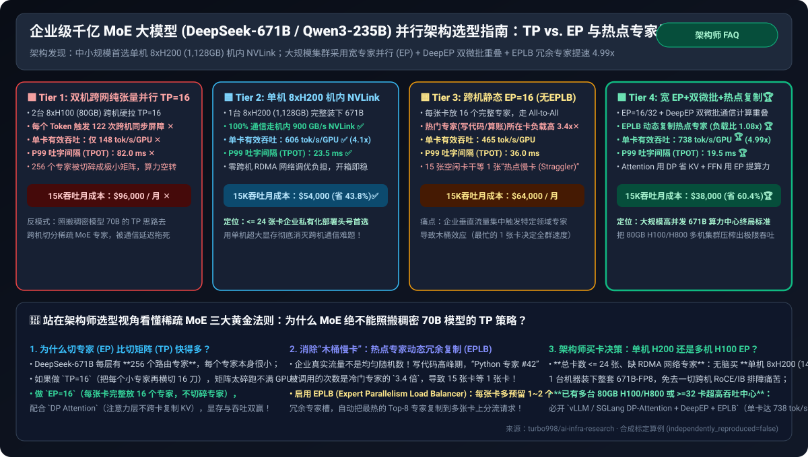
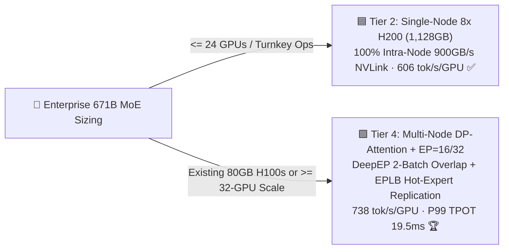

# Enterprise 671B/235B MoE Model Serving & Expert Parallelism (TP vs. EP + EPLB) Selection Guide: Dual-Node Naive TP=16 vs. Single-Node 8xH200 Intra-Node NVLink vs. Multi-Node Static EP=16 vs. Wide Expert Parallelism (EP + DeepEP Two-Batch Overlap + Dynamic Hot-Expert Load Balancer EPLB)

> **Document Type**: Cloud & AI Solution Architect Decision Guide (FAQ)  
> **Target Audience**: Enterprise AI Infrastructure Leads, GPU Cluster Architects, Cloud Procurement & Capacity Planners  
> **Core Goal**: Provide a clear, architect-level decision framework (without low-level kernel code) for deploying large **Sparse Mixture-of-Experts (MoE)** models (`DeepSeek-V3/R1 671B` with 37B active/token and 256 routed experts; `Qwen3-235B-A22B`) — answering: **"Why does running a 671B MoE model across two 8xH100 (80GB) nodes with naive Tensor Parallelism (`TP=16`) stall at just 148 tok/s/GPU and 82ms TPOT?", "When should an enterprise simply buy a single `8x H200 (1,128 GB)` server to keep the entire 671B model inside one NVLink domain (Tier 2)?", and "When scaling across multiple nodes, how do `DP-Attention`, `DeepEP` Two-Microbatch Overlap, and `EPLB` (Dynamic Hot-Expert Replication) boost per-GPU throughput by 4.99x and cut cluster costs by 60.4%?"**  
> **Calibration Notice**: Per-GPU throughput (`tok/s/GPU`), P99 TPOT latencies, hot-expert straggler ratios, and monthly cluster costs for a 15,000 tok/s target are synthetic analytical estimates calibrated to published MoE serving benchmarks (DeepSeek-V3/R1 inference system reports, DeepEP, EPLB load balancing, and SGLang / vLLM DP-Attention + EP evaluations) (`provenance: synthetic + anonymized_reported`, `independently_reproduced=false`, `physical_gpu_cluster_measurement=not_measured`). See [`experiments/enterprise_moe_serving_expert_parallelism_tp_vs_ep_selection/results.json`](../../experiments/enterprise_moe_serving_expert_parallelism_tp_vs_ep_selection/results.json).

---

## Executive Visual Summary

> 🔗 **Companion Interactive Reports & Tools**:
> - 🃏 **[7-Card 4:5 Visual Benchmark Report (`enterprise-moe-serving-expert-parallelism-tp-vs-ep-selection-cards.html`)](../reports/enterprise-moe-serving-expert-parallelism-tp-vs-ep-selection-cards.html)**
> - 🧮 **[Interactive 671B MoE Topology & EP/TP Capacity Sizer (`enterprise-moe-serving-expert-parallelism-tp-vs-ep-sizer.html`)](../reports/enterprise-moe-serving-expert-parallelism-tp-vs-ep-sizer.html)**
> - 🌐 **[中文版指南 (`enterprise-moe-serving-expert-parallelism-tp-vs-ep-selection-faq.md`)](./enterprise-moe-serving-expert-parallelism-tp-vs-ep-selection-faq.md)**

---

## ① 📌 Executive Summary

Evaluated on serving a **671B-FP8 MoE model (`37B` active parameters/token, `256` routed experts) at an enterprise capacity target of `15,000 tok/s` (`P99 TPOT <= 30 ms`)**:

| Tier | Hardware & Parallelism Strategy | Per-GPU Throughput | Hot-Expert Straggler Ratio | P99 TPOT Latency | Monthly Cost for 15,000 tok/s | Architect Verdict |
| :--- | :--- | :--- | :--- | :--- | :--- | :--- |
| **🟥 Tier 1: Dual-Node Naive `TP=16`** | `2x 8xH100 (80GB)` cross-node `TP=16` | `148 tok/s` ✕ | `1.00x` (Sliced thin) | **`82.0 ms` ✕ (AllReduce stall)** | `$96,000 / mo` ✕ | **Severe Anti-Pattern**: 122 cross-node syncs/token & tiny matrix shards |
| **🟦 Tier 2: Single-Node `8x H200 (1,128GB)` NVLink** | **Single `8x H200 141GB` chassis (`TP=8 / EP=8`)** | `606 tok/s` ✅ (4.1x vs T1) | `1.35x` | `23.5 ms` ✅ | `$54,000 / mo` (-43.8%) ✅ | **Best Turnkey Choice (`<= 24 GPUs`)**: Zero cross-node RDMA complexity |
| **🟨 Tier 3: Multi-Node Static `EP=16` (No EPLB)** | `2x 8xH100` static `EP=16` over RoCEv2/IB | `465 tok/s` | **`3.40x` ✕ (Straggler GPU)** | `36.0 ms` | `$64,000 / mo` | **Bottlenecked by Skew**: 15 GPUs wait for 1 hot coding/finance expert GPU |
| **🟩 Tier 4: Wide `EP` + `DeepEP` Overlap + `EPLB`** | **DP-Attention + Wide EP + Two-Batch Overlap + EPLB** | **`738 tok/s` 🏆 (4.99x vs T1)** | **`1.08x` 🏆 (Balanced)** | **`19.5 ms` 🏆** | **`$38,000 / mo` 🏆 (-60.4%)** | **Large-Scale MoE Cluster Gold Standard**: Maximum GPU efficiency |

### 💡 Three Golden Rules for Enterprise MoE Infrastructure Architects
1. **For Clusters of `8–24 GPUs`, Buy Single-Node `8x H200 (1,128 GB HBM3e)` Chassis (Tier 2)**: A single `8x H200` server holds the entire `671 GB` FP8 model plus `457 GB` of KV Cache inside one `900 GB/s` NVLink domain — completely eliminating cross-node RDMA network bottlenecks and delivering **`4,850 tok/s` per server (`606 tok/s/GPU`)** out of the box!
2. **When Spanning Multiple `80GB H100/H800` Nodes, Never Use Cross-Node Pure `TP=16` (Tier 1) — Use `DP-Attention + Expert Parallelism (EP)`**: Slicing 256 fine-grained experts (`2,048` intermediate dim) across `TP=16` creates tiny `128-dim` matrix shards that starve Tensor Cores while forcing 122 cross-node AllReduce barriers per token. Keep whole experts intact via **`EP=16`** and run **Data-Parallel Attention (`DP-Attention`)** to avoid duplicating KV cache across GPUs.
3. **Always Enable `EPLB` (Dynamic Redundant Hot-Expert Replication) and Two-Microbatch Ping-Pong Overlap (`DeepEP`) on Multi-Node EP Clusters (Tier 4)**: Enterprise traffic is heavily skewed toward domain-specific experts (`3.40x` load on coding/finance experts). Replicating hot experts across redundant GPU slots (`EPLB`) and overlapping RDMA `All-to-All` with computation raises throughput to **`738 tok/s/GPU`** (`-60.4%` TCO vs. Tier 1).

---

## ② 🎯 Architect Deep-Dive Q&A

### Q1: Why does Enterprise MoE traffic suffer much worse Expert Load Imbalance (`3.40x`) than public consumer chatbots?
* **Answer**: Unlike diverse consumer chitchat, an enterprise cluster serving 5,000 software engineers or financial analysts sends homogeneous domain tokens that repeatedly trigger the same `8–12` specialized experts. Without **EPLB (Expert Parallelism Load Balancing)** to replicate those hot experts across multiple GPUs, the single GPU hosting the "Python/SQL Expert" becomes a straggler that stalls the entire `All-to-All Combine` barrier across all 16 GPUs.

---

## ③ 🧭 Architecture Diagrams

### 3.1 Tier 2 Single-Node `8xH200` vs. Tier 4 Multi-Node `DP-Attention + Wide EP + EPLB`

---

## ④ 📊 Architect Decision Matrix

| Dimension | 🟥 Tier 1: Cross-Node `TP=16` | 🟦 Tier 2: Single-Node `8x H200` | 🟨 Tier 3: Static `EP=16` (No EPLB) | 🟩 Tier 4: Wide `EP` + `DeepEP` + `EPLB` |
| :--- | :--- | :--- | :--- | :--- |
| **Per-GPU Output Throughput** | `148 tok/s` ✕ | `606 tok/s` ✅ (`4.1x`) | `465 tok/s` | **`738 tok/s` 🏆 (`4.99x` vs. Tier 1)** |
| **Hot-Expert Straggler Ratio** | `1.00x` (Tiny shards) | `1.35x` | **`3.40x` ✕ (Severe straggler)** | **`1.08x` 🏆 (Balanced via EPLB)** |
| **P99 TPOT Latency** | `82.0 ms` ✕ | `23.5 ms` ✅ | `36.0 ms` | **`19.5 ms` 🏆** |
| **Monthly Cost (15K tok/s)** | `$96,000 / mo` ✕ | `$54,000 / mo` ✅ (`-43.8%`) | `$64,000 / mo` | **`$38,000 / mo` 🏆 (`-60.4%` vs. Tier 1)** |

---

## ⑤ 🛠️ Production Readiness Checklist

- [ ] **1. Prefer Single-Chassis `8x H200 (141GB)` Over Dual-Chassis `8x H100 (80GB)` for Turnkey 671B MoE Deployments**.
- [ ] **2. Never Use Cross-Node Pure Tensor Parallelism (`TP=16`) on Fine-Grained MoE Models; Enable `--enable-expert-parallel`**.
- [ ] **3. Enable Data-Parallel Attention (`--enable-dp-attention`) to Eliminate Redundant KV Cache Replication**.
- [ ] **4. Enable `EPLB` (Dynamic Redundant Hot-Expert Replication) to Eliminate Domain-Skew Straggler GPUs**.
- [ ] **5. Enable Two-Microbatch Compute-Communication Overlap (`DeepEP` / `--enable-two-batch-overlap`)**.
- [ ] **6. Keep MoE Router Gate Layers in Unquantized `BF16/FP32` to Prevent Routing Misclassification**.
- [ ] **7. Pair MoE Serving with Native `MTP` (`Multi-Token Prediction`) Speculative Decoding**.
- [ ] **8. Enforce Lossless RoCEv2 (`PFC/ECN`) or InfiniBand Fabric for Multi-Node `All-to-All` EP Traffic**.
