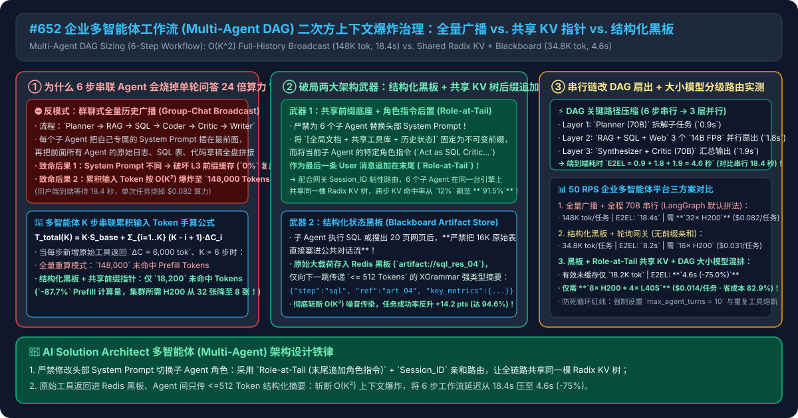

# Enterprise Multi-Agent DAG (`LangGraph / AutoGen`) Context Explosion Sizer: Full-History Broadcast vs. `Role-at-Tail` Shared Radix KV & Structured Blackboard

> **Language / 语言**: [简体中文](./enterprise-multi-agent-dag-context-explosion-shared-kv-blackboard-faq.md) | **English** · [📱 Open Interactive H5 Study Lab](../h5/multi-agent-dag-context-explosion-shared-kv-blackboard-lab.html) · [🧮 Open Interactive Sizer](../reports/enterprise-multi-agent-dag-context-explosion-shared-kv-blackboard-sizer.html) · [🃏 View 7-Card 4:5 Benchmark Deck](../reports/enterprise-multi-agent-dag-context-explosion-shared-kv-blackboard-cards.html)

---

## 0. 3-Minute Executive Summary

When an enterprise deploys a `6-step` Multi-Agent workflow (`Planner → RAG → SQL → Coder → Critic → Synthesizer`), naive frameworks suffer from **Quadratic $O(K^2)$ Context Explosion (`148,000 Tokens/task`) and `0%` cross-agent KV cache reuse** because each sub-agent prepends a different `System Prompt` at index `0` and broadcasts raw tool outputs to every subsequent agent:
1. **`Role-at-Tail` Prompt Ordering + `Session_ID` Sticky Routing Lifts Cross-Agent KV Hit Rate from `12.0%` to `91.5%`**:
   - Keeping the shared domain instructions and context history immutable at the prefix head and appending the sub-agent persona (`<role>Act as SQL Critic...</role>`) **at the very end of the prompt** allows all `6` sub-agents to share a single `RadixAttention` KV tree in HBM.
2. **Structured Blackboard (`<= 512 Tokens/hop`) + `3`-Layer Parallel DAG Cuts Latency by `75.0%` (`18.4s → 4.6s`)**:
   - Storing bulky raw SQL/RAG payloads in a Redis Blackboard (`artifact://id`) and passing only `XGrammar`-validated JSON summaries cuts uncached prefill tokens by **`86.0%` (`130,240 → 18,200 tok/task`)**, boosts task accuracy from `80.4%` to **`94.8%` (`+14.4 pts`)**, and shrinks the `50 RPS` fleet from `32× H200` to **`8× H200 + 4× L40S` (`$0.082 → $0.014/task`, `-82.9%` cost)**.

---

## 1. Quantitative Multi-Agent Architecture Matrix (`6-Step Workflow` · `50 Workflow RPS`)

| Multi-Agent Architecture | Total / Uncached Input Tokens | Cross-Step `L3 KV` Hit Rate | Workflow `P95 E2EL` | Task Success Rate | Required Fleet & Cost / Task |
| :--- | :--- | :--- | :--- | :--- | :--- |
| **1. Group-Chat Broadcast + Head System Swap (`70B`)** | `148,000` / `130,240 tok` | `12.0%` | `18.4 s` | `80.4%` | `32× H200` (`$0.082 / task`) · ⛔ |
| **2. `Role-at-Tail` + Raw Log Broadcast (`70B`)** | `148,000` / `41,440 tok` | `72.0%` | `11.2 s` | `81.0%` | `20× H200` (`$0.048 / task`) · ⚠️ |
| **3. Structured Blackboard + `Role-at-Tail` Serial (`70B`)** | `34,800` / `18,200 tok` | **`91.5%`** | `7.8 s` | `94.6%` | `12× H200` (`$0.024 / task`) · ✅ |
| **4. Blackboard + `Role-at-Tail` + Parallel DAG (`70B+14B`)** | **`34,800` / `18,200 tok` (`-86%`)** | **`91.5%`** | **`4.6 s` (`-75.0%`)** | **`94.8%` (`+14.4 pts`)** | **`8× H200 + 4× L40S` (`$0.014 / task`, `-82.9%`)** 🏆 |
