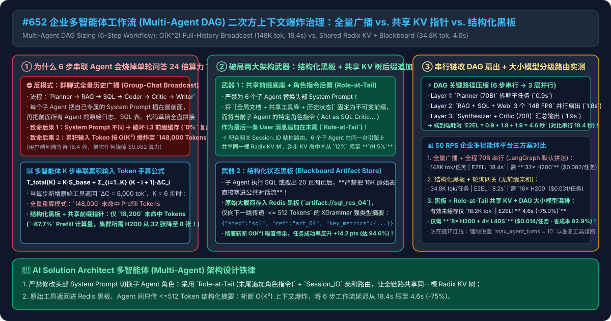
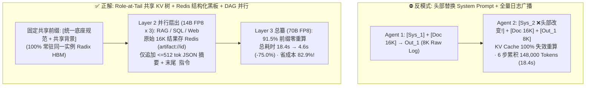

# 企业多智能体工作流（`Multi-Agent DAG / LangGraph / AutoGen`）二次方上下文爆炸（$O(K^2)$）治理：`Role-at-Tail` 共享 `Radix KV` 树指针与结构化黑板（`Blackboard`）容量规划指南

> **语言 / Language**: **简体中文** | [English](./enterprise-multi-agent-dag-context-explosion-shared-kv-blackboard-faq.en.md) · [📱 打开交互式 H5 精读页](../h5/multi-agent-dag-context-explosion-shared-kv-blackboard-lab.html) · [🧮 打开交互式容量计算器](../reports/enterprise-multi-agent-dag-context-explosion-shared-kv-blackboard-sizer.html) · [🃏 查看 7-Card 4:5 评测报告](../reports/enterprise-multi-agent-dag-context-explosion-shared-kv-blackboard-cards.html)

---

## 0. 3 分钟执行摘要（Executive Summary）

当企业从单轮 RAG 问答迈向由 **`6–10` 个专职智能体协作的复杂工作流（`Multi-Agent DAG`，如 `Planner → RAG 检索员 → Text-to-SQL 分析师 → Python 绘图员 → 合规审查员 → 报告总纂`）** 时，架构师常震惊地发现：**明明只有 `50 RPS` 的业务请求，后端 GPU 集群却像遭遇了 `1,200 RPS` 一样瞬间被打满，且用户端到端等待时间（`E2EL`）高达 `18.4 秒`！**
1. **诊断根因：群聊式全量广播导致的二次方（$O(K^2)$）Token 膨胀与 `0%` 缓存命中**：
   - 在默认的多 Agent 框架写法中，每一步子 Agent 都会① **把自己的专属角色定义替换到 `System Prompt` 最开头**，并② **把前序所有 Agent 的思考过程、20 页检索原文、几百行 SQL 原始查询结果全量拼接到历史消息中**；
   - **双重灾难**：① 每次切换子 Agent 都改动了第 `1` 个 Token（`System Prompt`），导致后端引擎 `L3 Radix KV Cache` 从头全部失效（跨步前缀复用率跌至 `12.0%`）！② $K = 6$ 步工作流累积处理的输入 Token 数按二次方增长：
     $$T_{\text{total}}(K) = K \cdot S_{\text{base}} + \sum_{i=1}^{K} (K - i + 1) \cdot \Delta C_i = \mathbf{148,000\text{ Tokens/task}}$$
2. **三大架构手术刀将单任务有效算力砍掉 `82.9%`、端到端延迟从 `18.4s` 压至 `4.6s`（`-75.0%`）**：
   - **手术刀 1：`Role-at-Tail`（角色指令后置）+ `Session_ID` 亲和路由（跨步 KV 命中率从 `12%` 飙至 `91.5%`）**：严禁切换头部 `System Prompt`！将所有子 Agent 共享的领域背景与工具定义固定在头部，而将当前子 Agent 的身份指令（如 `<role>你现在担任 SQL 审查员</role>`）**追加在对话最末尾**，并通过网关按 `Workflow_Session_ID` 一致性哈希到同一个引擎实例，使 6 步串联直接复用同一棵 `Radix KV` 树；
   - **手术刀 2：结构化状态黑板（`Structured Blackboard`）指针传递**：子 Agent 查出的 `16 KB` SQL 原始表或长网页存入 Redis/对象存储黑板（生成句柄 `artifact://sql_04`），仅向公共上下文写入 **`<= 512 Tokens` 的 `XGrammar` 强类型摘要**，使单任务累积 Token 从 `148,000` 骤降至 **`34,800 Tokens`**（其中未命中缓存仅 **`18,200 Tokens`**，减少 `87.7%` Prefill 计算），且因消除了无关上下文干扰，端到端任务准确率从 `80.4%` 反升至 **`94.6%`（`+14.2 pts`）**！
   - **手术刀 3：串行链改 `3` 层并行 DAG 扇出 + 大小模型分级路由**：`Planner/Synthesizer` 用 `70B FP8`，中间并行执行的 `RAG/SQL/Web` 子任务扇出至 `14B FP8`（`4× L40S`），将 `50 RPS` 工作流所需硬件从 `32× H200` 降至 **`8× H200 + 4× L40S`（单任务成本从 `$0.082` 降至 `$0.014`，节省 `82.9%`）**！

---

## 1. 灵魂拷问 Q&A（Cloud & AI Solution Architect 核心决策拆解）

### Q1：为什么“每个子 Agent 各写一段不同的 System Prompt”是多智能体系统最大的性能毒药？

因为大模型自回归注意力矩阵是严格**从左到右单向因果依赖（Causal Mask）**的：
- 如果 `Agent 1` 的开头是 `"You are a Financial Planner..."`，而 `Agent 2` 的开头是 `"You are a SQL Expert..."`，哪怕它们后面跟着完全相同的 `32,000 Tokens` 客户背景资料与前序对话，由于第 `4` 个 Token 就发生了分叉，这 `32,000 Tokens` 的 Key/Value 张量在数学上完全不同，GPU 必须 `100%` 从头重算 `32K` Prefill！
- **改为 `Role-at-Tail` 后**：前 `32,000 Tokens` 在 6 个 Agent 之间一字不差，直接命中 HBM 内的 `Radix Tree` 节点，`Agent 2` 只需做末尾 `300 Tokens` 的增量 Prefill，首字延迟从 `680 ms` 骤降至 **`35 ms`**！

---

## 2. 四套企业多智能体（`6-Step Multi-Agent` · `50 Workflow RPS`）架构横向选型矩阵

| 多智能体架构方案（单工作流含 `6` 个子 Agent 节点） | 单任务累积总 Token / 未缓存 Token | 跨步 `L3 KV` 前缀命中率 | 端到端工作流耗时 (`P95 E2EL`) | 端到端任务成功率 | `50 RPS` 所需 GPU 与单任务成本 |
| :--- | :--- | :--- | :--- | :--- | :--- |
| **1. 群聊全量广播 + 头部换 System Prompt + 串行 `70B`** | `148,000` / `130,240 tok` | `12.0%`（头部改动打碎缓存） | `18.4 s` | `80.4%`（中间迷失） | `32× H200` (`$0.082 / 任务`) · ⛔ **算力黑洞** |
| **2. `Role-at-Tail` 共享前缀 + 全量日志串行 `70B`** | `148,000` / `41,440 tok` | `72.0%` | `11.2 s` | `81.0%` | `20× H200` (`$0.048 / 任务`) · ⚠️ **原始日志仍撑爆显存** |
| **3. 结构化黑板 (`<=512 tok/hop`) + `Role-at-Tail` 串行 `70B`** | `34,800` / **`18,200 tok`** | **`91.5%`** | `7.8 s` | **`94.6%` (`+14.2 pts`)** | `12× H200` (`$0.024 / 任务`) · ✅ **适合严格串行审批流** |
| **4. 黑板 + `Role-at-Tail` + `3` 层 DAG 并行 + `70B/14B` 混排（推荐）** | **`34,800` / `18,200 tok` (`-86%`)** | **`91.5%`** | **`4.6 s` (`-75.0%`)** | **`94.8%`** | **`8× H200 + 4× L40S` (`$0.014 / 任务`，省 `82.9%`)** 🏆 |

---

## 3. 生产落地核对清单（Pre-Production Checklist）

- [ ] **重构所有多 Agent 提示词模板为 `Role-at-Tail`（固定共享头部 + 末尾注入子角色指令）**，并配置网关按 `x-workflow-session-id` 实施一致性哈希亲和路由；
- [ ] **上线 Redis `Artifact Blackboard`**：凡工具返回超过 `1,024 Tokens` 的原始 JSON/SQL/网页，一律落存黑板，仅向对话流注入句柄与 `<= 512 Tokens` 结构化摘要；
- [ ] **强制在网关与编排层设置三道防死循环熔断闸门**：① `max_workflow_steps = 10`；② 连续 `2` 次调用相同工具且参数哈希一致立即熔断；③ 单工作流总预算 `max_workflow_wcu = 80,000`。
