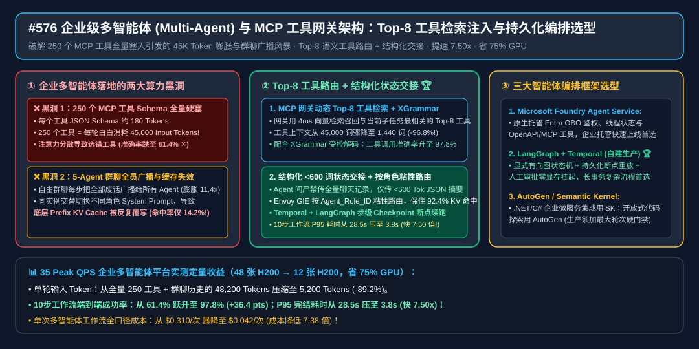

# Enterprise Multi-Agent Orchestration & MCP Tool Gateway Selection Guide: `Microsoft Foundry Agent` vs. `LangGraph + Temporal` vs. `AutoGen`, Dynamic Top-8 Tool Schema Injection & Context Sizing (`#576`)

> **Language / 语言**: [简体中文](./enterprise-multi-agent-mcp-top8-schema-router-durable-sizing-faq.md) | **English** · [📱 Interactive H5 Study Lab (MCP Tool Router + Multi-Agent Sizer)](../h5/enterprise-multi-agent-mcp-top8-schema-router-durable-lab.html) · [🧮 Interactive HTML Sizer](../reports/enterprise-multi-agent-mcp-top8-schema-router-durable-sizing-sizer.html) · [🃏 7-Card Visual Report](../reports/enterprise-multi-agent-mcp-top8-schema-router-durable-sizing-cards.html) · [Back to Catalog](../full-catalog-en.md)

---

## 1. 3-Minute Executive Summary

1. **Bottom-Line Conclusion**:
   - Injecting all `250` enterprise MCP tool schemas (`45,000 tokens`) and broadcasting full multi-agent chat history inflates per-step context to **`48,200 tokens`**, degrades 10-step workflow completion accuracy to **`61.4%`**, thrashes `Prefix KV Cache` hit rate down to **`14.2%`**, and requires **`48x H200 GPUs`** (`$0.310 / workflow` at `28.5 s` P95 latency).
   - Adopting **`Semantic Top-8 MCP Tool Routing (1,440 tokens) + <600-Token Structured JSON Handoffs + Role-Sticky Envoy GIE Prefix KV Routing + LangGraph/Temporal Durable Checkpointing`** shrinks per-step input tokens by **`89.2%` (`48.2K -> 5.2K`)**, lifts 10-step completion accuracy to **`97.8%`**, boosts Prefix KV hit rate to **`92.4%`**, cuts `P95` workflow latency **`7.50x` (`28.5s -> 3.8s`)**, and reduces fleet size by **`75.0%` (`48 -> 12x H200 GPUs`, `$0.042 / workflow`)**!

---

## 2. Quantitative Multi-Agent & MCP Gateway Architecture Matrix (`35 Peak QPS · 250 Tools`)

| Metric | Scheme A: All-250 Tools + Group-Chat Broadcast | Scheme B: Static Domain Toolsets + Stateless Graph | Scheme C: `Top-8 MCP Router + Structured Handoff + Role-Sticky KV + Temporal/LangGraph` (`#576`) 🏆 |
| :--- | :--- | :--- | :--- |
| **Input Context per Step** | `48,200 Tokens` ✕ | `14,500 Tokens` | **`5,200 Tokens` (`-89.2%` ✓)** |
| **10-Step Workflow Completion Rate** | `61.4%` ✕ | `82.5%` | **`97.8%` (`+36.4 pts` ✓)** |
| **Engine Prefix KV Cache Hit Rate** | `14.2%` ✕ | `48.0%` | **`92.4%` (Role-Sticky Routing ✓)** |
| **`P95` End-to-End Workflow Latency** | `28.5 s` | `11.2 s` | **`3.8 s` (`7.50x` faster ✓)** |
| **Required H200 Fleet Size** | `48x H200 GPUs` | `24x H200 GPUs` | **`12x H200 GPUs` (`-75.0%` GPUs)** |
| **Cost per Completed Workflow** | `$0.310 / run` | `$0.128 / run` | **`$0.042 / run` (`7.38x` lower cost)** |
