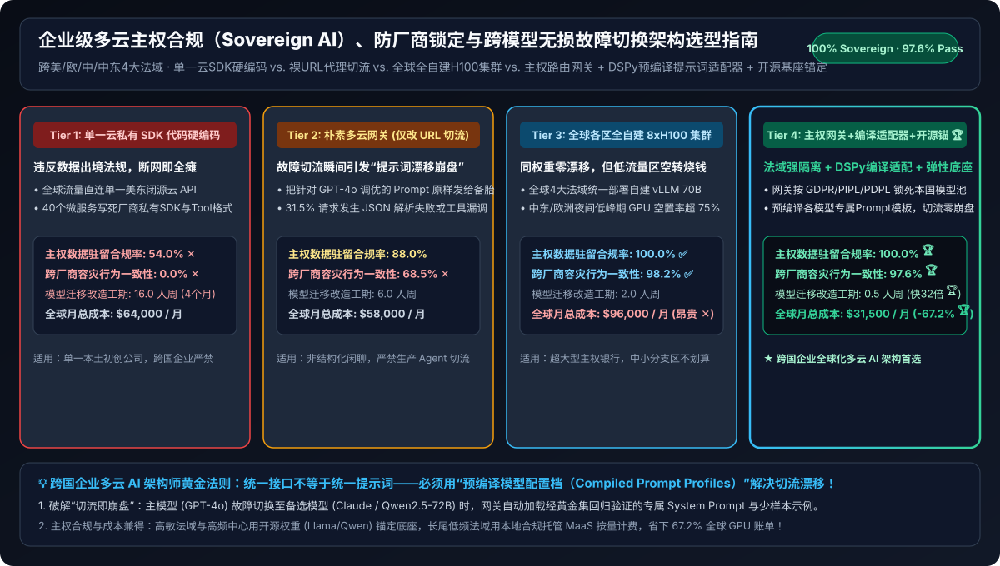
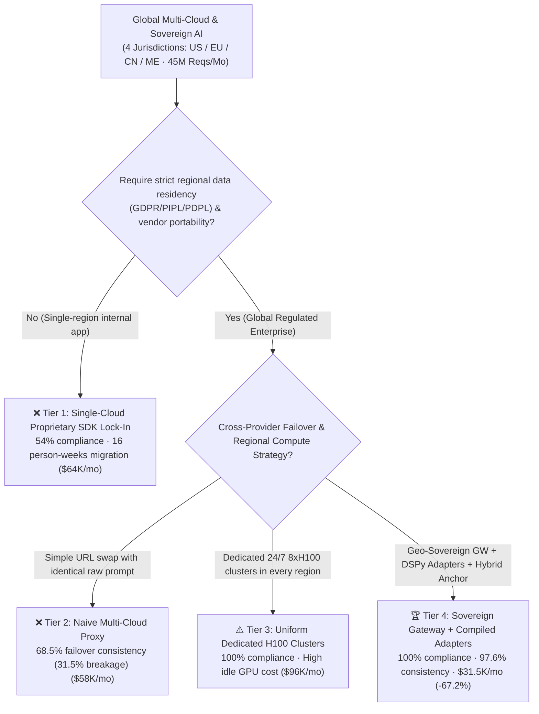

# Enterprise Sovereign Cloud, Multi-Cloud LLM Portability & Cross-Provider Failover Architecture Selection Guide: Single-Cloud Proprietary SDK Lock-In vs. Naive URL-Swap Proxy vs. Uniform Global Dedicated H100 Clusters vs. Geo-Sovereign AI Gateway + DSPy Pre-Compiled Prompt Adapter Profiles + Hybrid Open-Weights Sovereign Anchor

> **Author**: Cloud & AI Solution Architect | **Date**: 2026-11-18 | **Target Audience**: Global Enterprise Chief Architects, Data Protection Officers (DPO), AI Platform Engineering Leads, Multi-Cloud Infrastructure Directors  
> **Companion Tools**: [🧮 Interactive Multi-Cloud Sovereign AI & Portability Sizer (`enterprise-multi-cloud-sovereign-llm-portability-architecture-sizer.html`)](../reports/enterprise-multi-cloud-sovereign-llm-portability-architecture-sizer.html) ｜ [🃏 7-Card 4:5 Visual Benchmark Report (`enterprise-multi-cloud-sovereign-llm-portability-architecture-selection-cards.html`)](../reports/enterprise-multi-cloud-sovereign-llm-portability-architecture-selection-cards.html)

---

## 📌 1. Executive Summary (3-Minute Architect's Verdict)

When multinational enterprises operate across **North America (`US-East`), the European Union (`EU-Frankfurt`, under GDPR & EU AI Act), China (`CN-Shanghai`, under PIPL & Data Security Law), and the Middle East (`ME-Riyadh`, under PDPL)** serving **45,000,000 monthly requests**, architects must solve two critical challenges: **100% strict regional data residency** and **eliminating prompt/schema regressions when failing over across heterogeneous LLM providers**:

1. **Single-Cloud Proprietary SDK Hardcoded in Microservices (`Tier 1`) Fails Sovereignty and Locks In the Enterprise**:
   - Coupling 40 microservices directly to one vendor's proprietary SDK and routing global traffic to a single region yields **`54.0%` sovereign compliance**, **`0.0%` cross-provider failover resilience**, and requires **`16.0 person-weeks`** of code rewrites to switch model providers ✕.
2. **Naive Multi-Cloud Proxy (`Tier 2: Simple URL Swap Without Prompt Adaptation`) Suffers 31.5% Failover Regression**:
   - Unifying only the HTTP endpoint (`/v1/chat/completions`) while forwarding the exact same `GPT-4o`-tuned prompt directly to `Claude` or `Qwen2.5-72B` during an outage causes **`31.5%` of complex requests to fail JSON validation or miss tool calls (`68.5%` behavioral consistency)** ✕!
3. **Geo-Sovereign AI Gateway + Pre-Compiled Per-Model Prompt Adapter Profiles (`DSPy`) + Hybrid Open-Weights Sovereign Anchor (`Tier 4`) Is the Multinational Gold Standard**:
   - Enforcing **jurisdiction-pinned routing (`100.0%` sovereign compliance, zero cross-border failover leakage)** and maintaining **CI-verified, DSPy-compiled prompt/schema adapter profiles** for both primary managed cloud models and open-weights sovereign anchors (`Qwen2.5-72B / Llama-3.3-70B`) achieves **`97.6%` cross-provider failover behavioral consistency (`+29.1 pts` over Tier 2)**, reduces model migration effort to **`0.5 person-weeks (32x faster)`**, and cuts global 4-region cost to **`$31,500/month (-67.2% vs. Tier 3 uniform dedicated H100 clusters)`** 🏆!

| Architecture Tier | Core Mechanism | Sovereign Compliance | Failover Consistency | Migration Effort | Monthly Global Cost (4 Regions) | Architect Rating |
| :--- | :--- | :--- | :--- | :--- | :--- | :--- |
| **Tier 1: Single-Cloud SDK Lock-In** | Hardcoded vendor SDK & region | `54.0%` ✕ | `0.0%` ✕ | `16.0 person-weeks` ✕ | `$64,000 / mo` | ★☆☆☆☆ (Violates residency) |
| **Tier 2: Naive URL-Swap Proxy** | Same prompt sent to all models | `88.0%` | `68.5%` ✕ | `6.0 person-weeks` | `$58,000 / mo` | ★★☆☆☆ (31.5% failover breakage) |
| **Tier 3: Dedicated H100s Everywhere** | 24/7 GPU clusters in every country | `100.0%` ✅ | `98.2%` ✅ | `2.0 person-weeks` ✅ | `$96,000 / mo` ✕ | ★★★☆☆ (Idle regional GPU waste) |
| **Tier 4: Sovereign GW + DSPy Adapters** | **Geo-fenced + compiled profiles** | **`100.0%` 🏆** | **`97.6%` 🏆** | **`0.5 person-weeks` 🏆** | **`$31,500 / mo` 🏆** | ★★★★★ (**Production Choice**) |

---

## 🎯 2. Architect & Customer Deep-Dive Q&A

### Q1: Why does unifying the API schema (`/v1/chat/completions`, `Tier 2`) still break production apps during a multi-cloud failover?
- **Syntactic API compatibility is not semantic prompt compatibility**. A 2,000-token prompt engineered specifically for `GPT-4o` often triggers different refusal thresholds, formatting quirks, or tool-argument ordering when sent verbatim to `Claude` or `Llama-3.3-70B` (`68.5%` consistency).
- **Tier 4 Pre-Compiled Prompt Adapter Profiles**: Microservices call logical task contracts (`task_id="invoice_tax_audit_v3"`, `variables={...}`) rather than raw prompt strings. The gateway stores pre-compiled, golden-dataset-verified prompt templates for each target model (`Profile_GPT4o`, `Profile_Claude`, `Profile_Qwen72B`) and automatically swaps both the endpoint and the prompt profile during failover (`97.6%` consistency).

### Q2: How do we prevent "Vector Database Lock-In" across clouds and sovereign regions?
- **Never use a proprietary, non-exportable cloud Embedding API for enterprise RAG**. Standardize 100% of vector indexing on open-weights embedding models (`BGE-M3` or `Qwen3-Embedding-0.6B`, see Round 400) so identical embeddings can be generated across AWS, Azure, Alibaba Cloud, or on-prem sovereign data centers without re-indexing 100M documents.

---

## 🧭 3. Visual Architecture Diagrams

### 3.1 Multi-Cloud Sovereign AI & Portability Decision Tree

---

## 📊 4. Multi-Option Architect Decision Matrix

| Evaluation Dimension | Tier 1: Single-Cloud SDK | Tier 2: Naive URL-Swap Proxy | Tier 3: Dedicated H100s Everywhere | Tier 4: Sovereign GW + DSPy Adapters + Hybrid Anchor |
| :--- | :--- | :--- | :--- | :--- |
| **Sovereign Residency Compliance** | `54.0%` ✕ | `88.0%` | `100.0%` ✅ | **`100.0%` 🏆 (Hard jurisdiction fence)** |
| **Failover Behavioral Consistency** | `0.0%` ✕ | `68.5%` ✕ | `98.2%` ✅ | **`97.6%` 🏆 (Pre-compiled prompt profiles)** |
| **Model Migration Effort** | `16.0 person-weeks` ✕ | `6.0 person-weeks` | `2.0 person-weeks` ✅ | **`0.5 person-weeks` 🏆 (32x faster)** |
| **Monthly 4-Region Cost** | `$64,000 / mo` | `$58,000 / mo` | `$96,000 / mo` ✕ | **`$31,500 / mo (-67.2% vs Tier 3)` 🏆** |

---

## 🧪 5. Capacity & TCO Breakeven Worked Example

> **Provenance & Reproducibility**: All metrics below are generated by the sealed analytical model [`experiments/enterprise_multi_cloud_sovereign_llm_portability_selection/results.json`](../../experiments/enterprise_multi_cloud_sovereign_llm_portability_selection/results.json) (`provenance: synthetic_analytical_model_calibrated_to_published_multi_cloud_llm_gateway_dspy_prompt_compilation_and_sovereign_ai_residency_benchmarks`, `independently_reproduced=false`, `physical_gpu_cluster_measurement=not_measured`). Verify via `python experiments/enterprise_multi_cloud_sovereign_llm_portability_selection/run.py --check`.

| Metric | Tier 1 (SDK Lock-In) | Tier 2 (Naive Proxy) | Tier 3 (All Dedicated H100) | Tier 4 (Sovereign GW + Adapters) | Tier 4 Delta |
| :--- | :--- | :--- | :--- | :--- | :--- |
| **Sovereign Data Compliance** | `54.0%` | `88.0%` | `100.0%` | **`100.0%`** | **`+46.0 pts` vs. Tier 1** |
| **Failover Consistency** | `0.0%` | `68.5%` | `98.2%` | **`97.6%`** | **`+29.1 pts` vs. Tier 2** |
| **Model Migration Effort** | `16.0 person-weeks` | `6.0 person-weeks` | `2.0 person-weeks` | **`0.5 person-weeks`** | **`32.0x faster` portability** |
| **Monthly Global Cost** | `$64,000 / mo` | `$58,000 / mo` | `$96,000 / mo` | **`$31,500 / mo`** | **`-67.2%` (-$64,500/mo vs Tier 3)** |

🔗 **Full 7-Card 4:5 Visual Benchmark Deck**: [`docs/reports/enterprise-multi-cloud-sovereign-llm-portability-architecture-selection-cards.html`](../reports/enterprise-multi-cloud-sovereign-llm-portability-architecture-selection-cards.html)

---

## 🛠️ 6. Production Readiness & Architecture Review Checklist

- [ ] **1. Enforce Jurisdiction-Pinned Failover Boundaries**: Never allow a European (`GDPR`) or Chinese (`PIPL`) request to fail over across borders to a US endpoint during an outage.
- [ ] **2. Decouple Application Code from Raw Prompt Strings**: Pass `task_id` and structured variables to the gateway; store per-model compiled prompt profiles in the gateway registry.
- [ ] **3. Dual-Model CI Golden Regression Gate**: Automatically test every task against both the primary cloud model and the open-weights backup (`Qwen2.5-72B / Llama-3.3-70B`) in CI.
- [ ] **4. Standardize RAG on Open-Weights Embeddings (`BGE-M3 / Qwen3`)**: Avoid proprietary cloud embedding lock-in.
- [ ] **5. Canonical MCP & JSON Schema Tool Definitions**: Keep all tool integrations vendor-neutral.
- [ ] **6. Maintain 15% Live Traffic on Open-Weights Sovereign Anchor**: Keep backup open-weights endpoints warm and continuously validated in production.
- [ ] **7. In-Region Raw Telemetry Storage**: Keep raw prompt/response logs inside each sovereign region; aggregate only anonymized metrics globally.
- [ ] **8. Quarterly Provider Price/Performance Rebalancing**: Shift routing weights across validated providers in `<3 days` without touching microservice code.
