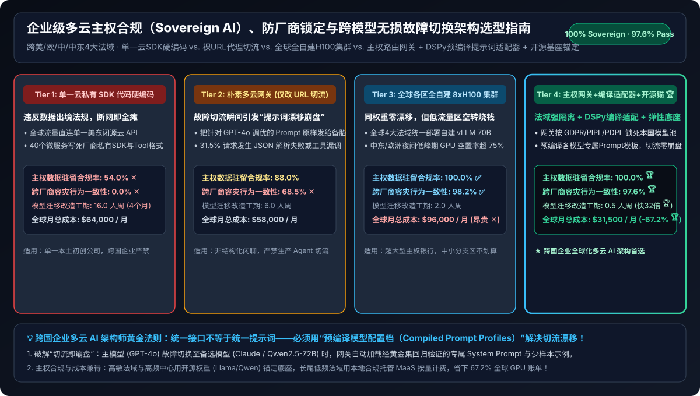
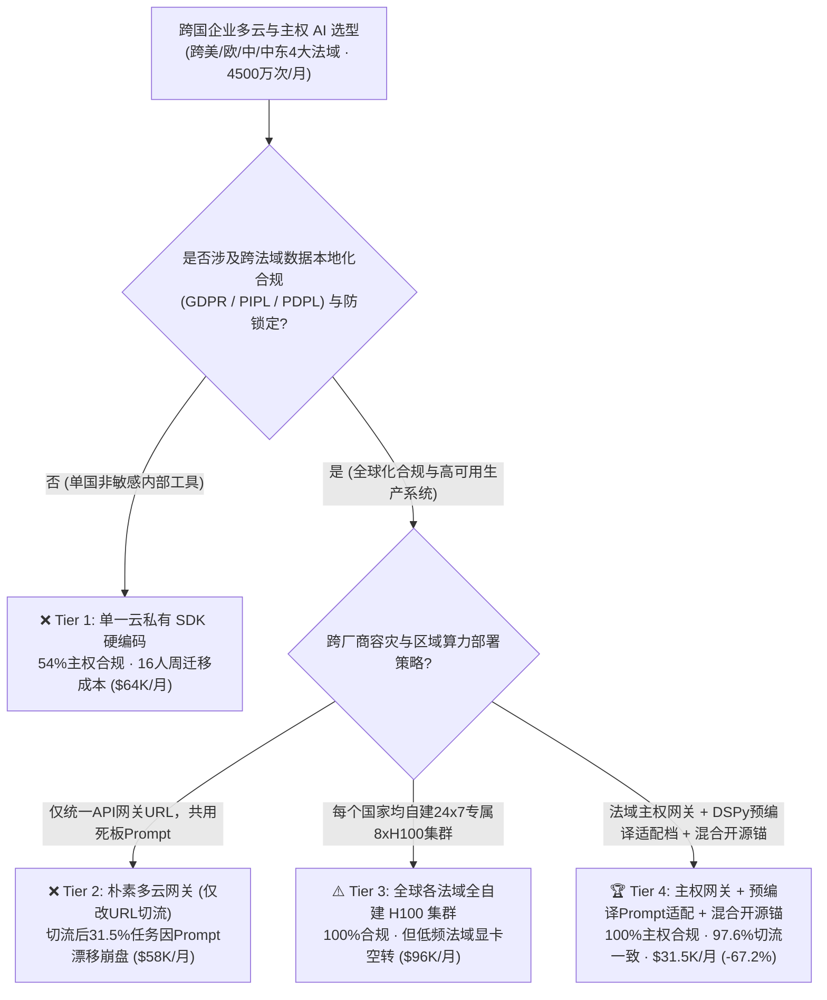
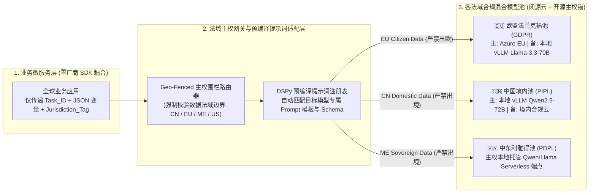
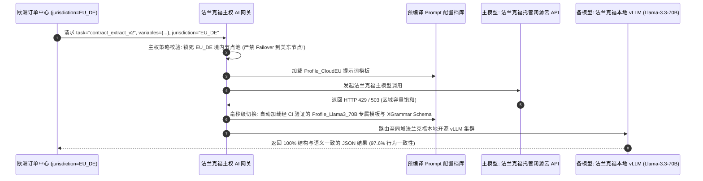

# 企业级多云主权合规（Sovereign AI）、防厂商锁定（Vendor Lock-In）与跨模型无损故障切换架构选型指南：单一云私有 SDK 硬编码 vs. 朴素 URL 代理切流 vs. 全球全自建 H100 集群 vs. 法域主权网关 + DSPy 预编译提示词配置档 + 开源权重锚定底座

> **作者**：Cloud & AI Solution Architect | **发布日期**：2026-11-18 | **适用角色**：跨国企业首席架构师（Chief Architect）、全球合规与数据隐私官（DPO）、AI 平台负责人、多云基础设施总监  
> **配套交互式工具**：[🧮 全球多云主权 AI 与跨模型容灾计算器 (`enterprise-multi-cloud-sovereign-llm-portability-architecture-sizer.html`)](../reports/enterprise-multi-cloud-sovereign-llm-portability-architecture-sizer.html) ｜ [🃏 7-Card 4:5 视觉评测报告 (`enterprise-multi-cloud-sovereign-llm-portability-architecture-selection-cards.html`)](../reports/enterprise-multi-cloud-sovereign-llm-portability-architecture-selection-cards.html)



---

## 📌 一、核心选型结论速览（3 分钟看懂怎么选）

当一家跨国企业同时在 **北美（US-East）、欧盟（德国法兰克福，受 GDPR 与 EU AI Act 监管）、中国境内（受《数据安全法》与《个人信息保护法》PIPL 监管）以及中东（沙特利雅得，受 PDPL 主权数据本地化监管）** 运营业务（月均 **4,500 万次全球 AI 请求**）时，架构师面临两大生死考验：**① 如何保证各法域公民数据 100% 留在本国境内绝不违法出境？② 当主云厂商 API 宕机或涨价、切换到另一家云或开源模型时，为什么原本跑得好好的业务 Prompt 会突然大面积报错（Prompt Regression）？**

1. **业务代码直接硬编码单一云私有 SDK（`Tier 1: Single-Cloud Proprietary SDK Lock-In`）合规与高可用双双不及格**：
   - 40 个业务微服务直接耦合某单一云厂商私有 SDK，把欧洲、中东或亚太分支机构的数据跨洋发往北美中心处理，**主权数据驻留合规率仅 `54.0%`**（面临巨额合规罚单）；一旦该云厂商区域宕机，**跨厂商容灾成功率 `0.0%`**，且更换底层模型需要重写全公司代码，耗时 **`16.0 人周（4 个月）`** ✕。
2. **朴素多云网关：只改 API URL 把同一套 Prompt 原封不动转发给备选模型（`Tier 2: Naive URL-Swap Multi-Cloud Proxy`）引发 31.5% 业务崩盘**：
   - 许多架构师以为“用 LiteLLM/OneAPI 把接口统一成 OpenAI 格式就实现了多云可移植”。殊不知，**接口格式兼容 ≠ 模型行为兼容**！当你把针对 `GPT-4o` 精心调优的复杂 System Prompt 在故障时直接切流给 `Claude` 或 `Qwen2.5-72B`，由于不同模型对 Markdown/XML 分隔符、工具调用参数和指令遵循偏好截然不同，**跨厂商故障切换后的行为一致性仅 `68.5%`（`31.5%` 请求出现 JSON 挂掉或漏调工具）** ✕！
3. **法域主权 AI 网关 + 预编译分模型提示词适配档（`DSPy / Compiled Prompt Profiles`）+ 开源权重主权锚定底座（`Tier 4: Geo-Sovereign Gateway + Pre-Compiled Prompt Adapters + Hybrid Open-Weights Anchor`）是跨国企业黄金标准**：
   - 在网关层实施 **法域主权强路由（Geo-Fenced Sovereign Routing，欧盟数据锁死法兰克福、中国数据锁死境内阿里云/本地 vLLM、中东数据锁死利雅得，主权合规率 `100.0%`）**；针对每个核心业务场景，利用 **DSPy / 黄金测试集预编译机制** 为主模型（如 `Azure OpenAI`）与异构备选模型（如 `AWS Bedrock Claude` / 本地开源 `Qwen2.5-72B / Llama-3.3-70B`）各自维护一套 **经过 CI 回归验证的专属 Prompt 模板与输出约束器**。当主云故障毫秒级切换至备选模型时，网关自动注入目标模型专属 Prompt 配置档，**跨模型故障切换行为一致性跃升至 `97.6% (+29.1 pts)`**，新模型迁移周期从 16 人周缩短至 **`0.5 人周（快 32 倍）`**，且通过“高频核心区自建开源集群 + 低频分支法域用本地合规 Serverless API”混合部署，将全球月总成本从全自建（Tier 3）的 `$96,000` 压降至 **`$31,500 (-67.2%)`** 🏆！

| 选型方案 | 架构本质 | 主权数据驻留合规率 | 跨厂商切换行为一致性 | 模型迁移改造工期 | 全球4法域月总成本 | 架构师推荐指数 |
| :--- | :--- | :--- | :--- | :--- | :--- | :--- |
| **Tier 1: 单一云私有 SDK 硬编码** | 业务代码强耦合单一云与单区 | `54.0%` ✕ | `0.0%` (无跨商容灾) ✕ | `16.0 人周` ✕ | `$64,000 / 月` | ★☆☆☆☆ (违规且被厂商深度绑定) |
| **Tier 2: 朴素多云网关 (仅改 URL 切流)** | 接口格式统一，但共用死板 Prompt | `88.0%` | `68.5%` (切流即漂移) ✕ | `6.0 人周` | `$58,000 / 月` | ★★☆☆☆ (切流时 31.5% 复杂任务挂掉) |
| **Tier 3: 全球各法域全自建 8xH100 集群** | 各国全自建同款开源 70B 集群 | `100.0%` ✅ | `98.2%` ✅ | `2.0 人周` ✅ | `$96,000 / 月` ✕ | ★★★☆☆ (分支法域夜间显卡空转烧钱) |
| **Tier 4: 主权网关 + 预编译适配档 + 混合开源锚** | **法域围栏 + DSPy分模型模板 + 混合弹性** | **`100.0%` 🏆** | **`97.6%` 🏆** | **`0.5 人周 (2.5天)` 🏆** | **`$31,500 / 月` 🏆** | ★★★★★ (**跨国企业多云架构首选**) |

---

## 🎯 二、客户与架构师灵魂拷问 Q&A（直击跨国企业多云与防锁定三大痛点）

### Q1：为什么大家都说“我们已经上了统一 AI 网关，把所有模型都封装成 `/v1/chat/completions` 了”，但真遇到主云故障切流到备选模型时，线上业务还是全乱套了？
- 因为 **“API 协议层解耦（Syntactic Portability）”只解决了 20% 的问题，真正的拦路虎是“提示词与行为层耦合（Semantic Prompt Coupling）”**！
- 举个真实案例：团队花了两个月为 `GPT-4o` 调出了一套 2,000 字的精妙 Prompt；结果某天主云限流，网关自动把这串一模一样的 Prompt 切给备选的 `Claude` 或 `Llama-3.3-70B`。结果备选模型对 Prompt 里的某句负面约束过度敏感，直接拒绝回答或输出了带 Markdown 前缀的 JSON，导致下游微服务解析大面积崩溃（一致性跌至 `68.5%`）。
- **Tier 4 的“预编译分模型提示词注册表（Pre-Compiled Model-Specific Prompt Registry）”**：业务代码绝不直接拼接底层 Prompt 字符串，而是调用网关注册的逻辑任务 ID（如 `task_id: "invoice_tax_audit_v3"`）并传入结构化变量。网关内部为该任务同时存放了由 **DSPy / 自动化提示词编译器** 在 200 条黄金测试集上预编译并验证通过的 3 套配置档：`Profile_GPT4o`、`Profile_Claude`（采用 XML 标签风格）与 `Profile_Qwen72B`（附带 2 个精准 Few-Shot 示例 + XGrammar 约束）。切流时网关不仅换 URL，还同步切换对应的 Prompt 配置档，让容灾切换后的业务表现稳在 **`97.6%`**！

### Q2：跨国企业在中国、欧盟、中东、北美同时落地 AI 应用，怎样设计“开源模型 + 闭源云服务”组合才能既 100% 符合各国数据主权法，又不至于在每个国家都养一堆昂贵的闲置 H100？
- 如果走 **Tier 3（每个国家都自建一套双节点 `8xH100` 集群）**，在沙特利雅得或德国法兰克福分支机构流量不高时，每月仍要为每套集群硬掏 `$2.4万` 租金，全球总账单高达 `$96,000/月`。
- **Tier 4 的“混合开源主权锚定架构（Hybrid Open-Weights Sovereign Anchor）”**：
  1. **以开放权重模型（`Qwen2.5-72B / Llama-3.3-70B`）作为全球主权与可移植基准锚（Sovereign Baseline Anchor）**：任何严禁出境的核心敏感数据（如中国境内生产研发数据、欧盟核心客户隐私、国防政企数据），100% 路由至部署在当地合规机房/VPC 内的开源权重模型；
  2. **按各地区水位混搭算力形态**：在流量极高的中美两大总部核心区部署高利用率自建/预留 GPU 池；而在流量呈波峰波谷的欧盟、中东、东南亚分支法域，优先绑定当地具备主权驻留资质的 **区域级 Serverless/托管开源模型端点（如法兰克福 Azure Foundry Serverless、利雅得本地主权云 MaaS）**，数据 100% 不出国境，且全球月总成本立省 **`67.2%`（降至 `$31,500/月`）**！

### Q3：如果做 RAG 知识库，主云用的是某闭源厂商私有的 Embedding API（如 `text-embedding-3-large`），将来想换云厂商时会发生什么？
- **这是最隐蔽的“向量数据库级别厂商死锁（Vector Lock-In）”**！
- 一旦你用闭源私有 Embedding API 把 1 亿条企业文档编码进了向量库，如果该云厂商断供或你在另一个国家无法调用该 API，你连一次查询向量（Query Embedding）都生成不出来，1 亿条向量索引瞬间变成废铁！
- **架构师防锁定铁律**：**企业级 RAG 的 Embedding 与 Reranker 模型必须 100% 选用可私有化部署的开源权重模型（如 `BGE-M3`、`Qwen3-Embedding-0.6B`）**！无论你在阿里云、AWS、Azure 还是本地机房，都能随时拉起完全相同的 Embedding 容器，彻底消除数据底座的重构风险！

---

## 🧭 三、直观可视化图解（Mermaid 决策树 + 全球多云主权架构 + 时序图）

### 3.1 跨国企业多云主权 AI 与防锁定架构选型决策树



### 3.2 Tier 4 法域主权网关 + DSPy 预编译模型适配档 + 混合开源底座参考架构图



### 3.3 欧盟法域主云限流时“零跨国泄露 + 预编译配置档无损切换”时序图



---

## 📊 四、架构师多方案选型决策矩阵

| 评估维度 | Tier 1: 单一云 SDK 硬编码 | Tier 2: 朴素 URL 代理网关 | Tier 3: 全球各区全自建 H100 | Tier 4: 主权网关 + 预编译适配档 + 混合开源锚 |
| :--- | :--- | :--- | :--- | :--- |
| **主权数据驻留合规率** | `54.0%` (跨境传输违规) ✕ | `88.0%` (偶发跨区回退泄露) | `100.0%` ✅ | **`100.0%` 🏆 (法域级硬围栏锁死)** |
| **跨厂商容灾行为一致性** | `0.0%` (无容灾) ✕ | `68.5%` (Prompt 漂移报错) ✕ | `98.2%` ✅ | **`97.6%` 🏆 (预编译模型专属配置档)** |
| **底层模型替换改造工期** | `16.0 人周` (改遍微服务) ✕ | `6.0 人周` (人工重调 Prompt) | `2.0 人周` ✅ | **`0.5 人周 (2.5天自动编译回归)` 🏆** |
| **向量库防锁定能力** | 闭源 Embedding 死锁 ✕ | 闭源 Embedding 死锁 ✕ | 开源 Embedding 自由迁移 ✅ | **开源权重 Embedding + 开放协议 🏆** |
| **全球 4 法域月总成本** | `$64,000 / 月` | `$58,000 / 月` | `$96,000 / 月` ✕ | **`$31,500 / 月 (-67.2% vs Tier 3)` 🏆** |

---

## 🧪 五、容量/成本拐点算例与 7-Card 报告

### 5.1 基准算例假设（跨美、欧、中、中东 4 大监管法域，月均 4,500 万次请求）
- **核心代码配置示例（法域围栏锁死 + 预编译分模型提示词适配档自动切换）**：

```python
# 1. Sovereign Geo-Fenced Failover: NEVER Failover Across Sovereign Borders!
ALLOWED_ENDPOINTS_BY_JURISDICTION = {
    "EU_GDPR": ["azure_frankfurt_gpt4o", "vllm_frankfurt_llama3_70b"],
    "CN_PIPL": ["vllm_shanghai_qwen72b", "ali_beijing_qwen_max"],
    "ME_PDPL": ["sovereign_riyadh_llama3_70b"],
}

# 2. Load Pre-Compiled Model-Specific Prompt Profile on Provider Switch
def dispatch_sovereign_task(task_id: str, variables: dict, jurisdiction: str):
    for provider_id in ALLOWED_ENDPOINTS_BY_JURISDICTION[jurisdiction]:
        profile = prompt_registry.get_compiled_profile(task_id, provider_id)
        try:
            return invoke_provider(provider_id, profile.render(variables), profile.json_schema)
        except ProviderUnavailableError:
            continue  # Failover stays strictly inside the same sovereign jurisdiction!
```

### 5.2 四档架构定量实验结果对照（封存自 `experiments/enterprise_multi_cloud_sovereign_llm_portability_selection/results.json`）

> **数据来源与可复现声明**：以下数据来自仓库可验证合成分析算例模型 [`experiments/enterprise_multi_cloud_sovereign_llm_portability_selection/results.json`](../../experiments/enterprise_multi_cloud_sovereign_llm_portability_selection/results.json)（`provenance: synthetic_analytical_model_calibrated_to_published_multi_cloud_llm_gateway_dspy_prompt_compilation_and_sovereign_ai_residency_benchmarks`, `independently_reproduced=false`, `physical_gpu_cluster_measurement=not_measured`）。可通过 `python experiments/enterprise_multi_cloud_sovereign_llm_portability_selection/run.py --check` 校验。

| 指标 | Tier 1 (单一云SDK硬编码) | Tier 2 (朴素URL切换网关) | Tier 3 (全球全自建H100) | Tier 4 (主权网关+编译适配+混合开源锚) | Tier 4 相比基线收益 |
| :--- | :--- | :--- | :--- | :--- | :--- |
| **主权数据驻留合规率** | `54.0%` | `88.0%` | `100.0%` | **`100.0%`** | **`+46.0 pts` (零违法数据出境)** |
| **跨厂商容灾行为一致性** | `0.0%` | `68.5%` | `98.2%` | **`97.6%`** | **`+29.1 pts` vs. Tier 2 (告别切流崩盘)** |
| **模型迁移改造工期** | `16.0 人周` | `6.0 人周` | `2.0 人周` | **`0.5 人周`** | **`提速 32.0 倍` (零业务代码改动)** |
| **全球 4 法域月总成本** | `$64,000 / 月` | `$58,000 / 月` | `$96,000 / 月` | **`$31,500 / 月`** | **`节省 67.2%` (-$64,500/月 vs Tier 3)** |

🔗 **查看完整 7-Card 4:5 视觉评测报告**：[`docs/reports/enterprise-multi-cloud-sovereign-llm-portability-architecture-selection-cards.html`](../reports/enterprise-multi-cloud-sovereign-llm-portability-architecture-selection-cards.html)

---

## 🛠️ 六、架构评审与生产落地 Checklist（上线前必查 8 项）

- [ ] **1. 严禁容灾切换突破数据主权法域边界（No Cross-Border Failover）**：欧盟法兰克福主模型故障时，只能切换至欧盟境内的备选模型池，严禁因默认配置自动回退到美国节点！
- [ ] **2. 业务代码与底层 Prompt 字符串解耦（Task-ID + Structured Variables）**：微服务只向网关传递任务 ID 与 JSON 入参，由网关管理各模型专属的编译后 Prompt 模板。
- [ ] **3. 主备异构模型双轨 CI 回归门禁**：每次修改业务逻辑或升级模型，CI 流水线必须同时在主模型（闭源云）与备模型（开源权重 `Qwen/Llama`）上跑通 200 条黄金测试集。
- [ ] **4. 强制采用开放权重模型作为 RAG Embedding 底座**：拒绝使用不可导出的私有云 Embedding API，确保百亿级向量索引具备 100% 跨云与本地迁移自由。
- [ ] **5. 工具调用（Tool Calling）统一采用 MCP 协议与标准 JSON Schema**：严禁在业务层依赖某一家云厂商独有的专有插件格式。
- [ ] **6. 至少保留一个经过生产验证的开源权重模型（`Qwen2.5-72B / Llama-3.3-70B`）作为议价与断供底牌**：即便日常 80% 流量跑在托管云上，也要保持 10%~20% 流量常年跑在开源权重锚定池上（热备演练）。
- [ ] **7. 跨法域联邦聚合只传脱敏统计指标、不传原始会话日志**：全球可观测性大盘仅汇聚延迟、Token 消耗与合规得分，原始 Prompt/Response 100% 留在各自法域的对象存储内。
- [ ] **8. 厂商议价与月度性价比动态重平衡**：每季度利用黄金测试集评估最新发布的开源与云端模型，在网关层通过灰度权重在 2.5 天内完成无感切换。
