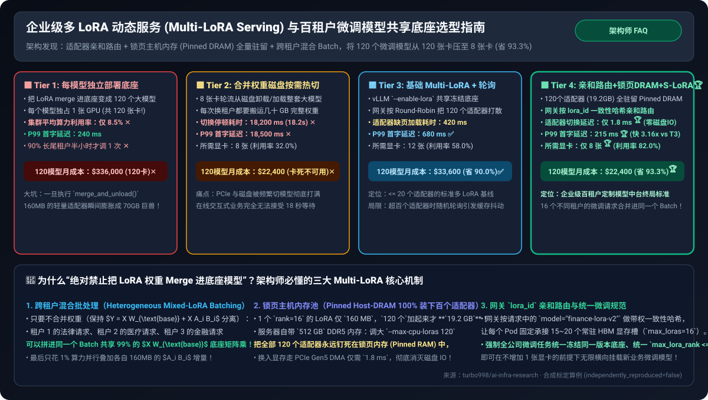
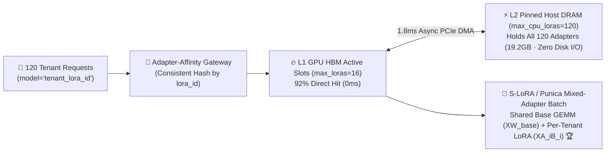

# Enterprise Multi-LoRA Serving & 100+ Tenant Adapter Consolidation Selection Guide: Dedicated Base Instance per Model vs. Merged-Weight Disk Swapping vs. Basic Multi-LoRA Round-Robin vs. Adapter-Affinity Routing + Pinned Host-DRAM Cache + Mixed-Adapter Continuous Batching

> **Document Type**: Cloud & AI Solution Architect Decision Guide (FAQ)  
> **Target Audience**: Enterprise MaaS Platform Leads, Multi-Tenant SaaS Engineering Directors, Fine-Tuning & MLOps Architects  
> **Core Goal**: Solve the "100-Adapter GPU Sprawl" crisis when an enterprise scales fine-tuning across 120 departments or customers — answering: **"Why does running `merge_and_unload()` after LoRA fine-tuning force us to buy 120 GPUs ($336,000/month) at 8.5% utilization?", "How can 16 different tenants' fine-tuned models execute inside the exact same GPU forward pass?", and "How does combining Adapter-Affinity Gateway Routing, a Pinned Host-DRAM 120-Adapter Pool, and S-LoRA/Punica Mixed-Adapter Batching consolidate 120 custom models onto just 8 GPUs (`-93.3%` cost) with 215ms P99 TTFT?"**  
> **Calibration Notice**: GPU counts, P99 TTFT latencies, adapter swap stalls, and monthly cluster costs are synthetic analytical estimates calibrated to published Multi-LoRA serving benchmarks (S-LoRA, Punica, LoRAX, and vLLM/SGLang dynamic Multi-LoRA evaluations) (`provenance: synthetic + anonymized_reported`, `independently_reproduced=false`, `physical_gpu_cluster_measurement=not_measured`). See [`experiments/enterprise_multi_lora_serving_hundred_tenant_adapter_selection/results.json`](../../experiments/enterprise_multi_lora_serving_hundred_tenant_adapter_selection/results.json).

---

## Executive Visual Summary

> 🔗 **Companion Interactive Reports & Tools**:
> - 🃏 **[7-Card 4:5 Visual Benchmark Report (`enterprise-multi-lora-serving-hundred-tenant-adapter-architecture-selection-cards.html`)](../reports/enterprise-multi-lora-serving-hundred-tenant-adapter-architecture-selection-cards.html)**
> - 🧮 **[Interactive 120-Tenant Multi-LoRA Consolidation Sizer (`enterprise-multi-lora-serving-hundred-tenant-adapter-architecture-sizer.html`)](../reports/enterprise-multi-lora-serving-hundred-tenant-adapter-architecture-sizer.html)**
> - 🌐 **[中文版指南 (`enterprise-multi-lora-serving-hundred-tenant-adapter-architecture-selection-faq.md`)](./enterprise-multi-lora-serving-hundred-tenant-adapter-architecture-selection-faq.md)**

---

## ① 📌 Executive Summary

Evaluated on hosting **120 customized fine-tuned tenant models (`LoRA rank=16`, `160 MB` per adapter, `250 RPS` aggregate cluster traffic)**:

| Tier | Architecture Pattern | GPUs Needed (120 Models) | Adapter Swap Stall | P99 TTFT Latency | Avg GPU Utilization | Monthly GPU Cost | Architect Verdict |
| :--- | :--- | :--- | :--- | :--- | :--- | :--- | :--- |
| **🟥 Tier 1: Dedicated Merged Instance / Model** | Merge LoRA into base weights; deploy 120 separate pods | **`120 GPUs` ✕** | `0.0 ms` | `240 ms` | `8.5%` ✕ (91.5% idle) | **`$336,000 / mo` ✕** | **Bankrupting Anti-Pattern**: 160MB delta balloons to 70GB |
| **🟨 Tier 2: Merged-Weight Disk Swapping** | Swap full merged models from disk on 8 GPUs | `8 GPUs` | **`18,200 ms` ✕** | `18,500 ms` (18.5s) ✕ | `32.0%` | `$22,400 / mo` ✕ | **Unusable**: 18.5s stall on every tenant switch |
| **🟦 Tier 3: Basic Multi-LoRA + Round-Robin** | **vLLM/SGLang Multi-LoRA** + stateless Round-Robin | `12 GPUs` ✅ | `420 ms` (Cache eviction) | `680 ms` ✅ | `58.0%` ✅ | `$33,600 / mo` (-90.0%) | **Good for `<= 20` Adapters**: Thrashing above 100 adapters |
| **🟩 Tier 4: Affinity Router + Pinned DRAM + Mixed Batch** | **lora_id Affinity + Pinned Host-DRAM + S-LoRA Batching** | **`8 GPUs` 🏆 (15x fewer)** | **`1.8 ms` 🏆 (Zero disk I/O)** | **`215 ms` 🏆 (3.16x vs T3)** | **`82.0%` 🏆** | **`$22,400 / mo` 🏆 (-93.3%)** | **100+ Tenant MaaS Gold Standard**: 8 GPUs serve 120 models |

### 💡 Three Golden Rules for Enterprise Multi-LoRA Architects
1. **Never Run `merge_and_unload()` on Multi-Tenant or Long-Tail Fine-Tuned Models**: Merging a `160 MB` LoRA adapter into a `70 GB` base model destroys weight sharing and prevents cross-tenant batching. Always ship unmerged LoRA adapters (`adapter_model.safetensors`) so all 120 tenants share a single frozen `FP8` base model in GPU HBM!
2. **Pin All 100+ Adapters in Host DRAM (`--max-cpu-loras 120`) to Eliminate Disk I/O**: `120` adapters at `160 MB` each require only **`19.2 GB` of Host RAM**. Pinning all adapters in host memory means a GPU HBM slot miss transfers weights over PCIe Gen5 DMA in **`1.8 ms`** (overlapped with base-layer computation) instead of `420 ms` from disk.
3. **Route by `lora_id` Consistent Hashing at the AI Gateway**: Replace Round-Robin with bounded-load consistent hashing on the requested `model` (`lora_id`) so each GPU replica's `16` active HBM LoRA slots achieve a `92%+` hit rate.

---

## ② 🎯 Architect Deep-Dive Q&A

### Q1: How can requests for 16 different fine-tuned models be batched together in a single GPU forward pass?
* **Answer (Distributive Property of Low-Rank Adapters: $Y = X W_{\text{base}} + (X A_i) B_i$)**:
  - In `Punica / S-LoRA` kernels (built into vLLM and SGLang), all requests in the batch first execute the massive base-model matrix multiplication $X W_{\text{base}}$ together as one dense batch (`99%` of FLOPS), and then a lightweight segmented Gather-GEMM kernel applies each request's specific `160 MB` adapter $(X A_i) B_i$ (`1%` of FLOPS).

---

## ③ 🧭 Architecture Diagrams

### 3.1 Tier 4 Adapter-Affinity Routing + 3-Tier LoRA Pool + Mixed-Adapter Batching

---

## ④ 📊 Architect Decision Matrix

| Dimension | 🟥 Tier 1: Merged 1-GPU-Per-Model | 🟨 Tier 2: Merged Disk Swapping | 🟦 Tier 3: Multi-LoRA + Round-Robin | 🟩 Tier 4: Affinity + Pinned DRAM + S-LoRA |
| :--- | :--- | :--- | :--- | :--- |
| **GPUs Required (120 Models)** | `120 GPUs` ✕ | `8 GPUs` | `12 GPUs` ✅ | **`8 GPUs` 🏆 (`15.0x` fewer GPUs)** |
| **Adapter Swap Stall** | `0.0 ms` | `18,200 ms` ✕ | `420 ms` | **`1.8 ms` 🏆 (Pinned DRAM DMA)** |
| **P99 TTFT Latency** | `240 ms` | `18,500 ms` ✕ | `680 ms` ✅ | **`215 ms` 🏆 (`3.16x` faster than Tier 3)** |
| **Avg GPU Utilization** | `8.5%` ✕ | `32.0%` | `58.0%` ✅ | **`82.0%` 🏆** |
| **Monthly Cluster Cost** | `$336,000 / mo` ✕ | `$22,400 / mo` ✕ | `$33,600 / mo` ✅ | **`$22,400 / mo` 🏆 (`-93.3%` vs. Tier 1)** |

---

## ⑤ 🛠️ Production Readiness Checklist

- [ ] **1. Forbid `merge_and_unload()` in Fine-Tuning Pipelines Unless a Single Model Saturates Dedicated GPUs**.
- [ ] **2. Standardize Base Model Revisions and Frozen Tokenizers Across All Departmental Fine-Tuning Jobs**.
- [ ] **3. Cap Standard Enterprise LoRA Rank at `max_lora_rank <= 32` (`r=16` Default)**.
- [ ] **4. Set `--max-cpu-loras >= Total_Active_Adapters` to Pin All Adapters in Host DRAM**.
- [ ] **5. Route Requests by `lora_id` Bounded-Load Consistent Hashing at the AI Gateway**.
- [ ] **6. Enable Zero-Downtime Dynamic Adapter Registration for Instant New-Tenant Onboarding**.
- [ ] **7. Run the Shared Base Model in `FP8 W8A8` While Keeping LoRA Adapter Weights in `BF16/FP16`**.
- [ ] **8. Enforce Strict Gateway RBAC Binding Between Authenticated `JWT tenant_id` and Requested `lora_id`**.
