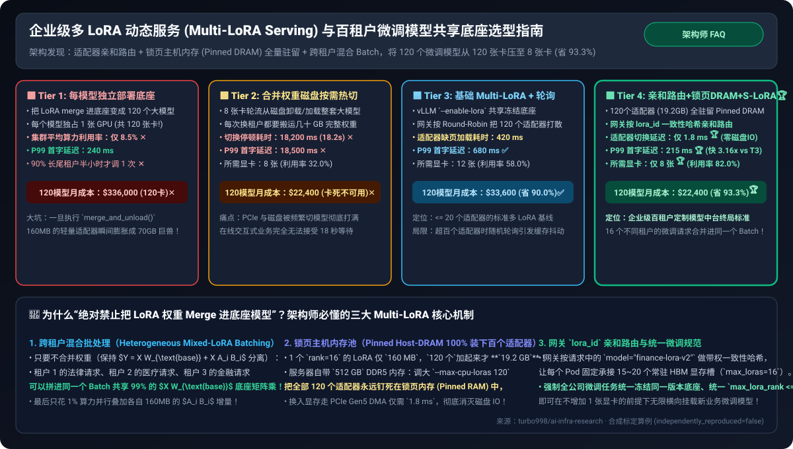
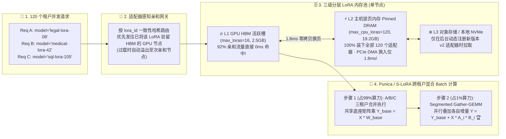
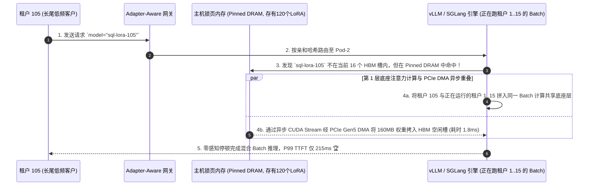

# 企业级多 LoRA 动态服务（Multi-LoRA Serving）与百租户微调模型共享底座架构选型指南：每模型独立部署整套底座 vs. 合并权重磁盘热切 vs. 基础 Multi-LoRA 轮询 vs. 适配器亲和路由 + 锁页主机内存（Pinned DRAM）全量驻留 + 跨租户混合 Batch 架构

> **文档类型**：企业级 AI 平台（MaaS）与推理编排层解决方案架构师（Cloud & AI Solution Architect）选型决策指南（FAQ）  
> **适用读者**：企业内部 MaaS 平台负责人、多租户 SaaS 产品技术总监、模型微调与交付负责人、云基础设施架构师  
> **核心目标**：用通俗、可量化的架构账本解决企业开启规模化微调（Fine-Tuning）后最头疼的“微调模型数量爆炸（100+ 个部门或客户各有各的微调版本）”——系统回答：**“为什么算法同学微调完顺手跑了一句 `model.merge_and_unload()` 把 LoRA 合并进底座，直接导致公司要多买 100 张显卡、每月多花 30 万美金？”、“怎么让 16 个不同部门的微调模型在同一张显卡的同一个 Batch 里同时推理？”、“当集群里有 120 个 LoRA 适配器时，怎么用‘网关 `lora_id` 亲和路由 + 锁页主机内存全量驻留’把切换停顿压到 1.8 毫秒、只用 8 张卡扛住全公司 120 个定制模型？”**。  
> **标定声明**：本文所引用的所需 GPU 卡数、P99 首字延迟（TTFT）、适配器冷热切换停顿与月度集群成本模型基于公开发布的多 LoRA 推理架构基准（S-LoRA、Punica、LoRAX 及 vLLM / SGLang 动态 Multi-LoRA 生产评测）构建的合成分析模型（`provenance: synthetic + anonymized_reported`, `independently_reproduced=false`, `physical_gpu_cluster_measurement=not_measured`），详见 [`experiments/enterprise_multi_lora_serving_hundred_tenant_adapter_selection/results.json`](../../experiments/enterprise_multi_lora_serving_hundred_tenant_adapter_selection/results.json)。

---

## 一图流总结（Executive Visual Summary）



> 🔗 **关联可交互报告与工具**：
> - 🃏 **[7-Card 4:5 视觉评测报告 (`enterprise-multi-lora-serving-hundred-tenant-adapter-architecture-selection-cards.html`)](../reports/enterprise-multi-lora-serving-hundred-tenant-adapter-architecture-selection-cards.html)**
> - 🧮 **[交互式百租户 Multi-LoRA 装箱与成本计算器 (`enterprise-multi-lora-serving-hundred-tenant-adapter-architecture-sizer.html`)](../reports/enterprise-multi-lora-serving-hundred-tenant-adapter-architecture-sizer.html)**
> - 🌐 **[English Version (`enterprise-multi-lora-serving-hundred-tenant-adapter-architecture-selection-faq.en.md`)](./enterprise-multi-lora-serving-hundred-tenant-adapter-architecture-selection-faq.en.md)**

---

## ① 📌 核心选型结论速览（Executive Summary）

当企业 AI 平台进入深水区，法务部、财务部、HR 部以及 100 家大客户都用自己的私有数据微调出了专属模型（共 **120 个微调模型**）。如果每个微调模型都当成一个独立的完整大模型去部署（Tier 1），哪怕 90% 的微调模型每十分钟才来 1 次请求，你也得为这 120 个模型配齐 **120 张 GPU（月烧 `$336,000`，平均利用率仅 `8.5%`）**！

基于 **120 个租户/业务线定制微调模型（LoRA `rank=16`，每个适配器仅 `160 MB`）、集群总并发 250 RPS** 的基准测算，四档服务架构对比如下：

| 架构档位 | 核心部署与调度机制 | 承载120个模型需GPU数 | 适配器切换停顿 | P99 首字延迟 (TTFT) | 集群平均利用率 | 月度 GPU 成本 | 架构师拍板结论 |
| :--- | :--- | :--- | :--- | :--- | :--- | :--- | :--- |
| **🟥 Tier 1：合并权重每模型独立部署** | `merge_and_unload` 后起 120 套独立实例 | **`120 张` ✕** | `0.0 ms` | `240 ms` | `8.5%` ✕ (91.5%空转) | **`$336,000 / 月` ✕** | **破产级反模式**：160MB 增量被放大成 70GB 独立底座 |
| **🟨 Tier 2：合并权重按需磁盘热切** | 8 张卡轮流从磁盘卸载/重载完整模型 | `8 张` | **`18,200 ms` ✕** | `18,500 ms` (18.5s) ✕ | `32.0%` | `$22,400 / 月` ✕ | **完全不可用**：每次换租户卡死 18 秒 |
| **🟦 Tier 3：基础 Multi-LoRA + 轮询网关** | **vLLM/SGLang 动态 LoRA** + 随机轮询路由 | `12 张` ✅ | `420 ms` (缓存驱逐) | `680 ms` ✅ | `58.0%` ✅ | `$33,600 / 月` (-90.0%) | **`<= 20` 个适配器标准基线**：百个以上时轮询引发频繁换页 |
| **🟩 Tier 4：适配器亲和路由 + 锁页内存全驻留** | **lora_id 亲和路由 + Pinned DRAM 驻留 + 混合 Batch** | **`8 张` 🏆 (减15.0x)** | **`1.8 ms` 🏆 (零磁盘IO)** | **`215 ms` 🏆 (快3.16x)** | **`82.0%` 🏆** | **`$22,400 / 月` 🏆 (-93.3%)** | **百租户 MaaS 中台终局标准**：8 张卡丝滑跑 120 个定制模型 |

### 💡 架构师三句话选型铁律
1. **微调交付第一红线：除非该单一模型独占流量就能跑满整张 GPU，否则绝对禁止在训练结束后执行 `merge_and_unload()` 把 LoRA 权重合并进底座模型（Tier 1）！**：保持底座模型权重 $W_{\text{base}}$ 100% 冻结只读，只导出 **`160 MB` 的纯 LoRA 适配器文件（`adapter_model.safetensors`）**——这是让 120 个定制模型共享同一套底座显存的唯一前提！
2. **理解动态 Multi-LoRA（`Punica / S-LoRA`）为什么能把不同客户的微调模型拼在同一个 Batch 里算**：因为矩阵乘法具有分配律 $X(W_{\text{base}} + A_i B_i) = X W_{\text{base}} + (X A_i) B_i$！在推理时，来自 16 个不同部门的请求**先合并在一起跑一次占 99% 计算量的共享底座矩阵乘 $X W_{\text{base}}$**，然后再用定制算子（BGMV / Segmented Gather-GEMM）各自加上那 1% 的轻量 $A_i B_i$ 偏移量——**吞吐几乎等同于单模型，却同时服务了 16 个完全不同的微调大脑！**
3. **当适配器数量超过 `30~100+` 个时，必须开启“锁页主机内存全量常驻（`--max-cpu-loras 120`）+ 网关 `lora_id` 一致性哈希亲和路由”（Tier 4）**：120 个 `160 MB` 的 LoRA 总共才 **`19.2 GB`**，还不到服务器 512GB DDR5 主机内存的一个零头！把全部 120 个适配器永远锁在主机内存（Pinned Host DRAM）里，哪怕遇到冷门租户突发调用，通过 PCIe Gen5 DMA 异步拉入显存也只需 **`1.8 ms`**（与前序层计算完全重叠），彻底消灭磁盘 I/O 抖动！

---

## ② 🎯 客户与架构师灵魂拷问 Q&A（Architect Deep-Dive Q&A）

### Q1：我们的算法团队为了图省事，每次给客户做完 LoRA 微调后都把权重合并（Merge）成一个完整的 70B 模型交付给运维，为什么架构师必须立刻叫停这种做法？
* **真相剖析（`Merge` 操作毁掉了显存共享与跨租户拼单Batching！）**：
  - 一旦你执行了 $W_{\text{merged}} = W_{\text{base}} + A \times B$，原本只有 `160 MB` 差异的两个租户模型，在物理文件上就变成了两个完全不同的 **`70 GB` 巨型文件**！
  - 这会带来双重灾难：
    1. **显存爆炸（120 倍膨胀）**：GPU 显存无法识别它们背后的底座是一样的，你必须为 120 个租户准备 $120 \times 70\text{ GB} = 8,400\text{ GB}$ 的显存（120 张卡，Tier 1）；
    2. **Batch Size 退化为 1**：租户 A 的请求和租户 B 的请求再也无法拼进同一个 Continuous Batch 里一起做矩阵乘！
  - 而保持 **Unmerged LoRA 插件化交付（Tier 3/4）**：每台 GPU 只加载 1 份 `70 GB` 底座，剩下的显存开辟 `16` 个仅占 `160 MB` 的热插拔 LoRA 槽位（共 `2.56 GB`），**8 张卡就能满血服务全部 120 个租户，每月直接省下 `$313,600`（`-93.3%`）**！

### Q2：我们已经开启了 vLLM 的 `--enable-lora`（Tier 3），为什么当租户微调模型涨到 120 个时，P99 首字延迟还是会偶尔飙到 680ms？
* **真相剖析（无状态轮询网关引发的“全集群缓存颠簸 Cache Thrashing”）**：
  - 假设你有 4 个推理副本（每个副本在显存里开 `max_loras=16` 个活跃槽位，在 CPU 内存开默认的 `max_cpu_loras=32`）。
  - 如果前端网关按传统 Round-Robin 轮询分发这 120 个租户的请求，那么每个副本都会收到全部 120 个租户的请求！结果就是：4 个副本的显存槽和 CPU 槽每时每刻都在发生 LRU 缓存未命中（Cache Miss），被迫频繁去磁盘/NFS 读取权重文件（每次耗时 `300~450 ms`）！
  - **Tier 4 两步根治法**：
    1. **网关层按 `model (lora_id)` 做带负载水位的有界一致性哈希路由（Adapter-Aware Affinity Routing）**：将第 `1~30` 号租户优先路由至副本 1，第 `31~60` 号路由至副本 2……让每个副本的 `16` 个 GPU HBM 槽位命中率超过 **`92%`**！
    2. **引擎层调大 `--max-cpu-loras 120`**：把全部 120 个适配器（仅 `19.2 GB`）预热锁死在主机 Pinned RAM 中，万一发生跨副本溢出，只走 `32 GB/s` 的 PCIe DMA 内存拷贝（`1.8 ms`），永远不碰慢速磁盘！

### Q3：如果不同团队训练 LoRA 时，有人用了 `rank=8`，有人用了 `rank=64`，还有人改了分词器（Tokenizer），还能放进同一个 Multi-LoRA 池里吗？
* **真相剖析（企业微调中台必须制定的“三统一契约”）**：
  - **不同 Rank（如 `r=8, 16, 32`）完全可以混部在同一个池子里！** 在 vLLM / SGLang 启动时只需设置 `--max-lora-rank 32`（或 `64`），引擎基于统一分页内存（S-LoRA Unified Paging）能同时兼容所有 `<= max_lora_rank` 的适配器。
  - **但以下两项必须全公司严格冻结统一**：
    1. **底座模型版本必须精确一致**（例如统一锁定 `Qwen2.5-72B-Instruct-FP8`）；
    2. **严禁修改词表大小（Vocabulary Size）或微调 `embed_tokens / lm_head` 全量词嵌入层**：一旦某个团队往词表里加了新 Token，词嵌入矩阵维度就变了，无法与其他租户共享底座。行业专有名词一律通过 Prompt 术语表或标准 `q_proj/k_proj/v_proj/o_proj/gate_proj/up_proj/down_proj` 线性层 LoRA 注入！

---

## ③ 🧭 直观可视化图解（Mermaid 决策树、三级 LoRA 缓存池与混合 Batch 图）

### 3.1 企业级微调模型部署与 Multi-LoRA 架构选型决策树

```mermaid
flowchart TD
    A[企业拥有多个微调定制模型需要上线推理] --> B{单个微调模型的日常并发流量有多大？}
    B -->|单一垂直模型流量极大 (>= 50 RPS)<br/>自身就能把 2~8 张 GPU 100% 跑满| C[可将 LoRA 合并进底座并量化为 FP8 W8A8<br/>独立独占节点池运行 (消除 5% LoRA 算子开销)]
    B -->|多部门 / 多客户定制模型 (10 ~ 500+ 个)<br/>每个模型流量呈波峰波谷或长尾分布| D{微调适配器总数量规模？}
    D -->|适配器数量 <= 16 个| E[🟦 Tier 3: 基础动态 Multi-LoRA<br/>全部常驻 GPU HBM 显存槽 (max_loras=16)<br/>零换入延迟]
    D -->|适配器数量 20 ~ 500+ 个| F[🟩 Tier 4: 网关 lora_id 亲和路由 + Pinned DRAM 全量预热 + 混合 Batch<br/>8 张卡承载 120 个模型 / 切换仅 1.8ms / 月成本省 93.3% 🏆]
```

### 3.2 Tier 4“网关亲和路由 + 三级 LoRA 缓存池 + 跨租户混合 Batch”参考架构图



### 3.3 跨租户混合 Batch 执行与 Pinned DRAM 极速换入时序图（Sequence Diagram）



---

## ④ 📊 架构师多方案选型决策矩阵（Architect Decision Matrix）

| 评估维度 | 🟥 Tier 1：合并权重独立部署底座 | 🟨 Tier 2：合并权重按需磁盘热切 | 🟦 Tier 3：基础 Multi-LoRA + 轮询 | 🟩 Tier 4：亲和路由 + 锁页 DRAM + 混合 Batch |
| :--- | :--- | :--- | :--- | :--- |
| **承载 120 个模型所需 GPU 数** | `120 张` ✕（1 模型 1 卡） | `8 张` | `12 张` ✅ | **`8 张` 🏆（比 Tier 1 少买 `112 张` 卡！）** |
| **冷门租户切换停顿耗时** | `0.0 ms` | **`18,200 ms`（18.2 秒）✕** | `420 ms`（磁盘/缓存驱逐） | **`1.8 ms` 🏆（Pinned DRAM 异步 DMA）** |
| **P99 首字延迟 (TTFT)** | `240 ms` | `18,500 ms` ✕（完全不可用） | `680 ms` ✅ | **`215 ms` 🏆（比随机轮询快 `3.16x`）** |
| **集群平均 GPU 算力利用率** | `8.5%` ✕（91.5% 闲置浪费） | `32.0%` | `58.0%` ✅ | **`82.0%` 🏆（16 租户拼单跑满同一个 Batch）** |
| **新租户模型上线耗时** | 15 分钟（拉起新 K8s Deployment） | 5 分钟 | 秒级 API 加载 | **🏆 毫秒级 API 热注册（零停机）** |
| **120 个模型月度集群成本** | **`$336,000 / 月` ✕** | `$22,400 / 月`（不可用） | `$33,600 / 月` ✅（省 `90.0%`） | **`$22,400 / 月` 🏆（比 Tier 1 省 `93.3%`）** |

---

## ⑤ 🧪 容量/成本拐点算例与 7-Card 报告（Quantitative Sizer & 7-Card Deck）

### 5.1 基准算例假设（120 个企业定制微调模型 · LoRA `rank=16` · 250 RPS 集群总流量）
- **为什么 Tier 4 能把月成本从 `$336,000` 砍到 `$22,400`（每年直接省下 `$376.3 万` 美金）？**
  1. **消灭底座冗余**：120 个租户模型的底座权重 `99.8%` 是完全相同的，只把那 `0.2%`（`160 MB`）的差异抽出来做动态插件，显卡需求从 `120 张` 降为 **`8 张`（缩减 `15.0 倍`）**；
  2. **跨租户统计复用（Statistical Multiplexing）**：当租户 A 空闲时，租户 B 和 C 自动吃满这 8 张卡的算力，再也没有任何一张显卡因为某个部门下班而空转！

```chart
{
  "data": {
    "values": [
      { "Tier": "1. 每模型独立部署底座", "所需GPU数量(张)": 120, "平均算力利用率(%)": 8.5, "月度总成本($K)": 336.0 },
      { "Tier": "2. 合并权重磁盘热切", "所需GPU数量(张)": 8, "平均算力利用率(%)": 32.0, "月度总成本($K)": 22.4 },
      { "Tier": "3. 基础Multi-LoRA+轮询", "所需GPU数量(张)": 12, "平均算力利用率(%)": 58.0, "月度总成本($K)": 33.6 },
      { "Tier": "4. 亲和路由+锁页DRAM+S-LoRA", "所需GPU数量(张)": 8, "平均算力利用率(%)": 82.0, "月度总成本($K)": 22.4 }
    ]
  },
  "semantic_types": {
    "Tier": "Category",
    "所需GPU数量(张)": "Quantity",
    "平均算力利用率(%)": "Percentage",
    "月度总成本($K)": "Amount"
  },
  "chart_spec": {
    "chartType": "Grouped Bar Chart",
    "title": "适配器亲和路由 + 锁页内存 + S-LoRA 混合批处理 (Tier 4) 将 120 模型压缩至 8 张卡，月省 93.3%",
    "subtitle": "120个租户微调模型 (250 RPS) 下的所需 GPU 数量、算力利用率 (%) 与月成本 ($K)",
    "encodings": {
      "x": "Tier",
      "y": ["所需GPU数量(张)", "平均算力利用率(%)", "月度总成本($K)"]
    }
  }
}
```

---

## ⑥ 🛠️ 架构评审与生产落地 Checklist（Production Readiness Checklist）

在企业上线多租户微调中台（Multi-LoRA Serving）前，架构师必须逐项核对以下 8 条铁律：

- [ ] **1. 严禁对中长尾微调模型执行 `merge_and_unload()` 合并权重交付**：微调流水线产物只准输出独立的 `adapter_model.safetensors` 与 `adapter_config.json`。
- [ ] **2. 全公司微调中台统一冻结标准底座模型版本与词表（Tokenizer）**：禁止单个业务组私自扩充词表或微调 `embed_tokens / lm_head`，确保 100% 适配器可共享同一底座。
- [ ] **3. 规范微调秩上限 `max_lora_rank <= 32`（推荐标准任务用 `r=16`）**：防止个别团队盲目开 `r=256` 耗尽显存分页槽。
- [ ] **4. 推理引擎显式调大主机锁页内存槽位数（`--max-cpu-loras >= 总适配器数`）**：利用廉价的服务器 DDR5 内存将上百个适配器 100% 常驻内存，彻底根除磁盘读取阻塞。
- [ ] **5. AI 网关配置基于请求 `model (lora_id)` 的有界负载一致性哈希路由（Adapter-Aware Routing）**：将相同适配器的请求聚拢到同一副本，使 GPU HBM 槽位（`--max-loras 16`）命中率保持在 `90%+`。
- [ ] **6. 开启运行时动态热注册接口（`VLLM_ALLOW_RUNTIME_LORA_UPDATING` 或控制面热加载）**：新租户微调完成后通过 API 毫秒级挂载上线，严禁为了加一个新 LoRA 而重启整个推理集群。
- [ ] **7. 底座模型开启 `FP8 W8A8`，同时将 LoRA 适配器保持在 `BF16/FP16` 高精度**：底座省下一半显存留给更多并发与适配器槽位，而高精度 LoRA 分支确保垂直领域微调效果零折损。
- [ ] **8. 网关层强制校验租户身份（`JWT tenant_id`）与所请求的 `lora_id` 归属关系**：严禁租户 A 在 API 请求里偷填租户 B 专属微调模型的 `lora_id`！
