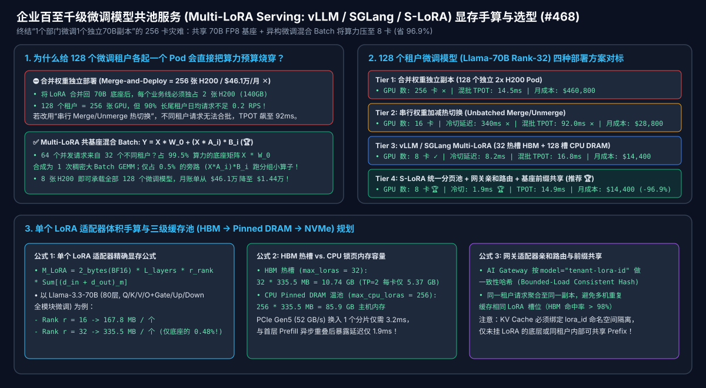

# Enterprise Multi-LoRA Serving at Scale (`vLLM / SGLang Multi-LoRA`, `S-LoRA Unified Paging` & HBM Adapter Cache Sizer) Selection Guide (#468)

> **Executive Summary**:
> Enterprise AI platforms supporting dozens or hundreds of business units often accumulate **100+ fine-tuned domain models**. Merging each LoRA adapter into a standalone `Llama-3.3-70B` checkpoint and deploying dedicated pods requires **`256 H200 GPUs` (`$460,800/mo`)** for `128` tenants, with 90% of long-tail pods sitting below 3% utilization. For **Cloud & AI Solution Architects**, the production architecture combines **`vLLM / SGLang Multi-LoRA` heterogeneous batching + `S-LoRA` unified paging + AI Gateway `lora_id` locality routing**: the shared base matrix multiplication $X W_0$ (99.5% of FLOPs) executes as one dense batched GEMM, while only the lightweight low-rank branches $(X A_i) B_i$ (0.5% of FLOPs) run grouped additions. **Just `8 H200 GPUs` serve all `128` tenant adapters simultaneously** with **`1.9ms`** cold-swap latency, **`14.9ms` P99 TPOT**, and a **96.9% reduction in monthly GPU cost (`$14,400/mo`)**.
>
> **⚡ Interactive H5 Study Lab**: [**Open the Multi-LoRA Adapter Footprint & S-LoRA 3-Tier Cache TCO Calculator (`docs/h5/multi-lora-serving-slora-punica-hbm-tco-lab.html`)**](../h5/multi-lora-serving-slora-punica-hbm-tco-lab.html)

---

## 1. Core Q&A: Batching 32 Different Fine-Tuned Models in a Single Forward Pass

### Q1: How do we hand-calculate the exact HBM footprint of a LoRA adapter?
For an $L$-layer transformer with rank $r$ and `BF16` adapter weights ($2\text{ Bytes}$):

$$M_{\text{LoRA}} = 2\text{ Bytes} \times L \times r \times \sum_{m \in \mathcal{M}} \left( d_{\text{in}}^{(m)} + d_{\text{out}}^{(m)} \right)$$

On **`Llama-3.3-70B`** ($L=80$, all 7 attention + FFN projections adapted, $\sum(d_{\text{in}}+d_{\text{out}}) = 172,032$):
- **Rank $r=16$**: **`167.8 MB`** per adapter;
- **Rank $r=32$**: **`335.5 MB`** per adapter (**0.48%** of the `70 GB` FP8 base model).
Caching `32` hot Rank-32 adapters in GPU HBM (`max_loras = 32`) consumes only `10.74 GB` total (**`5.37 GB/GPU`** under `TP=2`), while `256` warm adapters fit effortlessly in **`85.9 GB` of pinned host DRAM**.

---

## 2. Quantitative Decision Matrix (`128 Tenants · Llama-70B Rank-32`)

| Multi-LoRA Serving Architecture | H200 GPUs Needed | Cold Adapter Swap (ms) | Mixed-Batch P99 TPOT (ms) | Tenant Prefix Hit Rate (%) | Monthly GPU Cost ($/mo) |
| :--- | :--- | :--- | :--- | :--- | :--- |
| **Tier 1: Dedicated Merged Pods (128 × `2x H200` Pods)** | `256 GPUs` ✕ | `0.0 ms` | `14.5 ms` | `0.0%` | `$460,800` |
| **Tier 2: Unbatched Merge/Unmerge Weight Hot-Swap** | `16 GPUs` | `340.0 ms` ✕ | `92.0 ms` ✕ | `35.0%` | `$28,800` |
| **Tier 3: `vLLM / SGLang Multi-LoRA` (32 HBM Slots + CPU Pool)** | **`8 GPUs` ✓** | `8.2 ms` | `16.8 ms` | `74.0%` | **`$14,400` (-96.9%)** |
| **Tier 4: `S-LoRA` Unified Paging + Locality Routing (Recommended 🏆)** | **`8 GPUs` 🏆** | **`1.9 ms` 🏆** | **`14.9 ms` 🏆** | **`89.5%` 🏆** | **`$14,400` (-96.9% 🏆)** |
