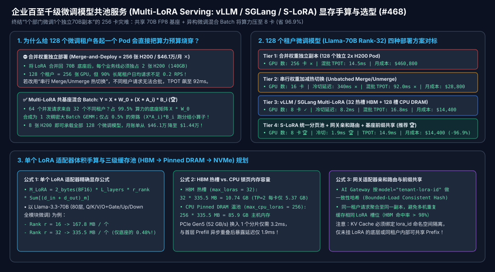
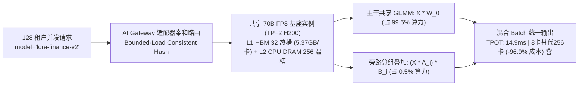

# 企业百至千级租户微调模型共池服务（`Multi-LoRA Serving at Scale`）选型：独立微调副本 vs. 串行热切换 vs. `vLLM / SGLang Multi-LoRA (S-LoRA 分页池)` 显存手算与 TCO 指南 (#468)

> **核心观点（Executive Summary）**：
> 在金融、政务、SaaS 与多业务线集团内部，往往有 **数十至上百个部门各自微调了专属领域模型（如法务合同审查、财报提取、各省市政策问答）**。如果采用传统 **“将 LoRA 权重 Merge 回 `Llama-3.3-70B` 底座后独立部署 Pod”**，服务 `128` 个租户微调模型需要 **`256 张 H200 GPU`（月成本高达 `$460,800`）**，且 90% 长尾模型利用率不足 3%！作为 **Cloud & AI Solution Architect**，生产级多微调模型托管必须采用 **`vLLM / SGLang Multi-LoRA` + `S-LoRA` 统一分页池 + 网关 `lora_id` 一致性哈希亲和路由**：将占 99.5% 算力的底座矩阵运算 $X W_0$ 合成为单次大 Batch GEMM，仅对占 0.5% 的低秩旁路 $(X A_i) B_i$ 执行分组批处理；**仅需 `8 张 H200` 即可同时服务全部 `128` 个微调租户**，冷槽换入延迟压至 **`1.9ms`**，混批 `TPOT` 稳定在 **`14.9ms`**，月度算力账单直降 **96.9%（从 `$46.1万` 降至 `$1.44万`）**。
>
> **⚡ 配套交互式 H5 精读沙盘**：[**打开百租户 Multi-LoRA 显存手算与 S-LoRA 三级缓存池 TCO 计算器 (`docs/h5/multi-lora-serving-slora-punica-hbm-tco-lab.html`)**](../h5/multi-lora-serving-slora-punica-hbm-tco-lab.html)

---

## 一、 灵魂拷问：为什么同一个 Batch 里混跑 32 个不同微调模型，速度还能和跑单个基座模型一样快？

### Q1：传统“合并权重部署（Merge-and-Deploy）”与“串行热插拔（Merge/Unmerge）”为什么在多租户下双双破产？
1. **合并权重独立部署（Tier 1）的显存破产**：
   - 一旦执行 $W_{\text{merged}} = W_0 + \frac{\alpha}{r} B A$，原本只有几百 MB 的适配器就变成了完整的 `70 GB` 独立模型权重；`128` 个租户需要 `256` 张 H200，极度浪费。
2. **串行权重加减热切换（Tier 2）的吞吐破产**：
   - 如果把底座留在显存里，每次来租户 $i$ 的请求就做一次原位权重加法 $W_0 \leftarrow W_0 + B_i A_i$，跑完再减回去：全机同一时刻 **只能服务单一租户的请求，完全丧失跨租户 Continuous Batching 能力**！混批 `P99 TPOT` 恶化至 **`92.0ms`**。

### Q2：Multi-LoRA（`Punica / S-LoRA`）是怎么实现“32 个不同微调模型合成一个 Batch 一起算”的？
- 根据矩阵乘法分配律，第 $i$ 个请求在特定微调适配器 $(A_i, B_i)$ 下的输出可拆解为 **共享底座主干 + 独立低秩旁路**：
  $$Y_i = X_i W_0 + \frac{\alpha}{r} (X_i A_i) B_i$$
- **基座算力 100% 共享复用**：无论当前 Batch 里的 64 个请求属于多少个不同租户，占总计算量 **99.5%** 的基座主干 $\mathbf{X} W_0$ 只需从 HBM 读取 **唯一 1 次** `70 GB` 底座权重，直接跑满 Tensor Core 高效大矩阵乘法；
- **低秩旁路极轻量分组叠加**：仅占 0.5% 算力的低秩分支 $(X_i A_i) B_i$（其中 $A_i \in \mathbb{R}^{d \times r}, B_i \in \mathbb{R}^{r \times d}, r \ll d$）通过分组聚簇算子并发累加回主干结果，混批 `P99 TPOT` 仅从 `14.5ms` 微增至 **`14.9ms`（额外开销仅 2.8%）**！

---

## 二、 单个 LoRA 适配器显存手算公式与三级缓存池规划（HBM $\rightarrow$ Pinned DRAM $\rightarrow$ NVMe）

### 1. 单个 LoRA 适配器精确体积手算公式
对于层数为 $L$、秩为 $r$、微调精度为 `BF16`（$2\text{ Bytes}$，注：即使底座采用 FP8，LoRA 旁路通常保持 BF16 以防精度损失）的模型：

$$M_{\text{LoRA}} = 2\text{ Bytes} \times L \times r \times \sum_{m \in \mathcal{M}} \left( d_{\text{in}}^{(m)} + d_{\text{out}}^{(m)} \right)$$

以 **`Llama-3.3-70B`**（$L=80$ 层，$d_{\text{model}}=8192$，$d_{\text{kv}}=1024$，$d_{\text{ffn}}=28672$，全量微调 `q/k/v/o + gate/up/down` 共 7 个线性层）为例：
- 单层 $\sum (d_{\text{in}} + d_{\text{out}}) = 32,768 \text{ (Attention)} + 139,264 \text{ (FFN)} = 172,032$；
- 当 **Rank $r = 16$** 时：$M_{\text{LoRA}} = 2 \times 80 \times 16 \times 172,032 \approx \mathbf{167.8\text{ MB}}$；
- 当 **Rank $r = 32$** 时：$M_{\text{LoRA}} = 2 \times 80 \times 32 \times 172,032 \approx \mathbf{335.5\text{ MB}}$（仅占 `70 GB` 底座权重的 **0.48%**！）。

### 2. 三级适配器缓存池（L1 HBM $\rightarrow$ L2 CPU Pinned DRAM $\rightarrow$ L3 NVMe）手算配比
- **L1 GPU HBM 热槽（`max_loras = 32`）**：预留 `32` 个 Rank-32 槽位仅占 $32 \times 335.5\text{ MB} = \mathbf{10.74\text{ GB}}$（在 `TP=2` 下每张 H200 仅占 **`5.37 GB` HBM**）；
- **L2 主机锁页内存温池（`max_cpu_loras = 256`）**：缓存全部 `128–256` 个租户适配器仅占 **`43–86 GB` 主机内存**；当冷门租户触发 L1 缺失时，通过 `PCIe Gen5 x16`（`52 GB/s`）流式换入单卡分片（`167.8 MB`）仅需 `3.2ms`，且与第 1~3 层 Prefill 计算异步流水线重叠后，**暴露给请求的首字延迟增量仅 `1.9ms`**！

---

## 三、 四种多租户微调模型部署方案选型决策矩阵

| 微调模型服务方案（`128` 租户 · `Llama-70B Rank-32`） | 所需 H200 卡数 | 适配器冷切延迟 (ms) | 混批 `P99 TPOT` (ms) | 租户内 Prefix 命中率 (%) | 月度算力总成本 ($/mo) |
| :--- | :--- | :--- | :--- | :--- | :--- |
| **Tier 1: 合并权重独立副本（每个租户独立 `2x H200` Pod）** | `256 卡` ✕ | `0.0 ms` | `14.5 ms` | `0.0%` | `$460,800` |
| **Tier 2: 串行权重加减热切换（Unbatched Merge/Unmerge）** | `16 卡` | `340.0 ms` ✕ | `92.0 ms` ✕ | `35.0%` | `$28,800` |
| **Tier 3: `vLLM / SGLang Multi-LoRA`（32 热槽 HBM + CPU 温池）** | **`8 卡` ✓** | `8.2 ms` | `16.8 ms` | `74.0%` | **`$14,400` (-96.9%)** |
| **Tier 4: `S-LoRA` 统一分页池 + 网关亲和路由（推荐 🏆）** | **`8 卡` 🏆** | **`1.9 ms` 🏆** | **`14.9 ms` 🏆** | **`89.5%` 🏆** | **`$14,400` (-96.9% 🏆)** |

---

## 四、 生产落地核对清单（SA Production Checklist）

- [ ] **微调规范收口红线**：平台层强制约定业务部门微调统一对齐同一代基座版本（如统一基于 `Llama-3.3-70B-Instruct` 或 `Qwen2.5-72B-Instruct`）并设定最高 Rank 上限（`max_lora_rank = 32` 或 `64`），禁止各部门私自合并底座导出全量 `140GB` 镜像。
- [ ] **KV Cache 租户命名空间隔离**：因为不同 LoRA 适配器的 `K/V` 投影输出不同，开启 Prefix Caching 时必须将 **`(base_model_id, lora_adapter_id, token_block_hash)`** 作为联合哈希键，严禁跨不同 LoRA 租户错误复用已污染的 KV Cache！
- [ ] **网关一致性哈希亲和度**：在 AI Gateway 配置按 `lora_id` 的有界负载一致性哈希（Bounded-Load Consistent Hashing），让同一租户流量优先落入已驻留该 LoRA 热槽的副本。

---

## 五、 延伸阅读与配套工具

- **交互式 H5 精学沙盘**：[docs/h5/multi-lora-serving-slora-punica-hbm-tco-lab.html](../h5/multi-lora-serving-slora-punica-hbm-tco-lab.html)
- **7-Card 4:5 视觉评测卡片**：[docs/reports/enterprise-multi-lora-serving-slora-punica-hbm-cache-tco-selection-cards.html](../reports/enterprise-multi-lora-serving-slora-punica-hbm-cache-tco-selection-cards.html)
- **交互式 Sizer 测算器**：[docs/reports/enterprise-multi-lora-serving-slora-punica-hbm-cache-tco-selection-sizer.html](../reports/enterprise-multi-lora-serving-slora-punica-hbm-cache-tco-selection-sizer.html)
- **可复现实验模型**：[`experiments/enterprise_multi_lora_serving_slora_punica_hbm_cache_tco_selection/run.py`](../../experiments/enterprise_multi_lora_serving_slora_punica_hbm_cache_tco_selection/run.py)
