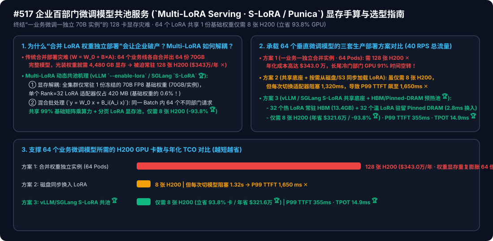

# Enterprise Multi-LoRA Serving (`64+` Fine-Tuned Adapters on 1 Shared 70B Base Pool via `vLLM / SGLang S-LoRA`) Selection Guide (#517)

> **Executive Summary**:
> Deploying **64 department-specific fine-tuned `70B` models** as separate merged-weight pods consumes **`4,480 GB` of weight memory** and requires **`128x H200 GPUs` (`$3.43M/yr` TCO with `91%` idle time ✕)**. **Multi-LoRA Shared-Base Serving (`vLLM V1 --enable-lora / SGLang S-LoRA`)** decouples the frozen base model (`70 GB`) from lightweight rank-32 LoRA adapters (`420 MB` each):
> 1. **53.7x Weight Memory Compression**: Pinning `32` hot adapters in HBM (`13.4 GB`) and `32` warm adapters in Host Pinned DDR5 RAM (`2.8 ms` PCIe Gen5 swap) allows all `64` vertical models to share **2 replicas (`8x H200 GPUs`)**;
> 2. **93.8% GPU Reduction**: Batched heterogeneous LoRA execution (`Punica / S-LoRA`) serves requests across dozens of adapters in the same continuous batch at **`14.9 ms` `P99 TPOT`**, cutting fleet size from `128` to **`8x H200 GPUs` (saving `$3,216,000 / year` 🏆)**!
>
> **⚡ Interactive H5 Study Lab**: [**Open Multi-LoRA Shared-Base Memory & GPU Sizer (`docs/h5/multi-lora-serving-slora-punica-shared-base-sizer-lab.html`)**](../h5/multi-lora-serving-slora-punica-shared-base-sizer-lab.html)

---

## 1. Quantitative Decision Matrix (`64 Fine-Tuned 70B Adapters @ 40 RPS Aggregate`)

| Multi-Model Serving Architecture | Total Weight HBM | Adapter Switch Latency | `P99 TTFT / TPOT` | Required `H200` GPUs | Annual TCO (`USD`) |
| :--- | :--- | :--- | :--- | :--- | :--- |
| **Anti-Pattern 1: Dedicated Merged Pods (`64 Pods`)** | `4,480 GB` ✕ | `0 ms` | `340 ms / 14.0 ms` | `128 GPUs` ✕ | `$3,430,000 / yr` ✕ |
| **Anti-Pattern 2: Blocking Disk/S3 Swap on Request** | `140 GB` | `1,320 ms` ✕ | `1,650 ms / 24.5 ms` ✕ | `8 GPUs` | `$214,000 / yr` |
| **Optimal: `vLLM / SGLang S-LoRA` Shared Pool 🏆** | **`140 GB` 🏆** | **`2.8 ms` 🏆** | **`355 ms / 14.9 ms` 🏆** | **`8 GPUs (-93.8%)` 🏆** | **`$214,000 (-$3.22M)` 🏆** |

---

## 2. Companion Links

- **Interactive H5 Study Lab**: [docs/h5/multi-lora-serving-slora-punica-shared-base-sizer-lab.html](../h5/multi-lora-serving-slora-punica-shared-base-sizer-lab.html)
- **7-Card 4:5 Visual Report**: [docs/reports/enterprise-multi-lora-serving-slora-punica-shared-base-sizing-selection-cards.html](../reports/enterprise-multi-lora-serving-slora-punica-shared-base-sizing-selection-cards.html)
- **HTML Sizer**: [docs/reports/enterprise-multi-lora-serving-slora-punica-shared-base-sizing-selection-sizer.html](../reports/enterprise-multi-lora-serving-slora-punica-shared-base-sizing-selection-sizer.html)
- **Reproducible Model**: [`experiments/enterprise_multi_lora_serving_slora_punica_shared_base_sizing_selection/run.py`](../../experiments/enterprise_multi_lora_serving_slora_punica_shared_base_sizing_selection/run.py)
