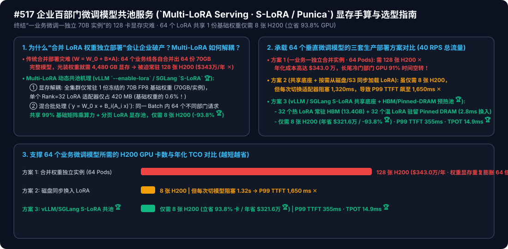

# 企业百部门微调模型共池服务（`Multi-LoRA Serving · 64+ 垂域 Adapter 共用 1 份基础权重`）选型：“一业务一独立合并实例” vs. `vLLM / SGLang (S-LoRA / Punica)` 动态分页适配器池显存手算与降本 `93.8%` 指南 (#517)

> **核心观点（Executive Summary）**：
> 当集团内 **64 个业务部门（财务、法务、HR、客服、供应链等）** 各自微调出一个专属的 `Llama-3.3-70B` 垂域模型时，最致命的反模式就是 **“将 LoRA 权重合并回基础模型（$W = W_0 + BA$），为每个部门单独拉起一个 70B 推理实例”**——这会瞬间吃掉 **`4,480 GB` 权重显存**、被迫常驻 **`128 张 H200 GPU`（年费 `$343.0 万`，且 91% 时间空转 ✕）**！本专题给出 **`Multi-LoRA` 动态共享底座共池架构（`vLLM V1 --enable-lora / SGLang S-LoRA`）** 的手算公式：
> 1. **1 份基础权重（`70 GB`）+ 64 个轻量级 LoRA 适配器（每个仅 `420 MB`）解耦共池**：全集群仅部署 `2` 个共享 `TP=4` 基础模型实例（共 **`8 张 H200`**），将 `32` 个高频热适配器常驻 HBM（仅占 **`13.4 GB` 显存**），其余 `32` 个温冷适配器常驻主机 Pinned DDR5 内存（`PCIe Gen5` 换入仅需 **`2.8 ms`**）；
> 2. **异构适配器同批并发计算（`y = W_0 x + B_i(A_i x)`）**：在同一 Continuous Batch 内，来自 64 个不同部门的请求共享 `99%` 的基础权重矩阵乘，仅在旁路执行轻量级分页 LoRA 算子（增加开销 `<1.1 ms`），将所需 H200 从 `128 张` 暴降至 **`8 张`（立省 `93.8%` GPU，每年净省 `$321.6 万` 🏆）**！
>
> **⚡ 配套交互式 H5 精读沙盘**：[**打开百部门 Multi-LoRA 共池显存手算与 GPU 降本计算器 (`docs/h5/multi-lora-serving-slora-punica-shared-base-sizer-lab.html`)**](../h5/multi-lora-serving-slora-punica-shared-base-sizer-lab.html)

---

## 一、 灵魂拷问：单个 LoRA 适配器占多大显存？100 个微调模型共池如何手算显存？

### Q1：如何手算单个 `LoRA (Rank r)` 适配器的显存体积与共池总显存？
$$\text{Bytes}_{\text{LoRA}} = 2 \times L \times n_{\text{target\_modules}} \times d_{\text{model}} \times r \times b_{\text{dtype}}$$
- 以 `Llama-3.3-70B`（$L=80, d=8192$，作用于 Q/K/V/O/Gate/Up/Down 7 个投影层，`Rank r=32`，BF16）为例：单个 LoRA 适配器参数量约 `2.1 亿（0.21B）`，显存体积仅 **`420 MB`**（若用 FP8 存储仅 **`210 MB`**，不到 70B 基础模型的 **`0.6%`**！）。
- **共池显存总账**：`1` 份 `70B FP8` 基础权重（`70 GB`）+ `32` 个 HBM 常驻热 LoRA（`32 × 0.42 GB = 13.44 GB`）= **`83.44 GB`**！对比独立合并部署的 **`64 × 70 GB = 4,480 GB`**，显存占用直接压缩了 **`53.7 倍`**！

---

## 二、 64 个垂直微调模型生产部署方案选型决策矩阵（`40 RPS 集团总流量`）

| 微调模型服务架构方案（`64 个部门级 70B LoRA`） | 权重总显存占用 | 适配器切换耗时 | `P99 TTFT / TPOT` | 所需 `H200` 卡数 | 年化总成本 (`TCO`) |
| :--- | :--- | :--- | :--- | :--- | :--- |
| **反模式 1：合并权重独立实例 (`64 Pods`)** | `4,480 GB` ✕ | `0 ms` | `340 ms / 14.0 ms` | `128 张 H200` ✕ | `$3,430,000 / 年` ✕ |
| **反模式 2：共享底座 + 每次从磁盘/S3 同步加载** | `140 GB` | `1,320 ms` ✕ | `1,650 ms / 24.5 ms` ✕ | `8 张 H200` | `$214,000 / 年` |
| **最佳方案：`vLLM / SGLang S-LoRA` HBM+DRAM 共池 🏆** | **`140 GB` 🏆** | **`2.8 ms` 🏆** | **`355 ms / 14.9 ms` 🏆** | **`8 张 H200 (-93.8%)` 🏆** | **`$214,000 (省$321.6万)` 🏆** |

---

## 三、 生产落地核对清单（SA Production Checklist）

- [ ] **全集团微调统一标准化基础底座版本与最大 `max_lora_rank`（如锁定 `Llama-3.3-70B / Qwen2.5-72B` + `r <= 64`）**：只有基于同一冻结底座的 LoRA 才能塞进同一个 `vLLM / SGLang` 共池实例做单 Batch 融合推理！
- [ ] **配置 `--max-loras`（单 Batch 最大并发适配器数）与 `--max-cpu-loras`（主机 Pinned DRAM 预热池容量）**：确保冷门部门适配器从主机内存毫秒级（`2.8ms`）热换入 HBM，严禁走远端对象存储同步拉取。

---

## 四、 延伸阅读与配套工具

- **交互式 H5 精学沙盘**：[docs/h5/multi-lora-serving-slora-punica-shared-base-sizer-lab.html](../h5/multi-lora-serving-slora-punica-shared-base-sizer-lab.html)
- **7-Card 4:5 视觉评测卡片**：[docs/reports/enterprise-multi-lora-serving-slora-punica-shared-base-sizing-selection-cards.html](../reports/enterprise-multi-lora-serving-slora-punica-shared-base-sizing-selection-cards.html)
- **交互式 Sizer 测算器**：[docs/reports/enterprise-multi-lora-serving-slora-punica-shared-base-sizing-selection-sizer.html](../reports/enterprise-multi-lora-serving-slora-punica-shared-base-sizing-selection-sizer.html)
- **可复现实验模型**：[`experiments/enterprise_multi_lora_serving_slora_punica_shared_base_sizing_selection/run.py`](../../experiments/enterprise_multi_lora_serving_slora_punica_shared_base_sizing_selection/run.py)
