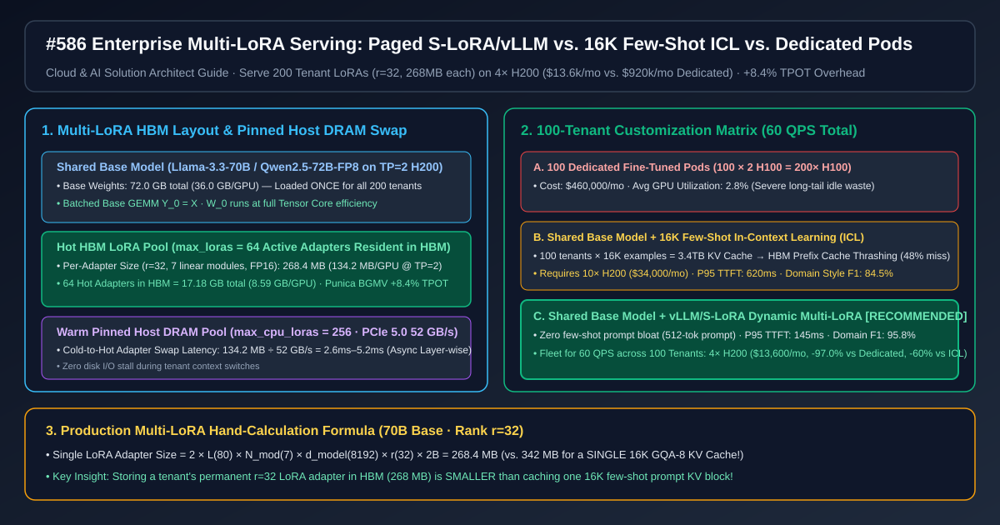

# Enterprise Multi-LoRA Serving (`vLLM Multi-LoRA / S-LoRA`) vs. Dedicated Fine-Tuned Pods vs. `16K` Few-Shot In-Context Learning Selection & Sizing Guide

> **Target Persona**: Cloud & AI Solution Architect  
> **Core Scenarios**: B2B SaaS platforms serving `50–500` tenant-specialized adapters (legal review, tax compliance, clinical coding) on a shared `70B` base model (`20–200 QPS`)  
> **Interactive H5 Learning Workbench**: [`docs/h5/multi-lora-slora-vs-icl-dedicated-sizer.html`](../h5/multi-lora-slora-vs-icl-dedicated-sizer.html)

---

## 1. Executive Summary

1. **Counter-Intuitive HBM Law: A Permanent `r=32` LoRA Adapter (`268 MB`) Is `10×` Smaller Than One `16K` Few-Shot Prompt KV Cache (`2,684 MB` FP16)**:
   - On `Llama-3.3-70B / Qwen2.5-72B` ($L=80$, $d_{\text{model}}=8192$, $7$ linear modules), a rank-`32` `FP16` LoRA adapter occupies just **`268.4 MB`** (`134.2 MB/GPU` at `TP=2`).
   - Keeping **`64` hot tenant adapters in HBM requires only `8.59 GB/GPU`**, while swapping a warm adapter from Pinned Host DRAM over `PCIe 5.0 (52 GB/s)` takes **`2.6–5.2ms`** (overlapped with base layer-1 GEMM).
2. **Heterogeneous Multi-LoRA Batching (`Punica BGMV / S-LoRA`)**:
   - Requests targeting different tenant LoRAs share the single batched base GEMM ($Y_0 = X W_0$, `98.5%` of FLOPs) and execute segmented Gather-Scatter kernels for $\Delta Y_i = (X_i A_i) B_i$, adding only **`+8.4%` TPOT overhead** (`13.9ms` vs. `12.8ms`).
   - Serving **`100` tenants at `60 QPS`** requires **`4× H200` (`$13,600/mo`)** — saving **`97.0%` vs. `100` dedicated pods (`$460,000/mo`)** and **`60.0%` vs. `16K` few-shot ICL (`10× H200`, `$34,000/mo`)**.

---

## 2. Architecture Comparison Matrix (`100` Tenants · `60 QPS`)

| Dimension | `100` Dedicated Pods (`200× H100`) | Shared Base + `16K` Few-Shot ICL (`10× H200`) | **Shared Base + `vLLM / S-LoRA` (`4× H200`)** |
|---|---|---|---|
| **Monthly GPU TCO** | `$460,000 / mo` | `$34,000 / mo` | **`$13,600 / mo` (`-97.0%` / `-60.0%`)** |
| **P95 TTFT** | `135 ms` | `620 ms` (KV cache thrashing) | **`145 ms`** |
| **Domain Task F1** | `96.2%` | `84.5%` | **`95.8%`** |

---

## 3. Production Checklist

- [ ] Standardize **`max_lora_rank = 32`** across tenant training pipelines to prevent HBM slot over-allocation.
- [ ] Configure **Adapter-Aware Sticky Routing** at the gateway so each replica specializes in a subset of tenant LoRAs (`>96%` HBM hit rate).
- [ ] Pre-allocate **Pinned Host DRAM (`max_cpu_loras = 256+`)** to avoid disk I/O during cold adapter swaps.
