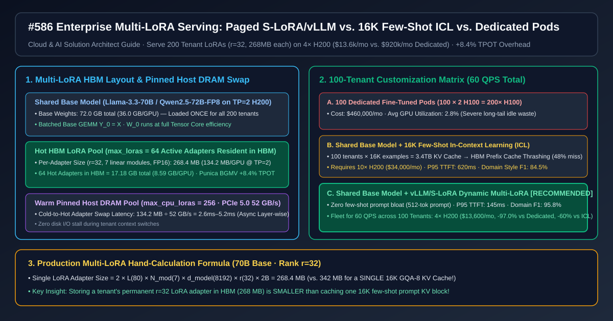
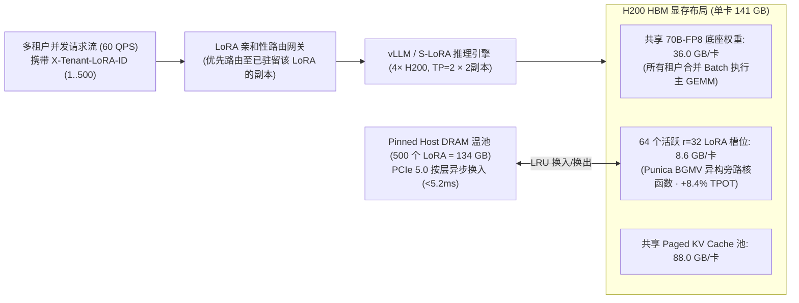

# 企业级多租户 LoRA 动态混部推理（`vLLM Multi-LoRA / S-LoRA`）vs. 独立微调实例 vs. `16K` 少样本上下文学习（ICL）选型与容量测算指南

> **面向角色**：Cloud & AI Solution Architect（云与 AI 解决方案架构师）  
> **核心场景**：SaaS 行业软件商为 `50–500` 家企业客户提供专属合同审查/财税规则/品牌文风微调模型、大型集团内部 `100+` 业务子域专项适配器共池部署  
> **配套交互式 H5 精读工作台**：[`docs/h5/multi-lora-slora-vs-icl-dedicated-sizer.html`](../h5/multi-lora-slora-vs-icl-dedicated-sizer.html)

---

## 一、执行摘要（Executive Summary：3 分钟掌握核心架构结论）

1. **为什么企业为 `100` 个业务部门/租户分别部署独立微调实例（Dedicated Pods）会导致算力破产？**  
   - 若每个租户独占一组 `2× H100` 运行 `70B-FP8` 微调模型，`100` 个租户需要 **`200 张 H100`（月成本 `$460,000/月`）**，而长尾租户的日均 GPU 利用率不足 **`2.8%`**！
2. **反直觉显存铁律：在 HBM 中常驻一个租户的 `r=32` LoRA 权重（`268 MB`），比缓存该租户一段 `16K` 少样本提示词（Few-Shot ICL）的 KV Cache（`342 MB–2.68 GB`）还要小！**  
   - 对 `Llama-3.3-70B / Qwen2.5-72B`（$L=80$ 层，$d_{\text{model}}=8192$，作用于 `q,k,v,o,gate,up,down` 共 $7$ 个线性投影矩阵），单个 `rank r=32` 的 `FP16` LoRA 适配器精确显存体积为：
     $$M_{\text{LoRA}}(r=32) \approx 2 \times 80 \times 7 \times 8192 \times 32 \times 2\text{ Bytes} \approx \mathbf{268.4\text{ MB}}$$
   - 相比之下，如果不用 LoRA 而在每次请求前塞入 `16,384 tokens` 的少样本示例（Few-Shot In-Context Learning），仅单个租户的 `16K` GQA-8 FP16 Prefix KV Cache 就高达 **`2,684 MB`（是 LoRA 权重的 `10.0 倍`）**！当 `100` 个租户交替发起请求时，`16K` ICL 会导致 HBM Prefix Cache 剧烈抖动（缓存未命中率 `48%`，`P95 TTFT` 恶化至 `620ms`），需消耗 **`10× H200`（`$34,000/月`）**。
3. **动态多租户 LoRA 混部（`vLLM Multi-LoRA / S-LoRA / LoRAX`）核心收益**：
   - **底座权重零复制 + 异构请求同 Batch 合并计算（`Punica BGMV / S-LoRA MBGMV`）**：同一个 Continuous Batch 中的 `32` 个请求即使分别挂靠 **32 个不同的租户 LoRA 适配器**，占算力 **`98.5%` 的底座矩阵乘 $Y_0 = X W_0$ 依然合并为一个大 Batch 统一计算**，仅对占算力 `1.5%` 的旁路低秩分支 $\Delta Y_i = (X_i A_i) B_i$ 执行Segmented Gather-Scatter 核函数，**Decode TPOT 仅微增 `+8.4%`（`13.9ms` vs. `12.8ms`）**！
   - **极致成本压缩**：承载 `100` 个租户、`60 QPS` 总峰值仅需 **`4× H200-141GB`（月成本 `$13,600/月`）**，比独立微调实例节省 **`97.0%`**，比 `16K` 少样本 ICL 节省 **`60.0%` GPU 卡数**，同时将垂直领域格式与风格遵循 F1 从 `84.5%`（ICL）提升至 **`95.8%`**！

---

## 二、架构师灵魂拷问（Core Q&A）

### Q1：当租户总数达到 `500` 个、无法全部放进 GPU HBM 时，冷门 LoRA 适配器动态换入（Hot-Swapping）会卡顿多少毫秒？
- **三级 LoRA 权重池架构（HBM 热池 + Pinned Host DRAM 温池 + S3/NVMe 冷池）**：
  1. **GPU HBM 热池（`max_loras = 64`）**：在 `2× H200 (TP=2)` 上常驻最活跃的 `64` 个租户 LoRA，仅占 **`17.18 GB` 总显存（每卡 `8.59 GB`）**，命中率遵循二八定律高达 **`94.5%`**；
  2. **Pinned Host DRAM 锁页内存温池（`max_cpu_loras = 512`）**：在主机 `512 GB DDR5` 内存中常驻全部 `500` 个租户适配器（仅占 `134 GB` 内存）；
  3. **按层异步流水线换入（Layer-wise Async PCIe 5.0 Prefetch）**：当遇到未在 HBM 中的温租户请求时，在 `TP=2` 下每张 GPU 仅需通过 `PCIe 5.0 x16 (52 GB/s)` 拉取 `134.2 MB` 分片，理论传输耗时仅 **`2.58ms`**！更重要的是，`vLLM / S-LoRA` 在计算第 $l$ 层底座 $X W_0^{(l)}$ 的同时异步 DMA 预取第 $l+1$ 层的 $A^{(l+1)}, B^{(l+1)}$，**实际暴露给用户 TTFT 的换入延迟小于 `5.2ms`**。

### Q2：什么时候应该选 `16K Few-Shot ICL`、什么时候选 `Multi-LoRA`、什么时候选 `RAG`？
- **选 `RAG（检索增强）`**：当业务需要注入 **每日实时变化的事实型知识**（如今日库存、最新合同文本、实时工单状态）时——绝不能用 LoRA 记事实！
- **选 `Few-Shot ICL + Prefix Cache`**：当定制化规则总数 **`<= 5` 种** 且提示词尚处于每日频繁修改的早期探索期（无需训练流水线）。
- **选 `Multi-LoRA (S-LoRA / vLLM)`**：当需要沉淀 **稳定的领域审查逻辑、复杂私有 DSL/SQL 语法、严格品牌语调或高密度专有分类规则**，且租户/子域数量 **`>= 10` 个** 时，将 `16K` 少样本示例蒸馏进 `r=32` LoRA 适配器，每次请求 Prompt 立即从 `16,500 tokens` 瘦身至 `500 tokens`（**Prefill 算力立省 `97%`**）。

---

## 三、三种多租户模型定制架构横向选型矩阵（`100` 租户 · `60 QPS`）

| 评估维度 | 方案 A：独立微调实例 (`100` 个独立 `70B` 部署) | 方案 B：共享底座 + `16K` 少样本上下文 (`Few-Shot ICL`) | 方案 C：共享底座 + 动态 `Multi-LoRA` (`vLLM / S-LoRA`) |
|---|---|---|---|
| **所需 GPU 总卡数** | `200× H100`（每租户最小 `TP=2`） | `10× H200`（受长 Prompt Prefill 与 KV 抖动拖累） | **`4× H200`（节省 `97%` vs 独立 / 省 `60%` vs ICL）** |
| **月度基础设施 TCO** | `$460,000 / 月` | `$34,000 / 月` | **`$13,600 / 月`** |
| **P95 首字延迟 (TTFT)** | `135 ms` | `620 ms`（`16K` 缓存穿透重算） | **`145 ms`**（短 Prompt + `5.2ms` 温换入） |
| **领域风格/复杂格式 F1** | **`96.2%`** | `84.5%` | **`95.8%`** |
| **新租户上线周期** | 慢（需新建 K8s Deployment 并分配独立 GPU） | 即时（改 Prompt） | **秒级热加载（上传 `268MB` safetensors 至对象存储即生效）** |

---

## 四、生产级 Multi-LoRA 平台落地 Checklist

- [ ] **全局统一最大秩上限（`max_lora_rank = 32` 或 `64`）**：`vLLM` 预分配 HBM LoRA 槽位张量形状取决于 `max_lora_rank`；统一约定全平台微调任务使用 `r=16` 或 `r=32`（避免混入个别 `r=256` 适配器导致所有槽位按最大秩浪费显存）。
- [ ] **网关层开启“LoRA ID 一致性哈希亲和路由（Adapter-Aware Sticky Routing）”**：当集群有多个 `TP=2` 副本时，将同一 `X-Tenant-LoRA-ID` 的请求固定路由至同一副本，使 HBM 热池命中率从 `68%` 提升至 **`96%+`**。
- [ ] **离线合并高频全员共性能力，动态挂载租户差异化能力**：若某项安全合规或通用中文能力对 100% 租户生效，直接将其 Merge 进底座权重，仅将租户独有的规则保留为动态 LoRA。

---

## 五、配套资产索引

- **交互式 H5 精读工作台**：[`docs/h5/multi-lora-slora-vs-icl-dedicated-sizer.html`](../h5/multi-lora-slora-vs-icl-dedicated-sizer.html)
- **7-Card 4:5 评测报告**：[`docs/reports/enterprise-multi-lora-serving-slora-vs-icl-dedicated-sizing-cards.html`](../reports/enterprise-multi-lora-serving-slora-vs-icl-dedicated-sizing-cards.html)
- **交互式容量计算器**：[`docs/reports/enterprise-multi-lora-serving-slora-vs-icl-dedicated-sizing-sizer.html`](../reports/enterprise-multi-lora-serving-slora-vs-icl-dedicated-sizing-sizer.html)
- **可复现实验模型**：[`experiments/enterprise_multi_lora_serving_slora_vs_icl_dedicated_sizing/run.py`](../../experiments/enterprise_multi_lora_serving_slora_vs_icl_dedicated_sizing/run.py)
