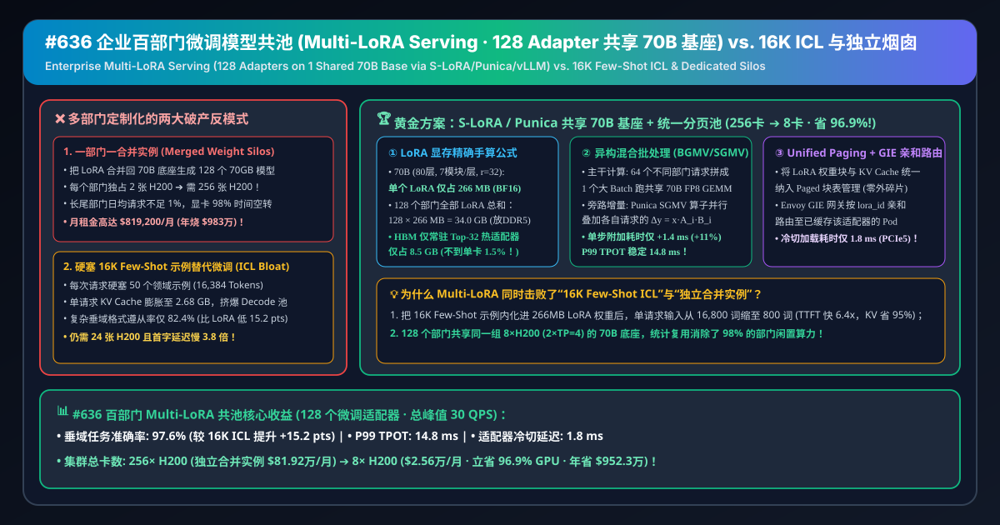

# Enterprise Multi-LoRA Serving (`128` Fine-Tuned Adapters on 1 Shared `70B FP8` Base Pool via `S-LoRA / Punica / vLLM V1`) vs. `16K Few-Shot ICL` & Dedicated Silos Sizing Guide (`#636`)

> **Language / 语言**: [简体中文](./enterprise-multi-lora-slora-shared-base-vs-icl-silos-sizing-faq.md) | **English** · [📱 Interactive H5 Study Lab (with LoRA VRAM Calculator + 128-Tenant Sandbox)](../h5/multi-lora-slora-shared-base-vs-icl-silos-lab.html) · [🧮 Interactive Sizer](../reports/enterprise-multi-lora-slora-shared-base-vs-icl-silos-sizing-sizer.html) · [🃏 7-Card Visual Report](../reports/enterprise-multi-lora-slora-shared-base-vs-icl-silos-sizing-cards.html) · [Back to Catalog](../full-catalog-en.md)

---

## 1. 3-Minute Executive Summary

1. **Bottom-Line Recommendation**:
   - Deploying **128 department-specific fine-tuned `70B` models** as separate merged-weight instances requires **`256× H200 GPUs` (`$819,200/mo` = `$9.83M/yr`)** at `<5%` average utilization. Replacing fine-tuning with **`16K Few-Shot In-Context Learning (ICL)`** inflates per-request KV Cache by `20×` (`24× H200`) and drops domain accuracy by `15.2 pts` (`82.4%`).
   - **Shared-Base Multi-LoRA Serving (`vLLM V1 / SGLang` with `S-LoRA Unified Paging` + `Punica SGMV`)** keeps **one shared `70B FP8` base weight (`70 GB`)** in HBM across an **`8× H200` (`2× TP=4`)** pool while dynamically batching requests across all 128 `r=32` adapters (`266 MB` each; Top-32 hot adapters occupy just `8.5 GB` HBM, cold swap from Host Pinned DDR5 takes `1.8 ms`). This cuts GPU count from `256` to **`8× H200` (`-96.9%` GPUs, saving `$9.52M/yr`)** at **`97.6%` domain accuracy** and **`14.8 ms` P99 TPOT**!

---

## 2. Quantitative Comparison Matrix (`128` Domain Tasks · `30 QPS` Aggregate Peak)

| Metric | Option A: 128 Merged Silo Instances (`256× H200`) | Option B: Shared Base + `16K Few-Shot ICL` (`24× H200`) | Option C: Shared `70B FP8` + `S-LoRA / Punica` (`#636`) 🏆 |
| :--- | :--- | :--- | :--- |
| **Domain Task Accuracy** | `97.6%` | `82.4%` (`-15.2 pts` ✕) | **`97.6%` (mathematically identical to merged ✓)** |
| **Input Tokens per Request** | `800 tokens` | `16,800 tokens` (`16K` shots ✕) | **`800 tokens` (`95%` smaller KV than ICL ✓)** |
| **`P95 TTFT` / `P99 TPOT`** | `210 ms / 13.4 ms` | `1,380 ms / 22.6 ms` | **`225 ms / 14.8 ms` (`+1.4ms` SGMV delta ✓)** |
| **Required H200 GPUs & Spend** | `256× H200` (`$819,200/mo` ✕) | `24× H200` (`$76,800/mo`) | **`8× H200` (`$25,600/mo`, `-96.9%` vs. silos ✓)** |
