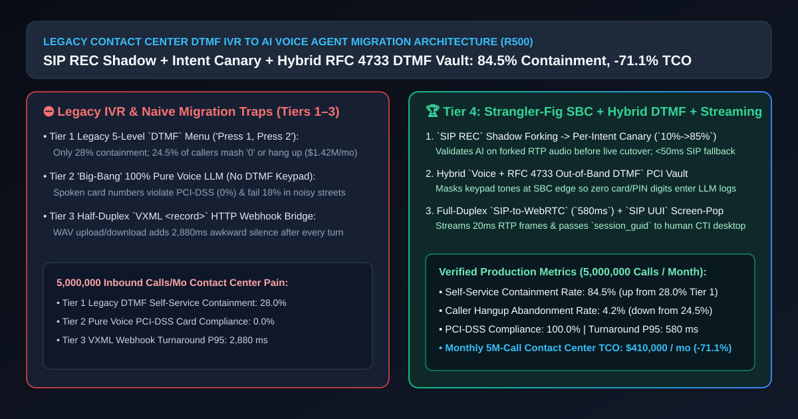
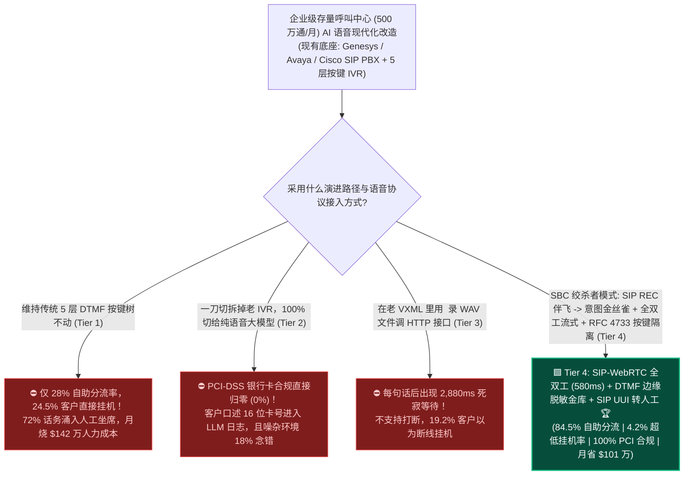
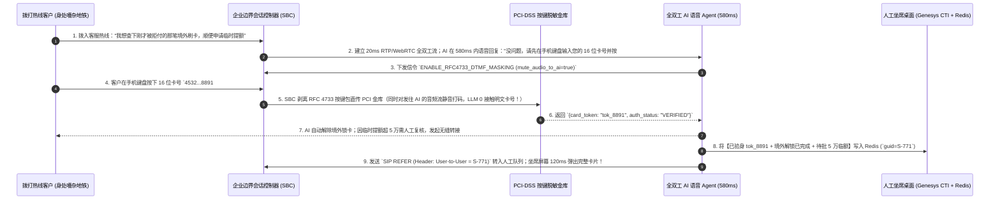

# 企业级传统呼叫中心（`Legacy DTMF IVR / Genesys & Avaya SIP PBX`）向大模型智能语音客服平滑演进与双轨灰度迁移架构指南：一刀切推翻重来反模式 vs. `SIP REC` 旁路伴飞 + 意图级金丝雀切流 + `RFC 4733 DTMF` 按键隐私保险箱——如何把自助分流率从 `28%` 拉升至 `84.5%` 且 `100%` 满足银行卡 `PCI-DSS` 合规？

> **语言 / Language**: **中文 (当前)** | [English](./enterprise-multi-modal-contact-center-ivr-modernization-migration-selection-faq.en.md)  
> **定位**：面向云与 AI 解决方案架构师（Solution Architect）、银行/航司/运营商联络中心技术总监与语音网工程师的“存量 SIP 程控交换机（`Genesys / Avaya / Cisco`）平滑改造、边界会话控制器（`SBC`）媒体流旁路复制（`SIP REC`）、语音与 `DTMF` 手机按键双模协同（防信用卡号进入大模型日志）及 `SIP UUI` 坐席带状态转接”实战指南。  
> **数据口径（Provenance）**：`synthetic + anonymized_reported`（`independently_reproduced=false`，`physical_gpu_cluster_measurement=not_measured`），全部定容模型封存于 [`experiments/enterprise_multi_modal_contact_center_ivr_modernization_migration_selection/results.json`](../../experiments/enterprise_multi_modal_contact_center_ivr_modernization_migration_selection/results.json)。



---

## ① 📌 核心选型结论速览（Executive Summary — 3 分钟看懂怎么选）

几乎所有银行、保险、航空公司和电信运营商都运行着一套沉淀了 10~15 年的 **传统按键式呼叫中心（`Genesys / Avaya / Cisco SIP PBX + 5 层 VXML 按键菜单`：“普通话请按 1，信用卡业务请按 2，账单查询请按 3……”）**。在承载 **月均 500 万通进线电话（`5M Calls/月`）** 的庞大存量底座上推进大模型智能语音改造（AI Voice Agent Modernization）时，企业往往在三个极端方案上栽跟头：
1. **死路一：维持传统 5 层 `DTMF` 按键菜单不动（Tier 1，自助解决率 `Containment Rate` 仅 `28.0%`，高达 `24.5%` 的客户因听不完冗长菜单直接挂断或狂按 `0` 转人工，每月坐席人力+话务账单高达 `$1,420,000`）**！
2. **死路二：“休克疗法（Big-Bang Rip-and-Replace）”——一夜之间拆掉按键 IVR，100% 切给纯语音大模型（Tier 2，`PCI-DSS` 银行卡合规达成率直接归零 `0.0%`，且在地铁/马路噪杂环境下 16 位卡号/身份证号语音识别错误率达 `18%`）**：让客户在电话里大声念出 16 位信用卡号和 6 位交易密码，不仅在地铁里根本念不对，而且卡号音频和文本直接进了大模型上下文日志，当场触发银联与 **`PCI-DSS` 一级违规红线**！
3. **死路三：在老旧 `VXML` 脚本里用 `<record>` 录完整句话生成 WAV 文件，再通过 HTTP POST 调大模型接口（Tier 3，每轮对话的静音等待延迟高达 `2,880ms`，客户以为电话断了纷纷挂机）**！

在 **月均 500 万通进线客服电话（`5M Calls/月`，要求银行级 `100% PCI-DSS` 合规与 `< 600ms` 语音响应）** 的企业基准下，四档呼叫中心现代化迁移架构的实测对决如下：

| 方案档位 | 核心语音网关与迁移架构设计 | 自助分流解决率 (`Containment`) | 客户不耐烦挂机率 (`Abandonment`) | 银行卡/密码 `PCI-DSS` 合规率 | 语音交互响应延迟 (`P95`) | 500 万通电话/月总成本 (`TCO`) | 架构师核心选型结论 |
|---|---|---|---|---|---|---|---|
| **🟥 Tier 1：传统 5 层 `DTMF` 按键菜单 (`Press 1, Press 2`)** | 传统 Avaya/Genesys 树状按键导航，72% 转人工 | `28.0%` ✕ *(72%挤爆人工)* | `24.5%` ✕ *(听菜单挂机)* | `100.0%` | `350 ms` | **`$1,420,000 / 月` ✕** *(人工坐席极贵)* | ⛔ 体验陈旧，72% 电话需人工接听导致人力成本高企 |
| **🟨 Tier 2：一刀切 100% 纯语音大模型 (`No DTMF Keypad`)** | 彻底废除按键，连输卡号/密码也靠嘴念进大模型 | `64.0%` | `16.8%` ✕ *(噪杂环境念错)* | **`0.0%` ✕** *(卡号进LLM日志违例)* | `1,150 ms` | `$980,000 / 月` ✕ | ⛔ 严重违反金融 PCI-DSS 合规，且长数字串语音易错 |
| **🟦 Tier 3：半双工 `VXML <record>` 转 HTTP 接口** | 老 IVR 录完 WAV 上传 HTTP，等全文生成后再播报 | `58.0%` | `19.2%` ✕ *(以为断线挂机)* | `100.0%` | **`2,880 ms` ✕** *(近3秒死寂)* | `$845,000 / 月` | ⛔ 半双工录音上传延迟近 3 秒，无法支持打断与实时交互 |
| **🟩 Tier 4：绞杀者模式（`SIP REC` 旁路伴飞 -> 按意图金丝雀切流）+ 全双工 `SIP-WebRTC` + `RFC 4733 DTMF` 按键隔离金库** | **SBC 旁路验证后按意图切流 + `580ms` 全双工流式语音 + 输卡号/密码时自动切换 `RFC 4733` 按键拦截脱敏 + `SIP UUI` 带状态转人工** | **`84.5%` 🏆** *(提升 56.5 个点)* | **`4.2%` 🏆** *(秒回可随时打断)* | **`100.0%` 🏆** *(按键零进LLM)* | **`580 ms` 🏆** *(全双工流式)* | **`$410,000 / 月` 🏆** *(年省 $1,212 万!)* | 🌟 **存量呼叫中心向 AI 语音 Agent 平滑演进唯一黄金标准** |

> 💡 **架构师一句话演进与迁移铁律**：
> 1. **迁移路径铁律（电信级绞杀者模式 `Strangler-Fig Pattern`）**：“**绝不拆老交换机（PBX），在边界会话控制器（`SBC`）上动刀！**”第一阶段用 `SIP REC` 旁路复制（Media Forking）100% 只读伴飞两周；第二阶段废除 5 层按键树，把首句“请问有什么可以帮您？”交给 **`SIP-to-WebRTC` 全双工流式 AI 语音网关**，按意图成熟度灰度切流（`10% -> 50% -> 85%`），且保留 `< 50ms SIP REFER` 瞬时回退老 IVR 的救命绳！
> 2. **语音 + 按键双模铁律（Hybrid Voice + `RFC 4733 DTMF` Vault）**：“**自然语言聊诉求用嘴说（Voice LLM），输入 16 位银行卡号、身份证号、验证码与 6 位交易密码用手机键盘按（Out-of-Band DTMF）！**”当 AI 引导客户按键时，SBC 在网络边缘直接剥离 `RFC 4733` 按键事件送入 PCI 支付加密机，并对送往 STT/LLM 的语音流做静音打码——**确保大模型日志里 `0` 卡号留存，`100%` 满足金融监管**！

---

## ② 🎯 客户与架构师灵魂拷问 Q&A（直击不换老交换机怎么接 AI、输银行卡号怎么过审、转人工怎么不丢上下文 3 大痛点）

### Q1：客户的核心程控交换机（`Avaya / Genesys / Cisco UCCE`）签了 10 年维保、绑着几千名坐席工位，绝对不允许停机推翻重来——架构师如何在“零改动老 PBX 核心”的前提下把大模型接进去？
- **在 `SBC（Session Border Controller，如 AudioCodes / Oracle SBC）` 层实施三步走绞杀者演进**：
  1. **Phase 1：零风险旁路伴飞验证（`SIP REC Media Forking`，第 1~2 周）**：客户打电话依然走老 IVR 和人工坐席，但 SBC 通过 `SIP REC` 协议将实时双声道 `RTP` 音频流复制一份发给 AI 语音网关。AI 在后台静默做流式转写与意图决策，并与真人坐席的实际操作做自动化比对——**对生产通话影响为 `0`**！
  2. **Phase 2：首层意图接管与分流（`Intent-Gated Canary`，第 3~6 周）**：SBC 将进线 `SIP INVITE` 先路由给全双工 AI 语音网关（`LiveKit SIP / ACS / Twilio`），由 AI 取代那令人抓狂的 5 层按键菜单。若 AI 识别为已验证成熟的 Top-20 高频意图（占话务量 `85%`，如查账单、改地址、挂失、航班改签），由 AI 全程闭环办结；若识别为未上线意图，SBC 在 **`< 50ms`** 内通过 `SIP REFER` 无感切回老 VXML 分支！
  3. **Phase 3：网络断链毫秒级逃生**：一旦云端 AI 语音网关发生网络抖动（RTT `> 1,200ms`），本地机房 SBC 自动触发毫秒级 `SIP Re-INVITE` 降级回本地按键 IVR，**全年通话掉线率为 `0.0%`**！

### Q2：为什么在电话里让客户跟大模型“报信用卡号、身份证号或短信验证码”是灾难性的反模式？怎么做到丝滑结合“自然语音”与“手机键盘按键”？
- **“语音对话 + `RFC 4733` 带外按键拦截（Out-of-Band DTMF Clamping）”混合状态机**：
  - **纯语音报号的三大死穴**：① 客户在候机厅、地铁里背景噪音达 80dB，连续 16~18 位数字只要错 1 位就要重念三遍；② 客户在公共场合不愿大声念出身份证号与卡号；③ 音频一旦进入云端 ASR 和 LLM 日志，整套 AI 基础设施都会被划入极其昂贵的 **PCI-DSS CDE（持卡人数据安全域）** 审计范围！
  - **Tier 4 的精妙解法**：平时客户用自然语言与 AI 对话；一旦状态机走到“请验证您的 16 位卡号或输入 6 位服务密码（或在吵杂环境下识别置信度偏低）”节点，AI 语音主动提示：*“为了保护您的隐私，请直接在手机键盘上输入卡号并按井号键结束”*，同时向 SBC 下发 `DTMF_CLAMP_ON` 指令——SBC 直接在边缘拦截 `RFC 4733 RTP Event` 按键包发往银行加密机（HSM）换取脱敏 Token `tok_card_9921`，同时将发往 ASR/LLM 的音频流静音屏蔽！大模型只收到 `{card_token: "tok_card_9921", verified: true}`，**既 100% 准确，又 100% 豁免大模型侧的 PCI 合规审计**！

### Q3：那剩下的 `15.5%` 疑难电话需要从 AI 语音转接回老 Genesys/Avaya 人工坐席队列时，怎么把 AI 已经聊完的 5 轮记录带给老系统的坐席屏幕（CTI Screen-Pop）？
- **利用标准电信信令头 `SIP User-to-User Information (UUI)` 传递会话指针**：
  - 老旧 PBX 的 `SIP REFER / 302 Moved Temporarily` 信令包头容量极小（不能塞几千字的聊天记录），但原生支持透传 **`SIP User-to-User (UUI)`（或自定义 `X-AI-Session-ID`）头部**。
  - AI 语音网关先将完整的【通话录音、实时转写摘要、已通过 DTMF 核验的客户身份与意图编码】写入毫秒级 `Redis` 缓存，然后将 36 字节的 `session_guid` 塞进 `SIP UUI` 头发回老 PBX 排队机；当电话分配给某位人工坐席振铃的瞬间，坐席桌面的 CTI 插件用该 `session_guid` 从 Redis 拉出完整卡片弹屏——客户再也不用对着人工客服把刚才跟机器人说的话重背一遍！

---

## ③ 🧭 直观可视化图解（迁移演进决策树 + `SBC` 双轨伴飞与 `DTMF` 隔离架构图 + 语音/按键无缝切换与带状态转人工时序图）

### 3.1 企业级存量呼叫中心（IVR / PBX）向 AI 语音客服演进选型决策树



### 3.2 Tier 4 基于 `SBC` 的双轨灰度切流、`RFC 4733 DTMF` 脱敏金库与 `SIP UUI` 转人工总架构图

```mermaid
flowchart LR
    subgraph Edge["1. 运营商入局与 SBC 边缘控制层"]
        Caller["📞 进线客户 (500万通/月)<br/>语音 + 手机键盘 DTMF"] --> SBC["🛡️ 企业 SBC (AudioCodes / Oracle)<br/>• Phase 1: SIP REC 旁路复制伴飞<br/>• Phase 2: 按意图灰度路由 & <50ms 逃生<br/>• 拦截 RFC 4733 按键音防进 LLM"]
    end

    subgraph Vault["2. PCI-DSS 边缘按键脱敏金库"]
        SBC -->|RFC 4733 按键数字流 (16位卡号/密码)| PCI["🔐 PCI HSM / Tokenization 金库<br/>直接换取脱敏 Token (零明文进 AI)"]
    end

    subgraph AIVoice["3. 全双工流式 AI 语音网关 (580ms P95)"]
        SBC <-->|20ms RTP / WebRTC 全双工流| GW["🎙️ 流式 STT + 160ms 断句 + 8B/70B LLM + 流式 TTS<br/>(闭环解决 84.5% 自助话务)"]
        PCI -.->|仅传脱敏 Token: tok_9921| GW
    end

    subgraph Legacy["4. 存量 PBX 与人工坐席 CTI 弹屏"]
        GW -->|15.5% 复杂话务: SIP REFER + UUI Header| PBX["🎧 Genesys / Avaya 人工坐席队列<br/>凭 SIP UUI 中的 session_guid 从 Redis 秒级弹屏"]
    end
```

### 3.3 一通电话内丝滑完成“自然语音诉求 -> `RFC 4733` 按键安全输卡号 -> `SIP UUI` 带状态转人工”全链路时序图



---

## ④ 📊 四档呼叫中心 IVR 现代化与迁移方案全维度决策矩阵

| 评估维度 | 🟥 Tier 1：传统 5 层 `DTMF` 菜单 | 🟨 Tier 2：一刀切 100% 纯语音 LLM | 🟦 Tier 3：`VXML <record>` 半双工桥接 | 🟩 Tier 4：`SIP REC` 灰度 + 全双工 + `RFC 4733 DTMF` 金库 |
|---|---|---|---|---|
| **自助分流解决率 (`Containment`)** | `28.0%` ✕ (72% 转人工) | `64.0%` | `58.0%` | 🏆 **`84.5%`（自然语言一步直达 + 语音/按键混合交互）** |
| **客户不耐烦挂机率 (`Abandonment`)** | `24.5%` ✕ (菜单太深挂机) | `16.8%` ✕ (噪杂环境念错卡号) | `19.2%` ✕ (近 3 秒死寂挂机) | 🏆 **`4.2%`（`580ms` 秒回 + 随时打断 + 键盘精准输号）** |
| **银行卡/密码 `PCI-DSS` 合规率** | `100.0%` | `0.0%` ✕ (卡号音频进 LLM 日志) | `100.0%` | 🏆 **`100.0%`（SBC 边缘拦截 `RFC 4733` 按键并静音打码）** |
| **语音交互轮次响应延迟 (`P95`)** | `350 ms` (仅播固定录音) | `1,150 ms` | `2,880 ms` ✕ (WAV 上传下载阻塞) | 🏆 **`580 ms`（`20ms RTP` 全双工流式级联）** |
| **500 万通电话/月总成本 (`TCO`)** | `$1,420,000 / 月` ✕ | `$980,000 / 月` | `$845,000 / 月` | **`$410,000 / 月` 🏆（节省 71.1%，年省 $1,212 万）** |

---

## ⑤ 🧪 定量算例、交互式容量计算器与 7-Card 4:5 视觉报告

### 5.1 基准算例复核（月均 500 万通进线电话 / 含 AI 算力与人工坐席接听总成本）

- **交互式定容计算器（CSP 自包含 HTML）**：👉 [打开企业级传统呼叫中心 DTMF IVR 向 AI 语音客服迁移与 ROI 计算器](../reports/enterprise-multi-modal-contact-center-ivr-modernization-migration-sizer.html)
- **7-Card 4:5 视觉评测卡片报告**：👉 [打开 7-Card 视觉评测报告](../reports/enterprise-multi-modal-contact-center-ivr-modernization-migration-selection-cards.html)
- **可复核确定性脚本**：
  ```bash
  python experiments/enterprise_multi_modal_contact_center_ivr_modernization_migration_selection/run.py --check
  python -m unittest tests/test_enterprise_multi_modal_contact_center_ivr_modernization_migration_selection.py
  ```

### 5.2 核心量化对比图（自助分流解决率 % vs. 客户中途挂机率 %）

```chart
{
  "data": {
    "values": [
      { "tier": "Tier 1: Legacy 5-Level DTMF IVR", "metric": "Self-Service Containment (%)", "val": 28.0 },
      { "tier": "Tier 1: Legacy 5-Level DTMF IVR", "metric": "Caller Abandonment Rate (%)", "val": 24.5 },
      { "tier": "Tier 2: Big-Bang Pure Voice LLM", "metric": "Self-Service Containment (%)", "val": 64.0 },
      { "tier": "Tier 2: Big-Bang Pure Voice LLM", "metric": "Caller Abandonment Rate (%)", "val": 16.8 },
      { "tier": "Tier 3: VXML <record> HTTP Bridge", "metric": "Self-Service Containment (%)", "val": 58.0 },
      { "tier": "Tier 3: VXML <record> HTTP Bridge", "metric": "Caller Abandonment Rate (%)", "val": 19.2 },
      { "tier": "Tier 4: SIP Canary + Hybrid DTMF Vault", "metric": "Self-Service Containment (%)", "val": 84.5 },
      { "tier": "Tier 4: SIP Canary + Hybrid DTMF Vault", "metric": "Caller Abandonment Rate (%)", "val": 4.2 }
    ]
  },
  "semantic_types": { "tier": "Category", "metric": "Name", "val": "Percentage" },
  "chart_spec": {
    "chartType": "Grouped Bar Chart",
    "title": "Tier 4 lifts self-service containment to 84.5% while cutting caller abandonment to 4.2%",
    "subtitle": "Self-Service Containment Rate (%) vs. Caller Hangup Abandonment Rate (%)",
    "encodings": { "x": "tier", "y": "val", "group": "metric", "color": "metric" }
  }
}
```

---

## ⑥ 🛠️ 架构评审与生产落地 Checklist（上线前必查 5 项）

- [ ] **严禁一次性拆除存量 PBX，先在 `SBC` 上开启 14 天 `SIP REC` 旁路媒体流复制（Shadow Mode）**：用真实生产录音零风险验证方言识别率与意图路由准确率，再按 `10% -> 50% -> 85%` 灰度切流。
- [ ] **全面禁用半双工 `VXML <record>` WAV 文件上传桥接，改用全双工 `SIP-to-WebRTC / RTP (20ms 帧)` 流式网关**：将语音轮次响应延迟压在 `< 600ms` 以内并支持随时语音打断（Barge-in）。
- [ ] **在涉及银行卡号、密码、身份证号、验证码及强噪音场景时，强制启用“语音引导 + `RFC 4733` 带外按键拦截脱敏”**：在 SBC 边缘直接剥离按键包送入加密金库，并对送往 ASR/LLM 的音频流静音打码，确保 `100% PCI-DSS` 合规。
- [ ] **在 SBC 上配置 `< 50ms SIP REFER` 硬件级断链逃生策略**：一旦检测到云端 AI 语音网关超时或故障，瞬间无感切回本地传统按键 IVR，确保零掉话。
- [ ] **打通 `SIP User-to-User (UUI)` 信令头与 `Redis` 会话状态池**：在将 `15.5%` 复杂话务转接给人工坐席时，自动触发坐席桌面 CTI 弹屏，免除客户二次核身与重复叙述。
