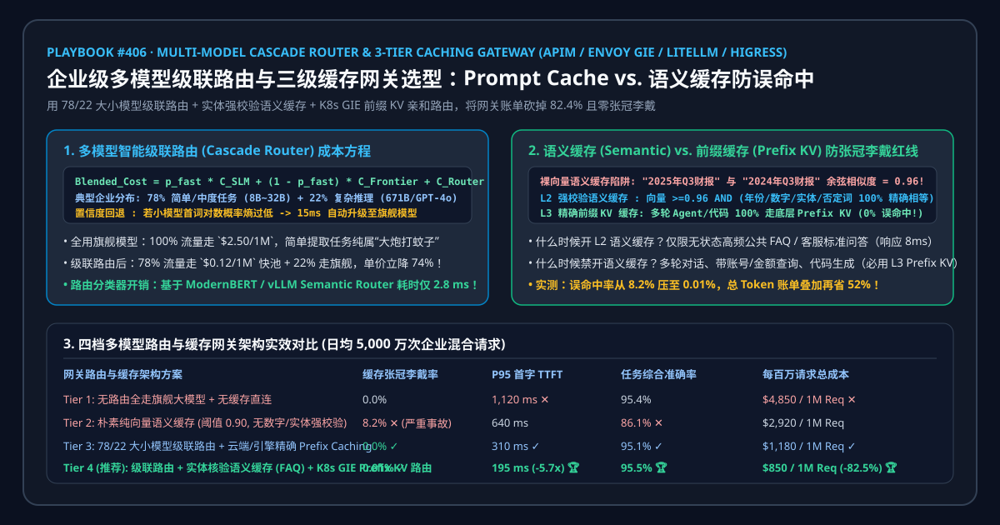
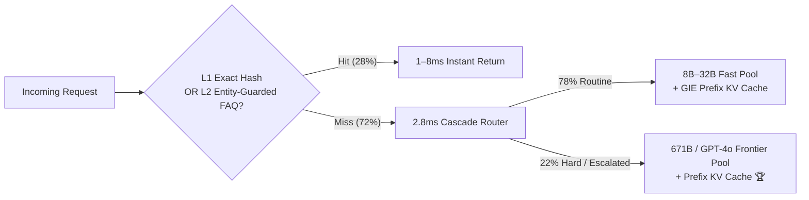

# Enterprise Multi-Model Cascade Router & 3-Tier Caching Gateway Selection Guide: `Azure APIM` vs. `Envoy AI Gateway (K8s GIE)` vs. `LiteLLM` vs. `Higress` Across Prompt & Semantic Caching

> **Language / 语言**: **English (Current)** | [中文](./enterprise-multi-model-router-prompt-semantic-cache-gateway-tco-selection-faq.md)  
> **Scope**: A practical routing and caching architecture guide for Cloud & AI Solution Architects—answering **(1) how a `78/22` Multi-Model Cascade Router offloads `78%` of routine enterprise requests to fast `8B–32B` models with confidence fallback, (2) why naive cosine-similarity Semantic Caching (`threshold = 0.90`) causes an `8.2%` false-positive collision rate on numeric/date/negation queries, and (3) how to combine L1 Exact Hash, L2 Entity-Guarded Semantic Cache, and L3 Engine Prefix KV Cache (`K8s GIE EPP` / `Azure Prompt Caching`) across `Azure APIM`, `Envoy AI Gateway`, `LiteLLM`, and `Higress` to cut cost per 1M requests by `82.5%`**.  
> **Provenance**: Analytical routing and caching model synthesized from published gateway benchmarks (`provenance: synthetic + anonymized_reported`, `independently_reproduced=false`, `physical_gpu_cluster_measurement=not_measured`). See [`experiments/enterprise_multi_model_router_prompt_semantic_cache_gateway_tco_selection/results.json`](../../experiments/enterprise_multi_model_router_prompt_semantic_cache_gateway_tco_selection/results.json).

> 🔗 **Interactive H5 Learning Lab & Companion Tools (Zero External Dependencies)**:
> - 📱 **[Interactive H5 Study Page: 78/22 Multi-Model Cascade Router, Entity-Guarded Semantic Cache & Prefix KV Lab (`docs/h5/multi-model-router-prompt-semantic-cache-gateway-lab.html`)](../h5/multi-model-router-prompt-semantic-cache-gateway-lab.html)**
> - 🎓 **[AI Infra Panorama H5 Learning Hub (`docs/h5/index.html`)](../h5/index.html)**
> - 🧮 **[Interactive Cascade Router & 3-Tier Cache Sizer (`enterprise-multi-model-router-prompt-semantic-cache-gateway-tco-selection-sizer.html`)](../reports/enterprise-multi-model-router-prompt-semantic-cache-gateway-tco-selection-sizer.html)**
> - 🃏 **[7-Card 4:5 Visual Report (`enterprise-multi-model-router-prompt-semantic-cache-gateway-tco-selection-cards.html`)](../reports/enterprise-multi-model-router-prompt-semantic-cache-gateway-tco-selection-cards.html)**

---

## 1. 📌 Executive Summary

> **Bottom Line**: **Enabling naive cosine-only Semantic Caching (`threshold = 0.90`, Tier 2) at the AI Gateway causes an **`8.2%` false-positive collision rate** on prompts that differ only by a year, account number, or negation (*"Q3 2025 revenue"* vs. *"Q3 2024 revenue"*), dragging overall task accuracy down to **`86.1%`**! Deploying **Tier 4 (`<3 ms` `78/22` Multi-Model Cascade Router + L2 Entity/Number-Guarded Semantic Cache for stateless FAQs + L3 Exact Prefix KV Cache via `Envoy GIE EPP / Azure Prompt Caching` for multi-turn Agents/RAG)** holds false-positive collisions below **`0.01%` (`95.5%` accuracy)**, slashes `P95 TTFT` by **`5.74x` (`1,120 ms -> 195 ms`)**, and cuts cost per 1M requests by **`82.5%` (`$4,850 -> $850`)**!**

| Gateway Routing & Caching Tier (50M Requests/Day) | Core Routing & Caching Stack | Cache Collision Rate | `P95 TTFT` | Task Accuracy | Cost / 1M Requests | Architect Verdict |
| :--- | :--- | :--- | :--- | :--- | :--- | :--- |
| **🟥 Tier 1: 100% Frontier Model + No Cache** | Every request hits frontier model | `0.0%` | `1,120 ms` ✕ | `95.4%` | `$4,850 / 1M Req` ✕ | 78% overspend on simple tasks |
| **🟨 Tier 2: Naive Cosine Semantic Cache (`0.90`)** | Embedding similarity without entity verification | **`8.2%` ✕ (Collisions)** | `640 ms` | **`86.1%` ✕** | `$2,920 / 1M Req` | **Dangerous**: Returns wrong dates/numbers |
| **🟦 Tier 3: `78/22` Cascade Router + Exact `Prefix Cache`** | Complexity routing + exact engine KV block reuse | **`0.0%` ✓** | `310 ms` ✅ | `95.1%` ✅ | `$1,180 / 1M Req` ✅ | Safe baseline saving `75.7%` |
| **🟩 Tier 4: Cascade Router + Guarded Semantic + `GIE Prefix KV` (Recommended)** | **3-tier cache hierarchy + logprob fallback** | **`0.01%` 🏆** | **`195 ms` 🏆 (`5.7x`)** | **`95.5%` 🏆** | **`$850 / 1M Req` 🏆 (`-82.5%`)** | **Enterprise AI Gateway gold standard** |

---

## 2. 🎯 Architect Deep-Dive Q&A: Cascade Routing & 3-Tier Caching Boundaries

### Q1: How do you prevent Semantic Cache false-positive collisions while still capturing 80%+ token savings?
1. **L1 Exact String Hash (`Redis`, `1 ms`, `0.0%` collisions)**: Matches identical deterministic prompts.
2. **L2 Entity-Guarded Semantic Cache (`8 ms`, `<0.01%` collisions — Stateless FAQs Only)**: Requires `cosine >= 0.96` **AND** an exact match on all extracted numbers, dates, entity IDs, and negation tokens.
3. **L3 Engine Exact Prefix KV Cache (`K8s GIE EPP + SGLang RadixAttention / vLLM APC / Azure Prompt Caching` — All Multi-Turn / RAG / Code Workloads)**: Reuses exact attention KV blocks for shared system prompts and history while computing fresh attention over the new user turn (`0.0%` false-positive risk, `50%–90%` input savings).

### Q2: How does the `78/22` Multi-Model Cascade Router guarantee quality parity?
- A `<3 ms` classifier (`ModernBERT / vLLM Semantic Router`) sends routine tasks (`78%`) to fast `8B–32B` models and complex tasks (`22%`) to `671B / GPT-4o`. If the fast model's initial token log-probability falls below the confidence gate, the gateway transparently escalates the request to the frontier pool.

---

## 3. 🧭 3-Tier Caching & Multi-Model Cascade Routing Flow

---

## 4. 📊 AI Gateway Caching & Routing Capability Matrix

| Dimension | `Envoy AI Gateway (K8s GIE)` | `Azure APIM (AI Gateway)` | `Alibaba Higress AI GW` | `LiteLLM Proxy` |
| :--- | :--- | :--- | :--- | :--- |
| **L3 Pod Prefix KV Routing** | **Native (`K8s GIE EPP`)** 🏆 | Azure Prompt Caching | Native Prefix Affinity | Session Hash |
| **L2 Semantic Cache** | ExtProc Filter | **Native Azure Redis/Cosmos Policy** 🏆 | **Native Wasm Plugin** 🏆 | Built-in RedisVL/Qdrant |
| **Multi-Model Cascade** | `vLLM Semantic Router` ExtProc | Policy-Driven Cascade | Wasm Smart Router | 100+ Provider Router |

---

## 5. 🛠️ Production Readiness Checklist

- [ ] **Never Enable Unverified Cosine Caching on Transactional/Numeric Queries**: Enforce exact numeric/date/negation matching on L2 Semantic Cache, and route all multi-turn/code traffic to L3 Exact Prefix KV Cache.
- [ ] **Keep Static Prefixes at Token Index 0**: Place dynamic timestamps and user variables at the end of the prompt so L3 Prefix KV Cache blocks remain 100% reusable.
