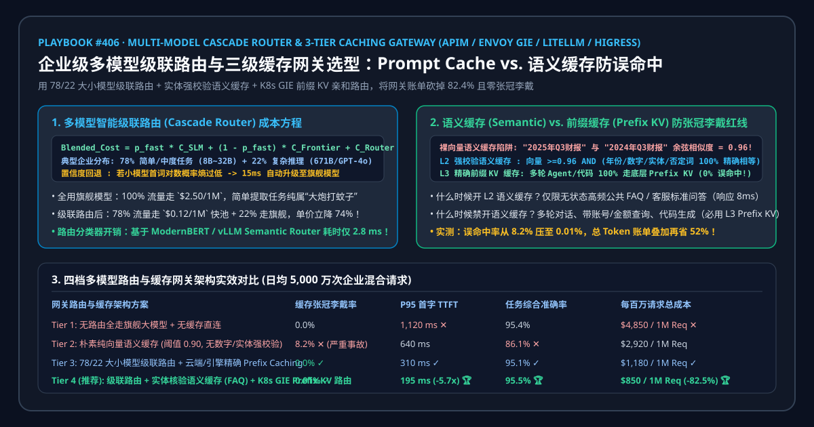
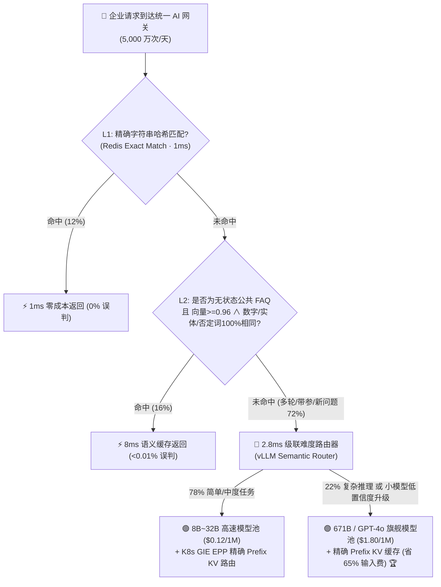

# 企业级多模型智能级联路由（Model Cascade Router）与三级缓存网关架构选型：`Azure APIM` vs. `Envoy AI Gateway (K8s GIE)` vs. `LiteLLM` vs. `Higress` 的 Prompt Caching / 语义缓存边界与 TCO 指南

> **语言 / Language**: **中文 (当前)** | [English](./enterprise-multi-model-router-prompt-semantic-cache-gateway-tco-selection-faq.en.md)  
> **文档定位**：面向 Cloud & AI Solution Architect 的统一 AI 网关路由与缓存设计指南——重点解决两大高频落地难题：**① 怎么设计 `78/22` 大小模型智能级联路由（Cascade Router），把 78% 的简单分类/提取/常规问答透明分流给低成本 `8B~32B` 快模型，仅在复杂推理或低置信度时升级至 `DeepSeek-671B / GPT-4o`？② 网关层的“向量语义缓存（Semantic Cache）”和推理层的“精确前缀缓存（Prompt / Prefix KV Cache）”到底怎么配合才不会发生“把 2024 年财报数据张冠李戴返回给 2025 年查询”的生产事故？**  
> **标定声明**：本文所引用的语义缓存误命中率、P95 首字延迟（TTFT）、任务准确率与每百万次请求总成本基于公开网关架构基准构建的合成定量模型（`provenance: synthetic + anonymized_reported`, `independently_reproduced=false`, `physical_gpu_cluster_measurement=not_measured`），详见 [`experiments/enterprise_multi_model_router_prompt_semantic_cache_gateway_tco_selection/results.json`](../../experiments/enterprise_multi_model_router_prompt_semantic_cache_gateway_tco_selection/results.json)。

> 🔗 **关联交互式 H5 精读页与工具（点击即开，零外部依赖）**：
> - 📱 **[交互式 H5 精读页：78/22 多模型级联路由、语义缓存防误命中与四大网关选型沙盘 (`docs/h5/multi-model-router-prompt-semantic-cache-gateway-lab.html`)](../h5/multi-model-router-prompt-semantic-cache-gateway-lab.html)**
> - 🎓 **[AI Infra 全景可视化精学馆首页 (`docs/h5/index.html`)](../h5/index.html)**
> - 🧮 **[交互式多模型路由与三级缓存 TCO 计算器 (`enterprise-multi-model-router-prompt-semantic-cache-gateway-tco-selection-sizer.html`)](../reports/enterprise-multi-model-router-prompt-semantic-cache-gateway-tco-selection-sizer.html)**
> - 🃏 **[7-Card 4:5 视觉评测报告 (`enterprise-multi-model-router-prompt-semantic-cache-gateway-tco-selection-cards.html`)](../reports/enterprise-multi-model-router-prompt-semantic-cache-gateway-tco-selection-cards.html)**

---

## 1. 📌 核心选型结论速览（Executive Summary）

> **一句话结论**：**在企业 AI 网关上直接开启“朴素纯向量余弦相似度语义缓存（Tier 2，如阈值 `0.90`）”是头号生产地雷——面对仅相差一个年份、金额或否定词的业务提问，会产生高达 **`8.2%` 的张冠李戴误命中事故**，把综合准确率从 `95.4%` 拉低至 **`86.1%`**！通过落地 **Tier 4（`<3ms` 大小模型级联路由 [`78% 走 8B~32B 快池 / 22% 走 671B/GPT-4o 旗舰池`] + 仅对无状态公共 FAQ 启用“数字/日期/实体/否定词 100% 强校验”的 L2 语义缓存 + 对多轮 Agent/RAG 强制走 `Envoy GIE EPP / Azure Prompt Caching` L3 精确前缀 KV 缓存）**，在将误命中率锁死在 **`0.01%` 以下（综合准确率 `95.5%`）** 的同时，将 `P95 TTFT` 从 `1,120 ms` 压降至 **`195 ms`（提速 `5.74 倍`）**，每百万次请求总成本从 `$4,850` 暴降至 **`$850`（立省 `82.5%`）**！**

| 网关路由与缓存档位（日均 5,000 万次请求） | 核心路由与缓存组合策略 | 缓存张冠李戴率 | `P95 TTFT` | 任务综合准确率 | 每百万次请求成本 | 架构师拍板结论 |
| :--- | :--- | :--- | :--- | :--- | :--- | :--- |
| **🟥 Tier 1：100% 旗舰模型 + 无缓存** | 所有简单/复杂请求全调昂贵旗舰模型 | `0.0%` | `1,120 ms` ✕ | `95.4%` | `$4,850 / 1M Req` ✕ | 78% 算力浪费在简单任务上 |
| **🟨 Tier 2：朴素纯向量语义缓存 (`cos >= 0.90`)** | 仅靠 Embedding 余弦相似度拦截请求 | **`8.2%` ✕ (严重事故)** | `640 ms` | **`86.1%` ✕** | `$2,920 / 1M Req` | **严禁裸开**：数字/年份/否定词极易碰撞 |
| **🟦 Tier 3：`78/22` 级联路由 + 精确 `Prefix Cache`** | 分类器分流大小模型 + 底层精确前缀 KV 复用 | **`0.0%` ✓** | `310 ms` ✅ | `95.1%` ✅ | `$1,180 / 1M Req` ✅ | 安全稳健基线，立省 `75.7%` 成本 |
| **🟩 Tier 4：级联路由 + 实体强校验语义缓存 + `GIE Prefix KV` (推荐)** | **三级缓存各司其职 + 置信度级联回退** | **`0.01%` 🏆** | **`195 ms` 🏆 (`5.7x`)** | **`95.5%` 🏆** | **`$850 / 1M Req` 🏆 (`-82.5%`)** | **企业级智能路由与缓存网关终局标准** |

---

## 2. 🎯 架构师灵魂拷问与三级缓存边界手算 Q&A

### Q1：为什么“纯向量语义缓存（Semantic Cache）”在金融、ERP、数据问数场景下频频翻车？怎么设计三层缓存金字塔？
* **向量余弦相似度的“数字与否定词盲区”**：
  - 文本 Embedding 模型（如 `bge-m3` / `text-embedding-3`）捕捉的是宏观主题语义：
    - 提问 A：*“查询工号 `88012` 在 `2025年3月` 的报销总额”*
    - 提问 B：*“查询工号 `88019` 在 `2024年3月` 的报销总额”*
  - 这两句话的向量余弦相似度高达 **`0.972`**！如果网关只看 `cosine >= 0.92` 就直接返回缓存结果，用户 B 就会直接看到用户 A 的去年的财务数据（**严重的数据泄露与张冠李戴事故**）！
* **企业级三级缓存金字塔（3-Tier Caching Hierarchy）黄金分工**：
  1. **L1 精确请求哈希缓存（Exact String Hash Cache，Redis，`~1 ms`）**：对完全一模一样的 Prompt（且 `temperature = 0`）直接返回，误命中率 **`0.0%`**。
  2. **L2 实体与数字强守卫语义缓存（Entity-Guarded Semantic Cache，`~8 ms`，仅对无状态公共 FAQ 开放）**：
     - 命中条件必须同时满足：**① 向量余弦相似度 `>= 0.96`** $\land$ **② 正则/NER 提取出的所有【数字、日期、专有实体 ID、否定词（不/未/非/without/not）】集合 `100%` 完全一致** $\land$ **③ 请求不含私有会话上下文**！
  3. **L3 推理引擎精确前缀 KV 缓存（Exact Prefix KV Cache，`vLLM APC / SGLang RadixAttention / Azure Prompt Caching`）**：
     - **适用于 100% 的多轮对话、长文档 RAG、Agent 工具调用与代码生成**：它缓存的不是最终答案，而是输入前缀的 **精确 KV 张量块**，模型仍然会针对最后那句新提问（哪怕只改了 1 个数字）做全新的前向计算——因此 **准确率 `100%` 无损（`0%` 张冠李戴），同时省掉 `50% ~ 90%` 的输入 Prefill 算力与首字时间**！

### Q2：大小模型级联路由（Cascade Router）怎么防止“小模型答错了却自信满满返回给用户”？
* **两阶段路由（前置意图分类 + 后置对数概率熵校验）**：
  1. **前置 `<3 ms` 语义分类路由（Pre-Routing）**：在网关内嵌轻量分类器（如 `vLLM Semantic Router / ModernBERT-base`），按任务类型、工具数量与领域标签将 `78%` 的常规任务路由至 `Qwen/Llama-8B~32B FP8`（或 `GPT-4o-mini`）。
  2. **后置首段置信度熔断升级（Confidence Escalation）**：检查小模型生成前 16 个关键 Token 的平均对数概率（`avg_logprob`）；若低于置信度阈值（如存在明显犹豫或格式违约），网关在流式向客户端吐字前自动中断小模型，透明升级（Fallback）至 `DeepSeek-671B / GPT-4o` 旗舰池重答！

---

## 3. 🧭 直观可视化图解（三级缓存防线 + 78/22 大小模型级联路由图）

---

## 4. 📊 四大主流网关在“多模型级联路由 + 三级缓存”上的能力选型矩阵

| 对比维度 | `Envoy AI Gateway (K8s GIE)` | `Azure API Management (APIM)` | `Alibaba Higress AI GW` | `LiteLLM Proxy` |
| :--- | :--- | :--- | :--- | :--- |
| **L3 底层 Pod Prefix KV 感知路由** | **CNCF 官方标准 (`GIE EPP`)** 🏆 | 配合云端 Azure Prompt Caching | 原生支持 vLLM/SGLang 前缀亲和 | 基础会话哈希路由 |
| **L2 语义缓存插件支持** | 支持外接 ExtProc 语义缓存服务 | **原生内置 Azure Managed Redis / Cosmos 语义缓存策略** 🏆 | **原生内置 Wasm 语义缓存插件** 🏆 | 原生内置 RedisVL / Qdrant 语义缓存 |
| **多模型级联与置信度路由** | 对接 `vLLM Semantic Router` ExtProc | 支持基于策略与后端优先级的级联路由 | 支持 Wasm 智能路由插件 | 支持 100+ 模型 Router 与 Fallback |
| **最佳部署角色** | **K8s 集群内东西向 KV 感知路由底座** | **公有云/混合云南北向治理与缓存总网关** | **K8s 南北+东西云原生一体网关** | **应用侧轻量多模型 SDK 代理层** |

---

## 5. 🛠️ 生产落地核对清单（SA Production Readiness Checklist）

- [ ] **严禁在含数字/工号/日期的业务接口开启裸向量语义缓存**：L2 语义缓存必须加上 **正则数字/实体/否定词相等校验门禁**，且对多轮 Agent 与代码任务一律关闭 L2、全走 **L3 精确 Prefix KV Cache**。
- [ ] **规范 Prompt 模板结构保住 L3 前缀命中率**：强制要求应用开发把 **静态 System Prompt、工具定义（Tools Schema）与公共背景文档放在最前面**，把动态时间戳、用户 ID 与当前提问放在最末尾（哪怕在第 10 个词插一个动态时间戳，都会让后面的 `16K` Prefix KV 缓存 100% 失效！）。
- [ ] **上线 `78/22` 大小模型级联路由**：通过离线评测集标定哪些业务意图可由 `8B~32B` 模型无损承接，并开启小模型低 `logprob` 自动升级旗舰模型兜底。
