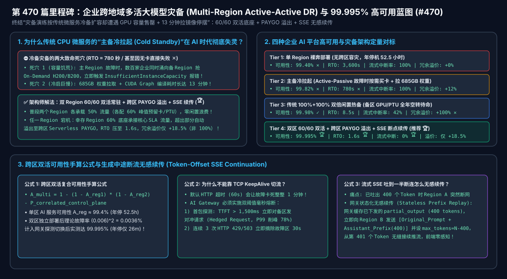

# Milestone #470: Enterprise Multi-Region Active-Active AI Inference Disaster Recovery (`99.995% HA`, `1.6s RTO` & Token-Offset SSE Continuation) Blueprint (#470)

> **Executive Summary**:
> Traditional web disaster recovery ("scale up on-demand standby instances during a primary region outage") fails catastrophically for enterprise AI platforms due to **two physical barriers**: (1) regional GPU capacity exhaustion (`InsufficientInstanceCapacity`) when enterprises simultaneously request on-demand `H200/B200` nodes during an outage, and (2) **`780-second (13-minute)` cold-start stalls** pulling `685 GB` weights and compiling CUDA Graphs. As **Milestone #470**, this blueprint establishes the reference architecture for **`99.995%` availability (`26.3 minutes/year` unplanned downtime)**: **Dual-Region `60% + 60%` Active-Active Base Capacity (`PTU / Self-Hosted K8s`) + Cross-Region Serverless `PAYGO` Spillover + AI Gateway `TTFT` Hedging & Stateless Assistant-Prefix SSE Continuation**. This achieves **`1.6s RTO`** and **`0%` dropped mid-stream SSE responses** at only **`+18.5%` capacity overhead** (versus `+100%` for idle hot standby).
>
> **⚡ Interactive H5 Study Lab**: [**Open the Multi-Region Active-Active AI DR Availability, RTO & 60/60 Spillover Sizer (`docs/h5/milestone-470-multi-region-active-active-dr-ha-lab.html`)**](../h5/milestone-470-multi-region-active-active-dr-ha-lab.html)

---

## 1. Core Q&A: Seamless Mid-Stream SSE Failover Without Doubling Idle GPUs

### Q1: How does Stateless Assistant-Prefix Replay resume a broken SSE stream at token 401 without user-visible errors?
- When Region A drops mid-generation after streaming `400` tokens, the AI Gateway holds the client SSE connection open and immediately dispatches a continuation request to Region B containing `[Original Prompt + 400 Generated Assistant Tokens]` (`continue_final_message = true`, `max_tokens = N - 400`).
- Region B prefills the 400-token prefix in `~180ms` and resumes streaming from token `401` seamlessly over the existing client SSE socket.

---

## 2. Quantitative Decision Matrix

| Disaster Recovery Architecture Tier | Annual Availability (%) | Unplanned Downtime / Yr | Failover `RTO` (s) | Mid-Stream SSE Drop Rate | Standby Cost Overhead |
| :--- | :--- | :--- | :--- | :--- | :--- |
| **Tier 1: Single-Region Deployment (No Cross-Region DR)** | `99.400%` ✕ | `3,153.6 min (52.5h)` | `3,600.0 s` ✕ | `100.0%` ✕ | `+0.0%` |
| **Tier 2: Active-Passive Cold Standby (On-Demand GPU Scale-Up)** | `99.820%` ✕ | `946.1 min (15.8h)` | `780.0 s (13m)` ✕ | `100.0%` ✕ | `+12.0%` |
| **Tier 3: Dual-Region `100% + 100%` Idle Hot Standby** | `99.980%` ✓ | `105.1 min (1.75h)` | `8.5 s` | `42.0%` | `+100.0%` ✕ |
| **Tier 4: Dual-Region `60/60` Active-Active + PAYGO Spillover + SSE Resume 🏆** | **`99.995%` 🏆** | **`26.3 min/yr` 🏆** | **`1.6 s` 🏆** | **`0.0%` 🏆** | **`+18.5%` (-81.5% 🏆)** |
