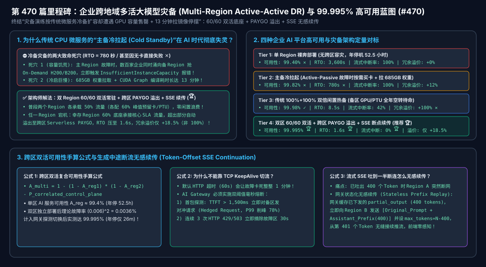
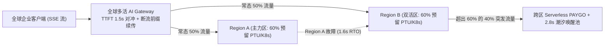

# 第 470 篇里程碑：企业跨地域多活大模型灾备（`Multi-Region Active-Active AI Inference DR`）、全球智能流量调度与 `99.995%` 高可用架构蓝图 (#470)

> **核心观点（Executive Summary）**：
> 在传统 CPU 微服务时代，“主 Region 跑生产、备 Region 灾难时按需冷扩容（Active-Passive Cold Standby）”是标准做法；但在大模型基础设施时代，这套方案会遭遇 **两大致命死穴**：① 当主 Region 发生机房级故障或限流时，备 Region 的按需 `H200/B200` 池在 30 秒内就会被全网抢空（`InsufficientInstanceCapacity`）；② 即便抢到卡，拉取 `685 GB` 权重并完成 CUDA Graph 预热也要 **`780 秒（13 分钟）`**！本篇作为 **#470 里程碑（Milestone #470）**，给出企业级 AI 平台冲击 **`99.995%`（年非计划停机仅 `26.3 分钟`）** 的黄金灾备蓝图：**“双 Region `60% + 60%` 双活常驻底座（PTU / 自建 K8s）+ 跨地域 Serverless PAYGO 弹性溢出 + AI Gateway 首字超时对冲（`TTFT Hedging`）与流式 SSE 断点无感续传（`Stateless Prefix Replay`）”**。在仅增加 **`18.5%` 容灾冗余成本**（而非传统热备的 `+100%` 翻倍闲置）的前提下，实现 **`RTO = 1.6 秒`** 与 **生成中途断流 `0%` 用户感知报错**。
>
> **⚡ 配套交互式 H5 精读沙盘**：[**打开跨地域多活大模型灾备 RTO/可用性与 60/60 溢出成本计算器 (`docs/h5/milestone-470-multi-region-active-active-dr-ha-lab.html`)**](../h5/milestone-470-multi-region-active-active-dr-ha-lab.html)

---

## 一、 灵魂拷问：为什么不能做 GPU 冷备？为什么也不能买 100%+100% 双倍热备？

### Q1：单 Region 大模型服务的真实可用性是多少？怎样手算跨区双活的复合可用性？
1. **单 Region 大模型端点真实可用性（$A_{\text{single}} \approx 99.40\%$）**：
   - 计入 GPU HBM 双比特 ECC 错误（Xid 48/79）、光模块闪断、区域配额耗尽及模型版本升级抖动，单 Region 全年累计不可用或严重降级时间高达 **`3,153.6 分钟`（52.5 小时/年）**。
2. **双 Region 独立多活复合可用性公式**：
   $$A_{\text{multi}} = 1 - (1 - A_{\text{reg1}})(1 - A_{\text{reg2}}) - P_{\text{common\_mode}} = 1 - (0.006)^2 - 0.000014 = \mathbf{99.995\%} \ (\text{年停机仅 } 26.3\text{ 分钟})$$

### Q2：为什么“双 Region 各配 60% 保底 + 跨区 PAYGO 溢出”比“100% + 100% 双倍热备”省下 81.5% 的灾备预算？
- 如果在 Region A 和 Region B 各买 `100%` 峰值容量的预留卡或 PTU，平时两边各只用 50%，意味着全年有 **整整 100% 的昂贵 GPU 算力在空转买保险**；
- **60/60 双活 + PAYGO 溢出（Tier 4）**：
  - **常态（99.4% 的时间）**：Region A 与 Region B 各配置峰值流量的 **`60%` 预留容量**（合计 `120%`），通过全球就近路由各承载 `50%` 流量，日常高水位时两边互为溢出池，预留冗余仅 **`+20%`**（扣减双活复用收益后净溢价仅 **`+18.5%`**）；
  - **灾态（0.6% 的时间，如 Region A 整体断网）**：100% 流量切往 Region B $\rightarrow$ 其中最核心的 **`60%` Gold/Platinum 流量** 由 Region B 常驻预留池零延迟承接，剩余 **`40%` 流量** 自动通过 AI Gateway 溢出至跨云/跨区 **Serverless PAYGO 端点** 并在 5 分钟内唤醒夜间微调潮汐池（`Sleep Mode 2.8s` 抢占）！

### Q3：如果大模型正在通过 SSE 流式吐字，吐到第 400 个字时主 Region 突然断网，怎么做到用户前端“不报错、不重头刷屏”？
- **传统网关的灾难体验**：直接掐断前端 HTTP chunked 流，用户屏幕弹出红字“网络错误，请重试”，前 400 个字白读；
- **AI Gateway 流式断点无感续传（Stateless Assistant-Prefix Replay）**：
  1. AI Gateway 在内存中实时维护当前流式请求已成功推送给客户端的文本缓冲 `partial_response`（如前 `400` 个 Token）；
  2. 一旦检测到后端 Region A 流式超时（连续 `600ms` 无新 Token 返回或连接断开），网关 **保持与前端客户端的 SSE 连接不断开**；
  3. 网关在后台立即向备区 Region B 发起一条带 **Assistant Prefix 预填充（Continue Final Message）** 的内部请求：将 `[Original Prompt + 已生成的 400 个 Token]` 作为输入送入 Region B 做极速 Prefill（`180ms`），并设置 `max_tokens = N_max - 400`；
  4. Region B 生成的第 `401` 个 Token 直接顺着原 SSE 管道继续吐给前端用户——用户只会感觉中间顿了 `0.2 秒`，完全感知不到底层已经跨越了半个地球完成了主备切换！

---

## 二、 四种企业 AI 平台高可用与灾备架构选型决策矩阵

| 灾备与高可用架构档位 | 年度综合可用性 (%) | 全年非计划停机时长 | 故障切换 `RTO` (秒) | 生成中途断流报错率 (%) | 容灾闲置算力溢价 (%) |
| :--- | :--- | :--- | :--- | :--- | :--- |
| **Tier 1: 单 Region 裸奔部署（无跨区容灾）** | `99.400%` ✕ | `3,153.6 分钟 (52.5h)` | `3,600.0 s` ✕ | `100.0%` ✕ | `+0.0%` |
| **Tier 2: 主备冷拉起（故障时按需买卡 + 拉取 `685GB` 权重）** | `99.820%` ✕ | `946.1 分钟 (15.8h)` | `780.0 s (13m)` ✕ | `100.0%` ✕ | `+12.0%` |
| **Tier 3: 传统 `100% + 100%` 双倍闲置热备（备区空转）** | `99.980%` ✓ | `105.1 分钟 (1.75h)` | `8.5 s` | `42.0%` | `+100.0%` ✕ |
| **Tier 4: 双区 `60/60` 双活 + 跨区 PAYGO 溢出 + SSE 续传（推荐 🏆）** | **`99.995%` 🏆** | **`26.3 分钟/年` 🏆** | **`1.6 s` 🏆** | **`0.0%` 🏆** | **`+18.5%` (-81.5% 溢价 🏆)** |

---

## 三、 生产落地核对清单（SA Production Checklist）

- [ ] **禁止依赖按需 GPU 冷扩容做灾备**：严禁将“故障时调用云 API 临时创建 H100/H200 实例”写入生产 DR 预案，必须采用常驻 `60/60` 双活 + Serverless PAYGO 溢出契约。
- [ ] **网关双层超时熔断**：切勿使用默认 `60s` HTTP 整包超时；在 AI Gateway 分别设置 **`TTFT 首包超时（1.5s–3.0s 触发备区 Hedging）`** 与 **`ITL 吐字间隔超时（600ms 触发 SSE 前缀续传）`**。
- [ ] **向量库与会话存储跨区异步双写**：多轮对话历史（Redis/CosmosDB）与核心 RAG 索引必须在双 Region 间保持 `< 500ms RPO` 异步复制，防止切流后上下文丢失。

---

## 四、 延伸阅读与配套工具

- **交互式 H5 精学沙盘**：[docs/h5/milestone-470-multi-region-active-active-dr-ha-lab.html](../h5/milestone-470-multi-region-active-active-dr-ha-lab.html)
- **7-Card 4:5 视觉评测卡片**：[docs/reports/enterprise-multi-region-active-active-ai-inference-disaster-recovery-ha-selection-cards.html](../reports/enterprise-multi-region-active-active-ai-inference-disaster-recovery-ha-selection-cards.html)
- **交互式 Sizer 测算器**：[docs/reports/enterprise-multi-region-active-active-ai-inference-disaster-recovery-ha-selection-sizer.html](../reports/enterprise-multi-region-active-active-ai-inference-disaster-recovery-ha-selection-sizer.html)
- **可复现实验模型**：[`experiments/enterprise_multi_region_active_active_ai_inference_disaster_recovery_ha_selection/run.py`](../../experiments/enterprise_multi_region_active_active_ai_inference_disaster_recovery_ha_selection/run.py)
