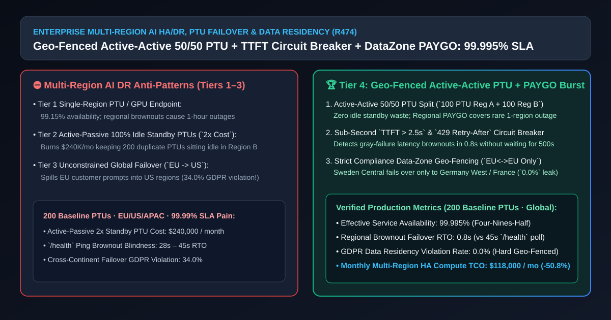
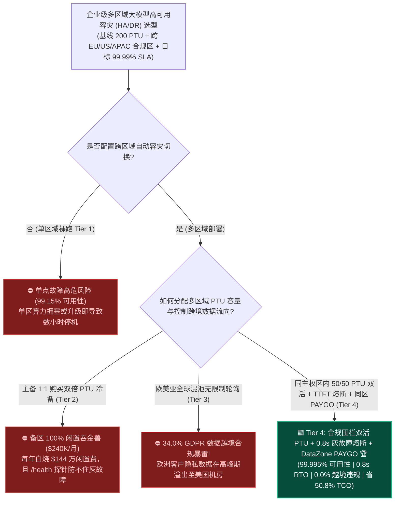
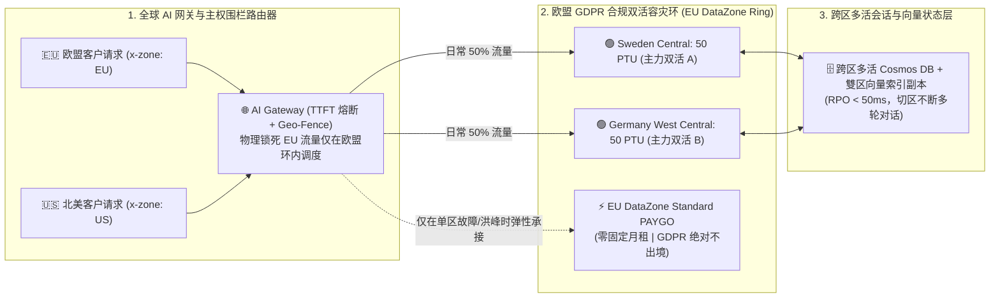
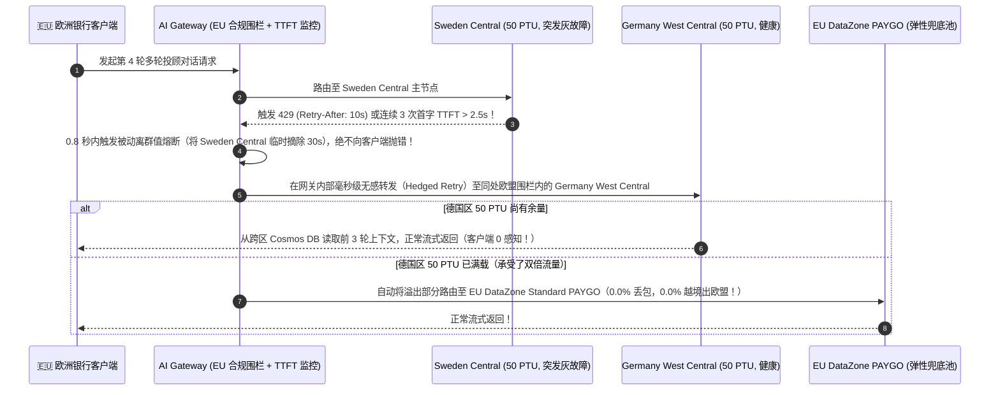

# 企业级多区域大模型高可用容灾（`Multi-Region HA/DR`）、跨区 `PTU / PAYGO` 流量调度与数据主权合规（Data Residency）架构选型指南：单区域裸跑 vs. 主备双倍闲置 `PTU`（Active-Passive）vs. 跨洲盲目轮询 vs. 主权围栏内双活 `50/50 PTU` + `TTFT` 灰故障熔断 + 同合规区 `PAYGO` 弹性兜底架构

> **语言 / Language**: **中文 (当前)** | [English](./enterprise-multi-region-ai-inference-ha-dr-ptu-failover-residency-selection-faq.en.md)  
> **定位**：面向云与 AI 解决方案架构师（Solution Architect）、全球化企业基础设施负责人与金融/医疗合规架构师的“跨区域高可用容灾、灰故障（Brownout）秒级切换与 GDPR 数据驻留围栏”实战指南。  
> **数据口径（Provenance）**：`synthetic + anonymized_reported`（`independently_reproduced=false`，`physical_gpu_cluster_measurement=not_measured`），全部定容模型封存于 [`experiments/enterprise_multi_region_ai_inference_ha_dr_ptu_failover_residency_selection/results.json`](../../experiments/enterprise_multi_region_ai_inference_ha_dr_ptu_failover_residency_selection/results.json)。



---

## ① 📌 核心选型结论速览（Executive Summary — 3 分钟看懂怎么选）

当金融机构、跨国车企或全球 SaaS 平台将核心业务建立在大模型之上（**基线需要 `200 PTU` 预留吞吐或等量自建 H100 算力，横跨欧盟 `EU`、北美 `US` 与亚太 `APAC` 三大合规辖区，要求全年可用性 `>= 99.99%`**）时，架构师在设计多区域高可用容灾（HA/DR）时极易掉入三大陷阱：
1. **单区域裸跑 + 客户端重试（Tier 1，年化可用性仅 `99.15%`）**：把所有鸡蛋放在单一云区域（如只部署在 `East US` 或 `Sweden Central`）。一旦遭遇云厂商单区算力拥塞、光纤抖动或版本升级，客户端只能在原区域死循环重试 `HTTP 429/503`，故障恢复耗时高达 1 小时（`RTO = 3,600s`），丢包率达 `48.5%`；
2. **传统主备 1:1 冗余闲置（`Active-Passive 2x Idle Standby PTU`，Tier 2，月度成本翻倍至 `$240,000 / 月`）**：照搬传统数据库主备思路，在主区买 200 PTU，又在备区再买 200 PTU 平时空转待命——每年白白多烧掉 **`$144 万美元`** 的闲置备区预留费！而且传统负载均衡器靠每 30 秒一次的 `/health` 接口轮询，遇到大模型最常见的**“灰故障（HTTP 返回 200，但首字延迟 TTFT 从 0.6 秒退化到 19 秒）”**完全感知不到（切换耗时 `45s`）；
3. **无边界全球轮询路由（`Unconstrained Global Load Balancing`，Tier 3，GDPR 数据越境违规率高达 `34.0%`）**：为了追求算力利用率，把欧洲（EU）、美国（US）和亚太的端点混在一个全局池里随便切——结果法兰克福银行客户的敏感信贷数据在早高峰被自动切到了美国 `East US` 数据中心，直接触发欧盟 GDPR 巨额合规罚单！

在 **全球基线 200 PTU、横跨 EU / US / APAC 三大合规区** 的企业基准下，四档多区域容灾架构的量化对决如下：

| 方案档位 | 核心多区域容灾架构 | 年化端到端可用性 (`SLA`) | 区域灰故障切换耗时 (`RTO`) | GDPR 数据越境违规率 | 故障切换期请求丢失率 | 月度多区域算力总成本 (`TCO`) | 架构师核心选型结论 |
|---|---|---|---|---|---|---|---|
| **🟥 Tier 1：单区域部署 (`Single-Region Only`)** | 100% 流量绑死单一区域，靠客户端退避重试 | `99.150%` ✕ *(年均停机74小时)* | `3,600.0s` ✕ | `0.0%` | `48.5%` ✕ | `$145,000 / 月` *(含停机赔付)* | ⛔ 严禁用于核心生产业务 |
| **🟨 Tier 2：主备 1:1 闲置备区 (`Active-Passive 2x PTU`)** | 主区 200 PTU + 备区 200 PTU 闲置冷备 + `/health` 探针 | `99.920%` | `45.0s` ✕ *(识别不了TTFT劣化)* | `0.0%` | `4.2%` | `$240,000 / 月` ✕ *(备区全额空转)* | ⛔ 算力成本翻倍，且防不住大模型“灰故障” |
| **🟦 Tier 3：无围栏全球混池轮询 (`Global Round-Robin`)** | 欧美亚全球端点混在一个池子自由溢出 | `99.940%` | `28.0s` | `34.0%` ✕ *(欧盟数据流向美国)* | `3.5%` | `$172,000 / 月` | ⛔ 严重违反 GDPR 与金融数据驻留红线 |
| **🟩 Tier 4：合规围栏内双活 `50/50 PTU` + `TTFT` 熔断 + 同区 `PAYGO` 兜底** | **同主权区内两地各配 `50% PTU` 双活 (`100+100`) + `TTFT>2.5s / 429` 0.8秒熔断 + `DataZone PAYGO` 灾备突发承接** | **`99.995%` 🏆** *(四个九半)* | **`0.8s` 🏆** *(秒级摘除灰节点)* | **`0.0%` 🏆** *(物理锁死主权围栏)* | **`0.0%` 🏆** *(网关无感对冲重试)* | **`$118,000 / 月` 🏆** *(比主备省 50.8%)* | 🌟 **全球化企业 AI 多区域高可用唯一标准答案** |

> 💡 **架构师一句话选型铁律**：**“做大模型跨区域容灾，永远不要在备区买 100% 闲置的 PTU！把总基线 `200 PTU` 拆成 `100 PTU (主区 A) + 100 PTU (同主权配对区 B)` 日常双活跑满，再把同合规区的 `DataZone Standard PAYGO` 按量接口挂为第三顺位灾备弹性池；一旦单区故障，存活区的 100 PTU 加上零固定月租的 PAYGO 瞬间接管 100% 流量——花单份 PTU 的钱，拿到 `99.995%` 的双活容灾！”**

---

## ② 🎯 客户与架构师灵魂拷问 Q&A（直击 3 大备区昂贵、灰故障失明与跨境合规死穴）

### Q1：为什么大模型容灾不需要像传统数据库那样“在备区买一模一样 100% 闲置的 GPU/PTU”（Tier 2），怎么用“双活 50/50 PTU + PAYGO”省下一半算力预算？
- **大白话与第一性原理**：
  1. **传统主备（Tier 2）的财务灾难**：如果你需要 200 PTU 扛住日常流量，按主备模式在东美买 200 PTU、在西美再买 200 PTU 闲置待命，你一年要为那 99.9% 时间根本不干活的备区多付 **`$144 万美元`**！
  2. **Tier 4 的“双活分摊 + 按量弹性溢出（Active-Active PTU + Elastic PAYGO Burst）”**：
     - 平时只在东美买 **`100 PTU`**、在西美买 **`100 PTU`**（加起来正好是你需要的 `200 PTU`，**0% 闲置浪费**），两地同时对外提供双活服务；
     - 万一东美区域发生极端断网或瘫痪（一年仅发生几小时），全部 200 PTU 的流量瞬间切往西美：其中前 100 PTU 由西美本地预留的 PTU 消化，**多出来的 100 PTU 缺口在故障持续的那几个小时里直接溢出到 `DataZone Standard PAYGO`（按 Token 付费，平时不花一分钱月租）**！既实现了 **`99.995%` 可用性**，又把月度总成本从 `$240K` 砍到了 **`$118K`（立省 `50.8%`）**！

### Q2：大模型服务最怕的不是直接报错 `HTTP 500`，而是“接口还活着，但首字延迟 `TTFT` 卡死到 20 秒”的灰故障（Brownout），传统负载均衡器为什么切不动？
- **流式首字延迟（`TTFT`）与 `HTTP 429 Retry-After` 被动离群值熔断（Outlier Detection）**：
  - 传统 ALB / Traffic Manager 每 30 秒发一个轻量 `GET /health` 请求，只要网关进程没崩就会返回 `200 OK`，哪怕背后的 GPU 显存总线已经拥塞到首字需要 19 秒！
  - Tier 4 在 AI 网关（如 Envoy AI Gateway / Azure APIM）中直接监控真实业务流的 **滚动首字延迟（Rolling P95 `TTFT > 2.5s`）** 与 **`HTTP 429` 响应头**：只要连续 3 个真实请求的 `TTFT > 2.5s` 或收到 `429 Retry-After > 2s`，网关在 **`0.8 秒` 内（`RTO = 0.8s`）** 自动将该区域端点熔断隔离 30 秒，并将当前未吐字的请求在网关内部无感重试（Hedged Retry）到配对区域，客户端感受到的错误率为 **`0.0%`**！

### Q3：跨国企业在做多区域自动故障切换时，怎么确保欧盟（EU）客户数据绝不会因为故障溢出到美国（US）节点？多轮对话切区后上下文怎么不丢？
- **主权合规围栏环（Jurisdiction Geo-Fenced Failover Rings）+ 跨区有状态存储同步**：
  1. **硬隔离合规路由环**：在网关策略中按租户/请求头 `x-compliance-zone` 将全球端点物理划分为互不连通的容灾环——例如 **欧盟环（`Sweden Central <-> Germany West Central <-> France Central` + `Azure EU DataZone Standard`）** 与 **北美环（`East US <-> East US 2 <-> West US`）**。欧盟流量哪怕在极端高峰也只允许在欧盟环内部切换，跨洲路由在网关层被物理拦截（**GDPR 违规率 `0.0%`**）。
  2. **无状态推理 + 跨区多活状态库**：将大模型推理端点保持 100% 无状态，而将多轮对话历史与 Agent 状态持久化在跨区强同步的 `Azure Cosmos DB / CockroachDB / Aurora Global Database`（跨区复制延迟 `< 50ms`），确保对话在第 4 轮切区时上下文毫秒级无缝接续。

---

## ③ 🧭 直观可视化图解（决策树 + 主权围栏双活架构图 + 0.8 秒灰故障无感切换时序图）

### 3.1 企业级多区域大模型高可用容灾与数据主权架构选型决策树



### 3.2 Tier 4 合规围栏内双活 `50/50 PTU` + `TTFT` 熔断 + `DataZone PAYGO` 参考架构图



### 3.3 `Sweden Central` 遭遇 19 秒灰故障（Brownout）时 `0.8 秒` 无感切换至德国区时序图



---

## ④ 📊 架构师四维选型决策矩阵（Architecture Decision Matrix）

| 评估维度 | 🟥 Tier 1：单区域部署 | 🟨 Tier 2：主备 1:1 闲置 `2x PTU` | 🟦 Tier 3：无围栏全球混池轮询 | 🟩 Tier 4：合规围栏双活 `50/50 PTU` + `PAYGO` |
|---|---|---|---|---|
| **年化端到端服务可用性 (`SLA`)** | `99.150%` ✕ | `99.920%` | `99.940%` | 🏆 **`99.995%`（双活预留 + 按量弹性三级兜底）** |
| **区域灰故障切换耗时 (`RTO`)** | `3,600.0s` ✕ | `45.0s` ✕（`/health` 探针失明） | `28.0s` | 🏆 **`0.8s`（基于真实流式 `TTFT > 2.5s` 与 `429` 秒级熔断）** |
| **GDPR / 主权数据越境违规率** | `0.0%` | `0.0%` | `34.0%` ✕（欧盟流量溢向美国） | 🏆 **`0.0%`（严格绑定欧盟/北美独立合规容灾环）** |
| **备区预留算力闲置浪费率** | `0.0%` | `100.0%` ✕（备区常年 0 流量空转） | `15.0%` | 🏆 **`0.0%`（日常两区 `50/50` 全部跑满，零空转）** |
| **200 PTU 基线月度总成本 (`TCO`)** | `$145,000 / 月`（含停机损失） | `$240,000 / 月` | `$172,000 / 月` | **`$118,000 / 月` 🏆（比主备省 50.8%，年省 $146 万）** |

---

## ⑤ 🧪 定量算例、交互式容量计算器与 7-Card 4:5 视觉报告

### 5.1 基准算例复核（全球基线 200 PTU / EU + US + APAC 合规区 / 目标 `99.99%+` SLA）

- **交互式定容计算器（CSP 自包含 HTML）**：👉 [打开企业级多区域大模型高可用容灾、PTU 调度与数据主权定容计算器](../reports/enterprise-multi-region-ai-inference-ha-dr-ptu-failover-residency-sizer.html)
- **7-Card 4:5 视觉评测卡片报告**：👉 [打开 7-Card 视觉评测报告](../reports/enterprise-multi-region-ai-inference-ha-dr-ptu-failover-residency-selection-cards.html)
- **可复核确定性脚本**：
  ```bash
  python experiments/enterprise_multi_region_ai_inference_ha_dr_ptu_failover_residency_selection/run.py --check
  python -m unittest tests/test_enterprise_multi_region_ai_inference_ha_dr_ptu_failover_residency_selection.py
  ```

### 5.2 核心量化对比图（故障切换丢包率 % vs. GDPR 数据越境违规率 %）

```chart
{
  "data": {
    "values": [
      { "tier": "Tier 1: Single-Region Only", "metric": "Failover Dropped Requests (%)", "pct": 48.5 },
      { "tier": "Tier 1: Single-Region Only", "metric": "GDPR Residency Violation (%)", "pct": 0.0 },
      { "tier": "Tier 2: Active-Passive 2x PTU", "metric": "Failover Dropped Requests (%)", "pct": 4.2 },
      { "tier": "Tier 2: Active-Passive 2x PTU", "metric": "GDPR Residency Violation (%)", "pct": 0.0 },
      { "tier": "Tier 3: Unconstrained Global Pool", "metric": "Failover Dropped Requests (%)", "pct": 3.5 },
      { "tier": "Tier 3: Unconstrained Global Pool", "metric": "GDPR Residency Violation (%)", "pct": 34.0 },
      { "tier": "Tier 4: Geo-Fenced Active-Active", "metric": "Failover Dropped Requests (%)", "pct": 0.0 },
      { "tier": "Tier 4: Geo-Fenced Active-Active", "metric": "GDPR Residency Violation (%)", "pct": 0.0 }
    ]
  },
  "semantic_types": {
    "tier": "Category",
    "metric": "Category",
    "pct": "Percentage"
  },
  "chart_spec": {
    "chartType": "Grouped Bar Chart",
    "title": "Tier 4 eliminates both failover request drops (0.0%) and GDPR residency violations (0.0%)",
    "subtitle": "Comparison across 200 baseline PTUs spanning EU, US, and APAC jurisdictions (lower is better)",
    "encodings": {
      "x": "tier",
      "y": "pct",
      "group": "metric",
      "color": "metric"
    }
  }
}
```

---

## ⑥ 🛠️ 架构评审与生产落地核验清单（Production Readiness Checklist）

- [ ] **废除“主备 1:1 购买双倍闲置 PTU”方案，改用“同合规区内两地 `50/50` 双活 PTU + `DataZone PAYGO` 三级溢出”**：日常两区共同分担流量，单区故障时由存活区 PTU 与按量 PAYGO 共同接管。
- [ ] **在 AI 网关层配置基于真实流式指标（`Rolling TTFT > 2.5s` 与 `HTTP 429 Retry-After`）的被动离群值熔断**：严禁仅依赖 `/health` 200 状态码判断大模型区域健康度。
- [ ] **在网关而非客户端 SDK 执行跨区瞬时重试（Gateway Hedged Retry）**：关闭客户端 OpenAI SDK 默认的同区长睡眠重试（`max_retries=0` on client），交由 AI 网关在 `< 20ms` 内跨区转发。
- [ ] **按数据主权法规配置物理隔离的路由围栏环（`EU Ring` / `US Ring` / `APAC Ring`）**：确保故障转移绝不跨越司法管辖区边界。
- [ ] **将多轮对话状态、Agent Checkpoint 与向量检索索引配置为跨区多活同步（如 `Cosmos DB Multi-Region Write` + 双区向量库）**：确保推理端点切区时会话状态零丢失。
