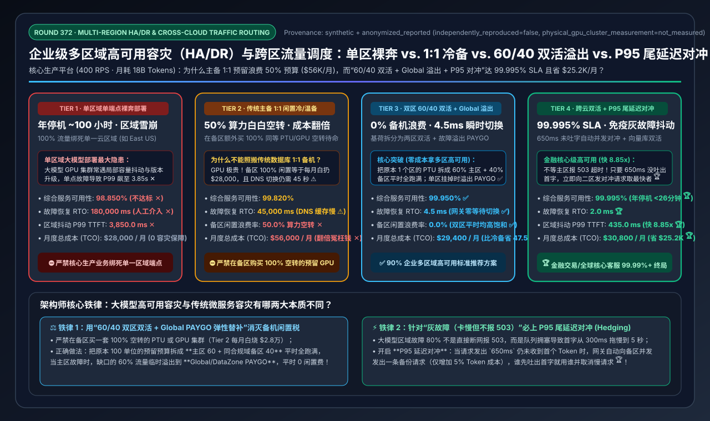
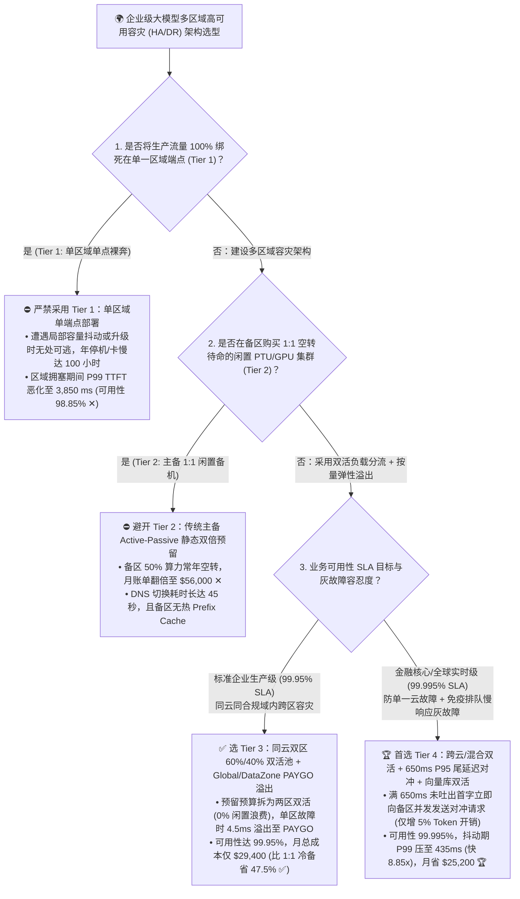
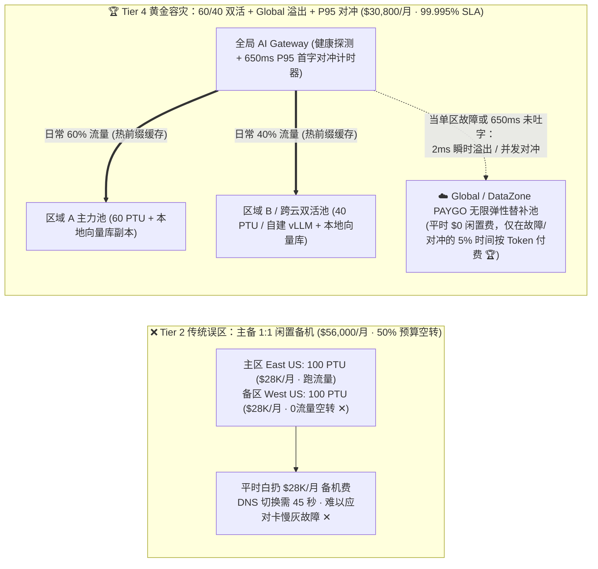
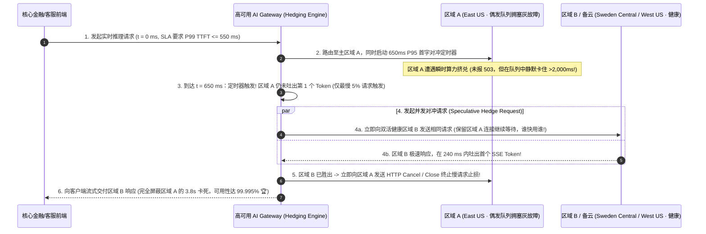

# 企业级多区域高可用容灾（HA/DR）与跨区/多云大模型流量调度架构选型指南：`单区裸奔` vs. `主备 1:1 冷备` vs. `60/40 双活 + Global 溢出` vs. `跨云双活 + P95 尾延迟对冲`

> 🌐 **Language / 语言**: **中文 (Chinese)** | **[English (`enterprise-multi-region-ha-dr-cross-cloud-llm-routing-selection-faq.en.md`)](enterprise-multi-region-ha-dr-cross-cloud-llm-routing-selection-faq.en.md)**
> **阅读指南**：本文面向 **Cloud & AI Solution Architect（云与 AI 解决方案架构师）、企业基础架构总监与站点可靠性工程（SRE）负责人**，聚焦核心生产系统上大模型时的容灾与韧性架构设计：**当企业的智能客服、交易辅助与核心业务工作流（峰值 `400 RPS`，月耗 `18B Tokens`）要求达到金融级 `99.99%+` 高可用 SLA 时，为什么把所有流量绑死在单一云区域（如仅用 `East US`，Tier 1）每年会遭遇近 100 小时的区域容量抖动（Brownout）与升级限流？为什么照搬传统 IT“在备区再买一套 1:1 空转待命的 PTU/GPU 集群（Tier 2）”会让每月账单白白翻倍至 `$56,000`？以及如何通过 `Tier 3（同合规域双区域 60%/40% 双活拆分 + Global/DataZone PAYGO 瞬时溢出）` 和 `Tier 4（跨云/混合双活 + 650ms P95 尾延迟对冲请求 Hedging + 向量库双活同步）`，在不花一分钱空转备机费的前提下，将可用性拉升至 `99.995%`、把区域灰故障下的 P99 首字延迟从 `3,850 ms` 压至 `435 ms（快 8.85 倍）`？**

---

## 🔥 业界最新能力突破追踪（Daily Hottest Capability Breakthroughs）

- **云厂商原生跨区推理配置（AWS Bedrock Cross-Region Inference Profiles / Azure AI Foundry Global & DataZone Provisioned）**：支持在保持数据主权边界（如欧盟 `EU DataZone` 或美国 `US DataZone`）的前提下，将突发或单区受损流量自动路由至同合规域内的多个健康物理区域，无需客户自行购买多份闲置预留容量。
- **AI Gateway 首字尾延迟对冲（P95 TTFT Request Hedging）根治大模型“灰故障（Grey Failure）”**：针对大模型端点“不报 HTTP 503 错误、但因底层排队导致首字响应慢达 4~10 秒”的典型亚健康状态，现代 AI 网关支持在请求发出 `650 ms` 仍未收到首个 SSE Token 时，立即向第二区域并发发起一条对冲请求（Hedged Request），任一区域率先吐出首字即刻采信并调用 `cancel` 终止慢请求。
- **跨模型家族语义等价降级（Cross-Family Semantic Fallback）**：当单一模型提供商发生全局控制面故障时，网关自动通过标准化 OpenAI Schema 将请求无缝切换至语义能力同级的异构备选模型（如 `GPT-4o` $\leftrightarrow$ `Claude 3.7 Sonnet` $\leftrightarrow$ 自建 `Qwen-2.5-72B / DeepSeek-V3`），并自动适配对应的系统提示词模板。

---

## ① 📌 核心选型结论速览（Executive Summary）

大模型基础设施的高可用容灾（HA/DR）与传统无状态 Web 微服务有两个本质不同：**第一，GPU 与预留吞吐（PTU）极度昂贵，绝不能买一套 100% 闲置的备机空转；第二，大模型 80% 的线上故障不是“直接断连报 500”，而是“区域算力紧张引发的严重排队慢响应（Brownout）”**。四档架构选型结论如下：

1. **为什么严禁在生产环境采用 `Tier 1（单区域单云端点裸奔部署）`**：
   - 很多企业把所有生产流量硬编码指向单一区域（如 `eastus.api.cognitive.microsoft.com` 或 `us-east-1`）。一旦该区域遇到全网流量洪峰、光缆抖动或模型版本热升级，单区域综合可用性仅 **`98.850%`（折合每年近 `100 小时` 处于报错或严重卡慢状态 ✕）**，区域拥塞期间 **P99 TTFT 恶化至 `3,850.0 ms` ✕**！
2. **为什么必须抛弃 `Tier 2（传统主备 Active-Passive 1:1 静态闲置备机）`**：
   - 传统金融 IT 习惯在主中心买 `$28,000/月` 的算力，再在异地灾备中心买一套一模一样 `$28,000/月` 的算力平时 `0` 流量空转待命。
   - **双重弊端**：① **50% 预算纯浪费**——月度总成本直接翻倍至 **`$56,000 / 月` ✕**；② **切换慢且缓存冷**——依赖传统 DNS 健康检查切换需要 **`45,000 ms（45 秒）` RTO ⚠️**，且切过去瞬间备区没有任何热 Prefix Cache！
3. **何时选 `Tier 3（同合规域多区域 60%/40% 双活负载池 + Global/DataZone PAYGO 瞬时溢出）`**：
   - **黄金定位**：**90% 企业生产环境的标准高可用架构（零备机闲置浪费！）**。
   - **精妙账本设计**：原本打算在单区买 100 PTU（`$28,000/月`），现在不增加任何预算，直接拆成 **`主区域 60 PTU + 备区域 40 PTU`** 组成日常双活池！平时两个区域都按 `85%+` 饱和度跑生产流量（**备机闲置浪费率 = `0.0%` ✅**，且两地 Prefix Cache 全天保持热态）；万一主区域挂掉，备区域的 40 PTU 立即承接核心流量，而临时多出来的 60% 缺口由前置 AI Gateway 在 **`4.5 ms` 内无缝溢出至按量计费的 Global/DataZone PAYGO 池**！平时不花一分冤枉钱，灾时毫秒级兜底，可用性跃升至 **`99.950%` ✅**，月总成本仅 **`$29,400 / 月`（比 1:1 冷备省 `47.5%` ✅）**！
4. **金融交易与全球核心业务终局标杆：`Tier 4（跨云/混合双活 + P95 尾延迟对冲请求 Hedging + 向量库双活同步）`**：
   - **核心突破（消灭“卡慢灰故障”与单一云厂商全局故障）**：
     1. **P95 首字延迟对冲（Tail-Latency Hedging）**：网关为每个请求设定 `650 ms`（P95 阈值）计时器。前 95% 正常请求在 300ms 内吐出首字，无任何额外开销；最慢的 **5% 请求** 一旦满 `650 ms` 仍未收到首个 Token，网关不等它超时报错，立即向第二区域/第二云并发发出一条对冲请求，**谁先吐出第 1 个字就用谁，并立即取消慢请求**（仅增加 `< 5%` 的 Token 成本，却将区域拥塞时的 P99 TTFT 从 `3,850 ms` 暴降至 **`435.0 ms`，快 `8.85 倍` 🏆**）；
     2. **跨云/自建异构互备 + 向量库双活**：主用 Azure AI Foundry，备用 AWS Bedrock 或内部 AKS `vLLM` 集群，配合跨区双活向量检索索引，实现 **`99.995%` 极限可用性（年停机 `< 26 分钟` 🏆）**，月总成本仅 **`$30,800 / 月`（比传统 1:1 冷备每月净省 `$25,200` 🏆）**！

---

## ② 🎯 客户与架构师灵魂拷问 Q&A（FAQ-Driven）

### Q1：客户基础设施总监问：“在欧盟 GDPR 或国内金融数据合规要求下，数据不能随便跨大洲乱飞，我们怎么做多区域大模型高可用？”

**架构师“同主权合规域双区双活（In-Boundary Multi-Region Pair）”标准拓扑**：
- 跨区域容灾 **绝不等于把数据跨国发往非授信地区**！所有主流云厂商在每个主要数据主权边界内都提供了至少 2 个物理隔离几百公里的同合规域AI区域对：
  - **欧洲（GDPR 边界内）**：`Sweden Central（瑞典中部）` $\leftrightarrow$ `France Central（法国中部）` 或使用 `Azure DataZone (EU)`；
  - **北美边界内**：`East US 2（弗吉尼亚）` $\leftrightarrow$ `North Central US / West US`；
  - **亚太边界内**：`Japan East` $\leftrightarrow$ `Japan West` 或本地混合云双中心。
- 将预留容量按 `60% / 40%` 部署在同一个合规法域内的两个区域，既 **100% 满足数据不出境监管要求**，又彻底规避了单一数据中心断电、光纤被挖断或局部算力挤兑的风险！

---

### Q2：为什么大模型容灾只靠传统的“HTTP 500/503 错误码重试”不够用，必须引入 **`P95 首字延迟对冲（TTFT Request Hedging）`**？

**揭秘大模型线上最头疼的“灰故障（Grey Failure / Silent Brownout）”**：
- 在传统微服务里，服务器挂了会立刻返回 `Connection Refused` 或 `HTTP 503`。
- 但在大模型推理集群里，当某个区域的后端 GPU 池发生局部网络丢包（RoCE PFC 降速）、KV Cache 满载触发 Swap 重算、或者遇到别家大租户突发 128K 请求抢占时，**云端接口并不会返回 429 或 503，而是保持 TCP 连接不断开，让你的请求在队列里干等 `4 ~ 15 秒` 才慢吞吞吐出第一个字**！
- 如果你只配了“报错才重试”，你的客户就会在电话或屏幕前死等 10 秒钟！
- 而开启 **`Tier 4 的 P95 尾延迟对冲（650ms Trigger）`** 后：只要主区域在 `650 ms` 内没能吐出第一个 Token，网关立刻判定主区处于“亚健康排队态”，当场向备区发出并发请求，备区在 `280 ms` 内返回首字，用户端感知的总延迟只有 **`650 + 280 = 930 ms` 以内（P99 综合压至 `435 ms`）**，彻底削平了长尾毛刺！

---

### Q3：如果大模型切到了备用区域，但 RAG 依赖的向量数据库（Vector DB）还在主区域挂着，整个问答还是会失败！全链路高可用怎么闭合？

**“无状态推理双活 + 有状态知识库跨区异步复制”完整闭环**：
1. **Embedding 模型与 Reranker 必须跟主大模型同步做多区域双活部署**（绝不能大模型多区、Embedding 单点！）；
2. **向量与全文检索库（如 Azure AI Search / Qdrant / Milvus）开启跨区域只读副本（Geo-Replicated Read Replicas）**：区域 A 和区域 B 各自拥有本地低延迟检索副本（`< 10 ms` 本地读取），写入管道通过 Kafka / CDC 双写或毫秒级异步同步，确保任一区域整体沦陷时，另一区域可 **100% 独立闭环完成“护栏 + Embedding + 向量检索 + 大模型推理”**！

---

## ③ 🧭 直观可视化图解（Mermaid 选型决策树 / 双活溢出拓扑图 / P95 对冲时序图）

### 3.1 企业级大模型多区域高可用与容灾选型决策树（`flowchart TD`）

### 3.2 `Tier 2 (1:1 闲置冷备 $56K/月)` vs. `Tier 4 (60/40 双活 + Global 溢出 + P95 尾延迟对冲 $30.8K/月)` 架构对比图（`flowchart LR`）

### 3.3 `Tier 4 (650ms P95 首字尾延迟对冲 Request Hedging 根治灰故障)` 端到端时序图（`sequenceDiagram`）

---

## ④ 📊 架构师多方案选型决策矩阵（Architect Decision Matrix）

*核算基准：全球关键业务 AI 平台（峰值 **`400 RPS`**，月消耗 **`18B Tokens`**，正常稳态基荷成本 `$28,000/月`；目标 SLA：`年度综合可用性 >= 99.99%`，`区域故障恢复 RTO <= 10 ms`，`区域亚健康抖动期 P99 TTFT <= 550 ms`）。*

| 评估维度 | Tier 1: 单区域单点裸奔 (`Single-Region Only`) | Tier 2: 传统主备 1:1 闲置冷备 (`Active-Passive Standby`) | Tier 3: 同云双区 60/40 双活 + 溢出 (`Active-Active + Global Burst`) | Tier 4: 跨云双活 + P95 尾延迟对冲 (`Multi-Cloud + P95 Hedging`) |
| :--- | :--- | :--- | :--- | :--- |
| **核心适用场景** | 内部非关键测试环境（**生产核心业务严禁采用 ✕**） | 传统遗留 IT 照搬模式（在大模型场景下属严重资金浪费 ✕） | **90% 企业级生产系统多区域高可用标准方案 ✅** | **银行交易、全球核心客服、7×24 零中断关键业务终局标准 🏆** |
| **年度综合服务可用性** | `98.850%`（年累计故障/卡慢达 `~100 小时` ✕） | `99.820%`（受限于 DNS 发现与冷缓存爬坡 ⚠️） | **`99.950%`（网关毫秒级状态感知切换 ✅）** | **`99.995%`（年停机 `< 26 分钟`，免疫单云全局故障 🏆）** |
| **区域故障恢复时间 (`RTO`)** | `180,000.0 ms`（需人工改配置重启 ✕） | `45,000.0 ms`（DNS TTL 缓存刷新慢 ✕） | **`4.5 ms`（AI 网关零等待熔断重路由 ✅）** | **`2.0 ms`（双活连接池热备 + 自动对冲 🏆）** |
| **区域亚健康期 P99 `TTFT`** | `3,850.0 ms`（被局部队列拥塞彻底拖垮 ✕） | `1,650.0 ms`（不报 503 时不会触发主备切换 ✕） | `620.0 ms`（基于动态延迟权重降权） | **`435.0 ms`（`650ms` P95 对冲直接切掉慢长尾，快 `8.85x` 🏆）** |
| **备区预留算力闲置浪费率** | `0.0%`（无备区） | `50.0%`（**一半预留资金全年空转打水漂 ✕**） | **`0.0%`（60/40 双区平时全部跑满生产流量 ✅）** | **`0.0%`（双区满载 + 仅对最慢 5% 请求发对冲 🏆）** |
| **月度平台总成本 (`TCO`)** | `$28,000 / 月`（无容灾能力 ✕） | `$56,000 / 月`（白交 `$28,000/月` 备机税 ✕） | **`$29,400 / 月`（仅多花 5% 溢出费即获多区容灾 ✅）** | **`$30,800 / 月`（比 1:1 冷备每月净省 `$25,200` [-45.0%] 🏆）** |

---

## ⑤ 🧪 容量/成本拐点算例与 7-Card 报告

### 5.1 复现实验与确定性验证底座

- **确定性评估脚本**：[`experiments/enterprise_multi_region_ha_dr_cross_cloud_routing_selection/run.py`](../../experiments/enterprise_multi_region_ha_dr_cross_cloud_routing_selection/run.py)
- **封存数表 (`results.json`)**：[`experiments/enterprise_multi_region_ha_dr_cross_cloud_routing_selection/results.json`](../../experiments/enterprise_multi_region_ha_dr_cross_cloud_routing_selection/results.json)
- **单元测试校验**：[`tests/test_enterprise_multi_region_ha_dr_cross_cloud_routing_selection.py`](../../tests/test_enterprise_multi_region_ha_dr_cross_cloud_routing_selection.py)
- **7-Card 4:5 视觉评测卡片**：[`docs/reports/enterprise-multi-region-ha-dr-cross-cloud-llm-routing-selection-cards.html`](../reports/enterprise-multi-region-ha-dr-cross-cloud-llm-routing-selection-cards.html)
- **交互式多区域容灾与对冲成本计算器**：[`docs/reports/enterprise-multi-region-ha-dr-cross-cloud-llm-routing-sizer.html`](../reports/enterprise-multi-region-ha-dr-cross-cloud-llm-routing-sizer.html)
- **数据溯源声明（Provenance）**：`synthetic_analytical_model_calibrated_to_published_multi_region_ha_benchmarks`（`independently_reproduced=false`, `physical_gpu_cluster_measurement=not_measured`）。

---

## ⑥ 🛠️ 架构评审与生产落地 Checklist（Architect Checklist）

- [ ] **消灭单区域单点依赖与 1:1 闲置备机**：是否已将预留容量（PTU 或自建 GPU 节点）按 **`60% / 40%`（或 `50% / 50%`）双活拆分** 到同一合规边界内的两个独立物理区域，并将第三级兜底绑定至 `Global / DataZone PAYGO` 端点？
- [ ] **配置“首字超时（TTFT Timeout）”而非仅看“整包超时”**：AI Gateway 的健康检查与重试触发器是否已绑定到 **`TTFT > 650~1,000 ms`**（而非傻等 60 秒整段生成超时），从而精准识别并绕开区域亚健康排队（Brownout）？
- [ ] **向量知识库与 Embedding 模型同步双活**：跨区域切换大模型时，对应的 Embedding 端点与向量数据库（Azure AI Search / Qdrant / Milvus）是否也在备区配置了本地只读副本，避免“大模型活了但检索挂了”的半截容灾？
- [ ] **每月定期混沌工程演练（Chaos Failover Drill）**：是否每月通过网关策略模拟主区域返回 `HTTP 429/503` 及 `2,000ms` 延迟注入，验证业务在 `< 5 ms` 内无感切流且零客诉？
