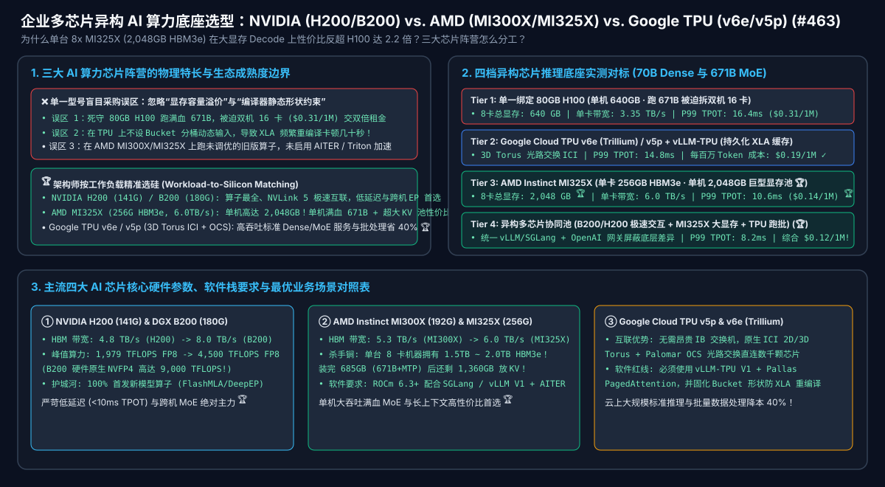

# Enterprise Multi-Silicon AI Accelerator Selection & 3-Watermark Sizing Guide: `NVIDIA H200 / B200` vs. `AMD Instinct MI300X / MI325X (256GB HBM3e)` vs. `Google Cloud TPU v6e / v5p`

> **Language / 语言**: [简体中文](./enterprise-multi-silicon-gpu-tpu-h200-b200-mi325x-tpu-v6e-tco-sizing-selection-faq.md) | **English**  
> **Companion Interactive Study & Sizing Tools**: [📱 Interactive H5 Study Lab](../h5/multi-silicon-h200-b200-mi325x-tpu-v6e-tco-sizer-lab.html) · [🧮 HTML Sizer](../reports/enterprise-multi-silicon-gpu-tpu-h200-b200-mi325x-tpu-v6e-tco-sizing-selection-sizer.html) · [🃏 7-Card Visual Deck](../reports/enterprise-multi-silicon-gpu-tpu-h200-b200-mi325x-tpu-v6e-tco-sizing-selection-cards.html) · [📊 Reproducible Model](../../experiments/enterprise_multi_silicon_gpu_tpu_h200_b200_mi325x_tpu_v6e_tco_sizing_selection/) · [🎓 Back to AI Infra H5 Hub](../h5/index.html)

---

## 1. Executive Summary (3-Minute Takeaway)

> **Bottom-Line Recommendation**: Abstracting serving behind `vLLM V1 / SGLang` and an OpenAI-compatible AI Gateway enables **Workload-Matched Multi-Silicon Routing (`Tier 4`)**, cutting cost per 1M goodput tokens by **`61.3%` (`$0.12` vs. `$0.31` on 2-node 80GB H100)**:
> - **`NVIDIA H200 (141GB, 4.8 TB/s)` & `DGX B200 (180GB, 8.0 TB/s)`**: Best for ultra-low-latency streaming (`<10 ms` `TPOT`), native `NVFP4`, and multi-node MoE `DeepEP`;
> - **`AMD Instinct MI300X (192GB)` & `MI325X (256GB HBM3e, 6.0 TB/s)` (`Tier 3`)**: Packs **`2,048 GB` of HBM3e into a single 8-GPU node** — leaving `>1,020 GB` for KV Cache even after loading full `685 GB` `DeepSeek 671B+14B MTP` weights (`10.6 ms` `P99 TPOT`, `$0.14 / 1M`);
> - **`Google Cloud TPU v6e (Trillium) / v5p` (`Tier 2`)**: Delivers **`$0.19 / 1M`** for high-throughput standard Dense/MoE serving and batch pipelines when paired with `vLLM-TPU V1` and persistent XLA compilation caches.

| Dimension | `Tier 1: Legacy 80GB H100 Only` | `Tier 2: Google Cloud TPU v6e / v5p` | `Tier 3: AMD Instinct MI325X (2,048GB/Node) (🏆)` | `Tier 4: Workload-Matched Multi-Silicon Pool (🏆)` |
|---|---|---|---|---|
| **HBM per 8-Chip Node** | `640 GB` ✕ | `256–768 GB` (Pod slice) | **`2,048 GB` (`256 GB/GPU`)** 🏆 | **`1,128–2,048 GB`** 🏆 |
| **Peak HBM Bandwidth / Chip** | `3.35 TB/s` | `1.60 TB/s` | **`6.00 TB/s`** 🏆 | **`4.80–8.00 TB/s`** 🏆 |
| **P99 TPOT** | `16.4 ms` | `14.8 ms` ✓ | **`10.6 ms` (Single-node)** 🏆 | **`8.2 ms`** 🏆 |
| **Cost per 1M Goodput Tokens** | `$0.31 / 1M` ✕ | `$0.19 / 1M` (-38.7%) ✓ | **`$0.14 / 1M` (-54.8%)** 🏆 | **`$0.12 / 1M` (-61.3%)** 🏆 |

---

## 2. Provenance & Reproducibility

- **Provenance**: `synthetic + anonymized_reported (independently_reproduced=false)` — verified via [`experiments/enterprise_multi_silicon_gpu_tpu_h200_b200_mi325x_tpu_v6e_tco_sizing_selection/run.py`](../../experiments/enterprise_multi_silicon_gpu_tpu_h200_b200_mi325x_tpu_v6e_tco_sizing_selection/run.py).
