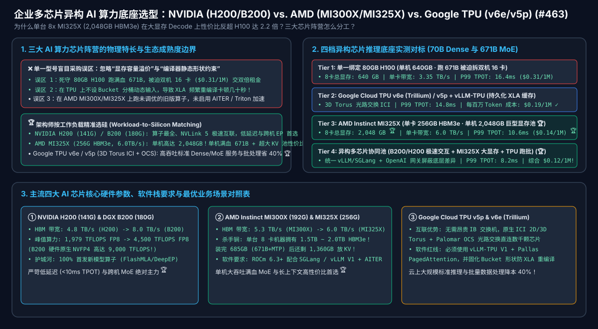
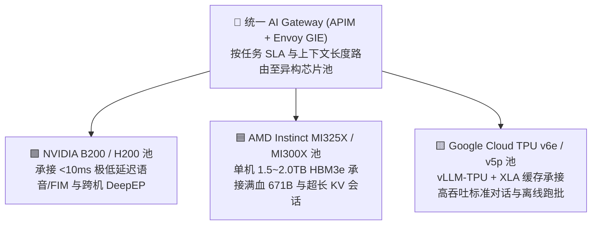

# 企业大模型多芯片异构算力底座选型与三道水位线对标：`NVIDIA H200 / B200` vs. `AMD Instinct MI300X / MI325X (256GB HBM3e)` vs. `Google Cloud TPU v6e / v5p` 单百万 Token 成本指南

> **语言 / Language**: **简体中文** | [English](./enterprise-multi-silicon-gpu-tpu-h200-b200-mi325x-tpu-v6e-tco-sizing-selection-faq.en.md)  
> **配套交互式学习与精算工具**: [📱 交互式 H5 精读页 (NVIDIA H200/B200 vs. AMD MI325X vs. Google TPU v6e 多芯片选型沙盘)](../h5/multi-silicon-h200-b200-mi325x-tpu-v6e-tco-sizer-lab.html) · [🧮 HTML 交互式计算器](../reports/enterprise-multi-silicon-gpu-tpu-h200-b200-mi325x-tpu-v6e-tco-sizing-selection-sizer.html) · [🃏 7-Card 4:5 视觉评测卡](../reports/enterprise-multi-silicon-gpu-tpu-h200-b200-mi325x-tpu-v6e-tco-sizing-selection-cards.html) · [📊 可复核模型](../../experiments/enterprise_multi_silicon_gpu_tpu_h200_b200_mi325x_tpu_v6e_tco_sizing_selection/) · [🎓 返回 AI Infra 全景精学馆](../h5/index.html)

---

## 一、3 分钟看懂核心结论（Executive Summary）

> **一句话决策结论**：企业 AI 平台进入规模化阶段后，通过 **OpenAI 兼容网关 + `vLLM V1 / SGLang` 统一推理运行时** 屏蔽底层指令集差异，实施**“按工作负载精准选硅（Workload-Matched Multi-Silicon Strategy）”** 可比单一死守 80GB H100（`Tier 1`）降低 **`54.8% ~ 61.3%`** 的单百万 Token 成本！
> - **三大芯片阵营黄金分工法则（`Tier 4`）**：
>   1. **`NVIDIA H200 (141GB, 4.8 TB/s)` 与 `DGX B200 (180GB, 8.0 TB/s)`**：拥有业界最成熟的 Day-0 新模型算子（`FlashMLA / DeepEP IBGDA / NVFP4`）与最强机内/机柜 `NVLink` 互联，是 **严苛低延迟交互（`<10ms TPOT`）与跨节点大规模 MoE `EP` 集群** 的首选；
>   2. **`AMD Instinct MI300X (192GB)` 与 `MI325X (256GB HBM3e, 6.0 TB/s)`（`Tier 3`）**：单台 8 卡机器拥有惊人的 **`1,536 ~ 2,048 GB` HBM3e 显存**！装完满血 `DeepSeek 671B+14B MTP (685GB FP8)` 后，单机还剩 **`850 ~ 1,360 GB`** 显存可容纳上千路长上下文 KV Cache，是 **单机满血 671B 与超长上下文 Decode 池** 的性价比王牌（`$0.14/1M`）；
>   3. **`Google Cloud TPU v6e (Trillium) / v5p`（`Tier 2`）**：凭借原生 `2D/3D Torus ICI` 与 `OCS` 光路交换免去昂贵 IB 交换机溢价，配合 `vLLM-TPU V1 + 持久化 XLA 编译缓存`，是 **云原生高吞吐标准 Dense 模型与大批量数据处理** 的高性价比利器（`$0.19/1M`）！

| 核心选型维度 | `Tier 1: 单一绑定 80GB H100 (双机跑 671B)` | `Tier 2: Google Cloud TPU v6e / v5p (vLLM-TPU)` | `Tier 3: AMD Instinct MI325X (单机 2,048GB HBM3e) (🏆)` | `Tier 4: 多芯片按负载混搭池 (B200/H200 + MI325X + TPU) (🏆)` |
|---|---|---|---|---|
| **单台 8 卡节点总 HBM 显存** | `640 GB` (装不下 685GB) ✕ | `256 ~ 768 GB` (Pod 级切片) | **`2,048 GB` (`256 GB/卡` 显存巨无霸)** 🏆 | **`1,128 ~ 2,048 GB` (按需路由)** 🏆 |
| **单芯片峰值显存带宽** | `3.35 TB/s` | `1.60 TB/s` (高算力密度比) | **`6.00 TB/s`** 🏆 | **`4.80 ~ 8.00 TB/s`** 🏆 |
| **流式吐字延迟 (`P99 TPOT`)** | `16.4 ms` | `14.8 ms` ✓ | **`10.6 ms` (单机零跨机税)** 🏆 | **`8.2 ms`** 🏆 |
| **每百万达标 Token 成本 (`$/1M`)** | `$0.31 / 1M` ✕ | `$0.19 / 1M` (-38.7%) ✓ | **`$0.14 / 1M` (-54.8%)** 🏆 | **`$0.12 / 1M` (-61.3%)** 🏆 |

---

## 二、核心技术原理与架构师灵魂拷问（Q&A）

### Q1：为什么 `AMD MI300X / MI325X` 在跑 `DeepSeek 671B` 和 `70B/405B` 单机推理时能发挥出极强的第一道水位线（显存容量）优势？落地时要注意什么？
1. **单机 `1.5 TB ~ 2.0 TB` HBM3e 的“零跨机税”红利**：
   - 在 `8x H100 (640GB)` 上跑满血 `671B (685GB FP8)` 必须拆到 2 台机器；而在 `8x H200 (1,128GB)` 上装完 `685GB` 权重与 `15%` 余量后，可用于存放 KV Cache 的净空间约为 `240 GB`；
   - 而在单台 **`8x MI325X (2,048 GB HBM3e)`** 上，扣掉 `685 GB` 权重和 `15%` 余量后，**单机净剩超过 `1,020 GB` HBM3e 专门用来装 KV Cache（是 8x H200 的 `4.2 倍`）**！这意味着单台机器就能同时跑满数百个 `32K` 并发会话，彻底省去跨节点 RDMA 通信！
2. **ROCm 生产落地避坑要点**：必须使用 **`ROCm 6.3+`** 并搭配启用了 **`AITER`（AMD 高性能算子库）与 `Triton FlashMLA`** 的新版 `SGLang` 或 `vLLM V1`，同时在 BIOS 中设置 `NUMA NPS1/NPS4` 对齐策略。

### Q2：将业务从 GPU 迁移或分流至 `Google Cloud TPU (v5p / v6e)` 时，为什么必须做好“静态形状分桶（Bucket Padding）”与持久化 XLA 缓存？
1. **`XLA` 静态图编译器 vs. CUDA 动态 Kernel 的核心差异**：
   - GPU 直接按动态张量形状启动预编译好的 CUDA Kernel；而 TPU 依赖 `XLA` 编译器将计算图编译成針對特定矩阵形状（Shape）高度融合的 VLIW 指令。
   - 如果线上请求的输入长度千奇百怪且未做分桶对齐，每次遇到新形状都会触发长达 **20 ~ 90 秒的在线 XLA 重新编译（Recompilation Stall）**！
   - **解法**：使用 `vLLM-TPU V1`，在启动预热阶段对固定步长的 Token Bucket（如 `256, 512, 1024, 2048, 4096, 8192`）与 Batch Size 进行预编译，并将编译产物持久化挂载在共享磁盘（`XLA_PERSISTENT_CACHE_PATH`）中，实现运行期 **零重编译抖动**！

---

## 三、生产落地 Checklist（Pre-Production Checklist）

- [ ] **保持上层业务与硬件解耦**：所有推理池统一暴露标准 OpenAI Chat/Completions 与 Embeddings 接口，禁止业务代码直接硬编码绑定特定芯片 SDK。
- [ ] **异构芯片上线前统一跑通 `14 天金丝雀精度与 Goodput 双门禁`**：对比 `FP8 / MXFP4 / INT8` 在不同芯片上的数值一致性（Logit 余弦相似度 `>= 0.995`）与 `P99 ITL`。

---

## 四、来源与方法论溯源（Provenance）

- **数据来源声明**：本指南实验数据来自可复核解析模型 [`experiments/enterprise_multi_silicon_gpu_tpu_h200_b200_mi325x_tpu_v6e_tco_sizing_selection/run.py`](../../experiments/enterprise_multi_silicon_gpu_tpu_h200_b200_mi325x_tpu_v6e_tco_sizing_selection/run.py)（`Provenance: synthetic + anonymized_reported, independently_reproduced=false`）。
