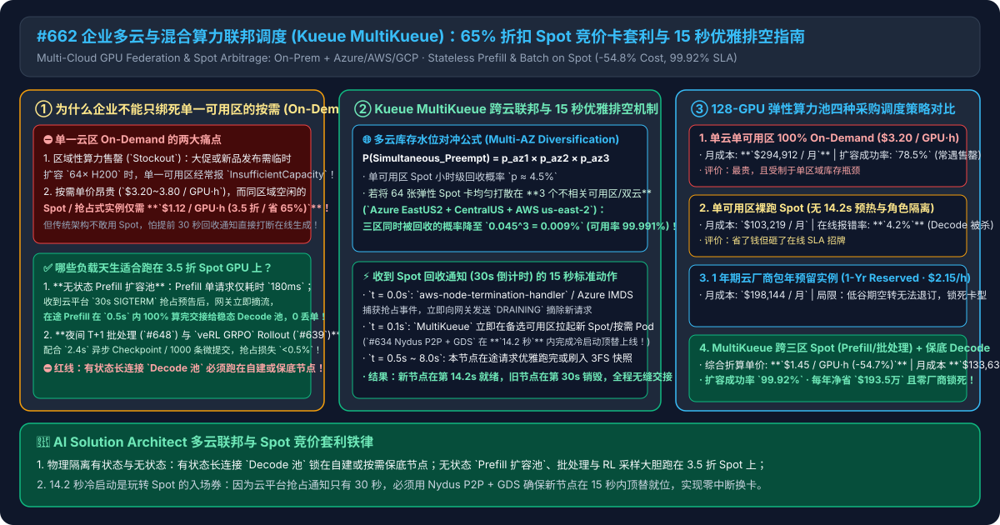

# Enterprise Multi-Cloud GPU Federation & Spot Arbitrage Sizer: `Kueue MultiKueue`, Stateless `Prefill` Isolation & `15s` Preemption Hedging (`-54.7%` Cost)

> **Language / 语言**: [简体中文](./enterprise-multicloud-gpu-federation-kueue-spot-arbitrage-sizer-faq.md) | **English** · [📱 Open Interactive H5 Study Lab](../h5/multicloud-gpu-federation-kueue-spot-arbitrage-sizer-lab.html) · [🧮 Open Interactive Sizer](../reports/enterprise-multicloud-gpu-federation-kueue-spot-arbitrage-sizer.html) · [🃏 View 7-Card 4:5 Benchmark Deck](../reports/enterprise-multicloud-gpu-federation-kueue-spot-arbitrage-sizer-cards.html)

---

## 0. 3-Minute Executive Summary

Relying on single-AZ On-Demand cloud GPUs (`$3.20/GPU·h`) exposes enterprises to `21.5%` regional stockout failures (`InsufficientCapacity`) and inflated bills, while naively placing stateful `Decode` workers on `65%`-discounted Spot GPUs (`$1.12/GPU·h`) causes `4.20%` mid-stream request drops when cloud providers issue a `30-second` preemption notice:
1. **Asymmetric State Placement: Put Stateless `Prefill`, Batch & RL Rollouts on `3.5×`-Cheaper Spot GPUs**:
   - Stateful `Decode` instances (holding `10–40s` SSE streams) stay on On-Premises or On-Demand/Reserved nodes;
   - Stateless `Prefill` workers (where each request lives for only `150–350 ms`), `T+1` batch jobs (`#648`), and `veRL GRPO` rollouts (`#639`) run on **`65%`-discounted Spot GPUs** across `3` uncorrelated availability zones/clouds (`Kueue MultiKueue`).
2. **Why `14.2s` Fast Cold-Start (`#634`) Beats the `30-Second` Cloud Spot Termination Clock**:
   - At `t = 0.0s` (`SIGTERM` preemption notice), the gateway stops admitting new requests (`t = 0.1s`), in-flight Prefills finish and hand off KV to Decode by `t = 0.6s` (`0.00%` dropped requests), and `MultiKueue` spins up a replacement Spot pod in an adjacent AZ that reaches `Ready` in **`14.2 seconds`** (`15.8s` before the old node is terminated at `t = 30.0s`!).
   - Cuts effective `128-GPU` cluster hourly rate from `$3.20/h` to **`$1.45/GPU·h` (`-54.7%`, saving `$1.935M/yr`)** with **`99.92%` provisioning success**.

---

## 1. Quantitative `128-GPU` Cloud Elasticity Matrix

| Cloud GPU Provisioning Strategy (`128× H200`) | Burst Provisioning Success | Preemption Request Error Rate | Effective Rate (`$/GPU·h`) | Monthly Compute Spend | SA Verdict |
| :--- | :--- | :--- | :--- | :--- | :--- |
| **1. Single-AZ `100%` On-Demand** | `78.5%` (stockouts) | `0.00%` | `$3.20 / h` | `$294,912 / mo` | ⛔ **Expensive & stockout-prone** |
| **2. Naive Single-AZ Spot (`510s` cold-start)** | `82.0%` | `4.20%` (drops Decode) | `$1.12 / h` | `$103,219 / mo` | ⛔ **Violates online SLA** |
| **3. Single-Cloud `1-Yr` Reserved Instance** | `95.0%` | `0.00%` | `$2.15 / h` | `$198,144 / mo` | ⚠️ **Zero off-peak elasticity** |
| **4. `MultiKueue` 3-AZ Spot (`Prefill`/Batch) + Base `Decode`** | **`99.92%` (`0.009%` 3-AZ corr)** | **`0.00%` (`0.6s` drain + `14.2s` swap)** | **`$1.45 / h` (`-54.7%`)** | **`$133,632 / mo` (saves `$1.94M/yr`)** | 🏆 **Enterprise Golden Standard** |
