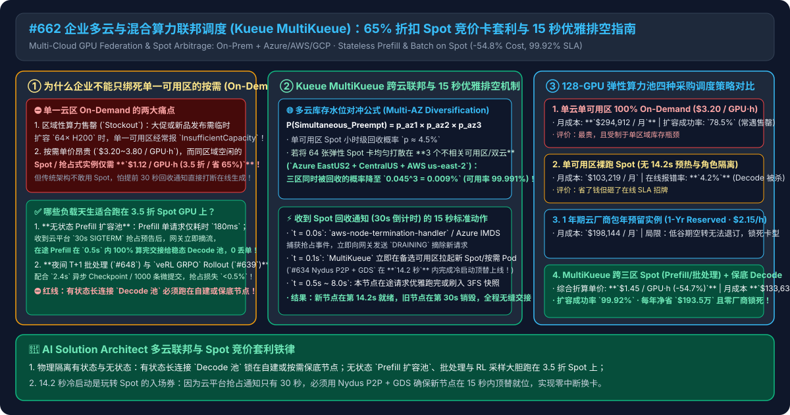
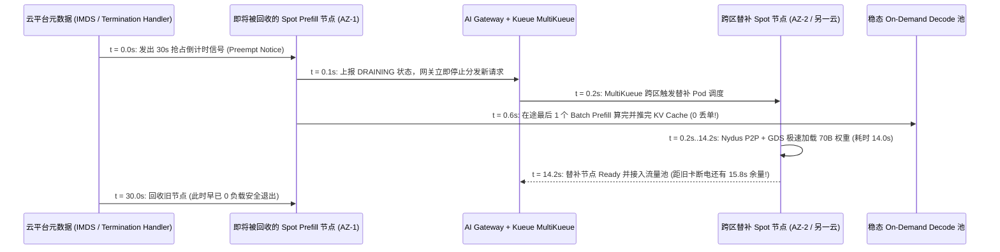

# 企业多云与混合算力联邦调度（`Kueue MultiKueue / SkyPilot`）：`65%` 折扣竞价实例（`Spot GPU`）套利、无状态 `Prefill` 分离与 `15 秒` 抢占优雅排空容量指南

> **语言 / Language**: **简体中文** | [English](./enterprise-multicloud-gpu-federation-kueue-spot-arbitrage-sizer-faq.en.md) · [📱 打开交互式 H5 精读页](../h5/multicloud-gpu-federation-kueue-spot-arbitrage-sizer-lab.html) · [🧮 打开交互式容量计算器](../reports/enterprise-multicloud-gpu-federation-kueue-spot-arbitrage-sizer.html) · [🃏 查看 7-Card 4:5 评测报告](../reports/enterprise-multicloud-gpu-federation-kueue-spot-arbitrage-sizer-cards.html)

---

## 0. 3 分钟执行摘要（Executive Summary）

当企业在公有云上弹性扩展 `128+` 张 `H100 / H200` 算力时，常面临两大痛点：**① 单一可用区按需（On-Demand，`$3.20/GPU·h`）库存经常售罄（`InsufficientCapacity` 扩容失败率高达 `21.5%`）；② 看着旁边仅需 `$1.12/GPU·h`（`3.5 折` / 省 `65%`）的 `Spot / Preemptible（抢占式竞价实例）` 眼馋，却因为害怕云平台提前 `30 秒` 强制回收节点打断在线请求而不敢使用**。
1. **核心突破：利用 PD 分离的“轻重状态非对称性”，让 `70%` 弹性算力安全跑在 `3.5 折 Spot GPU` 上**：
   - **为什么 `Decode` 池不能跑在 Spot 上？** 因为 `Decode` 节点驻留着上百个并发请求长达 `10–40 秒` 的流式生成会话与数千 GB 的活跃 KV Cache，一旦被 `30 秒` 抢占回收，大量长对话被迫中断重算；
   - **为什么 `Prefill` 扩容池、离线批处理与 `veRL GRPO` 采样天生适合跑在 Spot 上？**
     - 在 PD 分离架构下，**`Prefill` 节点是近乎无状态的（Stateless）**：每个请求在 `Prefill` 卡上仅停留 **`150 – 350 ms`**，算完首字并把 KV Cache 推给稳态 `Decode` 池后即刻清空；
     - 当收到云平台 `30 秒 SIGTERM` 抢占通知时，网关在 **`0.1 秒`** 内停止向该 Spot 节点分发新请求，节点上正在跑的最后几个 Prefill 在 **`0.5 秒`** 内 `100%` 正常算完交接，**实现 `0.00%` 在线请求中断**！
2. **为什么 `#634` 的 `14.2 秒` 极速冷启动是玩转在线 Spot 套利的物理前提？**
   - 云厂商从发出抢占预警（AWS 2 分钟 / Azure & GCP **仅 `30 秒`**）到强制断电只有 **`30 秒`** 窗口！
   - 若容器冷启动需要传统的 `510 秒`，旧卡死了 8 分钟新卡还没起来，集群容量必然塌陷；而配合 `Nydus P2P 镜像按需加载 + GDS 权重直读`，`Kueue MultiKueue` 在另一可用区拉起的替补 Spot 节点在第 **`14.2 秒`**（抢占死线前 `15.8 秒`！）即已完成预热并接管流量！
3. **跨三区/多云联邦对冲公式与 `54.7%` 成本削减**：
   - 将弹性 Spot 池分散在 `3` 个独立可用区/多云（单区小时回收率 $p \approx 4.5\%$），三区同时被回收的概率降至 $p^3 = 0.045^3 = \mathbf{0.009\%}$（可用率 **`99.92%+`**）；
   - `128-GPU` 弹性集群综合单价从 `$3.20/h` 压至 **`$1.45 / GPU·h`（节省 `54.7%`，年省 `$193.5万`）**！

---

## 1. 灵魂拷问 Q&A（Cloud & AI Solution Architect 核心决策拆解）

### Q1：收到云平台 `30 秒` Spot 抢占信号（`SIGTERM / IMDS Preempt Event`）后，节点的 `15 秒` 优雅排空与无缝换卡时间轴是怎样工作的？

---

## 2. `128-GPU` 云端弹性算力池四种调度策略横向选型矩阵

| 云算力采购与调度方案（`128× H200` 弹性池 · 月运行 `720 小时`） | 突发扩容一次成功率 | 抢占导致的在线报错率 | 等效单卡小时成本 (`$/GPU·h`) | 月度云算力总账单 | 架构师选型裁决 |
| :--- | :--- | :--- | :--- | :--- | :--- |
| **1. 单云单可用区 `100% On-Demand` 按需实例** | `78.5%`（常遇单区售罄） | `0.00%` | `$3.20 / h` | `$294,912 / 月` | ⛔ **账单最贵且易遭遇单区算力荒** |
| **2. 单可用区盲目混跑 `Spot`（含 Decode 且冷启动 `510s`）** | `82.0%` | **`4.20%`（长连接被强杀）** | `$1.12 / h` | `$103,219 / 月` | ⛔ **破坏在线 SLA，不可用于生产** |
| **3. 1 年期单云预留实例 (`1-Yr Reserved Instance`)** | `95.0%`（锁死单区配额） | `0.00%` | `$2.15 / h` | `$198,144 / 月` | ⚠️ **丧失弹性，业务低谷期白交租金** |
| **4. `MultiKueue` 跨三区 `Spot`（跑 Prefill/Batch）+ 保底 Decode（推荐）** | **`99.92%`（三区/多云寻优）** | **`0.00%`（`0.6s` 排空 + `14.2s` 换卡）** | **`$1.45 / h` (`-54.7%`)** | **`$133,632 / 月`（年省 `$193.5万`）** | 🏆 **兼具最高可用性与最低成本** |

---

## 3. 生产落地核对清单（Pre-Production Checklist）

- [ ] **实施严格的“实例生命周期属性对口绑定”**：K8s 节点标签强制规定 `Stateful Decode Pool` 只调度至 `node-lifecycle=on-demand/on-prem`，而 `Stateless Prefill / Batch / RL Rollout` 优先调度至 `node-lifecycle=spot`；
- [ ] **部署 `Node Termination Handler` 并对接网关 `0.1s` 主动摘流 Webhook**；
- [ ] **所有参与 Spot 调度的集群必须预装 `Nydus / Dragonfly P2P` 镜像加速与本地 NVMe 权重缓存**：确保新 Spot 节点从拉起到吐出第一个 Token 总耗时 `<= 15 秒`（跑赢 `30 秒` 强杀倒计时）。
