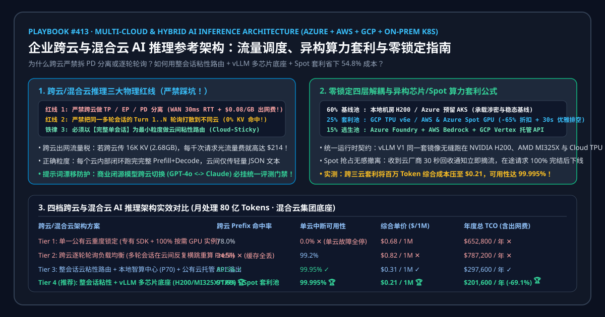
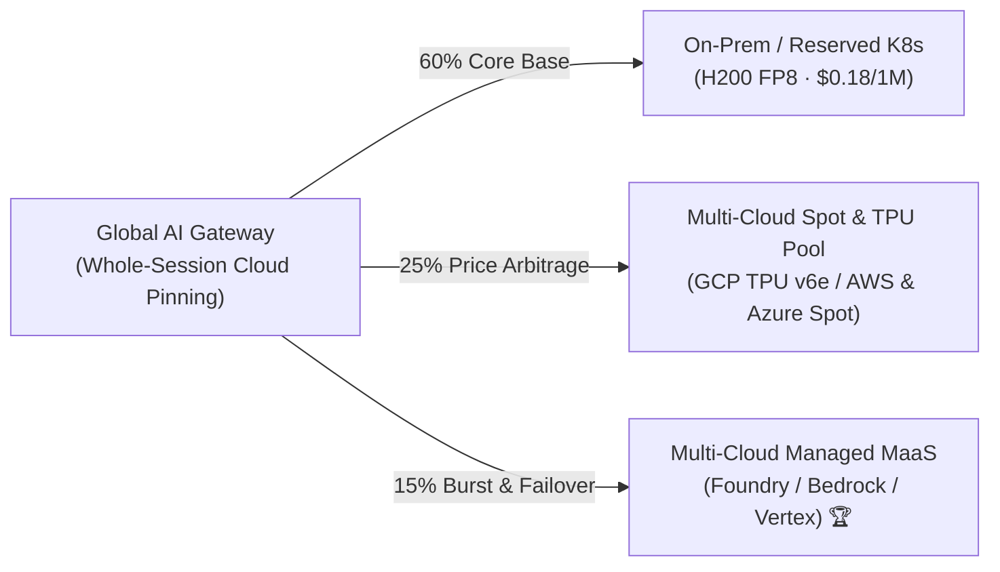

# Enterprise Multi-Cloud & Hybrid AI Inference Reference Architecture Guide: Traffic Routing, Spot/PTU Arbitrage & Zero-Lock-In Across `Azure`, `AWS`, `GCP` & `On-Prem K8s`

> **Language / 语言**: **English (Current)** | [中文](./enterprise-multicloud-hybrid-ai-inference-arbitrage-failover-architecture-selection-faq.md)  
> **Scope**: A practical multi-cloud and hybrid-cloud reference architecture guide for Cloud & AI Solution Architects—answering **(1) why you must never span `TP / PD Disaggregation` across WAN links or load-balance multi-turn sessions per-turn across clouds (`24.5%` KV hit rate + `$0.08/GB` WAN egress fees), (2) how to use a unified `vLLM V1 / SGLang` container layer across `NVIDIA H200`, `AMD MI325X`, and `Google Cloud TPU v6e` for Spot/Committed-Use price arbitrage, and (3) how the `60/25/15` Hybrid Fleet cuts annual TCO by `69.1%` at `99.995%` cross-cloud availability**.  
> **Provenance**: Analytical multi-cloud routing and TCO model synthesized from published cloud pricing and serving benchmarks (`provenance: synthetic + anonymized_reported`, `independently_reproduced=false`, `physical_gpu_cluster_measurement=not_measured`). See [`experiments/enterprise_multicloud_hybrid_ai_inference_arbitrage_failover_architecture_selection/results.json`](../../experiments/enterprise_multicloud_hybrid_ai_inference_arbitrage_failover_architecture_selection/results.json).

> 🔗 **Interactive H5 Learning Lab & Companion Tools (Zero External Dependencies)**:
> - 📱 **[Interactive H5 Study Page: Multi-Cloud Whole-Session Sticky Routing, Multi-Silicon Spot Arbitrage & TCO Lab (`docs/h5/multicloud-hybrid-ai-inference-arbitrage-failover-lab.html`)](../h5/multicloud-hybrid-ai-inference-arbitrage-failover-lab.html)**
> - 🎓 **[AI Infra Panorama H5 Learning Hub (`docs/h5/index.html`)](../h5/index.html)**
> - 🧮 **[Interactive Multi-Cloud & Hybrid TCO Sizer (`enterprise-multicloud-hybrid-ai-inference-arbitrage-failover-architecture-selection-sizer.html`)](../reports/enterprise-multicloud-hybrid-ai-inference-arbitrage-failover-architecture-selection-sizer.html)**
> - 🃏 **[7-Card 4:5 Visual Report (`enterprise-multicloud-hybrid-ai-inference-arbitrage-failover-architecture-selection-cards.html`)](../reports/enterprise-multicloud-hybrid-ai-inference-arbitrage-failover-architecture-selection-cards.html)**

---

## 1. 📌 Executive Summary

> **Bottom Line**: **Across an enterprise processing `8 Billion Tokens/month`, naive per-turn round-robin load balancing across clouds (Tier 2) scatters multi-turn conversations across separate cloud KV pools, collapsing Prefix KV Cache hit rate to **`24.5%`** and increasing annual spend to **`$787,200`**; meanwhile, single-cloud on-demand lock-in (Tier 1) costs **`$652,800/year`** with zero resilience against a provider outage! Deploying **Tier 4 (Whole-Session Cloud-Sticky Global Gateway + `60%` On-Prem/Reserved H200 Base + `25%` Multi-Cloud Spot/TPU v6e Arbitrage Pool running unified `vLLM V1` + `15%` Multi-Cloud Managed MaaS Failover)** preserves **`91.6%` Prefix KV hit rate**, achieves **`99.995%` cross-cloud availability**, and slashes annual TCO by **`69.1%` (`$652,800 -> $201,600/year`, `$0.21 / 1M tokens`)**!**

| Multi-Cloud / Hybrid Architecture Tier (8B Tokens/Mo) | Routing & Capacity Mix | Cross-Cloud Prefix Hit | Provider-Outage Uptime | Blended `$/1M` | Annual TCO | Architect Verdict |
| :--- | :--- | :--- | :--- | :--- | :--- | :--- |
| **🟥 Tier 1: Single-Cloud Lock-In** | 100% on-demand GPUs + proprietary SDK in 1 cloud | `78.0%` | **`0.0%` ✕ (Single Point)** | `$0.68 / 1M` | `$652,800 / yr` ✕ | Exposed to regional GPU stockouts & outages |
| **🟨 Tier 2: Per-Turn Cross-Cloud Round-Robin** | Alternates turns of the same session across clouds | **`24.5%` ✕ (Cache Lost)** | `99.2%` | **`$0.82 / 1M` ✕** | `$787,200 / yr` ✕ | **Severe Anti-Pattern**: Recomputes full history every turn |
| **🟦 Tier 3: Session-Sticky On-Prem (`70%`) + Cloud Burst (`30%`)** | Pins full `Conversation_ID` to one cloud/DC | `89.5%` ✅ | `99.95%` ✅ | `$0.31 / 1M` ✅ | `$297,600 / yr` ✅ | Solid hybrid baseline |
| **🟩 Tier 4: Session-Sticky + Multi-Silicon `vLLM` + `Spot` Arbitrage (Recommended)** | **`60%` Base + `25%` Spot/TPU Arbitrage + `15%` MaaS** | **`91.6%` 🏆** | **`99.995%` 🏆** | **`$0.21 / 1M` 🏆** | **`$201,600 / yr` 🏆 (`-69.1%`)** | **Flagship zero-lock-in hybrid AI factory** |

---

## 2. 🎯 Architect Deep-Dive Q&A: Multi-Cloud Physics & Silicon Arbitrage

### Q1: Why must every cloud/datacenter act as a self-contained Serving Cell (never spanning PD Disaggregation or per-turn round-robin across clouds)?
- **WAN Latency & Egress Tax**: Transferring a `2.68 GB` `16K` KV cache across clouds incurs `15–35 ms` WAN RTT plus **`$0.08/GB` cloud egress fees (`$214` per 1,000 requests in network fees alone!)**. Furthermore, alternating turns of a conversation across clouds destroys Prefix KV locality (`24.5%` hit rate). Pin the entire `Conversation_ID` to a single cloud cell from Turn 1 to Turn N!

### Q2: How do you eliminate hardware and cloud lock-in while arbitraging Spot GPUs and Cloud TPUs?
- Standardize on **open-weight models (`DeepSeek-V3/R1`, `Qwen3`, `Llama-3.3`)** served via **`vLLM V1 / SGLang`**, which run identically across **NVIDIA H200 (`CUDA`), AMD MI325X (`ROCm`), and Google Cloud TPU v6e (`vLLM-TPU`)**, and use `30-second` Spot termination hooks to drain in-flight streams gracefully before preemption.

---

## 3. 🧭 Multi-Cloud Session-Sticky & 60/25/15 Arbitrage Architecture

---

## 4. 📊 Multi-Cloud Compute Pool Comparison Matrix

| Pool Tier | Hardware / Platform | Cost / 1M Tokens | Primary Strength | Target Share |
| :--- | :--- | :--- | :--- | :--- |
| **On-Prem / 3-Yr Reserved Base** | `8x H200 / B200` K8s | **`$0.16–$0.20 / 1M`** 🏆 | Data sovereignty & lowest unit cost | **`60%` Base Load** |
| **Cloud TPU Arbitrage Pool** | `GKE TPU v6e + vLLM-TPU` | **`$0.19–$0.23 / 1M`** 🏆 | High availability & strong price/perf | **`15%` Elastic Pool** |
| **Multi-Cloud Spot GPU Pool** | `AKS / EKS Spot H100 / MI300X` | **`$0.18–$0.25 / 1M`** 🏆 | `60%–70%` discount with 30s drain | **`10%` Stateless/Batch** |
| **Multi-Cloud Managed MaaS** | `Foundry / Bedrock / Vertex` | `$0.80–$2.50 / 1M` | Instant 10x burst & provider DR | **`15%` Burst/Escape** |

---

## 5. 🛠️ Production Readiness Checklist

- [ ] **Pin Full `Conversation_ID` Lifecycles to One Cloud Cell**: Never split multi-turn sessions or PD KV transfers across WAN links.
- [ ] **Stage Model Weights in Per-Cloud Regional Object Buckets**: Replicate `.safetensors` asynchronously once per release to avoid cross-cloud egress fees on pod autoscaling.
