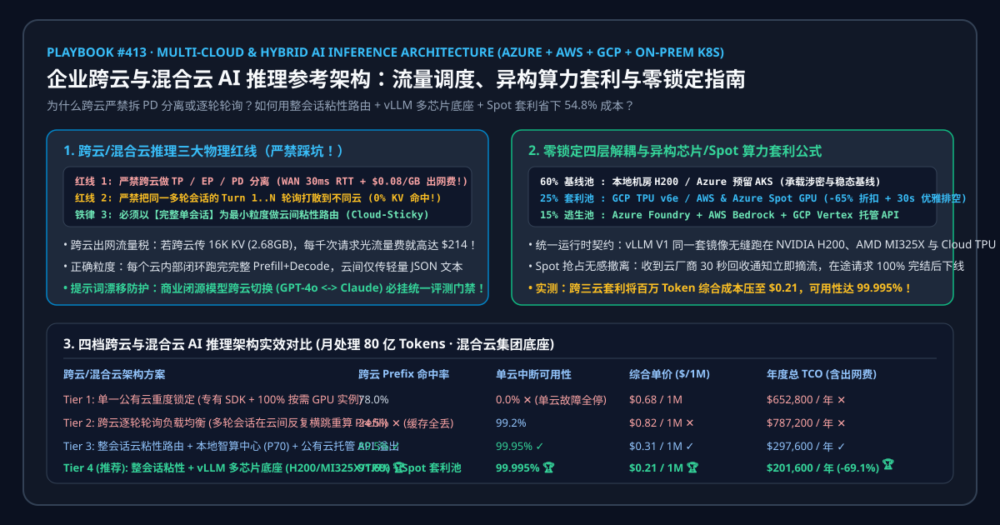
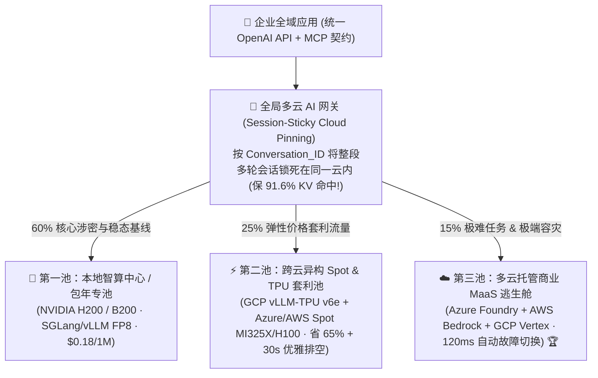

# 企业级跨云与混合云（Multi-Cloud & Hybrid Cloud: `Azure + AWS + GCP + 本地智算中心`）AI 推理流量调度、异构算力套利与零锁定参考架构指南

> **语言 / Language**: **中文 (当前)** | [English](./enterprise-multicloud-hybrid-ai-inference-arbitrage-failover-architecture-selection-faq.en.md)  
> **文档定位**：面向 Cloud & AI Solution Architect 的集团级跨云/混合云 AI 基础设施顶层设计白皮书——回答大型跨国及多云企业在整合 **本地 IDC 智算中心、Azure (AKS / Foundry)、AWS (EKS / Bedrock) 与 Google Cloud (GKE / Cloud TPU)** 时最关键的三个架构问题：**① 为什么跨云之间绝对不能拆 `PD 分离` 或做“逐轮（Per-Turn）轮询负载均衡”？② 如何用统一容器化推理栈（`vLLM V1 / SGLang`）屏蔽 `NVIDIA H200`、`AMD MI325X` 与 `Google Cloud TPU v6e` 的底层硬件差异，实现跨云 Spot/预留实例价格套利？③ 跨云故障切换（比如从 Azure GPT-4o 切到 AWS Bedrock Claude）时怎么防止业务 Prompt 行为漂移？**  
> **标定声明**：本文所引用的跨云 Prefix 命中率、单云中断可用性、每百万 Token 综合单价与年度总 TCO 基于公开多云架构基准与云厂商定价构建的合成定量模型（`provenance: synthetic + anonymized_reported`, `independently_reproduced=false`, `physical_gpu_cluster_measurement=not_measured`），详见 [`experiments/enterprise_multicloud_hybrid_ai_inference_arbitrage_failover_architecture_selection/results.json`](../../experiments/enterprise_multicloud_hybrid_ai_inference_arbitrage_failover_architecture_selection/results.json)。

> 🔗 **关联交互式 H5 精读页与工具（点击即开，零外部依赖）**：
> - 📱 **[交互式 H5 精读页：跨云整会话粘性路由、多芯片 Spot 套利与混合云 TCO 沙盘 (`docs/h5/multicloud-hybrid-ai-inference-arbitrage-failover-lab.html`)](../h5/multicloud-hybrid-ai-inference-arbitrage-failover-lab.html)**
> - 🎓 **[AI Infra 全景可视化精学馆首页 (`docs/h5/index.html`)](../h5/index.html)**
> - 🧮 **[交互式跨云与混合云推理 TCO 计算器 (`enterprise-multicloud-hybrid-ai-inference-arbitrage-failover-architecture-selection-sizer.html`)](../reports/enterprise-multicloud-hybrid-ai-inference-arbitrage-failover-architecture-selection-sizer.html)**
> - 🃏 **[7-Card 4:5 视觉评测报告 (`enterprise-multicloud-hybrid-ai-inference-arbitrage-failover-architecture-selection-cards.html`)](../reports/enterprise-multicloud-hybrid-ai-inference-arbitrage-failover-architecture-selection-cards.html)**

---

## 1. 📌 核心选型结论速览（Executive Summary）

> **一句话结论**：**在月消耗 `80 亿 Tokens` 的混合云企业中，如果做跨云负载均衡时按“单次 HTTP 请求逐轮轮询（Tier 2，第 1 轮发本地 IDC、第 2 轮发 AWS、第 3 轮发 Azure）”，会导致多轮长对话在每个云上的 Prefix KV 缓存命中率崩塌至 **`24.5%`**，反比单云锁定（Tier 1）多花 `20.6%` 的重算冤枉钱！通过落地 **Tier 4（“整会话云粘性全局网关 [`Session-Sticky Cloud Pinning`] + 60% 本地/包年 H200 主力基线池 + 25% 跨云异构 Spot/TPU v6e 算力套利池 [`vLLM V1` 统一屏蔽 NVIDIA/AMD/TPU] + 15% 三朵公有云托管 MaaS 逃生舱”）**，可将全局 Prefix KV 命中率锁在 **`91.6%`**，单云完全断网下的业务可用性推至 **`99.995%`**，并将每百万 Token 综合成本从 `$0.68` 压降至 **`$0.21`（年度总 TCO 从 `$65.3 万` 降至 `$20.2 万`，立省 `69.1%`）**！**

| 跨云/混合云架构档位（月处理 80 亿 Tokens） | 跨云流量调度与算力池配比 | 跨云 Prefix 命中率 | 单云中断可用性 | 综合单价 (`$/1M`) | 年度总 TCO | 架构师拍板结论 |
| :--- | :--- | :--- | :--- | :--- | :--- | :--- |
| **🟥 Tier 1：单一公有云重度锁定** | 100% 绑定单云专有 API 与按需 GPU 实例 | `78.0%` | **`0.0%` ✕ (单云故障全停)** | `$0.68 / 1M` | `$652,800 / 年` ✕ | 缺乏议价权，遇区域性缺卡或故障即停摆 |
| **🟨 Tier 2：跨云逐轮轮询 (`Per-Turn RR`)** | 同一多轮会话的不同轮次在多云间随机跳转 | **`24.5%` ✕ (缓存全废)** | `99.2%` | **`$0.82 / 1M` ✕** | `$787,200 / 年` ✕ | **头号跨云反模式**：每轮都在远端重算全文 |
| **🟦 Tier 3：整会话云粘性 + 本地 (70%) + 云溢出 (30%)** | 按 `Conversation_ID` 锁死单云直到会话结束 | `89.5%` ✅ | `99.95%` ✅ | `$0.31 / 1M` ✅ | `$297,600 / 年` ✅ | 稳健混合云标准（本地跑稳态、公有云削峰） |
| **🟩 Tier 4：整会话粘性 + `vLLM` 多芯片 (`H200/MI325X/TPU`) + `Spot` 套利 (推荐)** | **60% 基线 + 25% 跨云异构 Spot/TPU + 15% MaaS 逃生** | **`91.6%` 🏆** | **`99.995%` 🏆** | **`$0.21 / 1M` 🏆** | **`$201,600 / 年` 🏆 (`-69.1%`)** | **集团级多云零锁定与 FinOps 套利终局架构** |

---

## 2. 🎯 架构师灵魂拷问与跨云手算红线 Q&A

### Q1：为什么绝对不能跨公有云（或跨本地 IDC 与公有云专线）拆 `PD 分离` 或 `TP`？账本怎么算？
* **物理延迟与云厂商出网流量费（Egress Fee）双重暴击手算**：
  1. **带宽与延迟鸿沟**：机房内部 `400G RoCEv2 RDMA` 延迟仅 `2 us`、带宽 `47.5 GB/s`；而跨云专线（ExpressRoute / Direct Connect / Interconnect）延迟通常在 **`8 ~ 35 ms`**，带宽仅 `10G ~ 100G`（`1.2 ~ 12 GB/s`）。
  2. **天价出网流量税（WAN Egress Tax）**：公有云对外输出流量通常收费 **`$0.05 ~ $0.09 / GB`**。如果把 Prefill 放在云 A、Decode 放在云 B，一条 `16K` 请求的 `Llama-70B FP8 KV Cache` 为 `2.68 GB`——**仅仅跨云传这一次 KV Cache 的公有云出网流量费就要 `$2.68 × $0.08 = $0.214`（相当于每百万 Token 额外加税 `$200+`，比算力本身还贵 500 倍！）**。
  - **架构铁律**：**每个云/每个数据中心内部必须是自包含的完整推理单元（Complete Serving Cell）**！云与云之间只传输几 KB 的纯文本 JSON 请求与 SSE 响应流，绝不跨广域网传输未压缩的激活张量或 GB 级 KV Cache！

### Q2：怎么用开源权重 + `vLLM V1` 实现真正的“跨云跨芯片零锁定套利（Multi-Silicon & Spot Arbitrage）”？
* **三层解耦消除供应商锁定**：
  1. **接口层统一**：全集团应用 100% 面向内部统一网关编程（遵循标准 OpenAI API + MCP 工具契约），业务代码里 `0` 处直接 import 特定云厂商专有 SDK。
  2. **模型层同构（Open-Weight Parity）**：主力 75% 业务采用开源标准模型（如 `DeepSeek-V3/R1`、`Qwen2.5/3`、`Llama-3.3`）。这意味着无论请求被网关路由到本地 IDC 的 `H200`、Azure 的 `AMD MI300X/MI325X`、还是 GCP 的 `Cloud TPU v6e`，**跑的都是逐词表完全一致的同一个模型权重，切换时 `0` Prompt 漂移**！
  3. **算力层动态套利（Spot + 30s 优雅排空）**：通过 `SkyPilot / Karpenter / Kueue` 实时比价三朵云的 `Spot GPU / 抢占式 TPU v6e`（通常比按需实例便宜 **`60% ~ 70%`**）；当某云发出 30 秒 Spot 回收中断信号时，网关在 `10 ms` 内将该节点摘除新流量，配合 `vLLM Sleep / CRIU 热快照` 在 15 秒内排空在途请求并无缝切往低价备云！

---

## 3. 🧭 直观可视化图解（跨云整会话粘性路由 + 三池混合套利架构图）

---

## 4. 📊 四大主流云端与本地推理底座跨云套利选型矩阵

| 算力池类型 | 代表平台与芯片 | 单百万 Token 成本 | 核心优势 | 架构师分配比例与角色 |
| :--- | :--- | :--- | :--- | :--- |
| **本地智算中心 / 3年预留裸金属** | `8x H200 / B200` (K8s) | **`$0.16 ~ $0.20 / 1M`** 🏆 | 数据 100% 不出内网、单价最低 | **承载 `60%` 稳态基线与核心主权数据** |
| **Google Cloud TPU 推理池** | `GKE TPU v6e (Trillium) + vLLM-TPU` | **`$0.19 ~ $0.23 / 1M`** 🏆 | 高性价比、免抢 NVIDIA 紧缺卡配额 | **承载 `15%` 开源模型高吞吐弹性池** |
| **AWS / Azure Spot GPU 池** | `EKS / AKS Spot H100 / MI300X` | **`$0.18 ~ $0.25 / 1M`** 🏆 | 比按需实例便宜 `60%~70%` | **承载 `10%` 无状态短会话与异步任务** |
| **多云托管 MaaS API 池** | `Azure Foundry / Bedrock / Vertex` | `$0.80 ~ $2.50 / 1M` | 零基础设施运维、瞬间抗 10x 突发 | **承载 `15%` 闭源旗舰任务与跨云逃生舱** |

---

## 5. 🛠️ 生产落地核对清单（SA Production Readiness Checklist）

- [ ] **强制开启“整会话云粘性路由（Whole-Session Cloud Pinning）”**：网关按 `Conversation_ID` 一致性哈希将第 1~N 轮对话固定在同一云集群内，严禁跨云逐轮轮询。
- [ ] **跨云分发 140GB 模型权重采用对象存储内网镜像 + P2P**：在每朵云各自保留一份区域内 Object Storage（S3 / Azure Blob / GCS）模型仓库镜像，严禁每次扩缩容跨公有云拉取百 GB 权重产生天价出网费。
- [ ] **Spot 实例接入 `kube-node-termination-handler` 30 秒优雅摘流**：收到云厂商 Spot 抢占通知时立即向网关返回健康检查失败（停止进新单），利用剩余 25 秒让存量流式请求自然吐完。
