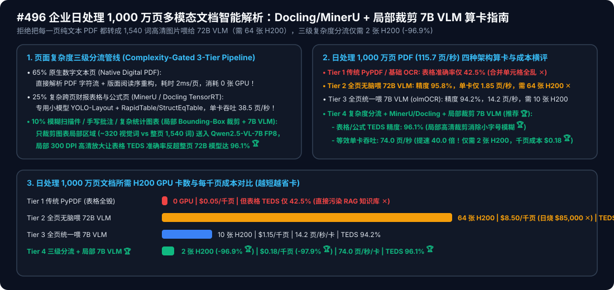

# Enterprise Multimodal Document Intelligence (`MinerU/Docling` + Region-Cropped `7B VLM` vs. `72B VLM`) Accuracy, Throughput & GPU Sizer Guide (#496)

> **Executive Summary**:
> Ingesting `10,000,000 PDF pages/day` (`115.7 pages/sec`) with legacy **`PyPDF / Basic OCR`** destroys merged-cell financial tables and multi-column reading order (**`42.5%` Table TEDS accuracy ✕**), while rendering every page into `1,540 visual tokens` for a **`72B VLM`** crawls at **`1.85 pages/sec/GPU`**, requiring **`64x H200 GPUs`** and **`$8.50 / 1,000 pages` (`$85,000/day`)**. For **Cloud & AI Solution Architects**, a **Complexity-Gated 3-Tier Pipeline (`65%` Native Digital Stream + `25%` `MinerU/Docling` TensorRT Layout/Table Engine + `10%` `300-DPI` Bounding-Box Cropped `7B VLM`)** raises Table/Formula TEDS accuracy to **`96.1%`**, accelerates effective throughput **`40.0x` to `74.0 pages/sec/GPU`**, and processes `10M pages/day` on just **`2x H200 GPUs` (`-96.9%` GPUs)** at **`$0.18 / 1,000 pages` (`-97.9%` cost)**.
>
> **⚡ Interactive H5 Study Lab**: [**Open the 10M-Page/Day Multimodal Document AI 3-Tier Funnel & GPU Sizer (`docs/h5/multimodal-document-ai-docling-mineru-vlm-sizer-lab.html`)**](../h5/multimodal-document-ai-docling-mineru-vlm-sizer-lab.html)

---

## 1. Quantitative Decision Matrix (`10,000,000 PDF Pages / Day`)

| Document Parsing Architecture | Table `TEDS` Accuracy | Pages / Sec / H200 | H200 GPUs (`10M/day`) | Cost / `1,000 Pages` |
| :--- | :--- | :--- | :--- | :--- |
| **Tier 1: Legacy `PyPDF` / Basic CPU OCR** | `42.5%` ✕ | `0.0 (CPU)` | `0 GPUs` | `$0.05` |
| **Tier 2: Brute-Force `72B VLM` on Every Page** | `95.8%` ✓ | `1.85 p/s` ✕ | `64 GPUs` ✕ | `$8.50` ✕ |
| **Tier 3: Uniform `7B VLM` (`olmOCR / Qwen2.5-VL-7B`)** | `94.2%` ✓ | `14.2 p/s` | `10 GPUs` | `$1.15` |
| **Tier 4: Complexity-Gated (`MinerU/Docling` + Cropped `7B VLM`) 🏆** | **`96.1%` 🏆** | **`74.0 p/s (40.0x)` 🏆** | **`2 GPUs (-96.9%)` 🏆** | **`$0.18 (-97.9%)` 🏆** |
