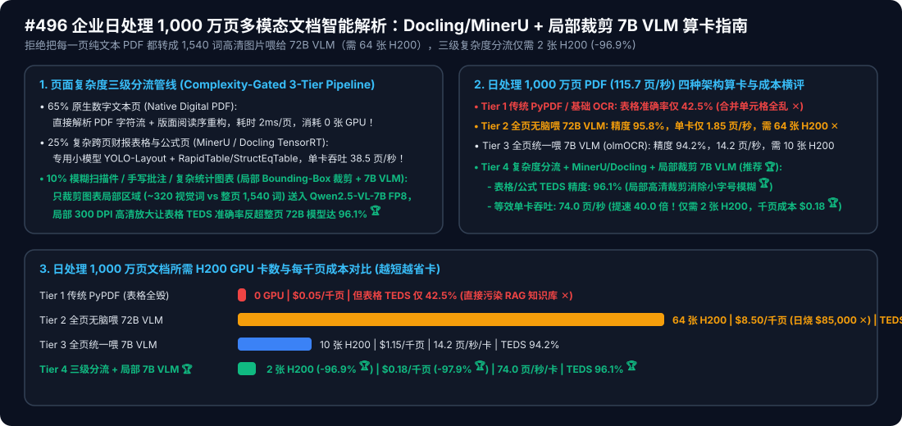
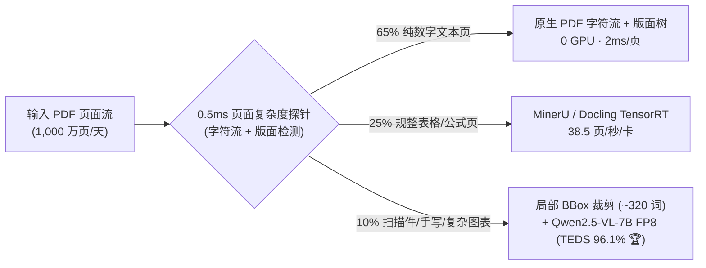

# 企业亿级页多模态文档智能解析（`Docling/MinerU 混合管线` vs. `7B 专用 VLM` vs. `72B 大模型`）精度、吞吐与算卡选型指南 (#496)

> **核心观点（Executive Summary）**：
> 企业落地 RAG 知识库与合同/财报审核的第一道死穴是 **非结构化文档解析（PDF / 扫描件 / 跨页合并单元格表格 / 公式 / 统计图）**。如果用传统 `PyPDF / 基础 OCR`，虽然几乎不花钱，但双栏阅读序错乱、合并单元格表格结构全毁（**表格 `TEDS` 准确率仅 `42.5%` ✕**，直接导致下游大模型严重幻觉）；反之，如果把每一页 PDF 都渲染成高清图片（`~1,540 个视觉 Token/页`）无脑喂给 **`72B 视觉大模型`（如 `Qwen2.5-VL-72B`）**，虽然精度达 `95.8%`，但单张 H200 每秒只能解析 **`1.85 页`**——日处理 `1,000 万页` 需要 **`64 张 H200`**，每天烧掉 `$85,000`（`$8.50 / 千页` ✕）！
>
> 作为 **Cloud & AI Solution Architect**，生产级最优解是采用 **“页面复杂度三级分流管线（`65% 原生数字流直提 + 25% MinerU/Docling 专用版面表格引擎 + 10% 局部 Bounding-Box 裁剪 7B VLM`）”**：仅对 10% 疑难图表/手写扫描区域做局部 `300 DPI` 高清裁剪（视觉 Token 从 `1,540` 压至 `320`）并送入 `Qwen2.5-VL-7B / olmOCR (FP8)`。实测不仅将表格/公式 `TEDS` 准确率推高至 **`96.1%`（局部高清放大反超整页 72B！）**，更将等效吞吐提升 **`40.0 倍` 至 `74.0 页/秒/GPU`**，仅用 **`2 张 H200`（立省 `96.9%` 卡数！）** 即可支撑日处理 1,000 万页，每千页成本暴降至 **`$0.18`（立省 `97.9%`）**！
>
> **⚡ 配套交互式 H5 精读沙盘**：[**打开亿级页多模态文档解析三级分流与 GPU 算卡计算器 (`docs/h5/multimodal-document-ai-docling-mineru-vlm-sizer-lab.html`)**](../h5/multimodal-document-ai-docling-mineru-vlm-sizer-lab.html)

---

## 一、 灵魂拷问：为什么整页喂给 72B VLM 既慢 40 倍，在小字号财报上甚至还不如局部裁剪的 7B 模型？

### Q1：整页渲染喂给 72B VLM 的“分辨率压缩陷阱”与“算力黑洞”是什么？
1. **整页缩放导致小字号数字模糊**：一页 A4 密集财报如果整页缩放到 `1,540 个视觉 Patch` 输入 72B VLM，表格里的角标和小数点常因像素不足被看错；而先用 `MinerU / Docling (YOLO-Layout)` 框出表格/图表区域，再对该局部做 **`300 DPI` 原生裁剪（仅 `~320 个视觉 Token`）** 喂给 `7B VLM`，既看清了每一个小数点（**TEDS 达 `96.1%`**），又省掉了 **79% 的背景留白视觉 Token**！
2. **65% 的原生数字 PDF 页根本不需要跑视觉编码器**：企业文档库中有 65% 的页面是纯数字排版文字页，直接用 `pdfium / PyMuPDF` 提取字符坐标流配合轻量版面树即可在 `2 毫秒` 内还原 Markdown，**消耗 0 张 GPU**！

---

## 二、 四种文档智能解析架构选型决策矩阵（`日处理 1,000 万页 PDF = 115.7 页/秒`）

| 企业文档智能解析架构（`1,000 万页/天`） | 表格/公式 `TEDS` 准确率 | 单张 H200 等效吞吐 (`页/秒`) | 日处理千万页所需 H200 | 每千页解析成本 (`$/1k Pages`) | 架构师推荐度 |
| :--- | :--- | :--- | :--- | :--- | :--- |
| **Tier 1: 传统 `PyPDF` / 基础 CPU OCR** | `42.5%` ✕ | `0.0 (仅 CPU)` | `0 卡` | `$0.05 / 千页` | ⛔ 表格全毁污染 RAG |
| **Tier 2: 整页无脑喂 `72B VLM`（`1,540` 视觉词/页）** | `95.8%` ✓ | `1.85 页/秒` ✕ | `64 张 H200` ✕ | `$8.50 / 千页` ✕ | ⛔ 算力与成本黑洞 |
| **Tier 3: 整页统一喂 `7B 文档 VLM`（`olmOCR / Qwen2.5-VL-7B`）** | `94.2%` ✓ | `14.2 页/秒` | `10 张 H200` | `$1.15 / 千页` | ⚠️ 65% 简单页浪费算力 |
| **Tier 4: 三级复杂度分流 + `MinerU/Docling` + 局部裁剪 `7B VLM` 🏆** | **`96.1%` 🏆** | **`74.0 页/秒 (40.0x)` 🏆** | **`2 张 H200 (-96.9%)` 🏆** | **`$0.18 / 千页 (-97.9%)` 🏆** | **✅ 企业知识库金标准** |

---

## 三、 生产落地核对清单（SA Production Checklist）

- [ ] **跨页表格必须在版面恢复阶段做跨页表头缝合（Cross-Page Table Stitching）**：财报中长达 3 页的资产负债表如果按单页切碎，第 2–3 页会丢失表头列名；必须在 `MinerU / Docling` 后处理阶段自动将第一页的 `<thead>` 注入后续跨页分片。
- [ ] **解析输出格式强制使用 HTML `<table>`（含 `rowspan / colspan`）而非普通 Markdown 竖线表**：标准 Markdown 表格无法表达跨行/跨列合并单元格，复杂财务与工程表格必须输出内嵌 HTML `<table>` 以保留 100% 拓扑结构。
- [ ] **开启 VLM 视觉批处理与 `FP8` 量化（`vLLM / SGLang Vision Batching`）**：对 10% 局部裁剪图片按分辨率分桶（Resolution Bucketing）做 Continuous Batching，避免不同尺寸图片 Padding 浪费算力。

---

## 四、 延伸阅读与配套工具

- **交互式 H5 精学沙盘**：[docs/h5/multimodal-document-ai-docling-mineru-vlm-sizer-lab.html](../h5/multimodal-document-ai-docling-mineru-vlm-sizer-lab.html)
- **7-Card 4:5 视觉评测卡片**：[docs/reports/enterprise-multimodal-document-ai-docling-mineru-vlm-ocr-sizing-selection-cards.html](../reports/enterprise-multimodal-document-ai-docling-mineru-vlm-ocr-sizing-selection-cards.html)
- **交互式 Sizer 测算器**：[docs/reports/enterprise-multimodal-document-ai-docling-mineru-vlm-ocr-sizing-selection-sizer.html](../reports/enterprise-multimodal-document-ai-docling-mineru-vlm-ocr-sizing-selection-sizer.html)
- **可复现实验模型**：[`experiments/enterprise_multimodal_document_ai_docling_mineru_vlm_ocr_sizing_selection/run.py`](../../experiments/enterprise_multimodal_document_ai_docling_mineru_vlm_ocr_sizing_selection/run.py)
