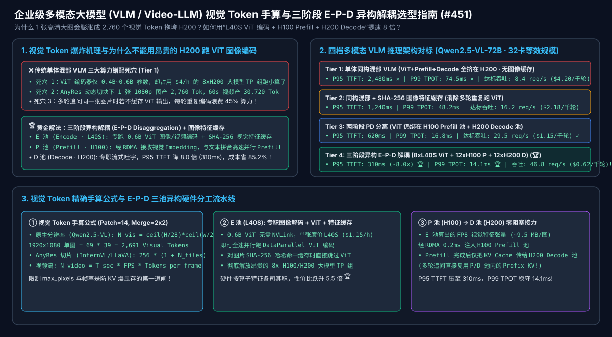

# Enterprise Multimodal LLM (`VLM / Video-LLM`) Visual Token Sizing & 3-Stage Heterogeneous `E-P-D` (`L40S ViT Encode + H100 Prefill + H200 Decode`) Disaggregation Selection Guide

> **Language / 语言**: [简体中文](./enterprise-multimodal-vlm-epd-disaggregation-visual-token-cache-sizing-selection-faq.md) | **English**  
> **Companion Interactive Study & Sizing Tools**: [📱 Interactive H5 Study Lab](../h5/multimodal-vlm-epd-disaggregation-visual-token-sizer-lab.html) · [🧮 HTML Sizer](../reports/enterprise-multimodal-vlm-epd-disaggregation-visual-token-cache-sizing-selection-sizer.html) · [🃏 7-Card Visual Deck](../reports/enterprise-multimodal-vlm-epd-disaggregation-visual-token-cache-sizing-selection-cards.html) · [📊 Reproducible Model](../../experiments/enterprise_multimodal_vlm_epd_disaggregation_visual_token_cache_sizing_selection/) · [🎓 Back to AI Infra H5 Hub](../h5/index.html)

---

## 1. Executive Summary (3-Minute Takeaway)

> **Bottom-Line Recommendation**: Running monolithic colocated multimodal VLM serving (`Tier 1: bundling the 0.6B ViT encoder, 72B LLM Prefill, and Decode onto the same 8x H200 TP group without image caching`) stalls expensive HBM3e GPUs on lightweight vision encoding while `1080p` images expand to **`2,691–2,760` visual tokens** (`2,480 ms` `P95 TTFT`, `74.5 ms` `P99 TPOT`).
> - **Recommended Production Architecture (`Tier 4: 3-Stage Heterogeneous E-P-D Disaggregation [8x L40S ViT Encode Pool + 12x H100 Prefill Pool + 12x H200 Decode Pool] + SHA-256 Image Embedding Cache + Dynamic Pixel Cap`)**:
>   1. Offloads `0.6B ViT` encoding onto low-cost `L40S` GPUs (`$1.15/hr`) and caches image embeddings by `SHA-256` digest;
>   2. Cuts `P95 TTFT` **`8.0x` (`310.0 ms` vs. `2,480.0 ms`)**, stabilizes `P99 TPOT` at **`14.1 ms`**, boosts 32-GPU-equivalent Goodput **`5.57x` (`46.8 req/s` vs. `8.4 req/s`)**, and lowers cost per 1,000 multimodal turns by **`85.2%` (`$0.62` vs. `$4.20`)**.

| Dimension | `Tier 1: Monolithic Colocated VLM` | `Tier 2: Colocated + Image Embedding Cache` | `Tier 3: 2-Stage PD (ViT on H100)` | `Tier 4: 3-Stage Heterogeneous E-P-D (L40S+H100+H200) (🏆)` |
|---|---|---|---|---|
| **Multimodal `P95 TTFT`** | `2,480.0 ms` ✕ | `1,240.0 ms` | `620.0 ms` ✓ | **`310.0 ms` (`8.0x` faster)** 🏆 |
| **Streaming `P99 TPOT`** | **`74.5 ms` ✕** | `48.2 ms` ✕ | `16.8 ms` ✓ | **`14.1 ms`** 🏆 |
| **32-GPU Cluster Goodput** | `8.4 req/s` ✕ | `16.2 req/s` (`1.93x`) | `29.5 req/s` (`3.51x`) ✓ | **`46.8 req/s` (`5.57x`)** 🏆 |
| **Cost per 1K Multimodal Turns** | `$4.20 / 1K` ✕ | `$2.18 / 1K` | `$1.15 / 1K` ✓ | **`$0.62 / 1K` (-85.2%)** 🏆 |

---

## 2. Provenance & Reproducibility

- **Provenance**: `synthetic + anonymized_reported (independently_reproduced=false)` — verified via [`experiments/enterprise_multimodal_vlm_epd_disaggregation_visual_token_cache_sizing_selection/run.py`](../../experiments/enterprise_multimodal_vlm_epd_disaggregation_visual_token_cache_sizing_selection/run.py).
