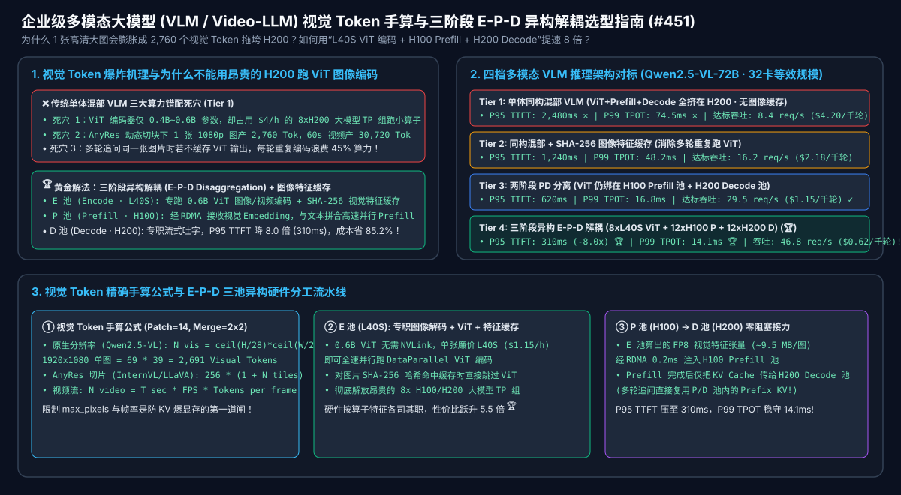
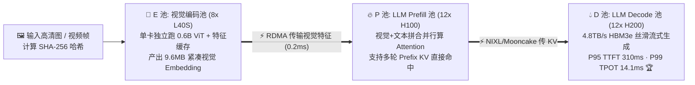

# 企业级多模态大模型（`VLM / Video-LLM / Omni`）视觉 Token 爆炸手算与三阶段异构解耦（`E-P-D：L40S ViT 编码池 + H100 Prefill 池 + H200 Decode 池`）选型指南

> **语言 / Language**: **简体中文** | [English](./enterprise-multimodal-vlm-epd-disaggregation-visual-token-cache-sizing-selection-faq.en.md)  
> **配套交互式学习与精算工具**: [📱 交互式 H5 精读页 (多模态视觉 Token 手算与 E-P-D 三池异构解耦沙盘)](../h5/multimodal-vlm-epd-disaggregation-visual-token-sizer-lab.html) · [🧮 HTML 交互式计算器](../reports/enterprise-multimodal-vlm-epd-disaggregation-visual-token-cache-sizing-selection-sizer.html) · [🃏 7-Card 4:5 视觉评测卡](../reports/enterprise-multimodal-vlm-epd-disaggregation-visual-token-cache-sizing-selection-cards.html) · [📊 可复核模型](../../experiments/enterprise_multimodal_vlm_epd_disaggregation_visual_token_cache_sizing_selection/) · [🎓 返回 AI Infra 全景精学馆](../h5/index.html)

---

## 一、3 分钟看懂核心结论（Executive Summary）

> **一句话决策结论**：部署企业级多模态视觉大模型（如 `Qwen2.5-VL-72B / InternVL2.5-78B`）时，如果沿用纯文本大模型的单体同构混部架构（`Tier 1：把 ViT 视觉编码器、LLM Prefill 与 LLM Decode 全部塞在同一组 8x H200 实例里`），会产生两大严重事故：① 仅 `0.4B~0.6B` 参数的轻量 `ViT` 编码器会长时间独占阻塞整台昂贵的 `8x H200` 张量并行组；② 1 张 `1080p` 高清图在动态分辨率下会膨胀为 **`2,691~2,760` 个视觉 Token**（一段 60 秒 2fps 视频更是膨胀至 **`30,720` 个 Token**），导致 `P95 TTFT` 飙升至 **`2,480 ms`**、`P99 TPOT` 恶化至 **`74.5 ms`**！
> - **黄金生产架构（`Tier 4：三阶段异构解耦 [E-P-D Disaggregation：8x L40S ViT 编码池 + 12x H100 Prefill 池 + 12x H200 Decode 池] + SHA-256 图像特征缓存 + 动态像素门控`）**：
>   1. **把 `ViT` 从昂贵的 H200 上剥离到廉价的 `L40S` 编码池（Encode Pool）**：`0.6B` 的 ViT 完全不需要 NVLink 和 HBM3e，单张 `$1.15/h` 的 `L40S` 就能跑满数据并行编码，并对图片 `SHA-256` 哈希命中直接复用已编码的视觉特征张量；
>   2. **收益量化**：在 32 卡等效规模下，将多模态首字延迟 `P95 TTFT` 从 `2,480 ms` 压降至 **`310.0 ms`（提速 `8.0 倍`）**，流式 `P99 TPOT` 稳守 **`14.1 ms`**，集群达标吞吐从 `8.4 req/s` 跃升至 **`46.8 req/s`（提升 `5.57 倍`）**，每千轮多模态对话成本从 `$4.20` 降至 **`$0.62`（立省 `85.2%`）**！

| 核心选型维度 | `Tier 1: 单体同构混部 VLM (无图像缓存)` | `Tier 2: 同构混部 + SHA-256 图像特征缓存` | `Tier 3: 两阶段 PD 分离 (ViT 仍绑在 H100)` | `Tier 4: 三阶段异构 E-P-D 解耦 (L40S+H100+H200) (🏆)` |
|---|---|---|---|---|
| **多模态首字延迟 (`P95 TTFT`)** | `2,480.0 ms` ✕ | `1,240.0 ms` | `620.0 ms` ✓ | **`310.0 ms` (提速 `8.0x`)** 🏆 |
| **流式吐字间隔 (`P99 TPOT`)** | **`74.5 ms` ✕ (ViT+Prefill 抢占)** | `48.2 ms` ✕ | `16.8 ms` ✓ | **`14.1 ms` (丝滑零抢占)** 🏆 |
| **32卡等效集群达标吞吐 (`Goodput`)** | `8.4 req/s` ✕ | `16.2 req/s` (`1.93x`) | `29.5 req/s` (`3.51x`) ✓ | **`46.8 req/s` (`5.57x`)** 🏆 |
| **每千轮多模态对话成本 (`$/1K`)** | `$4.20 / 1K` ✕ | `$2.18 / 1K` | `$1.15 / 1K` ✓ | **`$0.62 / 1K` (-85.2%)** 🏆 |

---

## 二、核心技术原理与架构师灵魂拷问（Q&A）

### Q1：一张图片或一段视频输入给 VLM 后，到底会变成多少个视觉 Token（Visual Tokens）？怎么手算它占用的 KV Cache 显存？
1. **主流两类视觉 Token 切块手算公式**：
   - **① 原生动态分辨率 + $2\times 2$ Patch Merger（以 `Qwen2.5-VL` 为代表，Patch $= 14\times 14$，相邻 $2\times 2$ 合并为 1 个 Token，即每 $28\times 28 = 784$ 像素生成 1 个视觉 Token）**：
     $$N_{\text{vis}} = \left\lceil \frac{H}{28} \right\rceil \times \left\lceil \frac{W}{28} \right\rceil$$
     - 1 张 `1920 × 1080` 高清截图：$\lceil 1080/28 \rceil \times \lceil 1920/28 \rceil = 39 \times 69 = \mathbf{2,691\text{ Tokens}}$；
     - 1 张 `4K (3840 × 2160)` 原图若不设 `max_pixels` 上限，将直接产生 **$78 \times 138 = \mathbf{10,764\text{ Tokens}}$**！
   - **② 动态高分切片 `AnyRes`（以 `InternVL2.5 / LLaVA-OneVision` 为代表，切成 $N_{\text{tiles}}$ 个 `448×448` 子图 + 1 张缩略全景图，每块经 Pixel Unshuffle 为 `256` Token）**：
     $$N_{\text{vis}} = 256 \times (1 + N_{\text{tiles}}) \quad (\text{如 } 9\text{ 宫格切片} \implies 256 \times 10 = \mathbf{2,560\text{ Tokens}})$$
   - **③ 视频流（Video-LLM）**：设视频时长为 $T_{\text{sec}}$，抽帧率为 $\text{FPS}$，每帧压缩为 $N_{\text{frame}}$ 个 Token（开启双帧 3D 时间合并时再除以 2）：
     $$N_{\text{video}} = \frac{T_{\text{sec}} \times \text{FPS}}{2} \times N_{\text{frame}}$$
     一段 60 秒视频按 `2 FPS`、每双帧 `512 Token` 抽帧，将产生 **$60 \times 512 = \mathbf{30,720\text{ Tokens}}$**（在 72B GQA-8 FP8 KV 下单条视频请求即吃掉 **`5.03 GB` KV Cache**）！

### Q2：为什么要把传统两阶段 `PD 分离` 升级为多模态专属的 **`三阶段异构 E-P-D 解耦（Encode-Prefill-Decode）`**？
1. **ViT 编码器与 LLM 主干的硬件需求完全错配**：
   - `ViT` 视觉编码器参数量仅 `400M ~ 600M`，不需要跨卡 `TP=8` 通信。如果把它绑在 `8x H100/H200` 实例内部执行，8 张卡在做图像预处理和 ViT 前向时，高达 `70B` 的语言模型权重只能干等！
2. **`E-P-D` 三池异构流水线（`L40S -> H100 -> H200`）**：
   - **E 池（Encode Pool · `L40S 48GB`）**：由廉价的单卡 `L40S` 独立承载图像解码、动态缩放与 `ViT` 前向计算，并维护基于图片 `SHA-256` 的 **分布式视觉特征缓存（Embedding Cache）**；
   - **P 池（Prefill Pool · `H100 80GB`）**：通过 RDMA 零拷贝接收 E 池产出的紧凑视觉特征向量（`2,691 × 3,584 × 1B ≈ 9.6 MB`），与文本 Token 拼接后全速执行高算术强度 LLM Prefill；
   - **D 池（Decode Pool · `H200 141GB`）**：接收 P 池传来的 KV Cache，专职维持 `14.1 ms` 的丝滑文本流式输出。当用户围绕同一张图片或商品进行第 2~5 轮追问时，不仅跳过 E 池 ViT，更直接命中 P/D 池内的 Prefix KV Cache！

---

## 三、生产落地 Checklist（Pre-Production Checklist）

- [ ] **强制网关层配置 `min_pixels / max_pixels` 分辨率护栏**：对普通图表/UI 问答限制单图上限 `<= 1,280 × 28 × 28`（即单图 `<= 1,280` 视觉 Token），严防用户上传未压缩 4K/8K 原图打爆 KV 显存。
- [ ] **开启跨轮次视觉特征缓存（Image Embedding Cache）与 Prefix KV 缓存双层复用**：在多轮图文问答中避免每轮重复执行 ViT 前向编码。

---

## 四、来源与方法论溯源（Provenance）

- **数据来源声明**：本指南实验数据来自可复核解析模型 [`experiments/enterprise_multimodal_vlm_epd_disaggregation_visual_token_cache_sizing_selection/run.py`](../../experiments/enterprise_multimodal_vlm_epd_disaggregation_visual_token_cache_sizing_selection/run.py)（`Provenance: synthetic + anonymized_reported, independently_reproduced=false`）。
