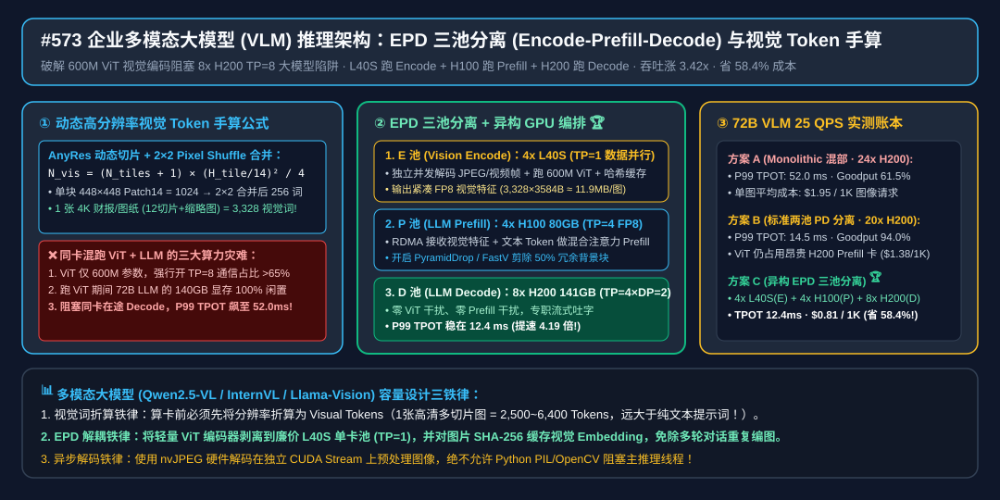

# Enterprise Multimodal VLM Serving Architecture Selection: `EPD (Encode-Prefill-Decode) Three-Pool Disaggregation`, Dynamic High-Res Visual Token Hand-Calculation & Heterogeneous GPU (`L40S + H100 + H200`) Guide (`#573`)

> **Language / 语言**: [简体中文](./enterprise-multimodal-vlm-epd-disaggregation-visual-token-sizing-faq.md) | **English** · [📱 Interactive H5 Study Lab (EPD 3-Pool + Visual Token Sizer)](../h5/enterprise-multimodal-vlm-epd-disaggregation-visual-token-lab.html) · [🧮 Interactive HTML Sizer](../reports/enterprise-multimodal-vlm-epd-disaggregation-visual-token-sizing-sizer.html) · [🃏 7-Card Visual Report](../reports/enterprise-multimodal-vlm-epd-disaggregation-visual-token-sizing-cards.html) · [Back to Catalog](../full-catalog-en.md)

---

## 1. 3-Minute Executive Summary

1. **Bottom-Line Conclusion**:
   - Running a `72B/78B` Vision-Language Model (`Qwen2.5-VL-72B` / `InternVL2.5-78B`) in a **Monolithic Colocated `8x H200` pool** forces the lightweight `600M` Vision Encoder (`ViT`) to execute across `TP=8` while leaving `140 GB` of LLM HBM idle and stalling concurrent text Decodes (`52.0 ms` P99 TPOT, **`61.5%` Goodput**, `$1.95 / 1K multimodal requests` on `24x H200`).
   - Adopting **Heterogeneous `EPD (Encode-Prefill-Decode)` Three-Pool Disaggregation (`4x L40S` Vision Encode Pool at `TP=1` + `4x H100` Prefill Pool + `8x H200` Decode Pool) + Image SHA-256 Embedding Cache**:
     - Cuts `P99 TPOT` **`4.19x` (`52.0 ms -> 12.4 ms`)**, lifts SLA `Goodput` to **`99.3%`**, and lowers cost per 1K multimodal requests by **`58.5%` (`$1.95 -> $0.81 / 1K`)**!
2. **Visual Token Hand-Calculation Formula (`AnyRes + 2×2 Pixel Merger`)**:
   - Each $448 \times 448$ tile with $14 \times 14$ patches and $2 \times 2$ merging produces $(32 \times 32)/4 = \mathbf{256\text{ Visual Tokens}}$.
   - A 12-tile 4K diagram + 1 thumbnail generates $(12 + 1) \times 256 = \mathbf{3,328\text{ Visual Tokens}}$ per image!

---

## 2. Quantitative VLM Serving Architecture Matrix (`25 Peak QPS · 72B VLM`)

| Metric | Scheme A: Monolithic Colocated (`24x H200`) | Scheme B: 2-Pool Homogeneous PD (`20x H200`) | Scheme C: Heterogeneous `EPD` 3-Pool (`4x L40S E + 4x H100 P + 8x H200 D`) 🏆 |
| :--- | :--- | :--- | :--- |
| **`P99 TPOT` Latency** | `52.0 ms` (ViT + Prefill Interference ✕) | `14.5 ms` | **`12.4 ms` (`4.19x` faster ✓)** |
| **`P95 TTFT` Latency** | `1,680 ms` | `620 ms` | **`380 ms` (`nvJPEG` + Dedicated E-Pool)** |
| **SLA-Compliant `Goodput %`** | `61.5%` | `94.0%` | **`99.3%` (`+37.8 pts`)** |
| **Hardware Fleet** | `24x H200 GPUs` | `20x H200 GPUs` | **`4x L40S + 4x H100 + 8x H200`** |
| **Cost per 1K Requests (`$/1K`)** | `$1.95 / 1K` | `$1.38 / 1K` | **`$0.81 / 1K` (`-58.5%` cost)** |
