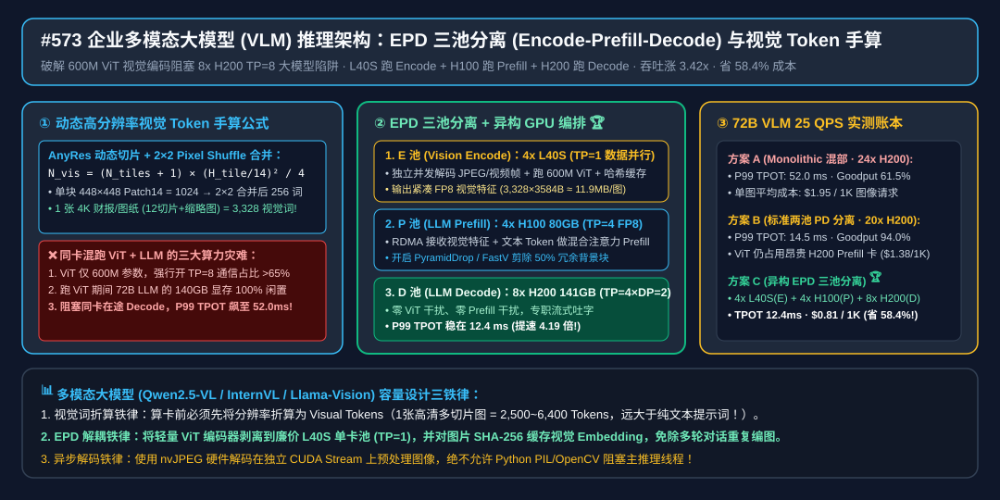

# 企业多模态大模型（VLM）推理服务架构选型：`EPD 三池分离（Encode-Prefill-Decode Disaggregation）`、动态高分辨率视觉 Token 手算与异构 GPU（`L40S + H100 + H200`）指南（`#573`）

> **Language / 语言**: **简体中文** | [English](./enterprise-multimodal-vlm-epd-disaggregation-visual-token-sizing-faq.en.md) · [📱 交互式 H5 精读页（含 EPD 三池图 + 视觉 Token 算卡器）](../h5/enterprise-multimodal-vlm-epd-disaggregation-visual-token-lab.html) · [🧮 交互式算卡器 Sizer](../reports/enterprise-multimodal-vlm-epd-disaggregation-visual-token-sizing-sizer.html) · [🃏 7-Card 评测报告](../reports/enterprise-multimodal-vlm-epd-disaggregation-visual-token-sizing-cards.html) · [返回总目录](../full-catalog-zh.md)

---

## 一、3 分钟核心结论卡片（Executive Summary）

1. **一句话结论**：
   - 在企业部署 `72B/78B` 多模态视觉语言模型（如 `Qwen2.5-VL-72B`、`InternVL2.5-78B`，处理高分辨率财报图表、工程图纸、商品图与多帧视频，峰值 `25 QPS`）时，传统的 **单体同池混部（Monolithic Colocated VLM）** 将仅 `600M` 参数的视觉编码器（`ViT`）与 `72B` 语言模型强行绑在同一组 `8x H200 (TP=8)` 进程内：当跑 `ViT` 编码图片时，`72B` 权重的 `140 GB HBM` 100% 闲置空转，且阻塞同卡正在进行的文本 Decode，导致 `P99 TPOT` 飙升至 **`52.0 ms`**（SLA `Goodput` 仅 **`61.5%`**，需 **`24 张 H200`**，千次请求成本 **`$1.95`**）；
   - 采用 **`EPD 三池异构分离架构（Encode-Prefill-Decode Disaggregation：4x L40S 跑 E 池 + 4x H100 跑 P 池 + 8x H200 跑 D 池）+ 图像 SHA-256 视觉 Embedding 缓存 + 2×2 Pixel Merger`**：
     - 将 `ViT` 彻底剥离到高算力性价比的 `L40S` 单卡池（`TP=1` 零跨卡通信），算完仅将紧凑的 `11.9 MB FP8` 视觉特征张量发给 `H100 Prefill` 池；
     - `P99 TPOT` 压降至 **`12.4 ms`（提速 `4.19 倍`）**，SLA `Goodput` 达 **`99.3%`**，千次多模态请求成本从 `$1.95` 降至 **`$0.81 / 1K Reqs`（节省 `58.5%` 成本）**！

---

## 二、灵魂拷问 Q&A：高分辨率视觉 Token 手算与 EPD 三池解耦机理

### Q1：客户说“我的多模态提示词只有 100 个汉字，为什么显存和首字延迟比 4K 纯文本还慢”？如何手算一张高清图片或一段视频产生的 `Visual Tokens`？
- **答**：架构师做多模态算卡的第一步，就是把图像分辨率折算成等价的 **Visual Tokens（$N_{\text{vis}}$）**：
  - 现代主流 VLM（`Qwen2.5-VL / InternVL`）采用 **动态高分辨率切片（Dynamic AnyRes Tiling）+ $2\times 2$ 像素重排合并（Pixel Shuffle / MLP Merger）**：
    - 设基础切片尺寸为 $448 \times 448$，ViT Patch 大小为 $14 \times 14$，则单个切片原始 Patch 数为 $(448/14) \times (448/14) = 32 \times 32 = 1,024$ 个；
    - 经过 $2 \times 2$ 相邻 Token 合并后，**每个 $448 \times 448$ 切片固定产生 $1,024 / 4 = \mathbf{256\text{ 个 Visual Tokens}}$**！
    - **公式**：对于一张被切分为 $N_{\text{tiles}}$ 个局部高清块 + `1` 个全局缩略图的图片：
      $$N_{\text{vis}} = (N_{\text{tiles}} + 1) \times 256$$
    - **算例**：
      1. **1 张 1080p/4K 财报扫描页或 CAD 图纸（切 `12 块 + 1 缩略图`）**：$N_{\text{vis}} = 13 \times 256 = \mathbf{3,328\text{ Tokens}}$（若一个请求带 3 张图，仅视觉 Token 就高达 **`9,984 Tokens`**，远超那 100 个汉字！）；
      2. **1 段 30 秒监控/赛事视频（按 `2 fps` 抽 `60 帧`，每帧经时空压缩后 `192 Tokens`）**：$N_{\text{vis}} = 60 \times 192 = \mathbf{11,520\text{ Tokens}}$！

---

### Q2：为什么在 `PD 分离` 之上还要把 `Encode (ViT)` 单独拆出来做成 `EPD 三池分离`？
- **答**：
  1. **并行维度错配**：`72B LLM` 必须开 `TP=4` 或 `TP=8`，但 `ViT` 视觉编码器通常只有 `300M–600M` 参数，矩阵极小；如果在 `TP=8` 的 H200 组里跑 `ViT`，每层微小的矩阵乘都要触发 NVLink `AllReduce`，算力利用率不足 `18%`。把 `ViT` 拆到独立的 **`L40S Encode 池`（以 `TP=1, DP=4` 方式运行）**，单卡效率直接翻 `3.5 倍`！
  2. **多轮对话的“图像特征缓存（Embedding Cache）”**：在多轮看图问答中，用户围绕同一张图纸连续追问 5 轮。在 `EPD` 架构下，`E 池` 按图片 `SHA-256` 缓存编码后的 `11.9 MB` 视觉特征向量，第 2~5 轮直接跳过 `ViT` 编码且命中 `P 池` 的 Prefix KV Cache！

---

## 三、三种多模态 VLM 推理架构定量对比矩阵（`25 Peak QPS · 72B VLM · 4K 图表问答`）

| 评估维度 | 方案 A：单体同池混部 (`Monolithic Colocated · 24x H200`) | 方案 B：标准两池 PD 分离 (`Homogeneous H200 PD · 20x H200`) | 方案 C：异构 EPD 三池分离 (`4x L40S E + 4x H100 P + 8x H200 D`) 🏆 |
| :--- | :--- | :--- | :--- |
| **流式吐字延迟 (`P99 TPOT`)** | `52.0 ms`（ViT 与 Prefill 抢占 ✕） | `14.5 ms` | **`12.4 ms`（提速 `4.19 倍` ✓）** |
| **首字延迟 (`P95 TTFT`)** | `1,680 ms` | `620 ms` | **`380 ms`（`nvJPEG` + 独立 E 池 + 图像哈希缓存）** |
| **SLA 达标有效吞吐率 (`Goodput %`)** | `61.5%` | `94.0%` | **`99.3%`（提升 `+37.8 pts`）** |
| **硬件配置总池** | `24x H200` | `20x H200` | **`4x L40S + 4x H100 + 8x H200`（仅用 8 张 H200）** |
| **每千次多模态请求成本 (`$/1K Reqs`)** | `$1.95 / 1K` | `$1.38 / 1K` | **`$0.81 / 1K`（成本降低 `58.5%`）** |

---

## 四、多模态 VLM 推理平台上线核对清单（SA Pre-Production Checklist）

- [ ] **1. 限制最大动态切片数（`max_dynamic_patch`）**：对普通拍照问答限制 `max_tiles = 6`（`1,792 Tokens`），仅对密集财报/工程图纸开放 `max_tiles = 12~16`。
- [ ] **2. 启用 `nvJPEG` GPU 硬件异步图像解码**：消除 CPU `PIL/OpenCV` 解码高清大图造成的 GIL 锁阻塞。
- [ ] **3. 开启图片 `SHA-256` 视觉 Embedding 缓存与 Prefix KV 对齐**：将图像占位符置于系统提示词之后、用户多轮追问之前。
