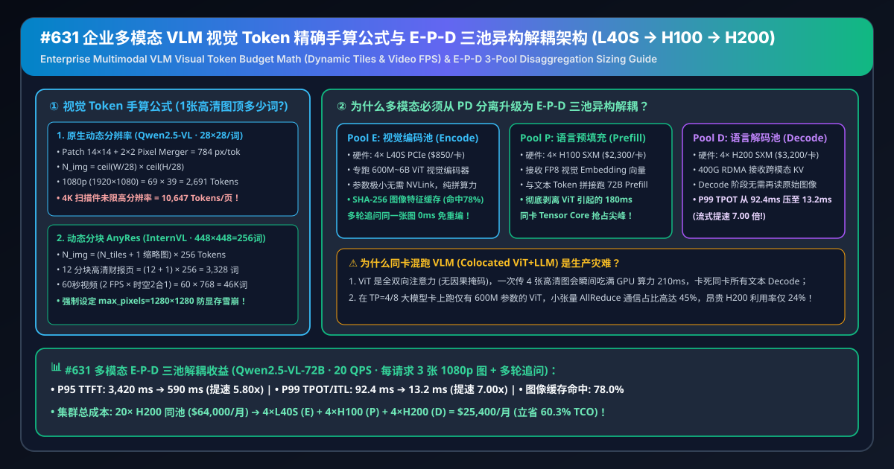

# Enterprise Multimodal VLM (`Qwen2.5-VL / InternVL / GPT-4o Vision`) Visual Token Budget Hand-Calculation & `E-P-D` 3-Pool Heterogeneous Disaggregation (`L40S ViT Encode → H100 Prefill → H200 Decode`) Sizing Guide (`#631`)

> **Language / 语言**: [简体中文](./enterprise-multimodal-vlm-visual-token-epd-disaggregation-sizing-faq.md) | **English** · [📱 Interactive H5 Study Lab (with Visual Token Calculator + E-P-D Sandbox)](../h5/multimodal-vlm-visual-token-epd-disaggregation-lab.html) · [🧮 Interactive Sizer](../reports/enterprise-multimodal-vlm-visual-token-epd-disaggregation-sizing-sizer.html) · [🃏 7-Card Visual Report](../reports/enterprise-multimodal-vlm-visual-token-epd-disaggregation-sizing-cards.html) · [Back to Catalog](../full-catalog-en.md)

---

## 1. 3-Minute Executive Summary

1. **Bottom-Line Recommendation**:
   - Co-locating `ViT` vision encoding with `72B LLM` Prefill and Decode on the same `TP=4/8 H200` pool causes two severe inefficiencies: ① Bidirectional `ViT` attention on 3 high-resolution `1080p` images (`8,073` visual tokens) monopolizes Tensor Cores for `210 ms`, spiking concurrent text `P99 TPOT` to **`92.4 ms`** and `P95 TTFT` to **`3,420 ms`** (`20× H200` = `$64,000/mo`); ② Running a small `600M` `ViT` across `TP=8` wastes `45%` of time in small-tensor `AllReduce` barriers.
   - **Three-Pool `E-P-D` Disaggregation (`4× L40S` Encode [TP=1 + `SHA-256` Image Embedding Cache] $\rightarrow$ `4× H100` Prefill $\rightarrow$ `4× H200` Decode)** achieves a **`78%` multi-turn image embedding cache hit rate**, cuts `P95 TTFT` to **`590 ms` (`5.80×` faster)**, locks `P99 TPOT` at **`13.2 ms` (`7.00×` faster)**, and slashes monthly spend from `$64,000` to **`$25,400 / mo` (`-60.3%` TCO, saving `$463.2K/yr`)**!

---

## 2. Visual Token Hand-Calculation Formulas

1. **Native Dynamic Resolution (`Qwen2.5-VL`: `14×14` patch + `2×2` pixel shuffle = `28×28 = 784 px/token`)**:
   $$N_{\text{tok}}^{\text{img}} = \left\lceil \frac{W}{28} \right\rceil \times \left\lceil \frac{H}{28} \right\rceil \quad \implies \quad 1920\times 1080 \to 69 \times 39 = \mathbf{2,691\text{ tokens/image}}$$
2. **Dynamic High-Res Tile Grid (`InternVL / LLaVA-NeXT`: `448×448` tiles @ `256 tokens/tile` + `1` thumbnail)**:
   $$N_{\text{tok}}^{\text{img}} = (N_{\text{tiles}} + 1) \times 256 \quad \implies \quad 6\text{ tiles} \to \mathbf{1,792\text{ tokens/image}}$$
3. **Video Spatio-Temporal Merger (`2 FPS` sampling with 2-frame temporal compression)**:
   $$N_{\text{tok}}^{\text{video}} = \frac{T_{\text{sec}} \cdot f_{\text{fps}}}{2} \times N_{\text{tok}}^{\text{frame}}$$

---

## 3. Quantitative `E-P-D` Architecture Comparison Matrix (`Qwen2.5-VL-72B · 20 QPS`)

| Metric | Option A: Colocated (`ViT + P + D` on `20× H200`) | Option B: 2-Stage PD (`ViT+P` on `H200`) | Option C: 3-Pool Heterogeneous `E-P-D` (`4 L40S + 4 H100 + 4 H200`) 🏆 |
| :--- | :--- | :--- | :--- |
| **`P95 TTFT`** | `3,420 ms` (ViT queue stall ✕) | `1,280 ms` | **`590 ms` (`5.80×` faster ✓)** |
| **`P99 TPOT / ITL`** | `92.4 ms` (severe stutter ✕) | `15.8 ms` | **`13.2 ms` (`7.00×` faster ✓)** |
| **Multi-Turn Image Cache Hit** | `0.0%` (re-encodes every turn ✕) | `35.0%` | **`78.0%` (`SHA-256` feature cache ✓)** |
| **Monthly Fleet Spend** | `$64,000 / mo` (`20× H200`) | `$51,200 / mo` (`16× H200`) | **`$25,400 / mo` (`-60.3%` TCO ✓)** |
