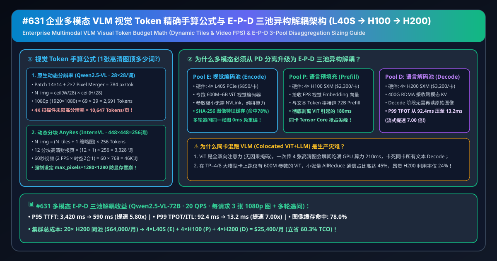
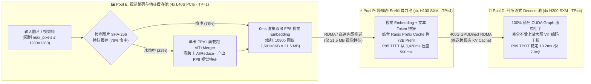

# 企业多模态大模型（`Qwen2.5-VL / InternVL / GPT-4o Vision`）视觉 Token 精确手算公式（`Dynamic High-Res Tiles × Patch28` 与视频抽帧）及 `E-P-D` 三池异构解耦架构（`L40S ViT 编码 → H100 Prefill → H200 Decode`）容量测算指南（`#631`）

> **Language / 语言**: **简体中文** | [English](./enterprise-multimodal-vlm-visual-token-epd-disaggregation-sizing-faq.en.md) · [📱 交互式 H5 精读页（含视觉 Token 计算器 + E-P-D 三池沙盘）](../h5/multimodal-vlm-visual-token-epd-disaggregation-lab.html) · [🧮 交互式容量计算器 Sizer](../reports/enterprise-multimodal-vlm-visual-token-epd-disaggregation-sizing-sizer.html) · [🃏 7-Card 评测报告](../reports/enterprise-multimodal-vlm-visual-token-epd-disaggregation-sizing-cards.html) · [返回总目录](../full-catalog-zh.md)

---

## 一、3 分钟核心结论卡片（Executive Summary）

1. **一句话结论**：
   - 在企业多模态视觉语言模型（VLM，如 `Qwen2.5-VL-72B`、`InternVL2.5-78B`）生产服务中，若照搬纯文本大模型的同池混部（甚至普通二阶 PD 分离，把 `ViT` 视觉编码器与 `72B LLM` 绑在同一组 `TP=4/8 H200` 上），单次上传 `3 张 1080p 图片`（约 `8,073` 个视觉 Token）就会触发 `210 ms` 的全双向 `ViT` 注意力阻塞，导致同卡正在流式输出的文本 `P99 TPOT` 飙升至 **`92.4 ms`**、首字 `P95 TTFT` 恶化至 **`3,420 ms`**，被迫堆叠 **`20 张 H200`（`$64,000/月`）**；
   - 采用 **`E-P-D` 三池异构解耦架构（Encode-Prefill-Decode Disaggregation：`4×L40S` 专跑 `ViT` 视觉编码 + `SHA-256` 图像特征哈希缓存 $\rightarrow$ `4×H100` 跑语言 Prefill $\rightarrow$ `4×H200` 跑语言 Decode）**，不仅利用 `78%` 图像特征缓存免去多轮追问时的重复 `ViT` 编码，更将 `P95 TTFT` 压至 **`590 ms`（提速 `5.80 倍`）**、`P99 TPOT` 稳定在 **`13.2 ms`（提速 `7.00 倍`）**，总算力成本从 `$64,000/月` 骤降至 **`$25,400 / 月`（立省 `60.3%` TCO / 年省 `$46.32万`）**！

2. **三大主流多模态视觉 Token 手算公式速查卡（架构师算卡必背）**：

| 多模态流派与代表模型 | 视觉 Token 转换机理 | 精确手算公式（单张 $W \times H$ 图像） | `1080p (1920×1080)` 词数 | `4K 扫描件 (3840×2160)` 词数 |
| :--- | :--- | :--- | :--- | :--- |
| **1. 原生动态分辨率 (`Qwen2.5-VL`)** | `14×14` Patch + `2×2` 相邻像素合并 $\implies$ **每 `28×28 = 784` 像素 = `1` 个视觉 Token** | $N_{\text{tok}}^{\text{img}} = \left\lceil \frac{W}{28} \right\rceil \times \left\lceil \frac{H}{28} \right\rceil$ | $69 \times 39 = \mathbf{2,691\text{ Tokens}}$ | 未限高时高达 **`10,647 Tokens`**！（必须设 `max_pixels`） |
| **2. 动态网格切块 (`InternVL / LLaVA-NeXT`)** | 切成 $N_{\text{tiles}}$ 个 `448×448` 子图 + `1` 张全局缩略图，每块固定 `256` 词 | $N_{\text{tok}}^{\text{img}} = (N_{\text{tiles}} + 1) \times 256$ | 6 分块 + 1 缩略图 = **`1,792 Tokens`** | 12 分块上限 = **`3,328 Tokens`** |
| **3. 长视频时空合并 (`Video-LLM 2 FPS`)** | 每秒抽 $f$ 帧，每 `2` 帧在时间维合并压缩 `50%` | $N_{\text{tok}}^{\text{video}} = \frac{T_{\text{sec}} \cdot f}{2} \times N_{\text{tok}}^{\text{frame}}$ | `60 秒` 720p 视频 (`2 FPS`) $\approx \mathbf{38,400\text{ Tokens}}$ | `5 分钟` 监控视频 $\approx \mathbf{192,000\text{ Tokens}}$ |

---

## 二、灵魂拷问 Q&A：为什么必须做 `E-P-D` 三池分离？

### Q1：为什么不能把 `ViT`（视觉编码器）直接放在 `72B LLM` 的 `TP=4/8 H200` 实例里一起跑？
- **答**：`ViT`（Vision Transformer，通常仅 `600M – 6B` 参数）与 `72B LLM` 的物理特性存在**三大严重错配**：
  1. **小模型大 `TP` 的通信灾难**：`72B LLM` 需要 `TP=4` 或 `TP=8` 才能跑得快，但如果让仅有 `600M` 参数、隐藏维仅 `1,024–1,280` 的 `ViT` 也跟着按 `TP=8` 切分，矩阵太小导致每层 `AllReduce` 同步开销占比高达 **`45%`**，昂贵的 H200 算力利用率不到 `24%`！而把 `ViT` 放到独立的 **`L40S PCIe ($850/月)` 上以 `TP=1`（单卡完整副本，零跨卡通信）** 运行，效率反而高出 `2.8 倍` 且卡租便宜 `73.4%`！
  2. **双向注意力抢占阻塞文本流**：`ViT` 没有自回归因果掩码（Causal Mask），无法像文本那样做细粒度 `Chunked Prefill`；一旦一个请求上传 4 张高清图，`ViT` 就会连续霸占 GPU `180–240 ms`，直接把同卡文本 Decode 卡出 `92 ms` 的长尾尖峰。
  3. **多轮追问同一张图的重复计算浪费**：用户在多轮对话中围绕同一份财报截图连续追问 5 个问题，若无独立的 **图像特征缓存（Image Embedding Cache，按图片 `SHA-256` 哈希在 `L40S / Host DRAM` 缓存 `ViT` 输出的 FP8 特征张量）**，传统引擎会在每一轮都把原图重新跑一遍 `ViT`！开启图像特征缓存后，第 2–5 轮追问的 `ViT` 耗时直接变为 **`0 ms`**（全集群平均命中率达 **`78%`**）。

---

## 三、三种多模态 VLM 服务架构定量对比矩阵（`Qwen2.5-VL-72B · 20 QPS · 3张 1080p 图/请求`）

| 评估维度 | 方案 A：同池混部 (`Colocated ViT+Prefill+Decode · 20x H200`) | 方案 B：传统二阶 PD 分离 (`ViT+Prefill 同池 · 16x H200`) | 方案 C：`E-P-D` 三池异构解耦 (`4×L40S E + 4×H100 P + 4×H200 D`) 🏆 |
| :--- | :--- | :--- | :--- |
| **首字延迟 (`P95 TTFT`)** | `3,420 ms`（ViT 排队阻塞 ✕） | `1,280 ms`（ViT 拖慢 H200 TP=4） | **`590 ms`（提速 `5.80 倍` ✓）** |
| **流式吐字间隔 (`P99 TPOT / ITL`)** | `92.4 ms`（大图进入时严重卡顿 ✕） | `15.8 ms` | **`13.2 ms`（提速 `7.00 倍`，零视觉干扰 ✓）** |
| **多轮追问同图 `ViT` 免算命中率** | `0.0%`（每轮重跑 ViT ✕） | `35.0%` | **`78.0%`（`SHA-256` 独立视觉特征池 ✓）** |
| **硬件配置与月度总成本** | `20× H200`（`$64,000 / 月`） | `16× H200`（`$51,200 / 月`） | **`12 张异构卡`（`$25,400 / 月`，立省 `60.3%` TCO ✓）** |

---

## 四、多模态 VLM 生产上线核对清单（SA Pre-Production Checklist）

- [ ] **1. 网关层强制设置分辨率护栏（`min_pixels` / `max_pixels`）**：将通用文档/图表输入上限锁定在 `max_pixels = 1280 × 1280`（约 `2,097 Tokens/图`），防止用户上传一张未压缩的手机 `1200万像素` 照片直接膨胀出 `15,300` 个视觉 Token 撑爆显存；
- [ ] **2. 开启基于图片内容 `SHA-256` 的 `ViT` Embedding 缓存**：在 `Pool E (L40S)` 前端挂载 Redis / Host DRAM 缓存池，确保多轮对话与高频商品/表单图片 `0 ms` 跳过 `ViT` 编码；
- [ ] **3. `ViT` 编码器坚持 `TP=1` 独立副本部署**：绝不将 sub-2B 的 `ViT` 跨 4–8 张 GPU 做张量并行切分。
