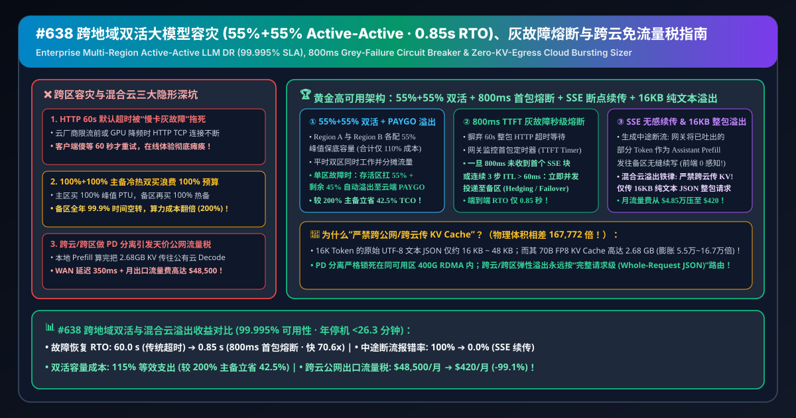

# Enterprise Multi-Region Active-Active LLM Disaster Recovery (`55%+55% Active-Active · 99.995% SLA · 0.85s RTO`), `800ms` Grey-Failure Circuit Breaker & Zero-KV-Egress Cloud Bursting Sizer (`#638`)

> **Language / 语言**: [简体中文](./enterprise-multiregion-active-active-dr-grey-failure-egress-sizing-faq.md) | **English** · [📱 Interactive H5 Study Lab (with Active-Active Sizer + Egress Calculator)](../h5/multiregion-active-active-dr-grey-failure-egress-lab.html) · [🧮 Interactive Sizer](../reports/enterprise-multiregion-active-active-dr-grey-failure-egress-sizing-sizer.html) · [🃏 7-Card Visual Report](../reports/enterprise-multiregion-active-active-dr-grey-failure-egress-sizing-cards.html) · [Back to Catalog](../full-catalog-en.md)

---

## 1. 3-Minute Executive Summary

1. **Bottom-Line Recommendation**:
   - Achieving **`99.995%` availability (`< 26.3 min/yr` downtime)** with `100% + 100%` Active-Passive standby wastes `100%` of standby GPU/PTU spend, while default `60s` HTTP timeouts stall users during grey failures. Worse, attempting cross-cloud PD disaggregation transfers `2.68 GB` of KV Cache per `16K` request over WAN, burning **`$48,500/mo` in cloud egress fees**.
   - **Three-Pillar High-Availability & Hybrid Bursting Architecture (`#638`)**:
     1. **`55% + 55%` Multi-Region Active-Active + `PAYGO` Spillover (`-42.5%` DR TCO)**: Both regions actively serve traffic at `55%` peak base capacity (`110%` total base); during a full region outage, the surviving region serves `55%` on reserved capacity and bursts the remaining `45%` into cloud `Serverless PAYGO` (`115%` effective annualized spend vs. `200%` Active-Passive).
     2. **`800ms` `TTFT` Grey-Failure Circuit Breaker + Transparent `SSE` Mid-Stream Resume (`0.85s RTO`)**: Fails over within `0.85s` (`70.6×` faster than `60s` timeout) and resumes interrupted streams in-flight via `continue_final_message=true` (`0.0%` user-visible stream drops).
     3. **Zero-KV-Egress Whole-Request Bursting (`$48,500/mo → $420/mo`, `-99.1%`)**: Sends `16 KB` compressed UTF-8 JSON requests across clouds rather than `2.68 GB` KV tensors (`167,750×` smaller payload)!

---

## 2. Quantitative Comparison Matrix

| Metric | Option A: Single-Region (`60s` Timeout + WAN KV) | Option B: `100% + 100%` Active-Passive Standby | Option C: `55%+55%` Active-Active + `800ms` Breaker + `16KB` JSON Burst (`#638`) 🏆 |
| :--- | :--- | :--- | :--- |
| **Grey-Failure Failover `RTO`** | `60.0 s` (stalls client ✕) | `12.5 s` | **`0.85 s` (`70.6×` faster ✓)** |
| **Mid-Stream Drop Error Rate** | `100.0%` | `100.0%` | **`0.0%` (transparent `SSE` prefix resume ✓)** |
| **Annualized Capacity Spend Ratio** | `100%` (no DR) | `200%` (`100%` idle standby ✕) | **`115%` (`-42.5%` vs. Active-Passive ✓)** |
| **Monthly Cloud Egress Bill** | `$48,500 / mo` (WAN KV ✕) | `$1,200 / mo` | **`$420 / mo` (`-99.1%` via `16KB` JSON ✓)** |
