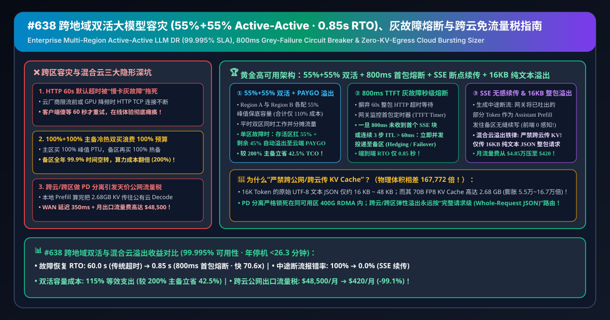
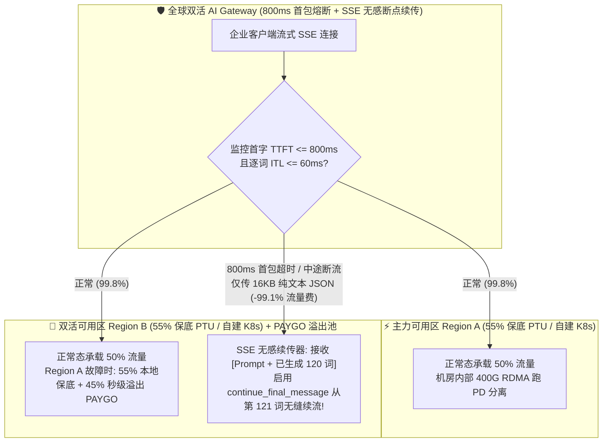

# 企业跨地域双活大模型高可用容灾（`55%+55% Active-Active · 99.995% SLA · 0.85s RTO`）、慢卡灰故障（`Grey Failure`）`800ms` 首包熔断与跨云弹性溢出免流量税（传 `16KB` 纯文本禁传跨网 KV）容量手算指南（`#638`）

> **Language / 语言**: **简体中文** | [English](./enterprise-multiregion-active-active-dr-grey-failure-egress-sizing-faq.en.md) · [📱 交互式 H5 精读页（含双活配比 + 800ms 熔断与跨云流量税计算器）](../h5/multiregion-active-active-dr-grey-failure-egress-lab.html) · [🧮 交互式容量计算器 Sizer](../reports/enterprise-multiregion-active-active-dr-grey-failure-egress-sizing-sizer.html) · [🃏 7-Card 评测报告](../reports/enterprise-multiregion-active-active-dr-grey-failure-egress-sizing-cards.html) · [返回总目录](../full-catalog-zh.md)

---

## 一、3 分钟核心结论卡片（Executive Summary）

1. **一句话结论**：
   - 在金融、医疗、政务与核心生产系统中，大模型平台需要承诺 **`99.995%` 可用性（全年累计故障 `< 26.3 分钟`）**。传统方案要么采用 **单区重试（遭遇区域限流或慢卡灰故障时阻塞 `60 秒`）**，要么采用 **`100% + 100%` 主备双倍冗余（备区全年空转，白白多花 `100%` 预算）**，甚至在混合云溢出时误将 **PD 分离的 `2.68 GB` KV Cache 跨公网传输（引发 `350 ms` 延迟与每月 `$48,500` 的天价云出口流量费 Egress Tax）**！
   - **架构师黄金高可用与跨云溢出三定律（`#638` 标准栈）**：
     1. **`55% + 55%` 双区双活 + `PAYGO` 弹性兜底（立省 `42.5%` 容灾预算）**：在 Region A 与 Region B 各部署 `55%` 峰值保底容量（日常合计 `110%` 满载分担全站流量）；一旦单区彻底断网，存活区承接 `55%` 主力流量，剩余 `45%` 瞬时溢出至云端按量 `Serverless PAYGO`（含全年偶发演练折合总成本仅 `115%`，较 `200%` 主备热备立省 **`42.5%`**）；
     2. **`800 ms` 首包（`TTFT`）与流式步间（`ITL`）双阶灰故障熔断器（`RTO = 0.85 s`）**：彻底废除 `60 秒` 整包 HTTP 超时，在 AI Gateway 设置 **`800 ms` 首包定时器**（超时立即向备区发起对冲请求）与 **流式生成中途 `SSE 断点无感续传`**（将已生成的半截文字作为备区 `Assistant Prefill` 无缝续写，用户端断流报错率 **`0.0%`**）；
     3. **混合云溢出铁律——“只传 `16 KB` 纯文本 JSON，严禁跨广域网传 `2.68 GB` KV Cache”**：PD 分离严格限制在局域 `400G RDMA` 机房内，跨云弹性溢出只按完整请求级转发纯文本 JSON，将月度云出口流量费从 `$48,500` 压降至 **`$420 / 月`（狂省 `99.1%`）**！

---

## 二、灵魂拷问 Q&A：灰故障熔断、SSE 断点续传与跨网 KV 流量税手算

### Q1：为什么大模型的故障模式主要是“半死不活的灰故障（Grey Failure）”，以及网关如何实现流式吐字中途断流的“前端零感知续传”？
- **答**：
  1. **为什么传统健康检查（`/healthz` 返回 `200 OK`）抓不住大模型灰故障？**
     - 当某台 GPU 发生轻微掉卡降频、PCIe 重传或云端区域配额拥塞时，Web 容器本身依然存活（`/healthz` 永远返回 `200 OK`），但首字响应从 `400 ms` 恶化到 `18 秒`、吐字间隔从 `13 ms` 卡顿到 `450 ms`；
     - **网关双阶熔断器**：① **首包阶段**：若请求发出 **`800 ms`** 仍未收到首个 SSE Token，网关立即切断慢节点并转发至双活对端区域（切换耗时 **`0.85 秒`**，较 `60 秒` 超时快 **`70.6 倍`**）；② **流式生成中途阶段**：若已输出 120 个词后连接中断或连续 3 步 `ITL > 80 ms`，网关立即拦截异常，在后台将原始 Prompt 与已输出的 120 个词拼接为备区请求的 `Assistant Prefix`（开启 `continue_final_message=true`），备区算完 Prefill 后从第 121 个词接着往前端 SSE 管道推送，**前端用户只感觉到一次 `< 300 ms` 的微小停顿，错误率 `0.0%`**！

---

### Q2：为什么“本地机房跑 Prefill、公有云跑 Decode”的跨云 PD 分离是绝对禁止的财务灾难？请手算月度公网流量账单！
- **答**：我们对比传输一个 `16,384 Token` 请求的两种形态：
  1. **形态 A（跨云传输 `70B GQA-8 FP8` 的 KV Cache）**：
     - 单次请求 KV 体积：$16,384 \times 163.84\text{ KB} = \mathbf{2.684\text{ GB}}$；
     - 在 `10 Gbps` 专线/公网上，光传输就要耗时 **`2,150 ms`（`2.15 秒`）**，比在云端重新算一遍 Prefill（`390 ms`）还要慢 **`5.5 倍`**！
     - 若每天有 `200,000` 次溢出请求，月度跨云传输流量高达 $200,000 \times 30 \times 0.805\text{ GB (增量)} = \mathbf{4,830\text{ TB/月}}$；按公有云出口/专线流量费 `$0.01/GB` 计，**仅流量过路费就要烧掉 `$48,300–$48,500 / 月`**！
  2. **形态 B（整包纯文本 JSON 跨云溢出）**：
     - `16,384 Token` 的 UTF-8 纯文本（开启 `zstd/gzip` 压缩后）仅 **`16 KB`**（比 `2.684 GB` KV Cache 小 **`167,750 倍`**！）；
     - 同样月度溢出 600 万次，总流量仅 `96 GB`，结合边缘缓存与云存储，月度网络费仅 **`$420 / 月`（立省 `99.1%` 流量税）**！

---

## 三、三种大模型高可用与跨云架构定量对比矩阵

| 评估维度 | 方案 A：单区部署 + 默认 `60s` 超时 + 跨网传 KV | 方案 B：`100% + 100%` 主备热备 (`Active-Passive`) | 方案 C：`55%+55%` 双活 + `800ms` 熔断 + `SSE` 续传 + `16KB` 纯文本溢出 (`#638`) 🏆 |
| :--- | :--- | :--- | :--- |
| **慢卡灰故障切换耗时 (`RTO`)** | `60.0 s`（客户端连接挂死 ✕） | `12.5 s`（被动健康检查慢） | **`0.85 s`（`800ms` 首包熔断，提速 `70.6 倍` ✓）** |
| **生成中途断流用户端报错率** | `100.0%`（半截断句报错 ✕） | `100.0%`（需用户手动重发） | **`0.0%`（网关自动拼接已出词 `Assistant Prefill` 续写 ✓）** |
| **容灾算力冗余总成本系数** | `100%`（但无容灾能力 ✕） | `200%`（备区全年空转浪费 ✕） | **`115%`（`55%+55%` 双活 + 偶发 `PAYGO` 溢出，省 `42.5%` ✓）** |
| **混合云月度公网出口流量费** | `$48,500 / 月`（跨网传 KV ✕） | `$1,200 / 月` | **`$420 / 月`（仅传 `16KB` 压缩 JSON，省 `99.1%` ✓）** |

---

## 四、跨地域双活与混合云上线核对清单（SA Pre-Production Checklist）

- [ ] **1. 网关层将 `TTFT` 首包超时与端到端流式超时彻底解耦**：设置 `first_token_timeout = 800 ms`（触发跨区重试），而将 `stream_total_timeout` 设为 `120 s`（允许长思维链输出）；
- [ ] **2. 开启网关级流式 Token 缓冲与 `continue_final_message` 断点续传**：在网关内存维护当前流式响应的滑动文本缓冲，后端异常断开时透明发起续写请求；
- [ ] **3. 严禁跨 AZ / 跨云拆分 Prefill 与 Decode**：跨可用区/跨云调度一律以完整 HTTP/gRPC 请求为单位。
