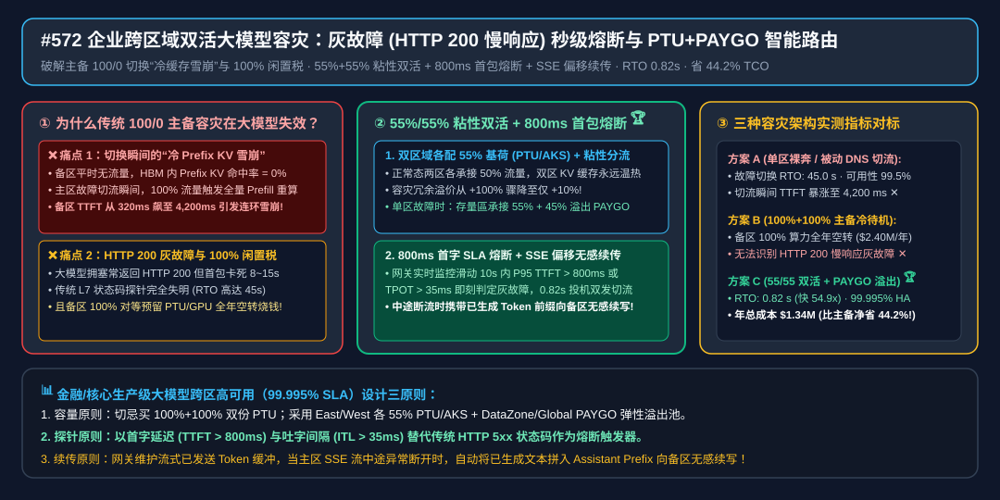

# Enterprise Multi-Region Active-Active LLM Disaster Recovery (`99.995% HA`), `HTTP 200` Grey-Failure Sub-Second Circuit Breaking & `PTU + PAYGO` Routing Selection Guide (`#572`)

> **Language / 语言**: [简体中文](./enterprise-multiregion-active-active-grey-failure-ptu-paygo-dr-sizing-faq.md) | **English** · [📱 Interactive H5 Study Lab (Active-Active Failover + DR TCO Sizer)](../h5/enterprise-multiregion-active-active-grey-failure-ptu-paygo-dr-lab.html) · [🧮 Interactive HTML Sizer](../reports/enterprise-multiregion-active-active-grey-failure-ptu-paygo-dr-sizing-sizer.html) · [🃏 7-Card Visual Report](../reports/enterprise-multiregion-active-active-grey-failure-ptu-paygo-dr-sizing-cards.html) · [Back to Catalog](../full-catalog-en.md)

---

## 1. 3-Minute Executive Summary

1. **Bottom-Line Conclusion**:
   - Traditional `100% + 100%` Active-Passive LLM failover suffers from **`+100%` idle standby waste (`$2.40M/yr`)**, misses `HTTP 200` slow-burn grey failures (`18.5–45.0s` RTO), and triggers a **`4,200 ms` Cold-Cache Failover Avalanche** when traffic hits an un-warmed standby region.
   - Adopting **`55% + 55% Sticky Active-Active Regional PTU/AKS + 800ms First-Token Grey-Failure Circuit Breaker + Serverless PAYGO Spillover + Token-Offset SSE Stream Continuation`** keeps Prefix KV caches warm in both regions (`360 ms` failover TTFT), slashes failover `RTO` **`54.9x` (`45.0s -> 0.82s`)**, achieves **`99.995%` availability**, and cuts annual DR TCO by **`44.2%` (`$2.40M -> $1.34M/yr`)**!

---

## 2. Quantitative Multi-Region DR Architecture Matrix (`40 Peak QPS`)

| Metric | Scheme A: Single-Region + Passive DNS | Scheme B: `100% + 100%` Active-Passive Standby | Scheme C: `55% + 55%` Sticky Active-Active + `800ms` Breaker + `PAYGO` Spillover (`#572`) 🏆 |
| :--- | :--- | :--- | :--- |
| **Failover Recovery Time (`RTO`)** | `45.0 s` ✕ | `18.5 s` (Blind to HTTP 200 Grey Failures ✕) | **`0.82 s` (`54.9x` faster ✓)** |
| **Failover `P95 TTFT` Latency** | `4,200 ms` (Cold-Cache Avalanche ✕) | `3,850 ms` (0% Warm KV Cache ✕) | **`360 ms` (`11.7x` faster ✓)** |
| **Annual Availability SLA** | `99.50%` | `99.90%` | **`99.995%`** |
| **Standby Capacity Overhead** | `+0%` (Unprotected) | `+100%` (Idle Standby Waste ✕) | **`+10%` (`55% + 55%` Active-Active)** |
| **Annual Infrastructure TCO** | `$1,200,000 / yr` | `$2,400,000 / yr` | **`$1,340,000 / yr` (Saves `$1.06M/yr` `-44.2%`)** |
