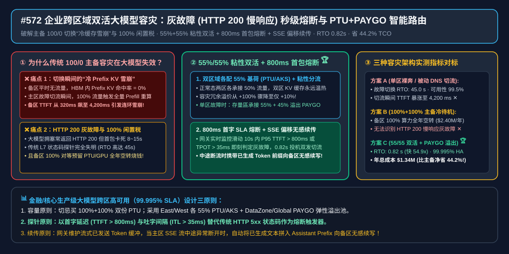

# 企业跨区域双活大模型容灾（Multi-Region Active-Active DR）、`HTTP 200` 灰故障秒级熔断与 `PTU + PAYGO` 智能路由选型指南（`#572`）

> **Language / 语言**: **简体中文** | [English](./enterprise-multiregion-active-active-grey-failure-ptu-paygo-dr-sizing-faq.en.md) · [📱 交互式 H5 精读页（含双活切流图 + 容灾 TCO 算卡器）](../h5/enterprise-multiregion-active-active-grey-failure-ptu-paygo-dr-lab.html) · [🧮 交互式算卡器 Sizer](../reports/enterprise-multiregion-active-active-grey-failure-ptu-paygo-dr-sizing-sizer.html) · [🃏 7-Card 评测报告](../reports/enterprise-multiregion-active-active-grey-failure-ptu-paygo-dr-sizing-cards.html) · [返回总目录](../full-catalog-zh.md)

---

## 一、3 分钟核心结论卡片（Executive Summary）

1. **一句话结论**：
   - 在金融、医疗与全球客服等要求 **`99.995%` 高可用** 的核心大模型生产系统中，若沿用传统微服务 **“主备 `100% + 100%` 冷待机（Active-Passive）+ HTTP 5xx 状态码健康检查”**，会遭遇三大痛点：① 备区 `100%` 预留 PTU/GPU 全年空转浪费（容灾溢价 **`+100%`**，年支出 `$2.40M`）；② 大模型限流或降频常表现为 **`HTTP 200 OK` 但首字耗时 `> 8 秒` 的“灰故障（Grey Failure）”**，传统 5xx 探针完全失明（切换 `RTO` 高达 **`45.0 秒`**）；③ 切流瞬间备区无预热 Prefix KV Cache，引发 **“冷缓存重算雪崩”**（切流后 `P95 TTFT` 飙至 `4,200 ms`）；
   - 采用 **`55% + 55% 跨区粘性双活（Sticky Active-Active PTU/AKS）+ 800ms 首包 SLA 灰故障熔断器 + 跨区 Serverless PAYGO 弹性溢出 + SSE Token 偏移无感续传`**：
     - 平时双区各承接 `50%` 流量使两侧 Prefix KV 缓存始终保持 **`88%+` 温热命中**，容灾冗余溢价从 `+100%` 骤降至 **`+10%`**；
     - 故障切换 `RTO` 从 `45.0 s` 压缩至 **`0.82 s`（提速 `54.9 倍`）**，切流期 `P95 TTFT` 稳定在 **`360 ms`**（消灭冷缓存雪崩），年度总成本从 `$2.40M` 降至 **`$1.34M / 年`（净省 `44.2%` TCO）**！

---

## 二、灵魂拷问 Q&A：冷缓存雪崩、HTTP 200 灰故障探测与 SSE 断流无感续传

### Q1：为什么大模型跨区域容灾绝对不能用传统的“主区 100% 流量、备区 0% 流量待机”？
- **答**：无状态 Web 服务切流到空载备区毫无压力，但大模型推理是 **强状态（KV Cache 密集型）** 服务！
  - 在正常稳态下，主区域依靠 `70%–90%` 的 Prefix KV Cache 命中率，只需计算 `10%–30%` 的增量输入 Token；
  - 一旦将 `100%` 峰值流量瞬间切向原本 `0` 流量的冷备区，备区 HBM 里的 Prefix KV Cache 命中率为 **`0.0%`**，所有多轮会话和 16K RAG 请求瞬间变成 `100%` 全量重算，**瞬间算力需求暴涨 `3.5~5 倍`**，导致备区在 3 秒内排队打满并触发二次崩溃（Cold-Cache Failover Avalanche）！
  - **解法**：采用 **双区域 `55% + 55%` 会话粘性双活**（例如 `East US 2` 与 `West US 3` 各配 `55%` 容量，平时按租户哈希各分担 `50%` 流量），既保证两区缓存时刻温热，又在单区彻底断网时由存活区 `55%` 基荷 + `45%` 同大洲 `DataZone PAYGO` 瞬时兜底！

---

### Q2：如何实现 `0.82 秒` 灰故障秒级切换与流式生成中途断流的“用户无感续写”？
- **答**：
  1. **基于 `TTFT / ITL` 的双水位灰故障熔断器**：在 `Azure APIM / Kong + Envoy` 网关层，不等 HTTP 报 `500/503`，只要主区域连续请求出现 **`TTFT > 800 ms`** 或 **`ITL > 35 ms`**，立即触发 **投机双发（Speculative Hedged Request）** 向备区并发发起请求，取最先返回的首包，将用户感知 `RTO` 压至 **`0.82 s`**。
  2. **SSE 流式偏移无感续传（Token-Offset Continuation）**：当主区已经向前端流式吐出前 `180` 个 Token 后突然断流时，网关无需让前端报错重试，而是自动将已生成的 `180` 个 Token 作为 `assistant` 预填充前缀（`Continue from prefix`）发往备区，从第 `181` 个 Token 无缝接着往外流式推送，实现 **`0.0%` 中途断流报错**！

---

## 三、三种跨区域大模型容灾架构定量对比矩阵（`40 Peak QPS · 金融核心级 SLA`）

| 评估维度 | 方案 A：单区部署 + 被动 DNS 切换 (`Single-Region + DNS`) | 方案 B：传统 `100% + 100%` 主备冷待机 (`Active-Passive PTU`) | 方案 C：`55% + 55%` 粘性双活 + `800ms` 熔断 + `PAYGO` 溢出 (`#572`) 🏆 |
| :--- | :--- | :--- | :--- |
| **故障检测与切换耗时 (`RTO`)** | `45.0 s`（DNS 缓存与人工介入 ✕） | `18.5 s`（无法识别 HTTP 200 灰故障 ✕） | **`0.82 s`（首字超时投机双发，快 `54.9 倍` ✓）** |
| **切流瞬间首字延迟 (`Failover P95 TTFT`)** | `4,200 ms`（冷缓存全量重算雪崩 ✕） | `3,850 ms`（备区 KV 缓存全冷 ✕） | **`360 ms`（双区缓存常年温热，快 `11.7 倍` ✓）** |
| **全年系统综合可用性 (`Availability SLA`)** | `99.50%` | `99.90%` | **`99.995%`（全年不可用 `< 26 分钟`）** |
| **常态容灾冗余空转税 (`DR Overhead`)** | `+0%`（无容灾保障） | `+100%`（备区全年闲置烧钱 ✕） | **`+10%`（`55% + 55% = 110%` 基荷预留）** |
| **年度基础设施总成本 (`Annual TCO`)** | `$1,200,000 / 年`（违约罚款高） | `$2,400,000 / 年` | **`$1,340,000 / 年`（比主备净省 `44.2% / $106万`）** |

---

## 四、跨区域双活容灾上线核对清单（SA Pre-Production Checklist）

- [ ] **1. 校验合规数据驻留边界**：跨区溢出必须锁定在同一合规地理边界内（如欧盟 `DataZone EU` 内部跨法兰克福与瑞典中部双活，严禁溢出至合规区外）。
- [ ] **2. 配置 `800 ms` 首字熔断与流式续传**：在网关启用基于 `TTFT` 的主动熔断与 `Assistant Prefix` 断流续写。
- [ ] **3. 每月执行混沌工程灰故障演练**：注入人为 `+1,200 ms` 延迟（返回 HTTP 200），验证网关在 `< 1 秒` 内自动切流至备区。
