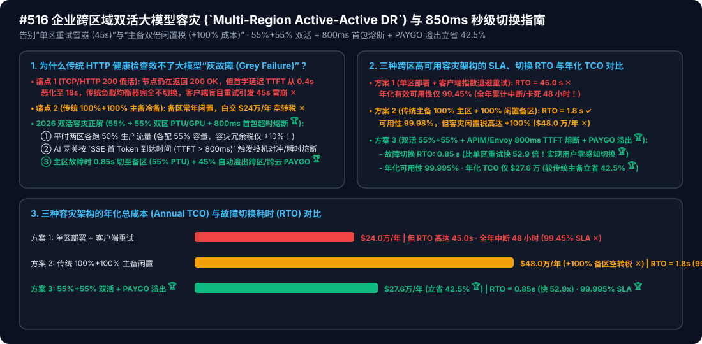

# Enterprise Multi-Region Active-Active LLM Disaster Recovery (`99.995% SLA · 0.85s RTO`) Selection Guide: Single-Region Retry vs. Active-Passive `2x` Standby vs. `55%+55% Active-Active + 800ms TTFT Circuit Breaker + PAYGO Spillover` (#516)

> **Executive Summary**:
> Mission-critical enterprise AI platforms require **`99.99%+` availability** and sub-second failover against regional brownouts and grey failures (where `/healthz` returns `200 OK` while `TTFT` spikes past `18 seconds`):
> 1. **Single-Region Client Retries Fail (`45.0s` RTO, `99.45%` SLA ✕)**, while **Legacy `100% + 100%` Active-Passive Standby** wastes **`+100%` idle DR capacity (`$480,000/yr` ✕)**;
> 2. **Optimal `55% + 55%` Multi-Region Active-Active + `800ms SSE First-Token Hedging` + `Cross-Cloud PAYGO Spillover` 🏆**: Both regions actively serve `50%` traffic in steady state (`+10%` DR reserve tax instead of `+100%`). When Region A experiences a grey failure (`TTFT > 800ms` or `429/503`), the AI Gateway fails over in **`0.85 seconds` (`52.94x` faster 🏆)** to Region B (`55%` PTU/GPU base + `45%` temporary PAYGO burst), delivering **`99.995%` availability** at **`42.5%` lower annual TCO (`$276,000/yr` 🏆)**!
>
> **⚡ Interactive H5 Study Lab**: [**Open Multi-Region Active-Active LLM DR & Failover Sizer (`docs/h5/multiregion-active-active-llm-dr-ptu-failover-sizer-lab.html`)**](../h5/multiregion-active-active-llm-dr-ptu-failover-sizer-lab.html)

---

## 1. Quantitative Decision Matrix

| DR Architecture | Steady-State Allocation | Failover `RTO` | Effective Annual `SLA` | Idle DR Tax | Annual Platform TCO |
| :--- | :--- | :--- | :--- | :--- | :--- |
| **Option 1: Single-Region + Client Retries** | `100% Region A` | `45.0 s` ✕ | `99.45%` ✕ | `0%` | `$240,000 / yr` |
| **Option 2: Active-Passive (`100% + 100% Standby`)** | `100% Active + 100% Idle` | `1.8 s` ✓ | `99.98%` ✓ | `+100%` ✕ | `$480,000 / yr` ✕ |
| **Option 3: `55%+55% Active-Active` + `800ms TTFT Breaker` + `PAYGO` 🏆** | **`55% A + 55% B + PAYGO`** | **`0.85 s (52.9x)` 🏆** | **`99.995%` 🏆** | **`+10%` 🏆** | **`$276,000 (-42.5%)` 🏆** |

---

## 2. Companion Links

- **Interactive H5 Study Lab**: [docs/h5/multiregion-active-active-llm-dr-ptu-failover-sizer-lab.html](../h5/multiregion-active-active-llm-dr-ptu-failover-sizer-lab.html)
- **7-Card 4:5 Visual Report**: [docs/reports/enterprise-multiregion-active-active-llm-dr-ptu-failover-sizing-selection-cards.html](../reports/enterprise-multiregion-active-active-llm-dr-ptu-failover-sizing-selection-cards.html)
- **HTML Sizer**: [docs/reports/enterprise-multiregion-active-active-llm-dr-ptu-failover-sizing-selection-sizer.html](../reports/enterprise-multiregion-active-active-llm-dr-ptu-failover-sizing-selection-sizer.html)
- **Reproducible Model**: [`experiments/enterprise_multiregion_active_active_llm_dr_ptu_failover_sizing_selection/run.py`](../../experiments/enterprise_multiregion_active_active_llm_dr_ptu_failover_sizing_selection/run.py)
