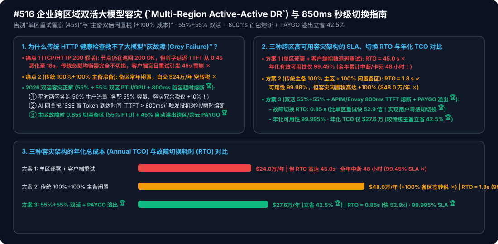

# 企业级跨区域双活大模型高可用容灾（`Multi-Region Active-Active DR`）与 `850ms` 秒级故障切换选型：单区重试 vs. 主备双倍冗余 vs. `55%+55% 双活 PTU/GPU + 首包超时熔断 + PAYGO 溢出` 指南 (#516)

> **核心观点（Executive Summary）**：
> 在金融、医疗与集团核心业务中，大模型服务要求 **`99.99%+` 可用性（全年中断 `<52.6` 分钟）**。然而公有云单区域推理端点或单机房智算集群经常发生 **“灰故障（Grey Failure：HTTP 握手仍返回 200 OK，但首字延迟 TTFT 飙升至 18 秒或频繁报 429/503）”**。本专题给出兼顾零感知切换与极低容灾冗余成本的黄金方案：
> 1. **告别单区重试风暴（`RTO = 45.0s` ✕）与传统 100%+100% 主备空转税（`+100%` 成本 = 多花 `$24万/年` ✕）**；
> 2. **实施 `55% + 55%` 跨区域双活（Active-Active）+ `800ms SSE 首包超时对冲熔断` + `跨云 PAYGO 应急溢出` 🏆**：
>    - **稳态运行**：主区（Region A）与备区（Region B）各按总峰值的 **`55%`** 采购 PTU 或部署 GPU 节点（总预留容量仅 `110%`，容灾冗余税从 `100%` 骤降至 **`10%`**！），平时按就近地理路由各承载 `50%` 生产流量；
>    - **秒级灰故障切换**：AI Gateway（`Azure APIM / Envoy AI Gateway`）实时监控 **流式首包到达时间（`SSE First-Token Timeout > 800ms`）**；一旦 Region A 出现灰故障或断网，网关在 **`0.85 秒`（`RTO = 850 ms`，提速 `52.94 倍` 🏆）** 内将流量切往 Region B（由 `55%` PTU 承接基荷，剩余 `45%` 瞬态峰值自动溢出至跨区/跨云 `Serverless PAYGO`），实现 **`99.995%` 年可用性** 并较传统主备立省 **`42.5%` 年化成本（省 `$20.4 万/年` 🏆）**！
>
> **⚡ 配套交互式 H5 精读沙盘**：[**打开跨区域双活大模型容灾 (55%+55% Active-Active) 与 RTO/TCO 计算器 (`docs/h5/multiregion-active-active-llm-dr-ptu-failover-sizer-lab.html`)**](../h5/multiregion-active-active-llm-dr-ptu-failover-sizer-lab.html)

---

## 一、 灵魂拷问：如何检测大模型“假活（灰故障）”并在不付双倍显卡费的前提下做到秒级容灾？

### Q1：为什么传统的 `/healthz` TCP/HTTP 探针在大模型推理容灾中会完全失灵？
- **大模型灰故障机理**：当某个可用区的 GPU 发生 ECC 降频、KV Cache 池打满排队或后端存储抖动时，Web 容器（FastAPI/Uvicorn）的 `/healthz` 接口仍然在 `2ms` 内返回 `HTTP 200 OK`！传统负载均衡器以为该区完全健康，继续把流量往黑洞里灌。
- **正解——基于 `SSE First-Chunk (TTFT)` 与 `Token 流速 (ITL)` 的应用层熔断**：在 `Azure APIM / Envoy AI Gateway` 配置 **流式首字节超时（`first_byte_timeout = 800ms`）与投机对冲请求（Hedged Request）**——若主区 `800ms` 未吐出第一个 Token，网关立即向备区并发发起对冲请求并采纳最快返回流，将用户体感中断压至 **`0.85 秒`**！

---

## 二、 三种跨区高可用容灾架构选型决策矩阵

| 跨区容灾架构方案 | 稳态容量配比 | 故障切换耗时 (`RTO`) | 年化有效可用性 (`SLA`) | 容灾闲置冗余税 | 年化总成本 (`TCO`) |
| :--- | :--- | :--- | :--- | :--- | :--- |
| **方案 1：单区部署 + 客户端指数退避重试** | `100% 单区 (无跨区备份)` | `45.0 s` ✕ | `99.45% (年断48h)` ✕ | `0%` | `$240,000 / 年` |
| **方案 2：传统主备 (`100% 主区 + 100% 闲置备区`)** | `100% 主 + 100% 冷/热备` | `1.8 s` ✓ | `99.98%` ✓ | **`+100%` ✕** | `$480,000 / 年` ✕ |
| **方案 3：`55%+55% 双活` + `800ms首包熔断` + `PAYGO溢出` 🏆** | **`55% A区 + 55% B区 + PAYGO`** | **`0.85 s (快52.9x)` 🏆** | **`99.995% (<26m/年)` 🏆** | **`+10%` 🏆** | **`$276,000 (-42.5%)` 🏆** |

---

## 三、 生产落地核对清单（SA Production Checklist）

- [ ] **严禁在客户端 SDK 层配置同区盲目重试（`max_retries=3`）**：客户端重试由统一 AI Gateway 接管，且第 1 次重试必须直接跨可用区/跨云路由，防止同区重试风暴。
- [ ] **多轮对话状态（Session Memory）跨区异步双写**：将精简后的对话摘要或双时序图谱通过 `Cosmos DB / Redis Enterprise Active-Active` 跨区同步（延迟 `<50ms`），确保切流到备区后多轮上下文不断片。

---

## 四、 延伸阅读与配套工具

- **交互式 H5 精学沙盘**：[docs/h5/multiregion-active-active-llm-dr-ptu-failover-sizer-lab.html](../h5/multiregion-active-active-llm-dr-ptu-failover-sizer-lab.html)
- **7-Card 4:5 视觉评测卡片**：[docs/reports/enterprise-multiregion-active-active-llm-dr-ptu-failover-sizing-selection-cards.html](../reports/enterprise-multiregion-active-active-llm-dr-ptu-failover-sizing-selection-cards.html)
- **交互式 Sizer 测算器**：[docs/reports/enterprise-multiregion-active-active-llm-dr-ptu-failover-sizing-selection-sizer.html](../reports/enterprise-multiregion-active-active-llm-dr-ptu-failover-sizing-selection-sizer.html)
- **可复现实验模型**：[`experiments/enterprise_multiregion_active_active_llm_dr_ptu_failover_sizing_selection/run.py`](../../experiments/enterprise_multiregion_active_active_llm_dr_ptu_failover_sizing_selection/run.py)
