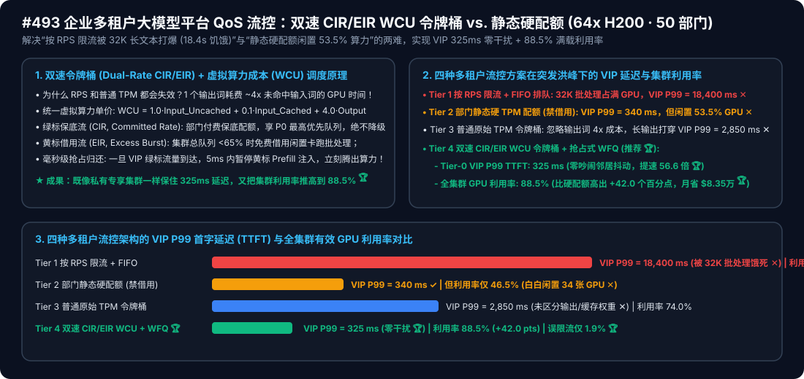

# Enterprise Multi-Tenant QoS, Dual-Rate `CIR/EIR` WCU Token Bucket & Noisy-Neighbor Isolation Selection Guide (#493)

> **Executive Summary**:
> On a shared `64-GPU` enterprise LLM platform serving `50 business units`, naive **RPS rate-limiting** lets a single department's `32K-token` batch job starve Tier-0 VIP traffic (**`P99 TTFT` spikes `56.6x` from `325ms` to `18,400ms`**), while **Rigid Static Hard Quotas** leave **`53.5%` of cluster GPUs idle (`46.5%` utilization, wasting `$92,000/month`)**. For **Cloud & AI Solution Architects**, the production gold standard is **Virtual-Compute-Unit (`WCU`) Dual-Rate Token Buckets (`CIR` Committed Green Rate + `EIR` Opportunistic Yellow Burst) + Preemptive Priority WFQ**: tenants borrow idle GPUs for free when global queue depth `< 65%` (**`88.5%` cluster utilization**), while VIP green traffic preempts yellow bursts within `5ms` to maintain **`325ms` P99 TTFT** and cut false `HTTP 429` rejections to **`1.9%`**.
>
> **⚡ Interactive H5 Study Lab**: [**Open the Multi-Tenant Dual-Rate CIR/EIR WCU Token Bucket & QoS Sizer (`docs/h5/multitenant-qos-token-bucket-wfq-isolation-lab.html`)**](../h5/multitenant-qos-token-bucket-wfq-isolation-lab.html)

---

## 1. Quantitative Decision Matrix (`64x H200 Shared Cluster · 50 Tenants`)

| Multi-Tenant QoS Architecture | VIP `P99 TTFT` Under Burst | Cluster GPU Utilization | False `HTTP 429` Rate | Monthly Stranded GPU Cost |
| :--- | :--- | :--- | :--- | :--- |
| **Tier 1: Unthrottled FIFO / Simple RPS Limit** | `18,400 ms` ✕ | `78.0%` | `18.5%` | `$64,000 / mo` |
| **Tier 2: Rigid Static Hard TPM Quota (No Borrowing)** | `340 ms` ✓ | `46.5%` ✕ | `34.0%` ✕ | `$92,000 / mo` ✕ |
| **Tier 3: Standard Raw-TPM Token Bucket** | `2,850 ms` ✕ | `74.0%` | `11.2%` | `$38,000 / mo` |
| **Tier 4: Dual-Rate `CIR/EIR` WCU Bucket + Preemptive WFQ 🏆** | **`325 ms` 🏆** | **`88.5% (+42.0 pts)` 🏆** | **`1.9%` 🏆** | **`$8,500 / mo` 🏆** |
