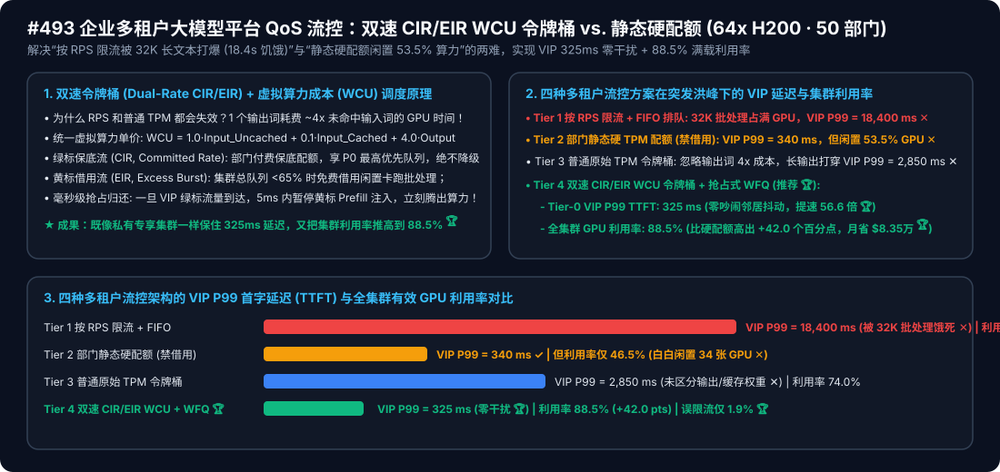
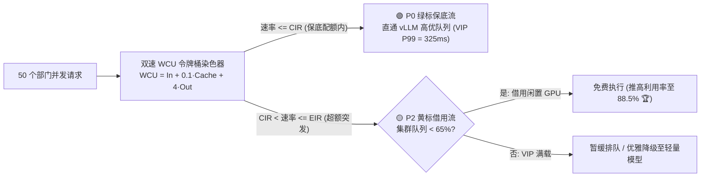

# 企业多租户大模型平台 QoS 流控、双速 WCU 令牌桶（`Dual-Rate CIR/EIR`）与吵闹邻居隔离选型指南 (#493)

> **核心观点（Executive Summary）**：
> 当企业建设一张 `64 张 H200` 的共享大模型推理平台，同时服务内部 `50 个业务部门`（既有要求 `< 350ms` 响应的对客 VIP 客服，又有动辄提交 `32K` 超长文档的营销报表批处理）时，最常见的两大事故是：
> 1. **按请求数（`RPS`）限流导致 VIP 被饿死**：10 个 `32K` 长文本请求消耗的 GPU 时间是 10 个 `500词` 短对话的 **64 倍**！一旦某个部门突发长文本洪峰，VIP 客服 `P99 TTFT` 会从 `325ms` 直接飙升 `56.6 倍` 到 **`18,400ms (18.4秒)`（吵闹邻居饥饿 Noisy Neighbor Starvation）**；
> 2. **按部门死卡硬配额（`Static Hard Quota`）导致算力巨额闲置**：如果严禁部门之间借用闲置配额，虽然保住了 VIP 延迟，但全集群平均利用率暴跌至 **`46.5%`（相当于 `34 张 H200` 长期空转，每月白白浪费 `$92,000`）**！
>
> 作为 **Cloud & AI Solution Architect**，生产级最优解是采用 **“虚拟算力令牌成本（`WCU = 1.0·未命中输入 + 0.1·缓存输入 + 4.0·输出词`）+ 双速令牌桶（`CIR 绿标保底速率 + EIR 黄标闲时透支速率`）+ 网关/引擎两级抢占式加权公平队列（`Preemptive Priority WFQ`）”**：让各部门在集群空闲时免费突发借用闲置卡跑满 **`88.5%` 利用率**；一旦 VIP 绿标流量到达，`5ms` 内暂停黄标任务的新 Prefill 注入，确保 **VIP `P99 TTFT` 稳守 `325ms` 零抖动**，同时将误触发的 `HTTP 429` 限流率从 `34.0%` 压至 **`1.9%`**！
>
> **⚡ 配套交互式 H5 精读沙盘**：[**打开多租户双速 CIR/EIR WCU 令牌桶与吵闹邻居隔离计算器 (`docs/h5/multitenant-qos-token-bucket-wfq-isolation-lab.html`)**](../h5/multitenant-qos-token-bucket-wfq-isolation-lab.html)

---

## 一、 灵魂拷问：为什么按 RPS 或普通 TPM 限流，共享集群依然会被单一部门打挂？

### Q1：为什么网关流控必须从 `RPS / 原始 TPM` 升级为 `虚拟算力单位（WCU）`？
- 在大模型推理引擎里，不同 Token 消耗的物理 GPU 时间天差地别：
  $$\text{WCU} = 1.0 \times T_{\text{input\_uncached}} + 0.1 \times T_{\text{input\_cached}} + 4.0 \times T_{\text{output}}$$
  1. **命中 Prefix Cache 的输入词（权重 `0.1x`）**：无需重算 Attention，只读显存，几乎不占算力；
  2. **未命中缓存的输入词（权重 `1.0x`）**：全量占用 Tensor Core 算力；
  3. **自回归生成的输出词（权重 `4.0x`）**：每吐 1 个词都要把整张模型的权重从 HBM 里完整搬运一遍，单词耗时是输入词的 4 倍以上！
- **结论**：如果在 AI Gateway（如 Envoy AI Gateway / LiteLLM / APIM）按 **WCU/分钟** 扣减令牌桶，就能让限流器与底层 GPU 真实负载 **1:1 严格对齐**！

### Q2：什么是电信级“双速三色令牌桶（Dual-Rate CIR / EIR）”？它如何兼顾 100% 隔离与 88.5% 高利用率？
- 借鉴运营商网络 QoS（RFC 2698 trTCM），为每个部门配置两个速率水位：
  1. **绿标承诺保底速率（`CIR, Committed Information Rate`）**：部门出钱认购的保底算力配额。落在 `CIR` 内的请求打上 `Priority = P0 (Green)` 标签，在网关和 vLLM 调度器中享受最高优先级，任何时候绝不排队；
  2. **黄标超额突发速率（`EIR, Excess Information Rate`）**：当某个部门在周一早上突发流量超过 `CIR` 时，**网关不要直接返回 `HTTP 429` 报错**！而是将其降级打上 `Priority = P2 (Yellow Opportunistic)` 标签：
     - 只要当前 GPU 集群全局排队深度 `< 65%`，黄标请求即可 **免费借用其他空闲部门的 GPU** 正常执行；
     - 一旦其他部门的 `P0 绿标` 流量涌入，调度器在 **`5ms` 内暂停黄标队列的新 Prefill 注入**，瞬间把 GPU 归还给保底主人！

---

## 二、 四种多租户 QoS 流控方案选型决策矩阵（`64x H200 · 50 个业务部门共享`）

| 多租户流控与调度方案（`64x H200` 共享集群） | 突发洪峰下 VIP `P99 TTFT` | 全集群平均 GPU 利用率 (%) | 误触发 `HTTP 429` 比例 | 每月闲置/浪费算力折算 | 架构师推荐度 |
| :--- | :--- | :--- | :--- | :--- | :--- |
| **Tier 1: 按 RPS 限流 + FIFO 排队（无隔离）** | `18,400 ms (18.4s)` ✕ | `78.0%` | `18.5%` | `$64,000 / 月` | ⛔ 严禁上生产 |
| **Tier 2: 部门静态硬配额（禁止跨部门借用）** | `340 ms` ✓ | `46.5%` ✕ | `34.0%` ✕ | `$92,000 / 月` ✕ | ⛔ 算力闲置过半 |
| **Tier 3: 普通原始 TPM 令牌桶（不分输入/输出/缓存）** | `2,850 ms` ✕ | `74.0%` | `11.2%` | `$38,000 / 月` | ⚠️ 长输出易击穿 |
| **Tier 4: 双速 `CIR/EIR` WCU 令牌桶 + 抢占式 WFQ（推荐 🏆）** | **`325 ms` 🏆** | **`88.5% (+42.0 pts)` 🏆** | **`1.9%` 🏆** | **`$8,500 / 月` 🏆** | **✅ 企业多租户金标准** |

---

## 三、 生产落地核对清单（SA Production Checklist）

- [ ] **采取“请求前预扣 + 流式结束后多退少补”两阶段令牌扣减**：请求进入网关时按 `Input_Tokens + Max_Expected_Output` 预冻令牌；流式生成结束（`[DONE]`）后根据实际生成的 `Output_Tokens` 与缓存命中状态实时返还差额。
- [ ] **开启 vLLM / SGLang 引擎级优先级调度（`--scheduling-policy priority`）**：将网关染色的 `X-QoS-Priority: 0 (Green) / 1 (Standard) / 2 (Yellow-Burst)` 透传至推理引擎，确保绿标请求在每个 Continuous Batching Step 优先入队。
- [ ] **为黄标超额请求配置“自动降级模型兜底（Graceful Model Downgrade）”**：当全集群繁忙导致某部门的黄标透支请求排队超过 `1.5 秒` 时，网关自动将其路由至同池轻量级 `32B/8B` 蒸馏模型，做到“超额只降档、绝不报 429 错误”。

---

## 四、 延伸阅读与配套工具

- **交互式 H5 精学沙盘**：[docs/h5/multitenant-qos-token-bucket-wfq-isolation-lab.html](../h5/multitenant-qos-token-bucket-wfq-isolation-lab.html)
- **7-Card 4:5 视觉评测卡片**：[docs/reports/enterprise-multitenant-qos-token-bucket-wfq-noisy-neighbor-isolation-selection-cards.html](../reports/enterprise-multitenant-qos-token-bucket-wfq-noisy-neighbor-isolation-selection-cards.html)
- **交互式 Sizer 测算器**：[docs/reports/enterprise-multitenant-qos-token-bucket-wfq-noisy-neighbor-isolation-selection-sizer.html](../reports/enterprise-multitenant-qos-token-bucket-wfq-noisy-neighbor-isolation-selection-sizer.html)
- **可复现实验模型**：[`experiments/enterprise_multitenant_qos_token_bucket_wfq_noisy_neighbor_isolation_selection/run.py`](../../experiments/enterprise_multitenant_qos_token_bucket_wfq_noisy_neighbor_isolation_selection/run.py)
