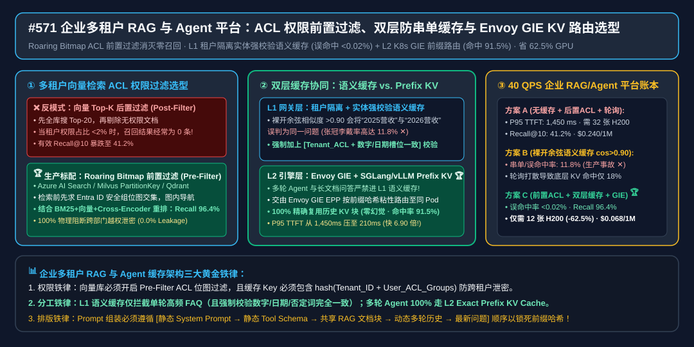

# Enterprise Multi-Tenant RAG & Agent Serving Platform Selection Guide: `Azure AI Search / Milvus` Pre-Filter ACL, Entity-Verified Semantic Cache & `Envoy GIE` Prefix KV Affinity Routing (`#571`)

> **Language / 语言**: [简体中文](./enterprise-multitenant-rag-acl-semantic-prefix-kv-gateway-sizing-faq.md) | **English** · [📱 Interactive H5 Study Lab (2-Layer Cache + RAG Sizer)](../h5/enterprise-multitenant-rag-acl-semantic-prefix-kv-gateway-lab.html) · [🧮 Interactive HTML Sizer](../reports/enterprise-multitenant-rag-acl-semantic-prefix-kv-gateway-sizing-sizer.html) · [🃏 7-Card Visual Report](../reports/enterprise-multitenant-rag-acl-semantic-prefix-kv-gateway-sizing-cards.html) · [Back to Catalog](../full-catalog-en.md)

---

## 1. 3-Minute Executive Summary

1. **Bottom-Line Conclusion**:
   - In a multi-tenant enterprise RAG & Agent platform (`40 Peak QPS`, `12K` context), combining **Post-Filter ACL vector search + Naive Cosine Semantic Cache ($\cos > 0.90$) + Round-Robin L7 load balancing** causes `Recall@10` to collapse to **`41.2%`** for restricted-access tenants, triggers an **`11.8%` false-positive cache collision rate** on queries differing only by year/number/entity, and thrashes engine Prefix KV Cache hit rate down to **`18.0%`** (`32x H200 GPUs`, `1,450 ms` P95 TTFT).
   - Adopting **`Roaring Bitmap Pre-Filter ACL` (`Azure AI Search / Milvus / Qdrant`) + `L1 Tenant-Scoped Entity-Verified Semantic Cache` + `L2 Envoy AI Gateway (K8s GIE EPP) Prefix-Hash KV Affinity Routing`** lifts `Recall@10` to **`96.4%`** (`0.0%` cross-tenant leakage), cuts semantic cache false positives `590x` to **`0.02%`**, raises engine Prefix KV hit rate to **`91.5%`**, speeds up `P95 TTFT` **`6.90x` (`1,450 ms -> 210 ms`)**, and shrinks required fleet size by **`62.5%` (`32 -> 12x H200 GPUs`, `$0.068 / 1M tokens`)**!

---

## 2. Quantitative Multi-Tenant RAG & Caching Architecture Matrix (`40 Peak QPS · 12K Context`)

| Metric | Scheme A: Post-Filter ACL + No Cache + Naive RR | Scheme B: Naive Cosine Semantic Cache ($\cos>0.90$) | Scheme C: Pre-Filter ACL + Entity-Verified L1 + Envoy GIE L2 Prefix KV (`#571`) 🏆 |
| :--- | :--- | :--- | :--- |
| **Restricted-Tenant `Recall@10`** | `41.2%` (Zero-Result Starvation ✕) | `78.5%` | **`96.4%` (`Pre-Filter Bitmap + Hybrid Rerank` ✓)** |
| **Cache False-Positive Collision Rate** | `0.0%` | `11.8%` (Number/Date/Tenant Mix-up ✕) | **`0.02%` (`590x` lower ✓)** |
| **Engine Prefix KV Cache Hit Rate** | `18.0%` (Broken by RR ✕) | `22.5%` | **`91.5%` (`Envoy GIE EPP` Affinity ✓)** |
| **`P95 TTFT` Latency** | `1,450 ms` | `640 ms` | **`210 ms` (`6.90x` faster)** |
| **Required H200 Fleet Size** | `32x H200 GPUs` | `20x H200 GPUs` | **`12x H200 GPUs` (`-62.5%` GPUs)** |
| **Effective Cost (`$/1M Tokens`)** | `$0.240 / 1M` | `$0.145 / 1M` | **`$0.068 / 1M` (`3.53x` lower cost)** |
