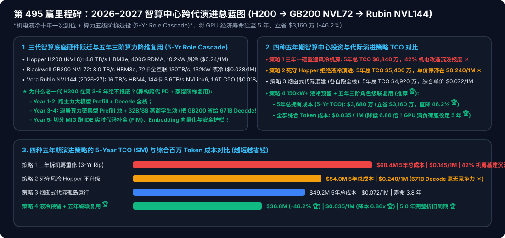

# Milestone #495: Enterprise 2026–2027 Next-Gen AI Factory Evolution (`Hopper H200 -> Blackwell GB200 NVL72 -> Vera Rubin NVL144`) & 5-Year Role-Cascade TCO Blueprint (#495)

> **Executive Summary**:
> With GPU architectures advancing on an annual cadence (`Hopper H200 -> Blackwell GB200/GB300 -> Vera Rubin NVL144 + HBM4 + 1.6T CPO`), enterprise CTOs and CFOs worry that today's multi-million-dollar GPU and facility CapEx will depreciate prematurely in 18–24 months. For **Cloud & AI Solution Architects**, the definitive antidote is **"Build the 150kW+ DLC/Optical Facility Envelope Once for 10 Years, and Cascade GPU Silicon Across a 5-Year 3-Stage Workload Lifecycle"**:
> - **Years 1–2 (Frontier Flagship)**: Run `671B/1T+ MoE Decode` and RL post-training on the newest rack-scale supernodes (`GB200 NVL72` / `Rubin NVL144`);
> - **Years 3–4 (Heterogeneous PD & Student Cascade)**: Reassign prior-generation `H200/B200` nodes into **Compute-Bound Prefill Pools and `32B/8B` Distilled Student Pools**;
> - **Year 5 (Fractional MIG Microservices)**: Partition `H200` nodes via **Hardware MIG (`1g.18gb`)** to power **10,000-developer IDE FIM completion, RAG Rerankers, OCR, and Safety Guardrails**.
>
> This architecture extends GPU economic life from `3.0 years` to **`5.0 full years`**, eliminates `42.0%` stranded facility retrofit write-offs, slashes 5-Year TCO by **`46.2%` (`$36.8M` vs. `$68.4M`, saving `$31.6M`)**, and drives blended fleet token economics down to **`$0.035 / 1M Tokens` (`6.86x` lower than Hopper-only)**.
>
> **⚡ Interactive H5 Study Lab**: [**Open the 2026–2027 Next-Gen AI Factory (H200 -> GB200 -> Rubin) & 5-Year Role-Cascade TCO Simulator (`docs/h5/milestone-495-nextgen-ai-factory-rubin-gb200-5yr-tco-lab.html`)**](../h5/milestone-495-nextgen-ai-factory-rubin-gb200-5yr-tco-lab.html)

---

## 1. Quantitative 5-Year Evolution & TCO Decision Matrix

| 5-Year Fleet & Facility Strategy | 5-Year Total TCO (`$M`) | Blended `$/1M Tokens` | GPU Economic Lifespan | Stranded Facility CapEx |
| :--- | :--- | :--- | :--- | :--- |
| **Strategy 1: 3-Year Rip-and-Replace Air-Cooled Hall** | `$68.4M` ✕ | `$0.145 / 1M` | `3.0 Years` ✕ | `42.0%` ✕ |
| **Strategy 2: Freeze on Hopper-Only Air-Cooled Fleet** | `$54.0M` | `$0.240 / 1M` ✕ | `4.0 Years` | `0.0%` |
| **Strategy 3: Unplanned Mixed-Generation Silos** | `$49.2M` | `$0.072 / 1M` | `3.8 Years` | `18.5%` |
| **Strategy 4: `150kW+` DLC Facility + 5-Yr Role Cascade 🏆** | **`$36.8M (-46.2%)` 🏆** | **`$0.035 / 1M (6.86x)` 🏆** | **`5.0 Years` 🏆** | **`0.0%` 🏆** |
