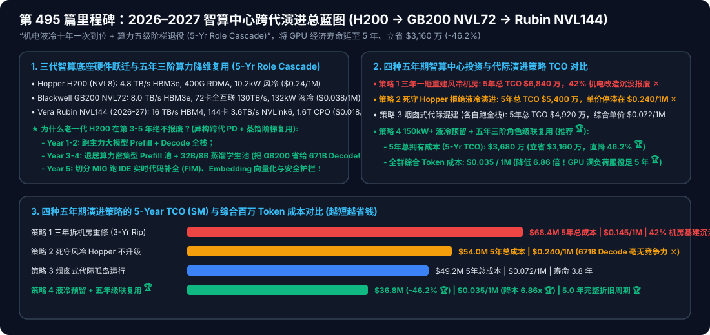
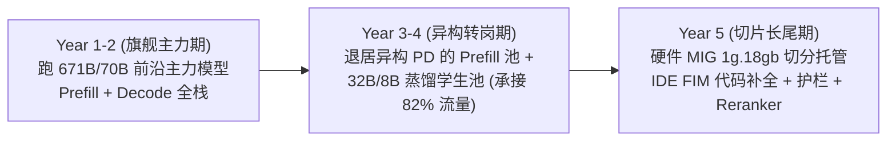

# 第 495 篇里程碑：企业 2026–2027 智算中心跨代演进总蓝图（`Hopper H200 -> Blackwell GB200 NVL72 -> Rubin NVL144`）与五年资产级联复用指南 (#495)

> **核心观点（Executive Summary）**：
> 在 NVIDIA 形成“一年一架构更新（`Hopper H200 -> Blackwell GB200/GB300 -> Vera Rubin NVL144 + HBM4 + 1.6T CPO`）”的急行军节奏下，企业 CTO 与 CFO 最核心的立项焦虑是：**“今天花几千万采购的 GPU 和智算机房，会不会 18 个月后就沦为落后的电子垃圾？”**
>
> 作为 **Cloud & AI Solution Architect**，破解代际贬值魔咒的终极架构法则是 **“物理机房十年一次到位（`150kW+ DLC 液冷环路 + OM4/单模光缆预埋`）+ 算力资产五年三阶降维级联复用（`5-Year 3-Stage Role Cascade`）”**：
> 1. **Year 1–2（当打之年）**：最新一代大超节点（如 `GB200 NVL72` / 未来的 `Rubin NVL144`）专攻高壁垒 **671B/1T 稀疏 MoE 超低延迟 Decode 与强化学习后训练（RL Rollout）**；
> 2. **Year 3–4（中年转岗）**：上一代 `H200 / B200` 节点绝不报废或贱卖！通过 **跨代异构 PD 分离** 转岗为 **算力密集型 Prefill 专用池、32B/8B 蒸馏学生主力池与夜间批处理池**；
> 3. **Year 5（余热榨干）**：通过 **硬件 MIG 切分** 承接 **万人研发 IDE 实时代码补全（`FIM`）、多模态 OCR、RAG Reranker 与实时安全护栏**。
>
> 实测表明：该蓝图将 GPU 有效经济服役寿命从 `3.0 年` 延长至完整的 **`5.0 年`（零机房砸墙返工报废）**，五年期总拥有成本（5-Yr TCO）从“三年拆机房重建”的 `$6,840 万` 降至 **`$3,680 万`（净省 `$3,160 万` / `-46.2%`）**，并将全集群综合推理成本压至 **`$0.035 / 1M Tokens`（比纯 Hopper 降低 `6.86 倍`）**！
>
> **⚡ 配套交互式 H5 精读沙盘**：[**打开 2026–2027 智算中心三代演进（H200/GB200/Rubin）与五年折旧 TCO 沙盘 (`docs/h5/milestone-495-nextgen-ai-factory-rubin-gb200-5yr-tco-lab.html`)**](../h5/milestone-495-nextgen-ai-factory-rubin-gb200-5yr-tco-lab.html)

---

## 一、 灵魂拷问：面对 18 个月一代的新芯片，如何让智算中心投资永不贬值？

### Q1：`Hopper H200`、`Blackwell GB200 NVL72` 与下一代 `Vera Rubin NVL144` 的核心架构边界在哪里？
| 硬件代际与超节点形态 | 单卡显存与带宽 | Scale-Up NVLink 域大小 | Scale-Out RDMA 演进 | 单机柜功率与冷却基线 | 主力擅长负载与百万词成本 |
| :--- | :--- | :--- | :--- | :--- | :--- |
| **Hopper HGX H200 (`NVL8`)** | `141GB HBM3e` (`4.8 TB/s`) | `8 卡` (`900 GB/s`) | `400G NDR / RoCEv2` | `10.2 kW`（风冷为主） | Prefill 池 / 70B Dense / 32B 学生 (`$0.240/1M`) |
| **Blackwell HGX B200 (`NVL8`)** | `192GB HBM3e` (`8.0 TB/s`) | `8 卡` (`1.8 TB/s`) | `800G XDR / UEC` | `15.5 kW`（高密风冷/冷板） | 70B–405B Dense / 高吞吐 Prefill (`$0.110/1M`) |
| **Blackwell GB200 (`NVL72` 整机柜)** | `192GB HBM3e` (`8.0 TB/s`) | **`72 卡全互联` (`130 TB/s`)** | `800G XDR / RoCEv2` | **`132 kW`（DLC 冷板液冷）** | **671B/1T MoE 极速 Decode (`$0.038/1M` 🏆)** |
| **Vera Rubin (`NVL144` 下一代预留)** | `288GB HBM4` (`~16 TB/s`) | **`144 卡全互联` (`3.6 TB/s/卡`)** | **`1.6T XDR2 / CPO 共封装光学`** | **`150–250 kW`（全液冷母排）** | **2T+ 超大 MoE 与百万上下文推理 (`$0.018/1M` 🏆)** |

### Q2：为什么说“机房基建按 10 年设计（150kW+ DLC 液冷管网预埋），GPU 算力按 5 年三阶降维级联”是 CFO 最认可的方案？
1. **机电与液冷管网切忌“按当前风冷 10kW 省钱建设”**：
   - 从 `GB200 NVL72 (132kW)` 到下一代 `Rubin NVL144 (180kW+)`，风冷已彻底退出历史舞台。如果首期机房不预留 **CDU 二次侧不锈钢分集水器接口与机柜承重（`>= 2,000 kg/柜`）**，两年后砸掉风冷机房改液冷将产生 **`42%` 的基建沉没报废成本**！
2. **GPU 五年三阶降维级联（5-Year 3-Stage Role Cascade）**：
   - 当第 3 年引入 `GB200 / Rubin` 时，把老一代 `H200` 节点通过 `400G RDMA (NIXL/Mooncake)` 挂载为 **异构 Prefill 算力池**（Prefill 吃的是 Tensor Core 算力，H200 的 `989 TFLOPS FP16 / 1,979 TFLOPS FP8` 依然极其强劲！）以及 **32B/8B 蒸馏小模型池**；
   - 到第 5 年，再将 `H200` 切分为 `7x 1g.18gb MIG` 硬件切片，运行企业内部 **10,000 名程序员的 IDE 实时代码补全（FIM）、安全护栏与向量重排（Reranker）**，让每一分硬件折旧产生 100% 业务价值！

---

## 二、 四种五年期智算中心跨代演进策略决策矩阵

| 五年期智算中心演进与折旧策略 | 5 年累计总成本 (`5-Yr TCO`) | 全群综合百万词成本 (`$/1M`) | GPU 实际经济服役寿命 | 机房基建返工报废率 | 架构师推荐度 |
| :--- | :--- | :--- | :--- | :--- | :--- |
| **策略 1: 三年一拆风冷机房重建（旧卡贱卖 + 砸墙改液冷）** | `$68.4M` ✕ | `$0.145 / 1M` | `3.0 年` ✕ | `42.0%` ✕ | ⛔ 巨额基建沉没 |
| **策略 2: 死守纯风冷 Hopper 拒绝跨代升级** | `$54.0M` | `$0.240 / 1M` ✕ | `4.0 年` | `0.0%` | ⛔ 大模型丧失竞争力 |
| **策略 3: 烟囱式代际孤岛运行（新旧集群各自跑全栈）** | `$49.2M` | `$0.072 / 1M` | `3.8 年` | `18.5%` | ⚠️ 旧卡跑 Decode 拖后腿 |
| **策略 4: `150kW+` 液冷预留 + 五年三阶角色级联复用（推荐 🏆）** | **`$36.8M (-46.2%)` 🏆** | **`$0.035 / 1M (降 6.86x)` 🏆** | **`5.0 年 (满额折旧)` 🏆** | **`0.0%` 🏆** | **✅ 2026–2027 终极蓝图** |

---

## 三、 生产落地核对清单（SA Production Checklist）

- [ ] **机房机电与液冷管网遵循“150kW–200kW/柜”十年期一次预埋**：即使首期上架部分 `40kW` 节点，也必须在地板下/架空层一次铺好支持 `150kW+ DLC` 的不锈钢环网与快插盲堵接口，未来上架 `GB200 / Rubin` 零动火施工。
- [ ] **光纤布线全部采用单模 OS2 + MPO-16/24 高密主干**：为 `800G XDR` 及下一代 `1.6T CPO（共封装光学）` 预留零重穿线升级通道，机柜内 Scale-Up 坚持无源铜缆（DAC / NVLink Spine）保最高可靠度。
- [ ] **统一通过 AI Gateway 与异构 PD 引擎屏蔽底层跨代硬件差异**：业务部门只调用逻辑模型名，由网关与调度器自动将 `Prefill / 32B 学生 / FIM` 路由至 `H200` 池、将 `671B MoE Decode` 路由至 `GB200 / Rubin` 池。

---

## 四、 延伸阅读与配套工具

- **交互式 H5 精学沙盘**：[docs/h5/milestone-495-nextgen-ai-factory-rubin-gb200-5yr-tco-lab.html](../h5/milestone-495-nextgen-ai-factory-rubin-gb200-5yr-tco-lab.html)
- **7-Card 4:5 视觉评测卡片**：[docs/reports/enterprise-nextgen-ai-factory-h200-gb200-rubin-5yr-cascade-tco-selection-cards.html](../reports/enterprise-nextgen-ai-factory-h200-gb200-rubin-5yr-cascade-tco-selection-cards.html)
- **交互式 Sizer 测算器**：[docs/reports/enterprise-nextgen-ai-factory-h200-gb200-rubin-5yr-cascade-tco-selection-sizer.html](../reports/enterprise-nextgen-ai-factory-h200-gb200-rubin-5yr-cascade-tco-selection-sizer.html)
- **可复现实验模型**：[`experiments/enterprise_nextgen_ai_factory_h200_gb200_rubin_5yr_cascade_tco_selection/run.py`](../../experiments/enterprise_nextgen_ai_factory_h200_gb200_rubin_5yr_cascade_tco_selection/run.py)
